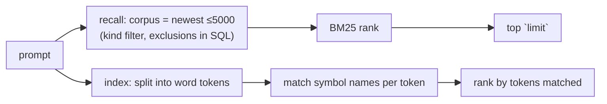

# Memory recall finds old memories; the code index matches plain-English prompts: spec

Branch `fix/memory-recall-index`. This is the contract for the TDD rounds: rows M1–M5. The defects come from the research in PR #97, `docs/research/pluggable-context-memory-2026-11.md` §3.2 (1–3), where the first three were confirmed with a probe crate.

## Problem

1. **Recall only ranks the newest `limit` memories.** `SqliteStore::recall` (`crates/hone-memory/src/sqlite_store.rs:436–440`) sets `effective_limit = query.limit.min(MAX_RECALL_CORPUS)`, runs `ORDER BY created_at DESC LIMIT effective_limit`, and BM25-ranks only those rows.
   - The constant's doc comment says the corpus cap is 5,000.
   - The agent asks for `limit: 5`, so BM25 sees the 5 newest memories and nothing older.
   - Probe: one relevant memory plus 5 newer unrelated ones. `limit 5` returns `[]`, while `limit 50` finds the relevant one.
   - Existing tests use `limit: 10` with at most 3 rows, so they don't see it.
2. **Outcome logs come back as "Relevant Memories".** `fetch_relevant_memories` (`crates/hone-core/src/agent.rs:782`) recalls with `kind: None`, so `Outcome` rows match. The TUI writes them after each turn, with the task text in the content.
3. **The code index finds nothing for a plain-English prompt.** `SqliteIndex::search` (`crates/hone-index/src/sqlite_index.rs:163`) matches `name LIKE '%<whole query>%'`.
   - Probe: `"fix the login bug"` gives 0 hits, while `"login"` gives 1.
   - So tier-2 injection ("Potentially relevant code") almost never fires.
   - And `find_relevant_files` and the Hybrid/Adaptive skeletons lose their index signal and fall back to words in file paths.

## Rows

| Row | Behaviour |
|---|---|
| M1 | **Recall ranks the whole corpus, then takes the top `limit`.** For a non-empty query, recall: 1. fetches the most recent `MAX_RECALL_CORPUS` (5,000) memories, after any kind filter; 2. ranks them by BM25; 3. returns the best `limit`.  A relevant memory older than the newest `limit` memories is found. An empty query (enumeration, as used by the memory index) is unchanged: the newest `limit`, no ranking. A memory with no lexical match is still not returned for a non-empty query, as today. |
| M2 | **Kind filters still apply before the cap.** With `kind: Some(k)`, only memories of that kind make up the corpus, so M1 holds within the kind. |
| M3 | **Outcome logs stay out of "Relevant Memories".** `MemoryQuery` can exclude kinds, and the exclusion is applied in SQL before the cap. `fetch_relevant_memories` excludes `Outcome`. Every other caller behaves as before. Adding the option must not break existing `MemoryQuery { .. }` literals across the workspace. Chosen shape (pinned by the tests): `MemoryStore::recall_excluding(&query, &[MemoryKind])`, with a default implementation (recall, then drop the excluded kinds) so mocks and `InMemoryStore` keep compiling. `SqliteStore` overrides it to exclude in SQL before the cap, and `EncryptedStore` delegates. |
| M4 | **Index search matches plain-English prompts.** The query is split into word tokens (letters, digits, `_`), lower-cased, without English stop words or tokens shorter than 3 characters. A symbol matches if its name contains any token, ignoring case.  Results are ranked in this order: 1. the number of distinct tokens the name contains; 2. exact name match over prefix over substring (the current tiers); 3. shorter name first.  Then they're cut to `limit`. • `"fix the login bug"` finds `login` and `handle_login`. • A single-identifier query (`"login"`, `"handle_login"`) gives the same results and order as today. • A query with no usable tokens returns nothing. |
| M5 | **The SQL stays bounded.** Each token is matched with a bound parameter, never by string-building SQL, so `%` and `_` in a token are escaped (`ESCAPE`). The number of tokens is capped (16), so a long prompt can't build a huge query. The row fetch per token is bounded so that ranking can still pick the best `limit`. |

### Review round 1 (M6–M9)

The index has **three** production callers, all passing the user's prompt: `context_injector.rs:363` (tier 2), `context_injector.rs:843` (the hybrid skeleton) and `hierarchical_skeleton.rs:463`.

| Row | Behaviour |
|---|---|
| M6 | **`SearchResult.score` follows the ranking.** The score folds in the number of matched tokens (for example `matched + tier`), so results come back in non-increasing score order. Callers that read the score (`compute_confidence`, the gap between the top two; `find_relevant_files`, which ranks by `score + 10`) then agree with the ranking. The doc comment states the scale.  (Review S1, reproduced: the prompt "fix the login bug" over `login`, `login_bug_fix` and `handle_login` scored `[0.8, 1.0, 0.5]`. The gap was negative, so confidence was Low and nothing was injected. With only `login` indexed it injected, so adding a better match switched injection off.) |
| M7 | **One scan, and the best multi-token matches always surface.** Search runs a single query: a matched-token count summed from per-token `LIKE … ESCAPE` terms, OR-ed in the `WHERE`, `ORDER BY matched DESC, length(name)`, with a small multiple of `limit`. Then the tier order is applied in Rust. A name matching several tokens is found however many shorter names match one token. The old per-token cap of 2,000 rows hid them.  (Review S2, reproduced: at 200k symbols the top 10 were all 2-token matches although 3-token names existed. A 6-token prompt took 111.5 ms against 9.3 ms for the old single `LIKE`.) |
| M8 | **The BM25 recall path doesn't fetch embeddings.** The corpus query used for lexical ranking leaves out the `embedding` column. That was about 55 ms extra per turn at 5,000 rows with 1536-dimension vectors. Not pinned by a test; the reviewer measured it. |
| M9 | **Semantic recall still offers up to 5 candidates after excluding outcomes.** `fetch_relevant_memories` asks the semantic path for enough candidates (or excludes inside the store) so that dropping `Outcome` rows doesn't leave fewer than 5 when more non-outcome matches exist. |
| M10 | **Listing memories keeps their embeddings.** M8 leaves out `embedding` only on the BM25 ranking path (a non-empty query). An empty-query listing (enumeration) still returns each memory's embedding. `GET /memory`, `/memory/stats` and anything else that lists memories report `has_embedding` correctly. Any caller that writes a listed memory back with `store` (`INSERT OR REPLACE`) doesn't erase its vector. (Found in review of the M8 change: the one `SELECT` in `recall_with_exclusions` served both paths, so the listing dropped embeddings too.) |
| M11 | **Searching memories keeps their embeddings too.** After BM25 ranking, recall fetches `embedding` for just the returned top `limit` ids (one `SELECT id, embedding … WHERE id IN (…)`) and attaches them. So `GET /memory?q=…`, which the desktop memory panel's search uses, reports `has_embedding` correctly. M8's saving stays: at most `limit` blobs are read, not 5,000. (Review round 2, reproduced: `recall(text="payment")` returned a stored vector's memory without it, so the desktop's "· embedded" badge disappeared for every searched memory.) |

Doc note: words under 3 characters and common English stop words (`new`, `get`, `use`, …) are not searched. That's fine for the prompt-driven callers, and the doc comment on `search` says so.

## Testing notes

- **M1–M3** go in `crates/hone-memory` with an in-memory or temp SQLite store.
  - **M1:** one relevant memory, then 5 or more newer unrelated ones, then recall with `limit: 5`. Also: a relevant memory beyond the newest 50.
  - **M3:** an `Outcome` row whose content matches the query is excluded when asked, and included when not. A test at the `fetch_relevant_memories` level, or wherever it's reachable, shows the agent's recall excludes `Outcome`.
- **M4/M5** go in `crates/hone-index` with a temp index holding a few symbols. Cover:
  - a plain-English query;
  - ranking by token count;
  - single-identifier compatibility;
  - stop words only;
  - a `%`/`_` token treated literally;
  - more than 16 tokens.
- **Workspace compile:** check that every `MemoryQuery` literal in the workspace still compiles (`cargo test --workspace --no-run`).

## Out of scope

- An FTS5 index (R5 in the report).
- Embeddings.
- The phase tracker and the `ContextInjected` emission (R1 fixes 4–5): those are separate PRs.
- Renaming "BM25" in event fields.
- A `harness-compare` re-run. Fix M4 changes what the model sees; re-run the `hone-inject` arm before and after, under its pre-registration rules, as a separate step.
