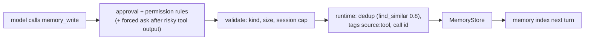

# `memory_write` tool and the `tool` memory writer: spec

Branch `feat/memory-write-tool`, stacked on `feat/doc-retrieval` (PR G2). Plan: `docs/plans/pluggable-context-implementation.md`, PR J (first part, J1). Design: `docs/research/pluggable-context-memory-2026-11.md` §4.7 (Writer: `tool`), §4.10 (risks).

## Problem

Hone writes memories only from English trigger phrases (`classify_turn`, `memory_worthy.rs`). The model can read memories (`memory_read`, the memory index) but can't decide to keep something: a fact it learned, a user's stated preference in other words than the triggers, a decision. MemGPT-style agents give the model a write tool; the research recommends one, with the runtime, not the model, applying writes so dedup, policy and attribution stay in one place.

## Rows

| Row | Behaviour |
|---|---|
| W1 | **Selected by `[memory] writer`.** New built-in writer names: `tool` (the tool only) and `triggers+tool` (both). `triggers` (default) and `off` are unchanged. The `memory_write` tool is offered to the model only when the writer includes `tool` and a memory store is configured. A project file can only turn writers `off` (PR D's rule), so it can't add the tool. |
| W2 | **The tool.** `memory_write { kind, content, tags? }`. `kind` is one of `user`, `feedback`, `project`, `reference` (not `conversation` or `outcome`). `content` is 1–2,000 characters after trimming. `tags` is at most 8 strings of at most 40 characters. Invalid input is a tool error the model sees; nothing is written. |
| W3 | **The runtime applies the write.** The tool proposes a `MemoryCandidate`; the agent's existing write path applies it: dedup with `find_similar(content, 0.8)` (a near-duplicate updates the existing memory instead of adding one), a UUID v7 id, and the tags `source:tool` and `call:<tool call id>` added. The result tells the model `{"id": …, "status": "added" | "updated"}`. |
| W4 | **It's a write, so it's gated.** `memory_write` is not read-only: it goes through the approval policy (the TUI asks unless "always" was chosen; `--step` asks) and permission rules (a `deny` rule on `memory_write` blocks it). |
| W5 | **Forced approval after risky tool output.** If any tool result earlier in the same turn was labelled with an injection risk (the existing guard labels), a `memory_write` in that turn needs approval even in auto-approve modes; in a headless run with no approver, it's refused with a tool error explaining why. This keeps injected text from becoming a stored "fact" silently. |
| W6 | **Bounded.** At most 20 `memory_write` calls succeed per session; later calls return a tool error. |
| W7 | **Visible.** Each successful write sends `AgentEvent::MemoryWritten { id, kind, status }` (status `added`/`updated`), rendered by the TUI as one line and named `memory_written` in the server's event maps. Encrypted stores work through the same path. |

## Testing notes

- **W2/W3/W6** through a real agent with the scripted provider calling `memory_write`, on an `InMemoryStore`/temp `SqliteStore`; dedup with a near-duplicate.
- **W1** registry/selection: the tool appears in `tools_offered` (receipts) only when selected.
- **W4/W5** with an approval policy that records requests, a deny rule, and a turn whose earlier tool result carries an injection marker.
- **W7** event emission, TUI handler, server maps.

## Out of scope

- `llm-extract` writer and `llm-summary` compactor (J2, J3).
- Editing or deleting memories through tools.
