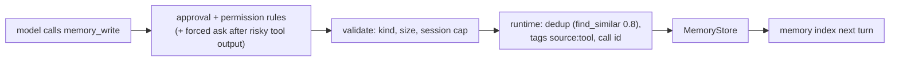

# `memory_write` tool and the `tool` memory writer: spec

Branch `feat/memory-write-tool`, stacked on `feat/doc-retrieval` (PR G2). Plan: `docs/plans/pluggable-context-implementation.md`, PR J (first part, J1). Design: `docs/research/pluggable-context-memory-2026-11.md` §4.7 (Writer: `tool`), §4.10 (risks).

## Problem

Hone writes memories only from English trigger phrases (`classify_turn`, `memory_worthy.rs`). The model can read memories (`memory_read`, the memory index) but can't decide to keep something: a fact it learned, a user's stated preference in other words than the triggers, a decision. MemGPT-style agents give the model a write tool; the research recommends one, with the runtime, not the model, applying writes so dedup, policy and attribution stay in one place.

## Rows

| Row | Behaviour |
|---|---|
| W1 | **Selected by `[memory] writer`.** New built-in writer names: `tool` (the tool only) and `triggers+tool` (both). `triggers` (default) and `off` are unchanged. The `memory_write` tool is offered to the model only when the writer includes `tool` and a memory store is configured. A project file can only turn writers `off` (PR D's rule), so it can't add the tool. |
| W2 | **The tool.** `memory_write { kind, content, tags? }`. `kind` is one of `user`, `feedback`, `project`, `reference` (not `conversation` or `outcome`). `content` is 1–2,000 characters after trimming. `tags` is at most 8 strings of at most 40 characters. Invalid input is a tool error the model sees; nothing is written. |
| W3 | **The runtime applies the write.** The tool proposes a `MemoryCandidate`; the agent's existing write path applies it: dedup with `find_similar(content, 0.8)` (a near-duplicate updates the existing memory instead of adding one), a UUID v7 id, and the tags `source:tool` and `call:<tool call id>` added. The result tells the model `{"id": …, "status": "added" | "updated"}`. |
| W4 | **It's a write, so it's gated.** `memory_write` is not read-only: it goes through the approval policy (the TUI asks unless "always" was chosen; `--step` asks) and permission rules (a `deny` rule on `memory_write` blocks it). |
| W5 | **Forced approval after risky tool output.** If any tool result earlier in the same turn was labelled with an injection risk (the existing guard labels), a `memory_write` in that turn needs approval even in auto-approve modes; in a headless run with no approver, it's refused with a tool error explaining why. This keeps injected text from becoming a stored "fact" silently. |
| W6 | **Bounded.** At most 20 `memory_write` calls succeed per session; later calls return a tool error. |
| W7 | **Visible.** Each successful write sends `AgentEvent::MemoryWritten { id, kind, status }` (status `added`/`updated`), rendered by the TUI as one line and named `memory_written` in the server's event maps. Encrypted stores work through the same path. |

### Review round 1 (W8–W15)

Review reproduced, auto-approved and with no injection: a `memory_write` near-duplicate rewrote the user's own feedback memory into its opposite, changed its kind and added a `source:user` tag; tool content with newlines forged a "verified" section inside the next session's system-role "Relevant Memories" block; a plain-language instruction in a repository file was stored without forced approval (the regex detector didn't flag it), and a labelled injection from an earlier turn still in context didn't count.

| Row | Behaviour |
|---|---|
| W8 | **The model can only update its own memories.** A tool write's near-duplicate check (`find_similar` 0.8) considers only memories tagged `source:tool` of the same kind; a match against any other memory (user-, trigger- or import-written) adds a new memory instead of updating. An update never changes a memory's kind. |
| W9 | **Reserved tags are refused.** Tags starting with `source:`, `call:`, `project:` or `__` in the tool's input are an input error naming the tag. The runtime's own `call:<id>` tags keep only the newest 5 on a memory. |
| W10 | **Tool content is stored as one line of data.** Newlines, tabs and other control characters in `content` are collapsed to single spaces before storing, so a stored memory can't introduce headings or list items into a later prompt. |
| W11 | **Model-written memories are labelled where they're shown.** In the "Relevant Memories" block and the memory index, a `source:tool` memory is prefixed `(model-written)`. |
| W12 | **Approval is forced whenever untrusted content is in context.** `memory_write` needs approval (overriding auto-approve, `--yes` and session "always") when the request it's part of contains any result of `read_file`, `grep`, `glob`, `shell`, `web_fetch`, `web_search`, an LSP tool or an MCP tool, or a HONE.md section — in this turn or any earlier one still in context. With no approver (headless), it's refused with an error that says why. A write in a turn whose context holds none of these (conversation only) follows the normal approval policy. This replaces W5's same-turn, regex-only rule. |
| W13 | **Tool-written memories stay in their project.** A tool write is tagged `project:<id>` (a hash of the working directory's canonical path, or of the git top-level when inside a repository), and recall and the memory index include `source:tool` memories only when that tag matches the current project. Other memories are unaffected. |
| W14 | **The approval prompt says what an update replaces.** When a tool write would update an existing memory, the approval request's arguments include `replaces: {id, content preview (≤120 chars)}`. |
| W15 | **Rules and limits are documented.** `docs/configuration.md` documents the `tool` writers, that permission rules match `memory_write` as `command = "memory_write"` (and that a broad `command = "*"` rule covers it), that the 20-write cap is per agent (one process; a TUI session switch resets it), that tags are stored unencrypted with `--encrypted-memory`, and that a new memory reaches the memory index on the next start (recall finds it next turn). A warning is logged when an MCP tool named `memory_write` is shadowed. |

### Review round 2 (W16–W20)

| Row | Behaviour |
|---|---|
| W16 | **Untrusted by default.** W12's forced approval applies when the request context holds **any** tool result except `memory_write`'s own (so `git_diff`, `git_status`, `symbol_search`, `memory_read`, `screen_capture`, every MCP and future tool count), or a HONE.md section, or the turn-1 injected repository skeleton, or a gathered context block from a source (env-snapshot, retrieval), or a recalled `source:tool` memory, or a project skill. Only a conversation whose context holds none of these follows the normal approval policy. Docs list the rule this way. |
| W17 | **The project filter applies before the cap.** Recall (BM25 and semantic) considers only memories visible in the current project — `source:tool` memories of other projects are excluded before `top_k` is applied (in the store query, or by over-fetching and then capping), so another project's tool memories can't use up recall slots. |
| W18 | **Worktrees share a project; a home-directory repo doesn't capture everything.** The project id resolves a git worktree to its repository's common git directory (`git rev-parse --git-common-dir` semantics, read from the `.git` file's `gitdir:` and the worktree's `commondir`, no subprocess), so a main checkout and its worktrees are one project. A `.git` at `$HOME` is ignored when looking for the repository root. |
| W19 | **Line and paragraph separators are collapsed too.** `one_line` treats U+2028, U+2029 and U+0085 like control characters. |
| W20 | **Dedup looks for the model's own match.** When the best near-duplicate is a memory the tool may not update, the tool's own best same-kind, same-project match above the threshold is used (updated) if there is one, so the model's duplicates don't accumulate. |

## Testing notes

- **W2/W3/W6** through a real agent with the scripted provider calling `memory_write`, on an `InMemoryStore`/temp `SqliteStore`; dedup with a near-duplicate.
- **W1** registry/selection: the tool appears in `tools_offered` (receipts) only when selected.
- **W4/W5** with an approval policy that records requests, a deny rule, and a turn whose earlier tool result carries an injection marker.
- **W7** event emission, TUI handler, server maps.

## Out of scope

- `llm-extract` writer and `llm-summary` compactor (J2, J3).
- Editing or deleting memories through tools.
