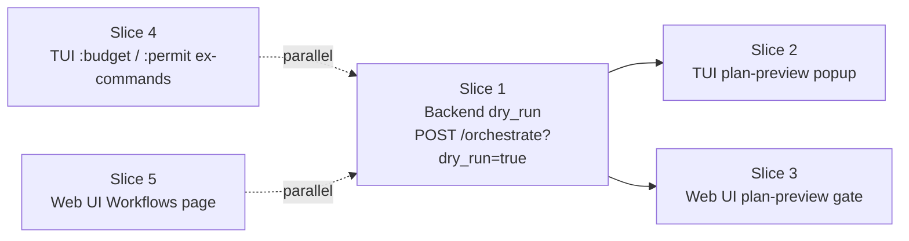

# Orchestration GUI/TUI surfaces — TDD implementation plan

**Status:** in-progress
**Source research:**
- `docs/research/gui-for-non-cli-users-2026-05.md` (web UI surfaces)
- `docs/research/tui-orchestration-integration-2026-05.md` (TUI portability)

The two top-recommended surfaces from each surface's analysis converge on
**one shared backend change** (`?dry_run=true` on `POST /orchestrate`)
plus per-client UI work. Implementation is sliced so each slice is
independently shippable and reviewable.

## Slicing

Slices 4 and 5 are independent — they don't touch the orchestrate flow.
Slice 1 unblocks slices 2 and 3.

## Decided defaults (revisit before merging)

| Question | Decision | Rationale |
|---|---|---|
| Where does `dry_run` halt? | After `PlanCreated`, before `execute_plan` | `decompose()` is already `pub` and only runs the lead LLM once; this gives accurate subtask count for free, no extra cost vs the expensive `execute_plan` path. |
| Cost-estimate formula | `lead_actual_cost + (subtask_count × default_per_worker_estimate_usd)` | Lead cost is real (we just paid it). Worker estimate uses a constant in `hone-core` (default 0.05 USD); operators can override later via `OrchestrateRequest`. |
| `?dry_run=true` query param vs `POST /plan` | Query param | Reuses the entire SSE pipeline, provenance tee, error handling. New route would duplicate ~80 LoC. |
| Per-run vs persistent governance (slice 4) | Per-run for v1 | Defer the persistence question; `:permit` flags only mutate the in-flight `AgentConfig`. |
| Vocabulary rename (Agent→Specialist, MCP→Connection) | **Defer** | Not blocking; cultural call belongs in its own PR. |

## Slice 1 — Backend `dry_run` (RED → GREEN → REVIEW)

### Contract

`POST /orchestrate?dry_run=true` with the existing `OrchestrateRequest`
body. The SSE stream emits exactly:

1. `model_info` (existing)
2. `plan_created` (existing — `goal`, `subtask_count`)
3. `budget_progress` (new shape — `spent_usd` is real lead cost,
   `budget_usd` is the projected total `lead + workers × estimate`,
   `workers_completed = 0`, `workers_total = subtask_count`)
4. `done` with a structured payload that includes the full `TaskPlan`
   (goal + subtasks list with id / agent / description / depends_on)

NO `worker_started`, `worker_completed`, `tool_call_*`, or `token`
events are emitted.

### Files in scope

| File | Change |
|---|---|
| `crates/hone-server/src/orchestration.rs` | Add `dry_run` to `OrchestrateRequest`; gate `execute_plan` path |
| `crates/hone-core/src/lib.rs` | Export `DEFAULT_WORKER_COST_USD: f64 = 0.05` constant |
| `crates/hone-server/tests/orchestrate_endpoint.rs` | Existing integration tests; add dry_run cases |
| `crates/hone-server/src/orchestration.rs::tests` | Unit tests for the new request shape |

### Test cases (test-architect writes these first)

- `dry_run_returns_plan_without_executing_workers` — POST with `dry_run=true`, assert SSE contains `plan_created` + `budget_progress` but NO `worker_started`/`worker_completed`/`tool_call_*`.
- `dry_run_emits_done_with_subtask_payload` — assert `done` event payload has the full `TaskPlan` JSON.
- `dry_run_cost_estimate_is_lead_plus_workers_times_constant` — mock provider with deterministic cost; assert `budget_progress.budget_usd == lead + N * 0.05`.
- `dry_run_false_or_missing_executes_normally` — back-compat: existing happy-path test still emits `worker_started`.
- `dry_run_with_zero_subtasks_returns_done_immediately` — empty plan edge case.
- `dry_run_when_decompose_fails_emits_error` — provider returns garbage JSON; assert `error` event, no `plan_created`.

## Slice 2 — TUI plan-preview popup

Triggered by a new `:plan <prompt>` user_command (or `/plan` slash) in
`crates/hone-tui/src/user_commands.rs`. Renders a modal-style overlay
(reuse the debugger pause-overlay pattern in `crates/hone-tui/src/render/`)
with the plan tree + cost estimate + `[r]un / [e]dit / [c]ancel` keybinds.
Existing approval-key infrastructure at
`crates/hone-tui/src/app.rs:1149-1184` is the pattern to mirror.

## Slice 3 — Web UI plan-preview gate

Extend `<WorkerProgressPanel>` to recognise dry-run sessions (the
absence of `worker_started` after `plan_created` for >2s, or — better —
a synthetic `dry_run: true` field on the request and matching surface
state in the panel). Add Edit / Run buttons that POST again without
`dry_run`.

## Slice 4 — TUI `:budget` and `:permit` ex-commands

Adds two new `UserCommand` variants. `:budget 0.50` sets the cost
ceiling for the next run; `:permit shell` adds an auto-allow rule for
shell tool calls. Both are per-run; not persisted for v1.

## Slice 5 — Web UI Workflows page

`<WorkflowsPanel>` reads `GET /recipes`, renders cards with form-from-
template-vars. New `POST /recipes` daemon route accepts a recipe blob
and writes to `~/.config/hone/recipes/<name>.toml`.

## TDD agent assignments

| Phase | Agent | Allowed to modify |
|---|---|---|
| Red (write tests) | `test-architect` | Test files only |
| Green (implement) | `rust-expert` (slices 1, 2, 4), `flutter-expert`/`fullstack-architect` for SolidJS slices (3, 5) | Source files only — never tests |
| Review | `code-reviewer` | Suggest only |

## Verification gates

Before each slice merges:

1. Slice's unit + integration tests green.
2. Workspace-wide `cargo test --workspace` green.
3. `cargo clippy --workspace -- -D warnings` clean.
4. `cargo fmt --check` clean.
5. For UI slices: visual spot-check via `make webui-dev` and `cargo run -p hone`.
