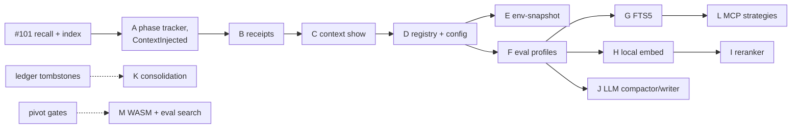

# Pluggable context, memory and retrieval: implementation plan

This turns the phased plan in `docs/research/pluggable-context-memory-2026-11.md` (§5) into pull requests. Each PR is TDD with separate test and implementation agents, then a separate review. Each PR has its own spec in `docs/plans/`.

PRs are stacked: each branch starts from the previous one and targets it as its base, so every diff shows only its own change. When a PR merges, the next one is retargeted to `main`.

## Pull requests

| Phase | PR | Branch | Spec | Ships | Depends on |
|---|---|---|---|---|---|
| 0 | #101 | `fix/memory-recall-index` | `memory-recall-index-spec.md` (M1–M11) | Recall ranks the whole corpus; outcome logs excluded; plain-English index search; README storage claim | — |
| 0 | A | `fix/context-phase-events` | `context-phase-events-spec.md` (K1–K7) | Phase tracker fed by real tool calls (`apply_patch`, test commands in `shell`); `ContextInjected` sent; pgvector claims corrected in docs | #101 |
| 1 | B | `feat/context-receipts` | `context-receipts-spec.md` | `ContextReceipt` types in `hone-proto`; `AgentEvent::ContextAssembled` per model call; audit span; `honed` provenance entry | A |
| 1 | C | `feat/context-show` | (in B's spec) | `hone context show [--session] [--turn]` and `--json` | B |
| 2 | D | `feat/strategy-registry` | `strategy-registry-spec.md` | Traits for context sources, recaller, compactor and writer; one registry; `[context]`, `[memory]`, `[retrieval]` tables with the user/project trust split; env vars and flags mapped onto them; `hone strategies`; golden test that the default profile's requests are byte-identical | C |
| 2 | E | `feat/env-snapshot` | (in D's spec) | `env-snapshot` context source, off by default | D |
| 3 | F | `feat/eval-profiles` | `eval-profiles-spec.md` | `hone eval` profiles, `--ablate`, `--check`, memory fixtures, run directories, Pareto table with confidence intervals, a 20-task starter suite including non-coding tasks | D |
| 4 | G | `feat/fts5-recall` | — | FTS5 lexical index for memory and workspace documents; markdown and fixed chunkers | F |
| 4 | H | `feat/local-embed` | — | `local-embed` feature: local embedder, `embedding_model` column, sqlite-vec, `hybrid` recaller | F |
| 4 | I | `feat/reranker` | — | Cross-encoder reranker (feature) and `llm` reranker | H |
| 4 | J | `feat/llm-compactor-writer` | — | `llm-summary` compactor; `llm-extract` and `tool` memory writers | F |
| 4 | K | `feat/consolidation-job` | — | Consolidation as a `honed` job | Ledger tombstones (not built) |
| 5 | L | `feat/mcp-strategies` | — | MCP adapter for third-party retrievers | G |
| 5 | M | — | — | WASM strategies and `hone eval search` | Pivot validation gates |

## Decisions that need the user

| When | Decision | Why it can't be defaulted |
|---|---|---|
| After A | Re-run the `hone-inject` arm of `benchmarks/harness-compare` before and after #101 + A | It costs model API spend (or needs a local model on wk-system) |
| Before G–J | Each Phase 4 built-in merges with an eval report from F | Running the report costs model calls |
| Before H, I | Adding heavy optional dependencies (an ONNX embedder, sqlite-vec, which is pre-v1) behind Cargo features | New native dependencies and a larger feature matrix |
| Before K | Consolidation needs the Belief Ledger's tombstones and supersession | That ledger is a separate, unbuilt design |
| Before M | Phase 5 is gated on the memory pivot's validation gates | A product decision |

## Rules carried through every PR

- Fix before abstracting: the default must work and be measured before alternatives are offered.
- Receipts carry ids and hashes, never text.
- The default profile stays byte-identical to the previous release unless a PR says otherwise and explains why.
- Project `.hone/config.toml` can choose built-ins only; plugins and remote embedders come from the user file.
