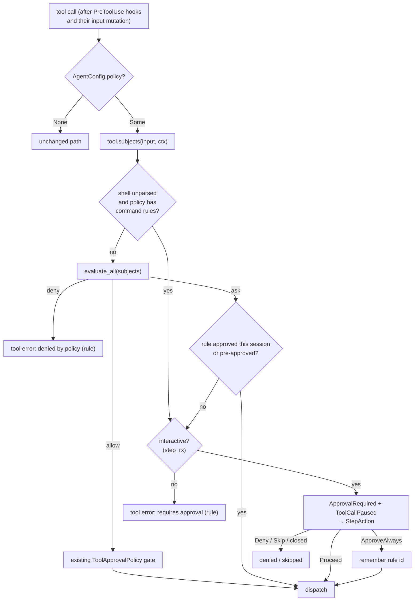

# P2.2: policy decision point in the agent loop (contract)

Part of Phase 2 of [`trust-defaults-daemon-2026-11.md`](trust-defaults-daemon-2026-11.md)
(§6.4, task P2.2). It builds on the policy model in [`policy-v2-spec.md`](policy-v2-spec.md)
(P2.1) and carries out the obligations that spec places on P2.2 in its §8.

**Invariant:** with no permission files, P2.2 changes **no** behaviour. The built-in rule
set stays empty until P2.5, so an empty policy allows everything. An agent with
`AgentConfig::policy == None` behaves exactly as before.

## 1. Scope

| In P2.2 | Later |
|---|---|
| `Tool::subjects()` with a default implementation, plus implementations for the native tools | MCP tool subjects (they use the default, which yields no subjects) |
| A shell parser that produces command subjects and best-effort path subjects | — |
| Canonicalising subject paths, and `PolicyContext::case_insensitive_paths` | — |
| One decision point in the agent loop, covering the sequential path, the parallel read-only path and the guard's synthetic read | — |
| `ask` handling: interactive runs pause, headless runs deny ("requires approval (rule …)"), and approvals are remembered per session by rule id | `--approve <rule-id>` flag (P2.3); honed wiring (P2.3) |
| Blocked decisions are recorded in the egress log when `--audit` is on | Full decision log in `.hone/audit.jsonl` (P2.7) |
| The CLI loads the policy and refuses to start if a policy file is broken | Built-in rules (P2.5); `hone policy …` (P2.6); IP checks at connect time (P2.5) |

## 2. Flow



## 3. Subjects (`crates/hone-tools`)

```rust
pub struct ToolSubjects {
    pub subjects: Vec<hone_config::policy::Subject>,
    /// True when a shell command could not be parsed (§4).
    pub unparsed: bool,
}

/// What subject extraction needs; built from `PolicyConfig::context`.
pub struct SubjectContext {
    pub workdir: PathBuf,          // canonical working directory
    pub home: Option<PathBuf>,
    pub case_insensitive: bool,    // fold argv[0]; mirrors PolicyContext
}

#[async_trait]
pub trait Tool {
    // ... existing methods ...
    /// What this call would touch. The default is no subjects.
    fn subjects(&self, input: &ToolInput, sctx: &SubjectContext) -> ToolSubjects {
        ToolSubjects::default()
    }
}

// crates/hone-tools/src/subjects.rs, re-exported at the crate root:
pub struct ShellParse {
    pub commands: Vec<Vec<String>>,          // normalised argv per simple command
    pub paths: Vec<(PathOp, PathBuf)>,       // via subject_path, in source order
    pub unparsed: bool,
}
pub fn parse_shell(cmd: &str, sctx: &SubjectContext) -> ShellParse;
impl ShellParse { pub fn into_subjects(self) -> ToolSubjects; } // Command = argv.join(" ")
pub fn subject_path(raw: &str, sctx: &SubjectContext) -> PathBuf;
```

`ToolContext` is unchanged.

**Wrappers must forward.** Any `Tool` that wraps another tool must forward `subjects()`
and `is_read_only()` to the inner tool. That includes `CachingToolWrapper` in
`bins/hone/src/tools/caching_tool.rs`. A test compares, for every tool in the CLI
registry with the cache on, the wrapper's subjects with the unwrapped tool's subjects
for the same input.

**`web_fetch` redirects.** A redirect is followed only when it stays on the same host.
On a redirect to another host, the tool stops and returns the status and the `Location`
to the model. The model's next `web_fetch` call is then checked against the policy like
any other.

`hone-tools` gains a dependency on `hone-config`. That creates no cycle, because
`hone-config` depends only on `hone-proto`.

### Paths: `subject_path(raw, sctx) -> PathBuf`

1. `~` or `~/x` expands to `home`, if there is one. `$HOME/x` and `${HOME}/x` expand the
   same way, but only in shell words.
2. A relative path is joined onto `workdir`.
3. **Canonicalise the longest existing prefix.** Symlinks resolve, and the on-disk case
   is restored on case-insensitive filesystems. The rest of the path is appended after
   lexical normalisation (`.`, `..`).
   - Try `canonicalize` on the whole path first. Walk up only if that fails, which keeps
     the cost at about one syscall per existing path.
   - **Dangling symlinks.** If a component that doesn't resolve is a symlink (checked
     with `symlink_metadata`), its target is read with `read_link`. Resolution continues
     from the target, with a limit of 40 hops; past the limit, the path is the link
     itself. A write through `notes.md -> ~/.ssh/authorized_keys` must give a subject
     under `~/.ssh`.
4. There is no containment check. Confining paths to the workdir stays the tool's job
   (`resolve_within_working_dir`). That function gets the same dangling-symlink handling
   as step 3, so `write_file` can't escape the workdir through a dangling link. This
   closes a hole that existed before P2.2.

### Per-tool subjects

| Tool (args) | Subjects |
|---|---|
| `read_file {path}` | Path Read |
| `write_file {path}` | Path Write |
| `edit_file {path}` | Path Read + Path Write (editing shows the content) |
| `multi_edit {edits[].path}` | Read + Write for each distinct path |
| `apply_patch {diff}` | Read + Write for each target in the `---`/`+++` headers. `a/` and `b/` prefixes are stripped and `/dev/null` is skipped. An unparseable diff gives no path subjects, because the tool will fail on it anyway |
| `grep {path?}`, `glob {path?}` | Path Read of the search root (default: the workdir) |
| `lsp_diagnostics`, `lsp_hover`, `lsp_code_actions {file}` | Path Read |
| `shell {command}` | §4 |
| `web_fetch {url}` | `Host`, taken from the URL parser (`url`/`reqwest::Url`), which gives canonical IPv4 for `http://127.1/` and similar. A URL that won't parse gives `Host(raw)`, which is malformed and so asks |
| symbol tools in `bins/hone` (`symbol_at`, …) taking a file | Path Read of the file |
| `git_*` tools | `Command("git <sub>")`, where `<sub>` is the tool name without its `git_` prefix. `git_checkout` and `git_branch` append their `name` argument |
| `web_search`, `memory_read`, `handoff`, `screen_capture`, `computer_control`, MCP tools | none |

## 4. Shell parsing: `parse_shell(cmd, sctx) -> ShellParse`

This is best-effort. Command rules are a speed bump; the sandbox is the security
boundary.

- **Simple commands.** The input splits into simple commands on `;`, `&&`, `||`, `|`, `&`
  and newline, but only outside quotes. Backslash-newline sequences are joined first.
- **Words:**
  - Single quotes are literal; double quotes allow `\"`, `\\` and `\$`. Backslash escapes
    work outside quotes.
  - `$'…'` is accepted with its standard escapes.
  - Adjacent quoted and unquoted parts join into one word: `g''it` → `git`,
    `"git" push` → `git push`.
- **Leading assignments.** `VAR=value` words before argv[0] are dropped.
- **argv[0]** is reduced to its basename (`/usr/bin/git` → `git`). With
  `case_insensitive`, it is also lowercased (`GIT` → `git`).
- **Command subject.** Each simple command gives one `Command` subject: argv joined by
  single spaces, so runs of whitespace and tabs collapse.
- **Reserved words and grouping.** These are removed before argv[0] is chosen:
  - leading `{`, `}`, `(`, `)`, `!`;
  - `if`, `then`, `else`, `elif`, `fi`, `while`, `until`, `do`, `done`, `time`;
  - `function NAME`, and `NAME()` when a body follows.

  So `{ git push; }`, `if true; then git push; fi` and `! git push` all produce
  `git push`.
- **Wrappers.** Known wrapper commands and their options are removed, and the wrapped
  command becomes argv[0]:
  - `env` (plus its `-i`/`-u X` options and `VAR=v` words);
  - `command`, `builtin`, `exec`, `nohup`;
  - `sudo` and `doas` (plus their options);
  - `timeout DURATION`, `nice -n N` / `nice`;
  - `stdbuf -oL` and the like, `xargs` (plus its options).

  The wrapper itself is **also** kept as its own command subject (`sudo git push` gives
  both `sudo git push` and `git push`), so a rule on the wrapper still matches.
- **Command strings.** The string argument of `sh -c`, `bash -c`, `zsh -c` and `dash -c`
  (with `-lc` and similar option bundles), and the arguments of `eval`, joined by
  spaces, are parsed again recursively. They count against the same depth limit.
- **Command names built at run time.** If argv[0], after quote removal, still contains
  an expansion (`$`, a backtick, or a brace expansion `{a,b}`) or `IFS`, the parse is
  `unparsed`. That catches `git${IFS}push`, `$G push`, `$(echo git) push` and
  `{git,} push`.
- **Arithmetic.** Inside `$((…))` and `((…))`, `<<` is a shift, not a heredoc.
  `echo $((1<<2))` must not swallow the lines after it.
- **Command substitution.** `$(…)` and backticks are parsed recursively, and the inner
  commands become subjects too. The maximum depth is 8.
- **Heredocs.** For `<<WORD` and `<<-WORD`, quoted or not, the body lines up to `WORD`
  are skipped and not parsed.
- **Path subjects**, all through `subject_path`:
  - Redirect targets: `>`, `>>`, `>|`, `&>`, `2>` and `N>` give Write. `<` gives Read.
  - Arguments after argv[0] that don't start with `-` give Read, unless they contain an
    unexpanded `$` (other than the `$HOME` forms).
  - `$HOME` and `${HOME}` expand at the start of a word's **text** even inside double
    quotes, so `"$HOME/.ssh/k"` and `"$HOME"/.ssh/k` both expand.
  - **Globs and braces.** A word with `*`, `?` or `[...]` is expanded against the
    filesystem the way the shell would: at most 256 matches, and every match becomes a
    subject. The literal directory prefix before the first glob segment also becomes a
    subject, so a rule on the directory (`~/.ssh/**`) matches even with zero matches.
    Brace expansion (`{a,b}`) runs first, capped at 64 words.
  - **`cd`.** A `cd <literal>` earlier on the same line is tracked. Later relative paths
    on that line are resolved against both the new directory and the workdir, and both
    become subjects. That is conservative, because it covers the case where the `cd`
    fails.
  - If argv[0] is one of `rm rmdir mv cp touch mkdir ln chmod chown tee truncate install`,
    or is `sed` with `-i`, the same arguments give Write as well.
  - `dd`: `of=PATH` gives Write and `if=PATH` gives Read.
- **Caps fail closed.** Every cap that cuts a result short sets `unparsed`:
  - 256 glob matches;
  - 4096 entries read per directory;
  - 64 brace words;
  - 64 glob-bearing words;
  - 16 `cd` bases;
  - 8 nested wrappers;
  - 1000 commands or paths.
- **Shell state the parser can't model** makes the line `unparsed`:
  - options that **widen** globbing:
    - `shopt -s` with `dotglob`, `extglob`, `globstar`, `nocaseglob`, `nullglob` or
      `failglob`;
    - `setopt`/`set -o` with zsh's `globdots`, `extendedglob`, `globstarshort`,
      `nocaseglob`, `nullglob` or `kshglob`;
    - `GLOBIGNORE=…` or `CDPATH=…` anywhere on the line.

    Common forms like `set -e`, `set -euo pipefail` and `set -o pipefail` **don't** make
    the line unparsed; no bash `set -o` option widens globbing;
  - a shell (`sh`, `bash`, `zsh`, `dash`, `ksh`) run with neither `-c` nor a script
    argument, so it reads commands from stdin (`echo 'git push' | sh`, `bash <<< …`,
    `sh -s`). `--version` and `--help` don't read stdin.
- **`pushd <literal>`** is tracked like `cd`.
- **More wrappers:** `time -p`, `arch -<arch>`, `caffeinate` (plus its options),
  `setsid`, `coproc`.
- **More command strings.** `su -c '…'`, `su --command='…'`/`--command '…'` and
  `env -S '…'`/`--split-string` are parsed recursively like `sh -c`.
- **Finding `-c` in a shell's options.** For `sh`/`bash`, a short-option bundle (`-…` or
  `+…`, not `--`) that contains `o` or `O` consumes the next word as its argument. So in
  `bash -euo pipefail -c '…'` and `bash -O extglob -c '…'`, the `-c` string is still
  found and parsed.
- **`unparsed = true`** also when argv[0] is built at run time (above), and when:
  - a quote is unbalanced, or a `$(` or backtick isn't closed;
  - a heredoc has no terminator;
  - the nesting is deeper than 8;
  - the input is longer than 64 KiB.

  Whatever was parsed before the error is still returned.

## 5. Policy context additions (`hone-config`)

- `PolicyContext` gains `pub case_insensitive_paths: bool`. When it is set, path rules
  compile with `GlobBuilder::case_insensitive(true)`. Command and host matching don't
  change.
- `PolicyContext::for_platform(workdir, home)` sets `case_insensitive_paths` to `true`
  on macOS and Windows, and `false` elsewhere.
- `CompiledPolicy::has_command_rules() -> bool` is true when any layer has a command
  rule.

## 6. The decision point (`crates/hone-core`)

```rust
#[derive(Clone)]
pub struct PolicyConfig {
    pub compiled: Arc<CompiledPolicy>,
    pub context: PolicyContext,          // for case_insensitive + home in subjects
    pub pre_approved: Vec<String>,       // rule ids; populated by P2.3's --approve
}
// AgentConfig gains: pub policy: Option<PolicyConfig>
```

`pub fn decide(policy: &PolicyConfig, session_approved: &HashSet<String>, tool: Option<&dyn Tool>,
call: &ToolCallRequest) -> GateDecision` is a pure function and is unit-testable. It builds
the `SubjectContext` from `policy.context`. It lives in `crates/hone-core/src/policy_gate.rs`,
and `PolicyConfig`, `GateDecision` and `decide` are re-exported at the `hone_core` root. It
returns:

- `GateDecision::Allow`
- `GateDecision::Deny { rule_id }`
- `GateDecision::Ask { rule_id }`

Its logic:

1. Find the subjects. An unknown tool has none.
2. **Evaluate each subject on its own.** Drop every `Ask` verdict whose rule id is in
   `session_approved` or `pre_approved`. A `Deny` is never dropped.
3. If any `Deny` remains, return the earliest one.
4. If the command is `unparsed` and the policy has **any command or path rule**, add
   `Ask { "builtin:unparsed-command" }`, unless that id is pre-approved.
5. If any `Ask` remains, return the earliest one. Otherwise return `Allow`.

So a parsed Deny always wins over the unparsed Ask. One approved rule never covers a
different Ask rule in the same call: `git push && cat ~/.ssh/k` still asks for the
`~/.ssh` rule after `git push` was approved. And a path-only policy still catches
commands hidden behind a parse error.

`CompiledPolicy` gains `has_path_rules()`, alongside `has_command_rules()`.

The `Agent` owns `policy_session_approved: HashSet<String>`. It lasts as long as the
`Agent` does.

- **Synthetic ids are never remembered.** `builtin:unparsed-command` and
  `builtin:invalid-host` are never added to the session set. For them, `ApproveAlways`
  acts as `Proceed`. Approving "always" there would switch off every command rule, or
  every malformed-host check, for the rest of the session.
- **They are still checked in step 5.** `pre_approved` (P2.3's `--approve`) may name a
  synthetic id, because that is an explicit choice made up front.

### Where it runs

- **Sequential path:** after the PreToolUse hooks, including their `mutated_input`, and
  before `ToolCallStart`.
- **Parallel path:** in the existing serial pre-pass, after each call's hooks. A call
  that is denied, or whose ask isn't approved, gets its result filled in up front and
  isn't dispatched. Ask prompts happen in that serial pre-pass.
- **Guard 1 (synthetic `read_file` before an edit):** the guard evaluates `Path Read` for
  the file first. It injects the read only on `Allow`. An `Ask` doesn't prompt for a
  synthetic read; the guard just skips the injection.

### Outcomes

- **Deny:**
  - `ToolCallEnd { is_error: true, result: {"error": "denied by policy", "rule": id} }`;
  - the model gets the tool result `(denied by policy: rule <id>)`;
  - no `ToolCallStart` is sent;
  - the tool is never dispatched.
- **Ask, interactive** (`step_rx` is `Some`): the agent sends
  `ApprovalRequired { action: <tool name>, description: "policy rule <id> requires approval" }`,
  then `ToolCallPaused`, and waits.

  | `StepAction` | Result |
  |---|---|
  | `Proceed` | Run once |
  | `ApproveAlways(_)` | Record the rule id for the session, then run |
  | `Skip` | Existing "skipped" result |
  | `Deny(reason)` | Existing "denied by user" result |
  | Channel closed | Deny with "requires approval (rule <id>)" |

  A call that the policy prompt approved is **not** paused again by `ToolApprovalPolicy`.

  In the TUI, **Esc** on an approval prompt sends `Skip`, not `Proceed`, so dismissing a
  prompt never runs the call. This applies to every approval prompt.

  A user's `Deny` or `Skip` at a policy prompt is written to the egress log, like the
  other blocked outcomes, with `block_reason: "policy: denied by user (rule <id>)"` or
  `"policy: skipped by user (rule <id>)"`.
- **Ask, headless** (`step_rx` is `None`): fail closed. `ToolCallEnd` is an error with
  `{"error": "requires approval", "rule": id}`, and the tool result is
  `(requires approval: rule <id>)`. The tool is never dispatched.
- **Egress log** (when `egress_log` is `Some`): every denied or unapproved call is
  recorded with `blocked: true` and `block_reason: "policy: deny (rule <id>)"` or
  `"policy: requires approval (rule <id>)"`.
- **Inheritance:** orchestrator workers and ensemble candidates are built from the
  lead's `AgentConfig`, so they inherit `policy`. Session approvals are **not** shared
  between agents. The reviewer has no tools and runs with `policy: None`.
- **Bookkeeping.** A call the policy blocks doesn't count towards `tool_calls_count`
  and isn't recorded as a read by the guards.
- **Guard 1** evaluates its synthetic read with the edit's path **after** hook mutation.

## 7. CLI (`bins/hone`)

- `load_permission_policy(working_dir)` takes the agent's own `working_dir`, so the
  tools and the policy share one source. It doesn't call `current_dir` a second time.
- **Home.** `home` is `$HOME` if it is absolute, otherwise `dirs_next::home_dir()` (the
  passwd entry). It may be `None`.
- **Workdir.** `workdir` is `canonicalize(working_dir)`, or `working_dir` itself if that
  is absolute.
- **No files → no policy.** If neither `<home>/.config/hone/permissions.toml` nor
  `<workdir>/.hone/permissions.toml` exists (checked with `symlink_metadata`), the
  result is `policy: None`. That is exactly today's behaviour, even with `$HOME` unset or
  the cwd gone.
- **Otherwise**, call
  `CompiledPolicy::load_layers(&ctx, &[], user: Option<&Path>, project: &Path)`. This is
  a new hone-config function, and `load_hierarchical_with_paths` delegates to it. A
  missing home skips the user layer. A missing workdir, or any load error, prints
  `hone: permission policy error: {e}` to stderr and exits with code 2. The error text
  is already sanitised by P2.1.
- **On success**, set
  `AgentConfig::policy = Some(PolicyConfig { compiled, context: ctx, pre_approved: vec![] })`.
- Every other `AgentConfig` constructor (tests, server, benches) sets `policy: None`.
  P2.3 wires up honed.

## 8. Tests that must exist

- **Shell parser:** splitting, quoting and joining (`g''it push`, `"git" push`,
  `git\<newline> push`), basename and case folding of argv[0], assignments, `$(…)` and
  backticks, heredoc skipping, redirect targets, writer commands, `dd`, `$HOME`/`~`
  expansion, and each `unparsed` trigger.
- **`subject_path`:** symlinked prefixes, a non-existent leaf, `..`, and on-disk case
  restored on macOS.
- **Per-tool `subjects()`** for every row of the §3 table.
- **`decide`:** every branch, including unparsed with and without command rules, session
  approval and pre-approval.
- **The agent loop with a mock provider:**
  - deny on the sequential and on the parallel path (the tool isn't dispatched, and the
    model sees the message);
  - ask in headless mode is denied;
  - ask in interactive mode, with `Proceed`, `ApproveAlways` (the second call doesn't
    prompt), `Deny` and a closed channel;
  - the guard's read is skipped when policy denies it;
  - hooks mutate the input before the policy sees it;
  - `policy: None` and an empty policy give unchanged behaviour;
  - the egress log records blocked calls.

## 9. Found in review and deferred (with owner)

| Gap | Owner |
|---|---|
| The `claude` CLI provider runs its own Bash, Read and Edit tools, which the gate never sees. Warn or refuse when the policy is non-empty, or translate the rules into its `--disallowedTools` | P2.3 |
| `hone-mcp-server` calls tools without the gate | P2.3 |
| `computer_control` has no subjects; it should ask by default | P2.5 (built-ins) |
| The native `grep` and `glob` walk into protected files under an allowed root. They need a policy filter passed into the walk, which needs the policy on `ToolContext` | P2.5 |
| `ApproveAlways` on a catch-all rule (`host = "*"` ask) approves every subject. Key catch-all approvals by rule and subject | P2.3 |
| Project `.hone/hooks.toml` hooks run before the gate | P2.5 |
| `ToolDispatcher` is exported and ungated, with no production callers. Delete it or gate it | P2.3 |
| Ensemble candidates share one `step_rx`. Not reachable today, because ensemble runs headless | P2.3 |
| `env -S'cmd'`, with the string attached to `-S`, isn't parsed as a command string. Treat a `-S…` word as the string | P2.3 |
| Suite B: watch how often unparsed commands ask, as a false-positive signal | P2.5 |
| Inherent limits; the sandbox is the boundary: aliases and functions, `git -C . push`, `find -exec`, `xargs` reading stdin, interpreters (`python -c`, `awk`), `source`, paths inside options (`curl -d @file`), `grep -r` | — |
