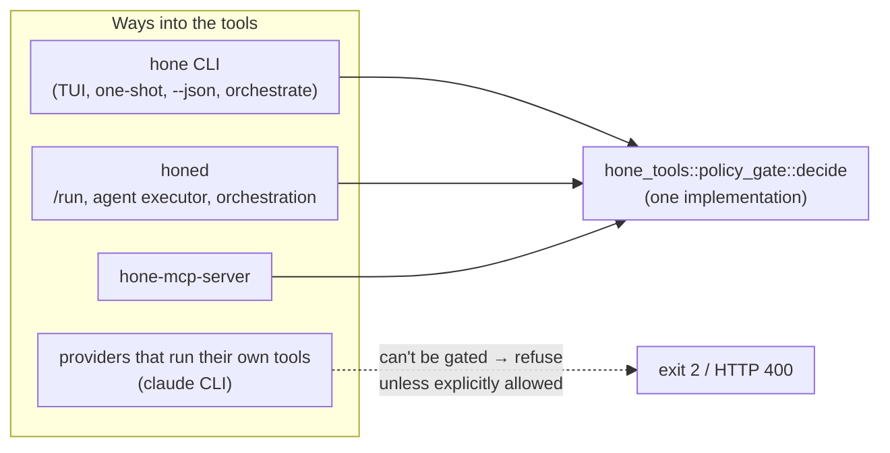

# P2.3: headless semantics, `--approve`, and the remaining entry points (contract)

Part of Phase 2 of [`trust-defaults-daemon-2026-11.md`](trust-defaults-daemon-2026-11.md)
(§6.4, task P2.3). It builds on [`policy-v2-spec.md`](policy-v2-spec.md) (P2.1) and
[`policy-p2.2-spec.md`](policy-p2.2-spec.md) (P2.2). P2.2 already made headless asks fail
closed. P2.3 adds the explicit opt-in. It also puts **every other way into the tools**
behind the same gate, and closes the P2.3 items listed in P2.2 §9.

**Invariant (unchanged):** with no permission files, behaviour doesn't change.

## 1. Scope

| # | Item | Where |
|---|---|---|
| 1 | Move the gate into `hone-tools`, so `hone-mcp-server` can use it without depending on `hone-core` | `crates/hone-tools/src/policy_gate.rs`; `hone-core` re-exports |
| 2 | `--approve <RULE_ID>` (repeatable) | `bins/hone` |
| 3 | honed: load the policy per run; `approve` in the request; load errors give 400 | `crates/hone-server` |
| 4 | Providers that run their own tools are refused under a non-empty policy | `hone-providers` trait, CLI and honed |
| 5 | Gate `hone-mcp-server` | `crates/hone-mcp-server`, `bins/hone-mcp-server` |
| 6 | Approvals of catch-all rules are keyed by subject | `policy_gate`, `hone-config` |
| 7 | Delete the unused, ungated `ToolDispatcher` | `crates/hone-core` |
| 8 | Ensemble candidates never share an approval channel | `crates/hone-core/src/ensemble.rs` |
| 9 | Parse `env -S'cmd'` (string attached to `-S`) | `crates/hone-tools/src/subjects.rs` |
| 10 | Docs: a "Permissions" section | `docs/configuration.md` |

## 2. The gate moves to `hone-tools`

- `PolicyConfig`, `GateDecision`, `decide`, and `resolve_permission_policy(working_dir,
  home)` (from `bins/hone/src/policy_load.rs`) move to `hone_tools::policy_gate`.
- `hone_core` keeps `pub use` re-exports, so existing paths still compile.
- `bins/hone/src/policy_load.rs` becomes a thin wrapper, or is removed. Its tests move
  with the function.
- There must be **one** implementation of `decide`. The agent loop, the MCP server and
  honed all call it.

## 3. `--approve <RULE_ID>`

- `hone --approve user:3 --approve allow-pypi …` is repeatable, and the values go into
  `PolicyConfig::pre_approved`.
- **Validation** happens at startup, after the policy loads. Each id must be either a rule
  id in the compiled policy (explicit or automatic) or one of the synthetic ids
  `builtin:unparsed-command` and `builtin:invalid-host`.
  - An unknown id exits 2 with `hone: --approve: unknown rule id '<id>'`, with the id
    escaped.
  - `--approve` with no policy loaded (no files) exits 2 with
    `hone: --approve given but no permission policy is loaded`.
- `hone-config` gains `CompiledPolicy::has_rule_id(&str) -> bool` and
  `CompiledPolicy::is_empty() -> bool` (no rules in any layer).
- A pre-approved id never turns a `Deny` into an allow. That is already the case in P2.2;
  this spec keeps it.

## 4. honed

- `RunRequest` gains `approve: Option<Vec<String>>`. It is validated like `--approve`:
  an unknown id, or ids with no policy loaded, give **400**.
- **`approve` needs an authenticated server.** If honed has no `auth_token`
  (no-auth loopback mode), a non-empty `approve` gives **400**: `approve requires an
  authenticated server`. Otherwise any local process could lift the user's ask rules.
- On each run, and in `agent_executor` and `orchestration`, honed calls
  `resolve_permission_policy(&working_dir, home)`, where `home` is the daemon process's
  `$HOME` if absolute, or else `dirs_next::home_dir()`. The result sets
  `AgentConfig::policy`.
- A load error gives **400** with the sanitised message. honed never starts a run on a
  policy it couldn't load.
- **Policy home.** `hone_tools::policy_gate::default_policy_home()` returns `$HOME` if it
  is absolute, otherwise `dirs_next::home_dir()`. The CLI, honed and `hone-mcp-server`
  all call it. `AppState` carries `policy_home: Option<PathBuf>`. It is resolved
  once at startup in production. The test constructor `AppState::with_mock_provider`
  sets it to `None`, so a developer's own `~/.config/hone/permissions.toml` never leaks
  into server tests.
- Runs without a step channel (`approval_policy` `Auto`) are headless: asks fail closed
  with the rule id. Runs with a step channel pause through the existing
  `POST /run/{request_id}/step` flow.

## 5. Providers that run their own tools

- `ModelProvider` gains `fn runs_own_tools(&self) -> bool { false }`. It returns `true`
  for:
  - the `claude` CLI and ACP adapters;
  - **the Gemini CLI adapter**. Gemini CLI has built-in file, search and web tools, and
    we can't verify that it never runs them in stdin mode, so this is the fail-closed
    choice;
  - any other adapter that emits `ObservedToolStart` / `ObservedToolEnd`.
- **Wrappers forward:**
  - `CachingProvider` forwards to its inner provider;
  - `FallbackChain` returns true if **any** member does;
  - `TierFallbackProvider` returns true if **any** tier provider does, not only its
    primary.
- **Refusal.** If the loaded policy is non-empty (`!compiled.is_empty()`) and the provider
  runs its own tools, Hone refuses to run:
  - the CLI exits 2 with `hone: this provider (<id>) runs its own tools, which the
    permission policy can't check; remove the policy files, use another provider, or
    set HONE_ALLOW_UNGATED_PROVIDER=1`. The shared helper
    `check_provider_gating(policy, runs_own_tools, allow_env)` builds the text without
    the id, and the caller may prefix it;
  - honed returns **400** with the same text.
- **Override.** `HONE_ALLOW_UNGATED_PROVIDER=1` skips the refusal. Hone then prints one
  warning line to stderr (the CLI) or logs it at warn level (honed).
- An empty policy, or none, means no refusal and no warning, so the invariant holds.

## 6. `hone-mcp-server`

- **Startup.** The server loads the policy for its working directory with
  `resolve_permission_policy`, with home taken from `default_policy_home()`.
  Approvals are checked with the shared `validate_approvals`.
  - A load error exits 2.
  - Pre-approved ids come from `HONE_APPROVE` (comma-separated), validated as in §3. An
    unknown id exits 2.
- **Each `tools/call`.** The server runs `decide` with the registered tool and its
  arguments. There is no interactive channel, so the session-approved set is always
  empty.
  - **Deny:** the result is `{"content":[{"type":"text","text":"denied by policy (rule <id>)"}],"isError":true}`,
    and the tool is not called.
  - **Ask:** the text is `requires approval (rule <id>)`, with `isError: true`, and the
    tool is not called.
  - **Allow:** the call proceeds as today.
- **No files:** no policy, and behaviour is unchanged.

## 7. Approving catch-all rules

- A rule is **literal** if its pattern contains no glob metacharacters (`*`, `?`, `[`,
  `{`). `hone-config` gains `CompiledPolicy::is_literal(rule_id) -> bool`.
  `is_catch_all` stays as a descriptive helper.
- `ApproveAlways` on a **literal** rule remembers the rule id. On **any rule with a
  wildcard**, it remembers the pair **(rule id, subject)**. That covers:
  - catch-alls (`*`, `**`);
  - near-catch-alls (`*.example`, `{workdir}/**`, `~/**`, `* *`);
  - patterns like `git push*`.

  The review showed that one approval of `*.example` for `good.example` otherwise
  allowed `evil.example`, and that `* *` approved for `ls -la` then allowed
  `curl -d @.env …`.
- **Subject key:**
  - commands use the normalised command text;
  - paths use the canonical path plus its op;
  - hosts use the normalised host.
- `decide` checks the session set for the rule id when the rule is literal. When it
  isn't, it checks for that rule id paired with the subject being evaluated. `pre_approved` (from `--approve`) is always by rule id,
  because the user named the rule explicitly.

## 8. Smaller items

- **`ToolDispatcher`:** delete `crates/hone-core/src/dispatcher.rs`, its re-export and
  `tests/tool_dispatch.rs`. It has no production callers and bypasses the gate.
- **Ensemble:** candidates (and the ranker) run with `step_rx: None`. They are headless,
  so asks fail closed rather than racing on one shared channel.
- **`env -S'git push'`:** a word that starts with `-S`, with the string attached, is the
  command string. The same applies to `--split-string=`, which is already handled.

## 9. Docs

`docs/configuration.md` gets a **Permissions** section covering:

- the two file locations;
- the rule format, pointing to `policy-v2-spec.md`, with a short example;
- precedence (built-in, then user, then project, tighten-only);
- interactive and headless behaviour;
- `--approve`;
- the `approve` field in honed;
- `HONE_APPROVE` for `hone-mcp-server`;
- `HONE_ALLOW_UNGATED_PROVIDER`;
- that command rules are a speed bump and the sandbox is the boundary;
- **where the project file is read from:** `<working dir>/.hone/permissions.toml`
  only. Running from a subdirectory doesn't pick up a parent's `.hone/`. Looking up
  the project root is deferred to P2.6;
- that "always" approves a wildcard rule for one subject at a time;
- that orchestration runs don't take `approve`;
- that the distributed worker loads the policy once, from its own directory, at
  startup, and exits 2 on a broken file.

## 10. Tests that must exist

- **`--approve` validation:** a known id, an automatic id, a synthetic id, an unknown id
  (exit 2), and no policy (exit 2). It never overrides a Deny.
- **honed:** a run with a project deny is blocked; `approve` works; an unknown approve id
  gives 400; a broken policy file gives 400; no files changes nothing.
- **Provider refusal:** a non-empty policy plus a `runs_own_tools` provider is refused
  (CLI and honed); the override env works; an empty policy isn't refused.
- **MCP server:** Deny, Ask and Allow over JSON-RPC; `HONE_APPROVE`; no files changes
  nothing; a broken file exits.
- **Catch-all:** an `ApproveAlways` on `host = "*"` ask for host A still asks for host
  B. A specific rule is still approved by id. `is_catch_all` is checked on the examples
  above.
- **Ensemble:** candidates have `step_rx: None`.
- **Parser:** `env -S'…'`.
- **Single implementation:** a test or compile check that `hone_core::decide` is the same
  function as `hone_tools::policy_gate::decide`.

## 11. Deferred from the P2.3 review

| Item | Owner |
|---|---|
| Look up the project root (as `HONE.md` loading does), so `repo/src` picks up `repo/.hone/permissions.toml` | P2.6 |
| `UnsafeFile` errors in honed's 400 body include the daemon's absolute paths | P2.6 |
| `approval_key` uses `to_string_lossy` for paths, so two non-UTF-8 names could share a key | P2.6 |
| Over MCP, `grep` walks into denied files under an allowed root. This is the P2.5 walk filter, now reachable over MCP | P2.5 |
| A literal command rule is a prefix match, so "always" on `git push` also covers `git push --force …`. That is documented. Revisit it when the built-in ask rules land; keying command rules by subject is the stricter option | P2.5 |
