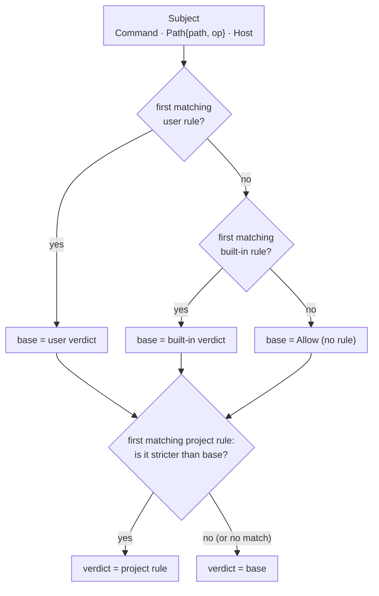

# Policy model v2: contract (P2.1)

Part of Phase 2 of [`trust-defaults-daemon-2026-11.md`](trust-defaults-daemon-2026-11.md)
(§6.4, task P2.1). This file is the contract that the tests in
`crates/hone-config/tests/policy_v2.rs` encode. Later tasks build on it:

- P2.2 wires `CompiledPolicy::evaluate_all` into the agent loop.
- P2.3 maps `ask` to "requires approval" in headless runs.
- P2.5 supplies the built-in rule set.

P2.1 itself ships only the model, the precedence rules, TOML loading (v1 and v2) and
validation. It has no callers yet.

## 1. Model



- **Subjects** are what a tool call touches:
  - `Subject::Command(String)`: a shell command line;
  - `Subject::Path { path, op }`, where `op` is a `PathOp`, either `Read` or `Write`;
  - `Subject::Host(String)`: a network host.
- **Rules** have one matcher (`command`, `path` or `host`), a `decision` (`allow`, `ask`
  or `deny`), an optional `id`, and, for path rules only, an `op` filter: `read`, `write`
  or `any`. The default is `any`.
- **Layers**, in order:
  1. `Builtin`: the shipped defaults, passed in by the caller and supplied by P2.5.
  2. `User`: `~/.config/hone/permissions.toml`. The user owns the machine, so user rules
     **replace** the built-in verdict for subjects they match.
  3. `Project`: `<workdir>/.hone/permissions.toml`. A project directory is untrusted, so
     its rules can only **tighten**.
- **Strictness** runs `Allow < Ask < Deny`.

## 2. Evaluation (normative)

1. Within each layer the **first** rule whose matcher matches the subject wins. This is
   the v1 semantics.
2. The base verdict is the user layer's first match. If the user layer has no match, it
   is the built-in layer's first match. If neither matches, it is
   `Verdict { decision: Allow, rule_id: None, layer: None }`.
3. Let *p* be the project layer's first match. If *p*'s decision is **strictly** stricter
   than the base decision, the verdict is *p*. Otherwise the verdict is the base. So a
   project `allow` never changes anything, and a project rule that only equals the base
   doesn't change it either.
4. `evaluate_all(&[Subject])` evaluates each subject and returns the strictest verdict.
   On a tie, the earliest subject wins. An empty slice gives the default `Allow`.
5. Evaluation never touches the filesystem and never compiles globs. All globs are
   compiled once in `CompiledPolicy::compile`.

## 3. Matching

### Command

- Commands are matched with the v1 semantics of `permissions::Rule::matches`:
  - **Glob:** a pattern containing `*` or `?` is a glob and must match the whole command.
    `*` also matches `/` and spaces.
  - **Literal:** any other pattern is a literal prefix at a word boundary. The command
    either equals the pattern or starts with the pattern followed by a space or a tab.
    A newline is **not** a word boundary, so an allow for `cargo test` doesn't match
    `cargo test\nrm -rf ~`.
- Leading and trailing whitespace is trimmed from the subject before matching. A pattern
  with leading or trailing whitespace is an `InvalidRule`, because it could never match a
  trimmed subject.
- Matching is case-sensitive.
- A command subject is matched as one string. Splitting compound commands (`;`, `&&`,
  `|`, newlines) and normalising argv[0] is the caller's job (P2.2): an allow for
  `cargo *` matches `cargo test; rm -rf ~` here.

### Path

**Pattern expansion** happens once, at compile time:

- `PolicyContext::workdir` must be absolute, and so must `home` when it is `Some`.
  Otherwise `compile` returns `PermissionError::InvalidContext`. Callers pass the
  canonical workdir.
- Before substitution, `workdir` and `home` are lexically normalised and then
  glob-escaped. Escaping covers `* ? [ ] { }` **and `\`**, because globset treats `\` as an
  escape character. So a workdir such as `/tmp/a\b` or `/work/a[1]` matches literally.
- A leading `~/` (or a bare `~`) becomes `PolicyContext::home`. If `home` is `None`, the
  rule can never match, and `compile` logs a warning naming the rule.
- `{workdir}`, anywhere in the pattern, becomes `PolicyContext::workdir`.
- After expansion, an absolute pattern is used as is, and so is one that starts with
  `**`. Any other pattern is joined onto the workdir, so `src/**` means
  `{workdir}/src/**`.
- The expanded pattern is then lexically normalised in the same way as subjects (see
  below), so `{workdir}/../x/**` means `/x/**`. A `..` that can't be resolved, because it
  follows a segment containing glob characters (`/a/**/../b`), makes the rule an
  `InvalidRule`.
- `**` must be a whole path segment. `**secret` or `a**` is an `InvalidRule`, because
  globset would silently read it as `*`.
- A bare `~` matches only the home directory itself, not its children.

**Globs:**

- `*` and `?` don't cross `/`; `**` does. In `globset` terms this is
  `literal_separator(true)`.
- Case-sensitive.
- A pattern ending in `/**` also matches the directory itself. So `~/.ssh/**` matches
  `~/.ssh`, because listing the directory reveals key names.

**Subject normalisation:**

- A relative path is joined onto the workdir. A subject that starts with `~` is a
  relative path like any other: it is joined onto the workdir and never expanded.
- The path is then lexically normalised: `.` is removed, `..` pops a component and never
  goes above `/`, and a trailing slash is dropped.
- Symlinks are **not** resolved and the filesystem is never read. Canonicalising is the
  caller's job; in P2.2 the file tools pass the path they actually open.
- Paths are matched as paths (bytes on Unix), never through a lossy UTF-8 conversion.
  So two different non-UTF-8 names can't collide.

**The `op` filter:**

| Rule `op` | Matches subject `op` |
|---|---|
| `any` | `Read` and `Write` |
| `read` | `Read` only |
| `write` | `Write` only |

### Host

**Subject normalisation**, in order:

1. A subject may contain only ASCII letters, digits, `-`, `_`, `.`, `:`, `[` and `]`.
   Anything else is **malformed**: `@`, `/`, `?`, `#`, `%`, `,`, `\`, whitespace, a control
   character or any non-ASCII character. This is an allow-list of characters, not a
   deny-list.
2. `[v6]` or `[v6]:port`: the brackets and the port are removed, and the inside must
   parse as an IPv6 address. Otherwise the subject is malformed.
3. Otherwise, a subject with exactly one `:` is `host:port`. The port must be all digits
   and is removed; anything else is malformed. A subject with more than one `:` must
   parse as an IPv6 address, or it is malformed.
4. The host is lowercased and **every** trailing `.` is removed. An empty result is
   malformed.
5. A host that parses as an IP address is rewritten in canonical form with `std::net`.
   An IPv4-mapped IPv6 address becomes plain IPv4, so `::ffff:127.0.0.1` is
   `127.0.0.1`, and `0:0:0:0:0:0:0:1` is `::1`.

A malformed host subject can never be allowed. The rules are still evaluated against
the raw subject, lowercased, and the verdict is the **stricter** of that result and
`Verdict { decision: Ask, rule_id: Some("builtin:invalid-host"), layer: Some(Builtin) }`.
On a tie, the `invalid-host` verdict wins. So a user `host = "*"` deny still denies
`user@evil.com`, and a malformed host never comes out looser than `Ask`. The id contains
`:` and isn't numeric, so it can't collide with an explicit or automatic id.

**Patterns** go through the same steps at compile time, with three differences:

- Glob characters `*`, `?` and `[...]` are allowed. A whole pattern of the form `[...]`
  whose inside parses as IPv6 is an IPv6 literal, not a character class.
- A pattern with a port, or any other `:` outside an IPv6 literal, is an `InvalidRule`.
  Ports aren't part of host rules.
- A non-ASCII pattern, or one containing `@`, `/`, `#`, `\` or whitespace, is an
  `InvalidRule`. Write internationalised names in punycode (`xn--…`).

The pattern is a glob over the whole normalised host, and `*` matches dots. So
`*.example.com` matches `a.b.example.com` but not `example.com`.

**Not in P2.1:**

- IDNA/UTS-46 mapping: non-ASCII subjects ask instead.
- The numeric IPv4 forms `inet_aton` accepts (`127.1`, `2130706433`, `0x7f.0.0.1`):
  P2.2 canonicalises them where it extracts hosts.
- Host rules match names, not resolved addresses (`169.254.169.254.nip.io`, DNS
  rebinding). Protecting loopback and cloud-metadata addresses needs a check of the
  resolved IP at connect time (P2.2/P2.5).

## 4. Rule IDs

- An explicit `id` is used as is. It must match `[A-Za-z0-9._-]{1,64}`. That keeps
  terminal escapes and invisible characters out of approval prompts and audit logs, and
  keeps `:` reserved for automatic ids.
- Otherwise the id is `"{layer}:{n}"`. `layer` is `builtin`, `user` or `project`, and `n`
  is the 1-based index of the rule within that layer, for example `user:2`. Rules with
  explicit ids count towards the index, so in `[explicit, auto]` the second rule is
  `user:2`.
- Explicit ids must be unique across all three layers. A duplicate gives
  `PermissionError::DuplicateRuleId(id)`.

## 5. TOML

```toml
version = 2            # optional; absent, 1 and 2 are all accepted

[[rules]]
id = "allow-cargo"     # optional
command = "cargo *"
decision = "allow"

[[rules]]
path = "~/.ssh/**"
op = "read"            # path rules only; read | write | any (default any)
decision = "deny"

[[rules]]
host = "*.pypi.org"
decision = "allow"

[[rules]]              # v1 spelling, still accepted: `match` means `command`
match = "git push*"
decision = "ask"
```

- **`load_policy_file(path)`** returns `Vec<PolicyRule>`:
  - a missing file gives `Ok(vec![])`;
  - the path must resolve to a **regular file**. A directory, FIFO, socket or device
    gives `PermissionError::UnsafeFile { path, reason }`, checked before the file is
    opened, so a FIFO can't block the loader. Symlinks are followed here;
  - at most **64 KiB** is read. A larger file gives `UnsafeFile` (no unbounded read from
    `/dev/zero` and the like);
  - any other I/O error gives `PermissionError::Io`;
  - a syntax error, or an unknown key in a rule or at the top level, gives
    `PermissionError::Toml(msg)`. `msg` is the parser's message **cut at its first
    backtick, double quote or single quote**, with control characters removed, plus
    `line:column`. It **never contains text from the file**. Parser messages quote keys
    and values, and the error could reach a terminal, a log or the model. A project
    file can carry terminal escapes (an OSC 52 clipboard write) or text addressed to the
    model;
  - a `version` other than 1 or 2 (0 and negatives included) gives
    `PermissionError::UnsupportedVersion(v)`, where `v` is an `i64`.
- Malformed rules still **parse**. A rule with no matcher or several, or an `op` on a
  rule that isn't a path rule, loads without error and is rejected by `compile`.
- **Validation** happens in `compile`. Any of the following gives
  `PermissionError::InvalidRule { layer, index (1-based), reason }`:
  - a rule with zero or more than one of `command`, `match`, `path` and `host`;
  - an `op` on a rule that isn't a path rule;
  - an empty pattern, or one longer than 1024 bytes;
  - a pattern or explicit id containing a control character (`char::is_control`);
  - an invalid explicit id;
  - the pattern-specific cases in §3 (whitespace around a command pattern, an
    unresolvable `..` or a partial `**` in a path pattern, a port or non-ASCII in a host
    pattern).

  A glob that doesn't compile gives `PermissionError::InvalidGlob`. More than **1000
  rules** in one layer gives `PermissionError::TooManyRules { layer, count, max }`. This
  keeps a hostile project file from slowing every tool call: at 20,000 rules, `evaluate`
  took 5.6 ms.
- **`CompiledPolicy::load_hierarchical_with_paths`** propagates every error. The policy
  fails closed and the caller decides what to do. The v1 loader, by contrast, silently
  ignored broken files. Neither the **project** path nor any of its ancestors strictly
  inside `ctx.workdir` may be a symlink; a symlink gives `UnsafeFile`. So
  `<workdir>/.hone/permissions.toml` with a symlinked `.hone` is refused here too. The
  user path may be a symlink, because dotfile managers symlink `~/.config` files.
- Every `Display` of a `PermissionError` that carries text from input escapes control
  characters (`char::escape_default` style), so no raw ESC or BEL ever reaches output.
  That covers `InvalidGlob.pattern`, `UnsafeFile.path`, `InvalidRule.reason`,
  `DuplicateRuleId` and `InvalidContext`. This backs up the compile-time check above.
- The type check and the open are separate steps, so there is a small race between
  them. Closing it needs `O_NOFOLLOW | O_NONBLOCK` and `fstat`, which isn't done in
  P2.1.
- **`CompiledPolicy::load_hierarchical`** reads:
  - user: `<home>/.config/hone/permissions.toml`, where `home` is `ctx.home`, on every
    platform, including macOS, like hone's other user-level loaders. `dirs_next::config_dir()`
    would be `~/Library/Application Support` there. With `ctx.home == None` it returns
    `InvalidContext`; it never falls back to a relative path;
  - project: `<workdir>/.hone/permissions.toml`. If `.hone` itself is a symlink, the
    result is `UnsafeFile`.

## 6. Rust API (`hone_config::policy`, re-exported at the crate root)

```rust
pub enum Subject { Command(String), Path { path: PathBuf, op: PathOp }, Host(String) }
pub enum PathOp { Read, Write }
pub enum OpFilter { Read, Write, Any }            // serde: "read" | "write" | "any"
pub enum Layer { Builtin, User, Project }          // serde: lowercase
pub struct PolicyContext { pub workdir: PathBuf, pub home: Option<PathBuf> }
pub struct Verdict { pub decision: Decision, pub rule_id: Option<String>, pub layer: Option<Layer> }

pub struct PolicyRule { /* serde shape of one [[rules]] entry */ }
impl PolicyRule {
    pub fn command(pattern: impl Into<String>, decision: Decision) -> Self;
    pub fn path(pattern: impl Into<String>, op: OpFilter, decision: Decision) -> Self;
    pub fn host(pattern: impl Into<String>, decision: Decision) -> Self;
    pub fn with_id(self, id: impl Into<String>) -> Self;
}
impl From<&permissions::Rule> for PolicyRule;      // v1 rule -> command rule

pub fn load_policy_file(path: &Path) -> Result<Vec<PolicyRule>, PermissionError>;

pub struct CompiledPolicy { /* compiled matchers */ }
impl CompiledPolicy {
    pub fn compile(ctx: &PolicyContext, builtin: &[PolicyRule], user: &[PolicyRule],
                   project: &[PolicyRule]) -> Result<Self, PermissionError>;
    pub fn evaluate(&self, subject: &Subject) -> Verdict;
    pub fn evaluate_all(&self, subjects: &[Subject]) -> Verdict;
    pub fn load_hierarchical_with_paths(ctx: &PolicyContext, builtin: &[PolicyRule],
                   user: &Path, project: &Path) -> Result<Self, PermissionError>;
    pub fn load_hierarchical(ctx: &PolicyContext, builtin: &[PolicyRule])
                   -> Result<Self, PermissionError>;
}
```

- `Decision` and `PermissionError` are shared with the v1 module (`permissions.rs`).
- `PermissionError` gains these variants: `InvalidRule { layer, index, reason }`,
  `DuplicateRuleId(String)`, `UnsupportedVersion(i64)`,
  `TooManyRules { layer, count, max }`, `UnsafeFile { path, reason }` and
  `InvalidContext(String)`.
- The v1 `PermissionPolicy` API and its tests stay unchanged.

## 7. Out of scope for P2.1

- The built-in rule set (P2.5).
- Splitting compound shell commands, and extracting the paths a command touches (P2.2).
- Headless semantics and `--approve` (P2.3).
- Audit logging (P2.7).
- Canonicalising symlinks (P2.2, in the tools).

## 8. Obligations on P2.2 (from the P2.1 security review)

- **Case-insensitive filesystems.** APFS and NTFS are case-insensitive by default, and
  matching here is case-sensitive, so a key file under `~/.SSH` doesn't match a rule
  for `~/.ssh/**`. `canonicalize` returns the on-disk case for paths that exist. P2.2
  must canonicalise the longest existing prefix, and either fold the case of the leaf on
  macOS and Windows or add `PolicyContext::case_insensitive_paths`, which would feed
  `GlobBuilder::case_insensitive`.
- **Commands.** Split compound commands and newlines, collapse whitespace, and match
  argv[0] by basename. On case-insensitive systems, fold argv[0]'s case too:
  `GIT push` runs git on macOS.
- **Paths.** Canonicalise before calling `evaluate`. Lexical `..` handling is wrong for
  `link/../x` unless the path was canonicalised first. Add a test for this.
- **Hosts.** Canonicalise the numeric IPv4 forms, and check resolved IPs at connect
  time.
- **Shell quoting and line continuations.** `g''it push`, `"git" push` and
  `git\<newline> push` all evade a literal deny of `git push`. P2.2 must unquote and join
  continuations, or **ask** when it can't parse a command. Command rules are a speed
  bump, not a security boundary; the sandbox (Landlock or Seatbelt) is the boundary.
- **Displaying policy text.** Escape control characters in any rule text, id or policy
  error before it is shown in an approval prompt (P2.3), in `explain` (P2.6) or in the
  audit log (P2.7).
- **Error context for `hone policy explain` (P2.6).** File errors should name the layer
  and path. `DuplicateRuleId` should name both occurrences, and `InvalidGlob` should
  name the layer and index.
