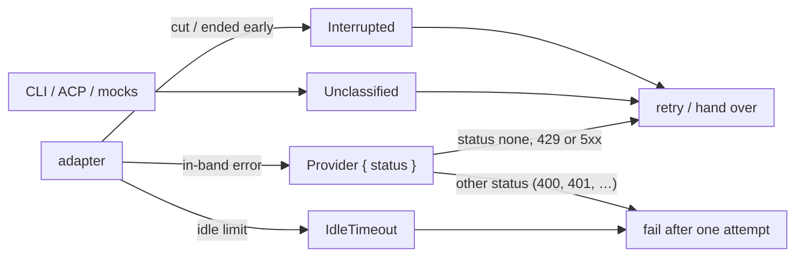

# Carry what kind of failure a stream error is — spec

**Date:** 2026-11-10 · **Branch:** `fix/provider-error-code` · **Follows:** PR #85

## 1. The problem

`ProviderEvent::Error` carries only a `message: String`. Since PR #85 a response that fails
before any output is retried by the agent and handed to the next provider by
`FallbackChain` / `TierFallbackProvider`, but with nothing but text to go on:

- **Errors a retry cannot fix are retried.** Providers report errors inside the stream
  with a code: OpenAI-compatible servers send `{"error": {"code": 400, …}}` (vLLM,
  LiteLLM `"code": "400"`, OpenRouter `"code": "server_error"`), Anthropic sends
  `{"type": "error", "error": {"type": "invalid_request_error", …}}`. The adapters keep
  only the message, so "maximum context length exceeded" is sent three times with the
  whole conversation (two extra requests, about 2 s, before the same error).
- **The idle-timeout exemption reads message text.** PR #85 recognises Hone's own idle
  timeout by the prefix `<provider> response timed out: `, so an in-band provider message
  that happens to start that way is also exempt (review finding, fails safe).

## 2. Contract

| # | Requirement | Test |
|---|---|---|
| E1 | **The event carries a kind.** `ProviderEvent::Error { message: String, kind: StreamErrorKind }`. New public type in `hone-proto` (re-exported at the crate root like `ProviderEvent`): `#[non_exhaustive]` enum `StreamErrorKind`, `Clone, Copy, Debug, Default, PartialEq, Eq, Serialize, Deserialize`, variants `Unclassified` (the default), `Interrupted`, `IdleTimeout`, `Provider { status: Option<u16> }`. The field is `#[serde(default)]`: JSON without `kind` deserialises as `Unclassified`. Messages are unchanged everywhere | Serde round trip of every variant; `{"type":"error","message":"x"}` → `kind == Unclassified` |
| E2 | **Transport failures are classified** in `StreamProgress::end_events` (all three HTTP adapters): a cause with `reqwest::Error::is_timeout()` → `IdleTimeout`; any other cause (cut, reset) → `Interrupted`; a clean end without the completion marker → `Interrupted` | Raw-server tests (as in `stream_transport_error.rs` / `stream_idle_timeout_message.rs`): stall → `IdleTimeout`, cut → `Interrupted`, clean end without marker → `Interrupted`, for openai, anthropic and ollama |
| E3 | **In-band errors carry the provider's status** as `Provider { status }`. **OpenAI-compatible** error object, first match wins: `error.code` an integer in 100–599; `error.code` a string of digits whose value is in 100–599; `error.code` a string in the name table; `error.type` a string in the name table; otherwise `None`. An `error` that is a plain string, or `finish_reason: "error"` without an error object → `Provider { status: None }`. **Anthropic** `error` event: `error.type` via the name table, otherwise `None`. **Ollama** `{"error": …}` → `Provider { status: None }` | One test per rule, including vLLM `"code": 400`, LiteLLM `"code": "400"`, OpenRouter `"code": "server_error"` → 500, a code out of range (`"code": 42`) and an unknown name → `None`, Anthropic `overloaded_error` → 529 and `invalid_request_error` → 400, Ollama → `None` |
| E4 | **Name table** (exact, case-sensitive): `invalid_request_error` 400, `authentication_error` 401, `permission_error` 403, `not_found_error` 404, `request_too_large` 413, `rate_limit_error` 429, `api_error` 500, `overloaded_error` 529, `server_error` 500, `context_length_exceeded` 400, `rate_limit_exceeded` 429 | Covered by E3 tests; one test per entry is fine |
| E5 | **One rule for a transient status.** New `pub fn is_transient_status(status: u16) -> bool` in `hone-proto`: `true` for 429 and 500–599. `ProviderError::is_transient()` uses it for `Http` (no behaviour change). New `StreamErrorKind::is_retryable(&self) -> bool`: `Unclassified` → `true`, `Interrupted` → `true`, `IdleTimeout` → `false`, `Provider { status: None }` → `true`, `Provider { status: Some(s) }` → `is_transient_status(s)` | Table tests for both functions, including the boundaries 428, 429, 430, 499, 500, 599, 600 |
| E6 | **Retries and hand-overs use the kind, not the text.** A failure before output is retried by the agent and handed over by `FallbackChain` / `TierFallbackProvider` only when its `kind.is_retryable()` (and, as before, the provider does not run its own tools and the request is not cancelled). Otherwise it fails after one attempt exactly as an idle timeout does since PR #85: one `AgentEvent::Error` with the message unchanged; the wrappers pass it on without trying another provider. `is_idle_timeout_message` (the text check) is removed | Agent, `max_attempts = 3`: `[Error{Provider{400}}]` → 1 call; `[Error{Provider{529}}]` then success → 2 calls; `[Error{Provider{None}}]` then success → 2 calls; `[Error{IdleTimeout}]` → 1 call; an `Unclassified` error whose message starts with `openai response timed out: ` **is** retried. `FallbackChain` [A `Provider{401}`, B ok] → A's error, B not called; [A `Provider{503}`, B ok] → B. `TierFallbackProvider` likewise |
| E7 | **The kind survives every layer:** the probe's replay of a failure (`StreamFailure` keeps the kind), `FallbackChain` / `TierFallbackProvider` reporting the last failure, `CachingProvider` — the caller sees the same `Error` event (message and kind) the provider produced | Wrapper and probe tests compare the whole `Error` event, not only the message |
| E8 | **End to end:** through the `hone` binary (`--json`, OpenAI-compatible mock), an in-band error before any output with `"code": 400` gets exactly 1 request and `success: false` with the provider's message; with `"code": 502` or `"code": "server_error"` the request is retried (always failing → 3 requests; failing once → 2 requests and `success: true`) | Request-counting mock as in `bins/hone/tests/stream_retry_entry.rs` |

Unchanged: every error message (including `response timed out` / `response interrupted`),
`AgentEvent`, `ProviderError` and its variants, everything else in PR #84 / #85.
CLI adapters, ACP, `MockProvider` and other producers emit `Unclassified` (they run their
own tools or are test doubles, so their errors keep today's handling).

## 3. Order of work

1. **Mechanical refactor (no behaviour change):** add `StreamErrorKind` (variants only, no
   methods) and the `kind` field; every producer sets `Unclassified`; patterns gain `..`;
   existing tests updated mechanically (literal gains `kind: …Unclassified`), all green.
2. **Red:** new tests for E1–E8 against the new type; `is_retryable` and
   `is_transient_status` do not exist yet, so keep their tests in one file.
3. **Green:** the methods, the adapter classification, and the probe using the kind.

## 4. Out of scope (follow-ups)

- A stream error that fails the turn is still turned into `ProviderError::Http { status: 0 }`
  in the agent; it could carry the in-band status.
- Request errors with HTTP status 0 (connection failures) are still never retried (PR #85
  follow-up).
- CLI and ACP providers do not classify their errors.
