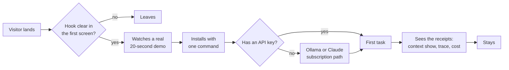
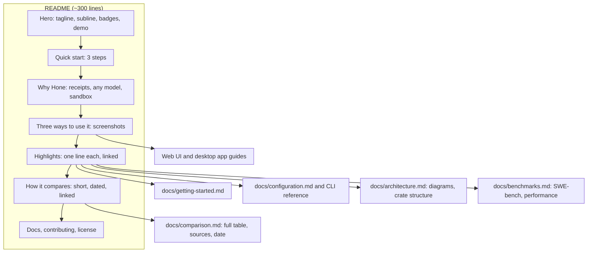
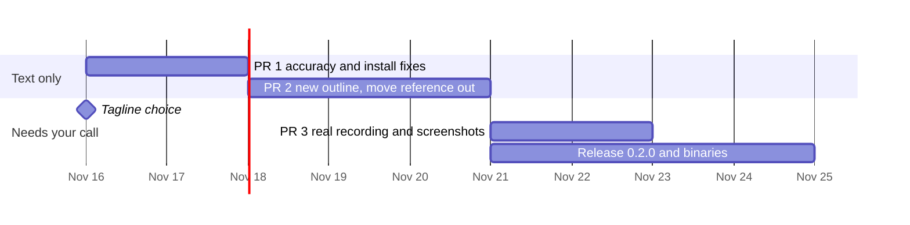

# README refresh: the hook, the visuals, the first five minutes

*2026-11-13. Line numbers refer to `README.md` on main at `c69fa98`.*

The README decides whether a visitor tries Hone. Today a visitor sees a retired tagline, a hand-drawn demo and 1,525 lines. The quick start is at line 945, and the recommended install command gives them a months-old build. This plan fixes the hook first, then the first run, then the layout.

## 1. What a visitor sees today

| Problem | Where | Effect |
|---|---|---|
| The tagline is "The Universal Terminal AI Code Agent". The August strategy retired it in favour of "agents with receipts". | Line 10 | Hone sounds like every other coding agent. |
| The demo is a hand-drawn SVG of a one-line Python fix. The README says itself that it isn't a recording. | Lines 31–84 | No proof that the product works, and nothing that is unique to Hone. |
| The badges show "tests 4300+", but main has 5,469. "SWE-bench 19.3%" is the second badge. | Lines 22–27 | A stale number, and the first comparison a visitor makes is on the axis Hone loses. |
| The recommended install is `cargo install hone-cli honed` from crates.io. Both crates are 0.1.0 from the spring, and `hone --version` prints 0.1.0 for every build. | Lines 868–883, 911–916 | New users get a build months older than the README describes. Nobody can tell which build they have. |
| The quick start is at line 945, after Benchmarks, Architecture and Installation. The README is 1,525 lines long. | Whole file | The first run is buried under reference material. |
| The text contradicts itself. "Hone is terminal-only (web UI planned)" and "Desktop GUI → Goose" appear, while lines 346–700 document a web UI and a desktop app. | Lines 1427, 1430, 1454 | Readers stop trusting the other claims. |
| Some comparison cells look out of date: Claude Code with no multi-agent support or cost tracking, Codex CLI with no MCP and "OpenAI only". | Lines 1405–1418 | This is the section competitors' users check first. |
| Some claims can't be checked, such as "Intelligence compounds… making the agent smarter with use". | Line 125 | It breaks the strategy's claim discipline: say "evidence", not "proof". |
| `demo.gif` (6.3 MB) and `demo.mp4` (3.5 MB) sit at the repo root unused. | Repo root | Every clone carries 10 MB that nobody sees. |

## 2. The hook

Three candidates:

| Hook | Unique to Hone? | Demo in 20 s? | True on main today? |
|---|---|---|---|
| **A. Agents with receipts:** see what the agent saw, did and spent | Yes. No other terminal agent has per-call context receipts plus an egress log. | Yes | Yes: `hone context show`, `hone trace`, `hone strategies`, `hone reports diff`, permission prompts, injection warnings |
| B. Any model, local or cloud, inside a kernel sandbox | Partly. Goose, OpenCode and Aider also run any model. | Partly | Yes, with Landlock opt-in on Linux |
| C. Multi-agent orchestration | Weak, since Claude Code has subagents | Hard | Yes |

**Recommendation: lead with A and use B as the supporting line.** A matches the strategy, can be shown in one short recording, and every word of it is true today.

Draft hero copy:

> **The coding agent that shows its receipts.**
>
> Hone runs any model, cloud or local, inside a kernel sandbox. It records what the model was given, what it touched and what it cost, so you can check every run.
>
> - **What it saw:** `hone context show` lists the memories, skills, files and token counts sent on each model call.
> - **What it did:** `permissions.toml` decides which tools need your approval, and `hone trace` shows every network call.
> - **What it cost:** a live cost per turn, budget caps, and `hone reports diff` to compare runs.

Wording rules from the strategy apply: "evidence" and "recorded", never "proof of honest execution".

## 3. Visual changes

1. **A first screen that fits on one screen.** Keep the logo lockup, then show:
   - the tagline and a one-sentence subline;
   - at most three badges: latest version, license, platforms;
   - the demo.

   Move the tests and SWE-bench badges into the Benchmarks page, with the date and model next to each number.
2. **A real recording instead of the SVG.** Record it with VHS, so the `.tape` is committed and anyone can re-record it. The script, about 20–30 s:
   - a one-line task in a small sample repo;
   - the permission prompt appears and is approved;
   - the agent finishes;
   - `hone context show` lists what the model was given;
   - `hone trace` lists the network calls.

   Use a local Ollama model, so it costs nothing and anyone can reproduce it. Keep the GIF under 3 MB, or upload an MP4 through GitHub's attachment URL so it isn't in the repo.
3. **"Three ways to use it", with pictures.** One screenshot each of the terminal UI, the web UI and the desktop app, side by side. Today these are text walk-throughs only, and the repo has no screenshots.
4. **One diagram, about receipts.** Replace the README's orchestration-pattern diagram with one showing where receipts are recorded: model call, tool call, network call, cost. Move the existing three Mermaid diagrams to `docs/architecture.md`.
5. **GitHub callouts for caveats:**
   - `> [!NOTE]` for "Landlock is opt-in on Linux" and "Windows isn't supported";
   - `> [!WARNING]` for anything that spends money.

   Use `
` for long examples.
6. **Social preview:** update `assets/social-preview.png` with the new tagline, and set it in the repo settings.
7. **Housekeeping:** move or delete the unused root `demo.gif`, `demo.mp4` and `demo.tape`.

## 4. The first five minutes

1. **Quick start right after the hero, in three steps:** install, choose a model, run a first task. Link to `docs/getting-started.md` for everything else.
2. **Make the install command give the current build.**
   - **Now:** `cargo install --locked --git https://github.com/wojciechkpl/hone hone-cli honed`.
   - **Then:** publish 0.2.0 to crates.io.
   - **Later:** prebuilt binaries on GitHub Releases plus a Homebrew tap, so people without Rust can try it. `.github/workflows/release.yml` already builds Linux x86_64 and macOS (Intel and Apple Silicon) binaries on a `v*` tag. GitHub Actions are off for the repo, so they'd need turning on for releases.
3. **Make `hone --version` print the git commit and build date,** so stale builds are obvious to users, and in bug reports.
4. **A path with no API key, written up as fully as the API-key path:**
   - **Ollama:** `hone configure` already offers it, with the default local address.
   - **A Claude subscription:** the `claude-cli:` adapter lets Claude Code subscribers use Hone without an API key. That's a strong on-ramp, and nobody would guess it from today's README.
5. **A sample repo to try it on,** for example `examples/first-task/` with one failing test. The first run then works the same for everyone and shows the receipts.
6. **A short troubleshooting box:**
   - no provider found;
   - the Linux sandbox is opt-in;
   - Windows isn't supported;
   - a stale `~/.cargo/bin/hone` on PATH.

## 5. A shorter README

Target about 300 lines, and move reference material into `docs/`, which the Pages site already publishes.

Sections to move out of the README:

| Section | Moves to |
|---|---|
| Built-in Agents and Recipes, When to Use What | `docs/` agents and recipes guide |
| Remote Access & Web UI, Desktop App | Web UI and desktop guides |
| Benchmarks | `docs/benchmarks.md` |
| Architecture, Crate Structure | `docs/architecture.md` |
| Configuration, CLI Reference | `docs/configuration.md` and a CLI reference page |
| Testing | `CONTRIBUTING.md` |

"What's new" stays as a short list of five recent items, with the rest in `docs/changelog.md`.

## 6. Accuracy pass

These fixes are needed whatever happens to the layout:

- Update or drop the stale tests badge.
- Put a date on the comparison table and cite a source for each competitor cell. Fix the "terminal-only" and "web UI planned" contradictions.
- Rewrite "Intelligence compounds…" as something you can check, for example: "remembers what worked, and you can inspect and prune those memories with `hone memory`".
- Show each SWE-bench number with its date, model and subset.

## 7. Personal details and secrets

The audit is done, and the fixes are in #118.
- **No secrets** in the current files or anywhere in git history. Every key-shaped string is a test fixture or a labelled canary.
- **Three personal details removed:** an email in `CITATION.cff`, a home-directory path, and a LAN hostname.

To keep it that way:
- Add a `gitleaks` pre-commit hook, with a `.gitleaks.toml` that allows the known fixtures.
- Set `user.email` for this repo to the GitHub noreply address. Commit metadata on main carries personal addresses. That history is already public; rewriting it would need a force-push.
- `.claude/agent-memory/` is in `.gitignore`, but two files there are tracked. Decide whether to untrack them.

## 8. Rollout

| Step | Contents | Needs your decision? |
|---|---|---|
| PR 1 | New tagline and subline, three badges, install from git, version with commit, accuracy fixes | The tagline |
| PR 2 | The ~300-line outline, reference moved to `docs/`, a sample repo for the first task | No |
| PR 3 | VHS recording, three screenshots, social preview | Which model records the demo (local Ollama costs nothing) |
| Release | crates.io 0.2.0, GitHub Release binaries from the existing `release.yml`, Homebrew tap | Yes: turning Actions on, and when to publish |
