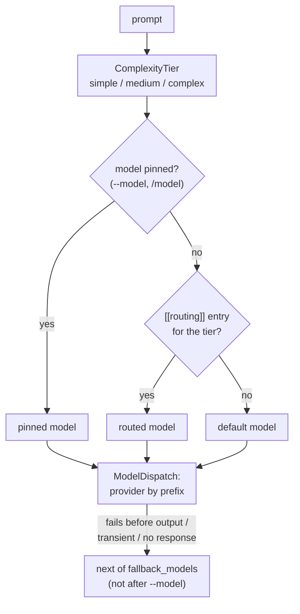

# Route each turn's model by complexity, and fall back to other models — spec

**Date:** 2026-11-10 · **Branch:** `fix/routing-wiring` · **Follows:** PR #81, #85, #86

## 1. The problem

- **`[[routing]]` is parsed and ignored.** `config.toml` accepts `[[routing]] task = … model = …`,
  but nothing reads it (PR #81 added a warning). Its example task names (`file_read`,
  `multi_file_edit`) come from the first scaffold and were never produced by anything. The
  May roadmap (`docs/research/competitive-analysis-2026-05.md`) planned routing by complexity:
  "simple → DeepSeek/Qwen, medium → Sonnet, complex → Opus". The TUI already sorts every
  prompt into a `ComplexityTier` (simple / medium / complex), but only to choose how the turn
  runs, always on one model.
- **The fallback wrappers are unused.** `FallbackChain` (fixed in #85 / #86) is not built by
  the `hone` binary; a provider that is down or overloaded fails the turn. It also never
  moves on when the request got no answer at all (HTTP status 0: connection refused, DNS),
  which is the main reason to fall back.
- **`/model` cannot switch providers.** It only replaces `AgentConfig::model`; the provider
  stays the one Hone started with, so `/model openai:gpt-4o` in an Anthropic session sends
  `gpt-4o` to Anthropic. It also leaves the status bar's model label unchanged.

Decided with the user (2026-11-10): `[[routing]]` picks the model per complexity tier, plus a
fallback list of models.



## 2. Contract

### Config (`hone-config`, `resolve`)

| # | Requirement | Test |
|---|---|---|
| G1 | **`[[routing]]` entries.** `task` is one of `simple`, `medium`, `complex` (exact, lowercase); `model` is a model id with an API-provider prefix (`anthropic:`, `openai:`, `ollama:`) and a valid name (`validate_model_name`). A missing or unknown prefix, or an invalid name, is a config error (exit 2), like `default_model`. An unknown `task` (e.g. `file_read`) → one warning, entry ignored. An agent-CLI prefix (`claude-cli:`, `gemini-cli:`) → one warning, entry ignored, in either file. Within one file the first entry for a task wins; a later duplicate warns. Per task, the project file's entry is used before the user file's (same order as `default_model`). The result is exposed on `Effective` as the routed model per tier, each with the path it came from. The "[[routing]] is not applied" warning is gone | Resolver tests: each tier; project overrides user per task while the user's other tiers stay; unknown task warns; CLI prefix warns (user and project); bad prefix and bad name are errors; duplicate warns, first wins; the old fixture (`file_read`, `multi_file_edit`) loads with two warnings and no routing |
| G2 | **`fallback_models`**, a new top-level array of model ids. Same validation as G1 models (error for a bad prefix or name; warning and dropped for a CLI prefix); duplicates are dropped, keeping the first. **Only the user file's list applies** (review round 1, B1): a fallback model is used without notice when the chosen one fails, so a repository could send the session to a provider of its choice, e.g. a project choosing a local Ollama model with `fallback_models = ["openai:…"]`. A project file's `fallback_models` is still validated (bad prefix or name → error) but ignored with one warning, like `[providers.*].base_url`. Exposed on `Effective` with its source path | Resolver tests for each rule; project list ignored with a warning and the user's list kept; `deny_unknown_fields` still rejects other unknown keys |

### Providers (`hone-providers`)

| # | Requirement | Test |
|---|---|---|
| G3 | **`ModelDispatch`**, a new public `ModelProvider`: built from providers keyed by model prefix (`anthropic`, `openai`, `ollama`) and a default model. `complete(request)` forwards to the provider for `request.model`'s prefix, unchanged. A prefix it has no provider for → `Err(ProviderError::ModelNotFound { model, provider })`, without calling anything. `has_provider_for(&ModelId) -> bool`. `id()`, `display_name()`, `supported_models()`, `estimate_tokens()`, `health()` are those of the default model's provider; `runs_own_tools()` is `true` if any member's is | Two recording providers: requests reach the one matching the prefix with the request unchanged (model included); unknown prefix → `ModelNotFound`, no call; `has_provider_for`; `id()` of the default |
| G4 | **Fallback models.** `ModelDispatch::with_fallback(Vec<ModelId>)`. For each request it tries, in order, `request.model` and then each fallback model whose provider it has (skipping one equal to `request.model`), sending each the request with `model` replaced. It moves on exactly when `FallbackChain` does (#85 / #86 rules and G5), carries `Usage` forward, and reports the last failure the way that member reported it; it reuses `FallbackChain` rather than reimplementing it. With no fallback models, behaviour is G3 | Primary fails before output (retryable) → fallback model's provider receives the request with the fallback model id; primary `Err(Http 503)` → fallback; primary `Err(Http 400)` → error, no fallback; primary fails after output → no fallback; fallback equal to the primary is skipped; a fallback whose provider is missing is skipped |
| G5 | **No answer at all moves on.** `FallbackChain` (and so G4) and `TierFallbackProvider` also move to the next member when the request got no response: `ProviderError::Http` with status 0 (connection refused, DNS, TLS, timeout waiting for headers). The agent's own retry is unchanged: it still does not retry status 0 | `FallbackChain` [A `Err(Http 0)`, B ok] → B; `TierFallbackProvider` likewise; agent with `Err(Http 0 "error sending request …")` → 1 call (existing behaviour) |

### Binary (`hone`)

| # | Requirement | Test |
|---|---|---|
| G6 | **Provider set.** When the session model is an API model, `hone` builds a `ModelDispatch` holding every API provider it can build: Anthropic and OpenAI when they have a key, Ollama always (from the resolved settings, as today), default = the session model. Its fallback list is `fallback_models`, **except when the model was chosen with `--model`** (exactly that model: no routing, no fallback). A routed or fallback model whose provider has no key → one warning on stderr, entry dropped. When the session model is an agent-CLI model, nothing changes from today and `[[routing]]` / `fallback_models` produce one warning each ("not applied with an agent CLI model"). Provider gating (`check_provider_gating`) and `HONE_CACHE` work as before | Binary tests (G10) |
| G7 | **The turn's model.** One pure, unit-tested function picks it: the pinned model if any; else the `[[routing]]` model for the turn's tier, if configured and its provider available; else the default model. **One-shot** (plain, `--json`, `--orchestrate`, `--ensemble`): the prompt's tier is `ComplexityClassifier::classify(prompt)`; the run uses that tier's model, `--json` reports it in `model`, and when a routed model is used one line goes to stderr: `hone: using <model> for this <tier> request (from [[routing]] in <path>)`. **TUI:** before each turn, after the tier is chosen, the turn's model is applied (agent model; the orchestrated path's config clone; status bar label and context limit) | Unit tests of the function for every combination; binary tests (G10) |
| G8 | **`/model` switches providers and pins.** `/model <id>` with an API prefix whose provider is in the session's `ModelDispatch` switches model and provider, updates the status bar label and context limit, and pins the model: routing stops for the rest of the session (fallback still applies). An agent-CLI prefix, or a provider without a key, shows an error line and keeps the current model. In a CLI-model session, `/model` behaves as today. **The confirmation line comes only after the check** (review round 1): typing `/model <id>` records the request without announcing a change; `hone` then shows either the confirmation (`Model changed to: <id>`) or the error, never both | Unit test of the validation function the TUI calls (available / CLI prefix / no key → message); `hone-tui` app test: `/model <id>` sets the pending change and adds no "Model changed to" line |
| G11 | **Project routing is announced** (review round 1, like a project `default_model` since PR #81): for each `[[routing]]` entry that comes from the project file and is applied, `hone` prints one line on stderr at start, in every mode: `hone: routing <tier> requests to <model> (from <path>)` | Binary test: project routing for `simple` → that line on stderr; user-file routing → no such line |
| G9 | **Nothing changes without the new config.** No `[[routing]]` and no `fallback_models`: same model, same requests (byte for byte) and the same `--json` output as before | Binary test: request body and `--json` output equal to a run on `main` for the same mock (or pinned golden values) |
| G10 | **End to end** through the binary with raw mocks (OpenAI-compatible via `HONE_OPENAI_BASE_URL`, Ollama via `[providers.ollama].base_url` in the user config) | (a) routing `simple → ollama:…`, default `openai:…`: a short simple prompt reaches only the Ollama mock, a complex prompt only the OpenAI mock; `--json` `model` names the model used; stderr line present for the routed run. (b) `fallback_models = ["ollama:…"]`, OpenAI mock fails before output every time → answer from the Ollama mock, `success: true`. (c) OpenAI base URL on a closed port → Ollama answers (G5). (d) same as (b) with `--model openai:…` → no request to Ollama, `success: false`. (e) routing to `anthropic:…` without an Anthropic key → warning, default model used. (f) routing to `claude-cli:…` → warning, ignored. (g) project routing for `simple` overrides the user's, user's `complex` still applies |

## 3. API names (shared by tests and implementation)

In `hone_config::resolve` (next to the existing `Effective`):

```rust
pub enum Tier { Simple, Medium, Complex }            // Debug, Clone, Copy, PartialEq, Eq
pub struct RoutedModel { pub model: ModelId, pub path: PathBuf }
pub struct TierRouting { /* private */ }             // Debug, Clone, Default, PartialEq
impl TierRouting { pub fn get(&self, tier: Tier) -> Option<&RoutedModel>; pub fn is_empty(&self) -> bool; }
// new fields on Effective:
pub routing: TierRouting,
pub fallback_models: Vec<ModelId>,
pub fallback_path: Option<PathBuf>,                  // the file the list came from

pub struct TurnModel { pub model: ModelId, pub routed_from: Option<PathBuf> }
/// G7: pinned → pinned; else routing[tier] if `available(model)`; else `default`.
pub fn turn_model(eff: &Effective, tier: Tier, pinned: Option<&ModelId>,
                  default: &ModelId, available: &dyn Fn(&ModelId) -> bool) -> TurnModel;
/// G8: Ok(model) for an API prefix with a valid name whose provider is `available`;
/// Err(message for the user) for an agent-CLI prefix, unknown prefix, bad name or
/// unavailable provider.
pub fn check_model_switch(model: &str, available: &dyn Fn(&ModelId) -> bool)
    -> Result<ModelId, String>;
```

`Config` gains `fallback_models: Vec<ModelId>` (`#[serde(default)]`).

In `hone_providers` (re-exported at the crate root):

```rust
pub struct ModelDispatch { /* private */ }
impl ModelDispatch {
    pub fn new(default_model: ModelId) -> Self;
    pub fn with_provider(self, prefix: &str, provider: Arc<dyn ModelProvider>) -> Self;
    pub fn with_fallback(self, models: Vec<ModelId>) -> Self;
    pub fn has_provider_for(&self, model: &ModelId) -> bool;
}
impl ModelProvider for ModelDispatch { /* G3, G4 */ }
```

## 4. Notes for tests

- The binary tests run with `HOME` and the working directory in a temp dir (see
  `bins/hone/tests/stream_retry_entry.rs`); the user config goes to
  `$HOME/.config/hone/config.toml`, the project config to `<wd>/.hone/config.toml`.
- Which prompts are simple / complex: see `crates/hone-core/src/complexity.rs`
  (`ComplexityClassifier::classify`); pick prompts from its own tests.
- The TUI loop itself is not driven by tests; G7/G8 are pinned by the pure functions it
  calls and reviewed by reading.

## 5. Out of scope (follow-ups)

- Cost estimates still use one flat rate ($3 / $15 per million tokens) for every model, so a
  routed or fallback model's cost is estimated at that rate.
- No notice in the TUI or `--json` when a fallback model answered (`--json` `model` names
  the chosen model); the context window reported once per session (`AgentEvent::ModelInfo`)
  is not updated per turn.
- The context budget stays the session model's: a turn routed to a model with a smaller
  window (e.g. Ollama's default `num_ctx`) gets the whole history and the server may
  truncate it silently.
- `HONE_CACHE` stores a fallback model's answer under the requested model's key.
- `ModelRouter` / `TierFallbackProvider` (cost / latency / quality tiers) stay unused: there
  is no config for their tier tables.
- `hone eval`, `hone spec`, recipes and `honed` keep their own provider choice.
- Agent CLIs (`claude-cli:`, `gemini-cli:`) cannot be routed to, used as fallbacks or
  switched to with `/model`: they run their own tools outside Hone's policy, and provider
  gating is checked only at start.
