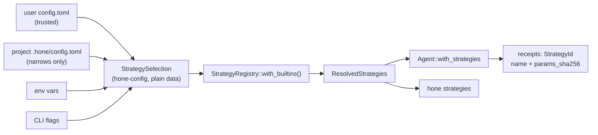

# Strategy registry and `[context]` / `[memory]` config: spec

Branch `feat/strategy-registry`, stacked on `feat/context-show` (PR C). Plan: `docs/plans/pluggable-context-implementation.md`, PRs D and E. Design: `docs/research/pluggable-context-memory-2026-11.md` §4.4–4.5.

## Problem

Hone's context choices are spread across CLI flags (`--no-inject`, `--skeleton-strategy`), environment variables (`HONE_NO_INJECTION`, `HONE_SKELETON_STRATEGY`, read in two places), hard-coded constants (recall top 5, outcome exclusion, the 2,000-token injection budget, trigger-phrase memory writes) and `AgentConfig` fields. `config.toml` can't choose any of them, nothing reports which are active, and there is no seam for a second implementation.

## Scope

This PR adds the seams and the selection for the strategies that **exist today**, each as a built-in that wraps today's code. New strategies come later: `env-snapshot` in PR E, FTS5 in G, embeddings in H, an async LLM compactor in J (which is also when compaction becomes an async trait), `[retrieval]` with G.

## Slots and built-ins

| Slot | Config key | Built-ins (default first) | Parameters (defaults = today) |
|---|---|---|---|
| Context sources | `[context] sources` | `memory-index`, `recall`, `skills`, `skeleton` (all on) | — |
| Skeleton | `[context.skeleton] use` | `adaptive`, `flat`, `dependency-graph`, `call-graph`, `hybrid` | `max_tokens = 2000`, `gap_threshold = 0.4` |
| Compactor | `[context] compactor` | `graduated`, `trim-only` | `[context.graduated] phase = false` |
| Budget | `[context] budget_ratio` | — | the per-model table |
| Recaller | `[memory] recaller` | `bm25`, `none` | `top_k = 5`, `exclude_kinds = ["outcome"]` |
| Writer | `[memory] writer` | `triggers`, `off` | — |

- `graduated` is today's behaviour: tool-result dedup, graduated compression, drop-oldest trimming, and phase compaction (PR A) when `phase` is on, which it isn't by default. `trim-only` keeps only drop-oldest trimming, which is needed to fit the budget.
- `[context.graduated] phase = true` turns on PR A's phase compaction; `HONE_PHASE_COMPACTION` maps to the same key (S2).
- `sources` lists what is on. Block order stays fixed (system prompt with the memory index, recall, skills, history), so the prompt-cache prefix doesn't move; listing sources in another order is accepted and doesn't reorder.

## Rows

| Row | Behaviour |
|---|---|
| S1 | **Config tables parse as plain data.** `hone-config` parses optional `[context]`, `[context.skeleton]`, `[context.graduated]` and `[memory]` into a `StrategySelection`: per slot, the chosen name, its parameters and the file each value came from. Unknown keys are errors (`deny_unknown_fields`), naming the file. `hone-config` doesn't depend on the registry. A file without these tables resolves to the defaults. |
| S2 | **Precedence: flag, then env var, then project file, then user file, then default.** `--skeleton-strategy` and `HONE_SKELETON_STRATEGY` set `context.skeleton.use`. `--no-inject` and `HONE_NO_INJECTION=1` remove `skeleton` from `sources`. `HONE_PHASE_COMPACTION` sets `context.graduated.phase`. The selection records which of these chose each value (`Flag`, `Env(name)`, `File(path)`, `Default`). `ContextInjector` no longer reads `HONE_SKELETON_STRATEGY` itself. |
| S3 | **A project file can only narrow.** In `.hone/config.toml`: `sources` is intersected with the user's; `top_k`, `max_tokens` and `budget_ratio` only take effect when lower than the user's (or default) value, otherwise they're ignored with a warning; `writer` and `recaller` can only be set to `off` / `none`; `[context.graduated] phase` can only be set to `false` (a repository can't turn on a lossy compaction). It may pick any built-in skeleton and compactor. Ignored values produce warnings that name the file, like `fallback_models` today. |
| S4 | **Unknown names fail.** An unknown strategy or source name in any file is an error naming the file and the key, listing the valid names. Through the CLI it exits with code 2 before any model call. |
| S5 | **Traits and registry.** `hone-core` gains a `strategy` module with: • traits `ContextSource` (`id`, `cadence`: `Once` or `EachTurn`, `async gather(&TurnView) -> Vec<ContextBlock>`), `Recaller` (`id`, `async recall(&dyn MemoryStore, &RecallQuery) -> Vec<ScoredMemory>`) and `MemoryWriter` (`id`, `async propose(&TurnRecord) -> Vec<MemoryCandidate>`), each with `fn id(&self) -> &StrategyId`; • `StrategyRegistry::with_builtins()`, explicit `register_*` per slot, `build(&StrategySelection, &StrategyDeps) -> Result<ResolvedStrategies, StrategyError>`, and `list() -> Vec<(slot, name, Origin)>` with `Origin::{Builtin, Feature(String), Plugin(String)}`; • the compactor and skeleton stay enums inside `ResolvedStrategies` for now. |
| S6 | **Built-ins wrap today's code, byte for byte.** With no config, or with a config that spells out every default, the requests a fixed scripted session sends are byte-identical to the previous release (PR B's golden fixture), and receipts carry the same strategy names and `params_sha256` values PR B pinned (for example recall `{"exclude":["outcome"],"limit":5}`). `params_sha256` is the hash of each strategy's effective parameters as compact key-sorted JSON with the internal names. |
| S7 | **Each choice takes effect.** • `skeleton` absent from `sources` → no injection and no `ContextInjected`. • `recall` absent, or `recaller = "none"` → no "Relevant Memories" block and no `MemoryRecalled`. • `skills` absent → no skills block. • `memory-index` absent → no memory index in the system prompt. • `top_k = 2` → at most 2 recalled memories; `exclude_kinds = []` lets outcome logs back in. • `writer = "off"` → no memories recorded from turns. • `compactor = "trim-only"` → no compression, dedup or phase compaction, only trimming. • `[context.graduated] phase = true` → phase compaction runs (PR A's K4/K10 behaviour). • `max_tokens` bounds the injection budget; `budget_ratio` overrides the per-model ratio. Receipts name the active strategies. |
| S8 | **The agent takes strategies without breaking `AgentConfig` literals.** `Agent::with_strategies(Arc<ResolvedStrategies>) -> Self`. An agent built without it behaves as today, deriving its strategies from the existing `inject_context`, `skeleton_strategy` and `embedder` fields. No field is added to `AgentConfig`. |
| S9 | **The CLI and `honed` apply the selection.** The one-shot CLI, the TUI and `honed`'s executor build the selection from config, env and flags and call `with_strategies`. Today `honed` turns injection off; that stays its default (its built-in default `sources` omit `skeleton`), but its config can now turn it on. |
| S10 | **`hone strategies [--json] [--check]`.** Prints each slot: the active strategy, its parameters, its origin, and what chose it (flag, env var name, file path or default), plus any warnings. `--json` prints the same as one object. `--check` prints nothing on success and exits 0; on an invalid config it prints the error and exits 2. |

## Testing notes

- **S1–S4** in `hone-config` (parsing, precedence, trust) and as CLI-level tests for exit codes.
- **S5–S8** in `hone-core` with a scripted mock provider; S6 reuses PR B's golden fixture and receipt pins.
- **S9** where reachable (the CLI's agent builder, `honed`'s executor config).
- **S10** through the binary with a temp `HOME` and project dir.

## Out of scope

- New strategies, `[retrieval]`, `[[plugins]]` and reordering blocks.
- Async compaction (`Compactor` trait), which arrives with the LLM compactor (PR J).
- `hone-eval` using strategies (PR F).
