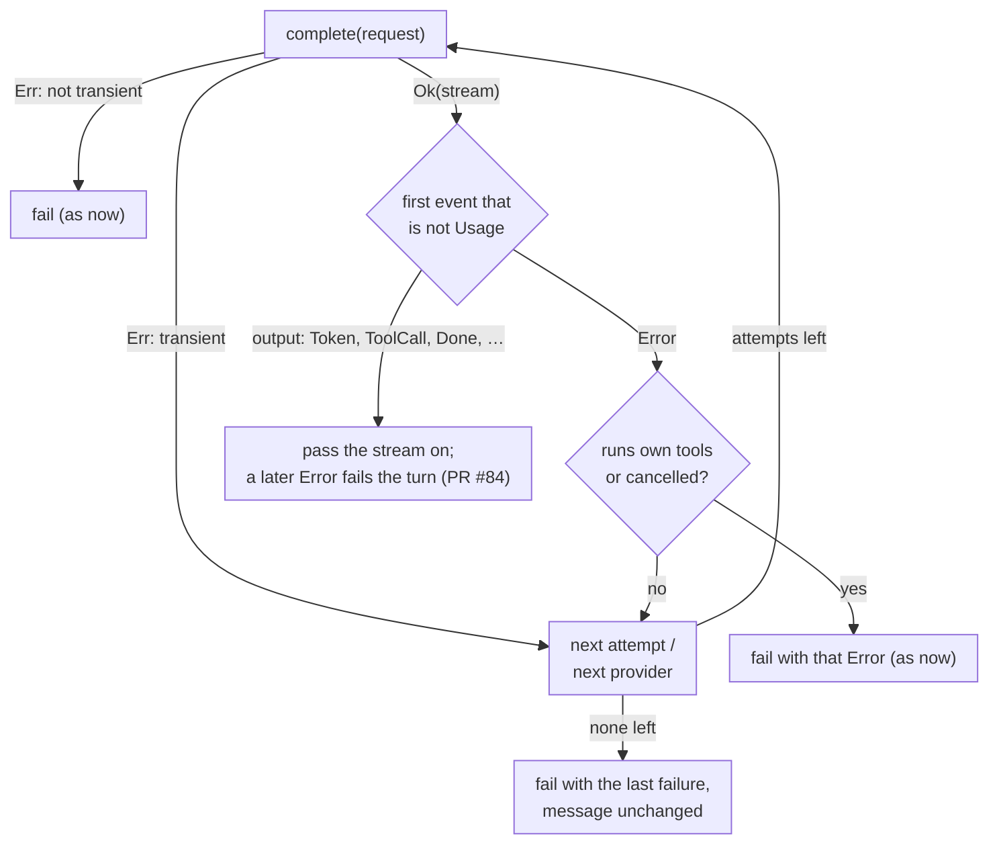

# Retry and fall back when a response fails before any output — spec

**Date:** 2026-11-10 · **Branch:** `fix/stream-retry-fallback` · **Follows:** PR #84

## 1. The problem

Since PR #84 a response that breaks is reported as `ProviderEvent::Error` instead of
looking complete. Nothing retries it or sends it to another provider:

- **The agent retries only the request.** `Agent` wraps `provider.complete()` in
  `retry()` (3 attempts, 500 ms / 1 s backoff), but `complete()` succeeds as soon as the
  `200` headers arrive. An Anthropic `overloaded_error`, an OpenRouter "Provider
  disconnected unexpectedly", a connection reset or an idle timeout that comes *before the
  first token* fails the turn at once, although nothing has been shown and a second
  attempt would be invisible to the user.
- **`FallbackChain` and `TierFallbackProvider` only look at `complete()`'s result.** A
  member whose stream fails before any output is returned as is; the next member is never
  tried.
- **Request errors are classified inconsistently.** The agent decides by text
  (`is_transient_error`: "503", "502", "429", "rate limit", …), so HTTP 500, 504 and
  Anthropic's 529 "Overloaded" are never retried, although the same overload sent in the
  stream would be after this change. `FallbackChain` moves on only for `RateLimit`;
  `TierFallbackProvider` for 5xx / 429 / `RateLimit`.

Decided scope (2026-11-10): **only failures before any output** are retried or sent to
another provider. A break after text has been shown still fails the turn, as in PR #84.

## 2. Definitions

- **Output event:** any `ProviderEvent` other than `Usage` and `Error`, i.e. `Token`,
  `ToolCall`, `ObservedToolStart`, `ObservedToolEnd`, `Truncated`, `Done` and any variant
  added later.
- **Failure before output:** the first event of a stream that is not `Usage` is an
  `Error`. (Anthropic reports input-token `Usage` at `message_start`, before any text.)
- **Transient error:** new public `ProviderError::is_transient(&self) -> bool` in
  `hone-providers`: `true` for `RateLimit`, `Timeout`, `Stream` (I/O), and `Http` with
  status 429 or 500–599; `false` for `Http` with status 0 or 4xx other than 429,
  `ModelNotFound`, `Serialization`. A failure before output is always transient (the server
  accepted the request and failed while answering; its text cannot be classified reliably,
  and one more attempt costs little because nothing was produced).

## 3. Contract

| # | Requirement | Test |
|---|---|---|
| R1 | **Agent retries a failure before output.** For a provider whose `runs_own_tools()` is `false`, a stream that fails before output is retried like a failed request: same `RetryConfig`, one attempt budget shared by request errors and stream failures, same backoff, the same request. Nothing from the failed attempt reaches the caller (no `AgentEvent::Error`, no tokens). If a later attempt succeeds, the turn succeeds with that attempt's answer | Scripted provider: `[Error]` then `[Token "hello", Done]` → turn `Ok`, answer "hello", 2 calls, no `AgentEvent::Error`. Same with `[Usage, Error]` first. Mixed: request `Err(Http 503)`, then `[Error]`, then success with `max_attempts = 3` → 3 calls, `Ok` |
| R2 | **All attempts fail:** the turn fails as it does today for that failure: exactly one `AgentEvent::Error` whose message is the last attempt's provider message unchanged (e.g. exactly `Overloaded`), `Err(AgentError::Provider(_))`, and the provider was called `max_attempts` times | Always `[Error "Overloaded"]`, `max_attempts = 3` → 3 calls, one `AgentEvent::Error` with message `Overloaded` |
| R3 | **Failure after output is not retried** (unchanged from PR #84): one call, the turn fails with that error, the text already streamed was delivered. `Done` counts as output (an empty answer is an answer). A stream that ends with no events at all is passed on as today, not retried | `[Token, Error]` → 1 call, `Err`, token delivered. `[ToolCall, Error]` → 1 call. `[Done]` → `Ok`, 1 call |
| R4 | **Streaming is preserved:** only the events before the first output are waited for; from the first output on, events reach the caller as they arrive | Provider stream yields `Token` and then waits on a signal the test controls: the test receives `AgentEvent::Token` before it releases the signal |
| R5 | **Usage from failed attempts is counted:** `Usage` reported before a failure (agent: in the turn's usage and the session cost; wrappers: passed on ahead of the next attempt's events, R8) | Agent: `[Usage(in 10), Error]` then `[Usage(in 20, out 5), Token, Done]` → turn usage input 30, output 5 |
| R6 | **Providers that run their own tools are not retried once their stream has started:** claude / gemini CLI and ACP agents may have run commands before their first event. A failure before output from a provider (or wrapper member) whose `runs_own_tools()` is `true` fails as today after one call. Request errors are retried as today | Agent with a provider whose `runs_own_tools()` is `true` and stream `[Error]` → 1 call, `Err` |
| R7 | **Cancellation is never retried:** when `CompletionRequest::cancel` is set and cancelled, a stream failure is passed on as is, without another attempt or provider | `FallbackChain` [A, B]: request with a cancelled token, A yields `[Error "cancelled"]` → the caller gets A's `Error`, B is never called |
| R8 | **`FallbackChain`** moves to the next member when a member (a) reports `Unavailable` health (as now), (b) fails the request with an `is_transient()` error (before: only `RateLimit`), or (c) has `runs_own_tools() == false` and its stream fails before output. A non-transient request error is returned at once (as now). Each member is tried at most once per call. `Usage` from a failed member is passed on ahead of the next member's events. When every member fails, the chain reports the last member's failure the way that member reported it: a request error as that `Err`, a stream failure as a stream with that member's events up to and including its `Error`, preceded by the `Usage` of earlier members | [A `[Error]`, B `[Token, Done]`] → caller sees B's events, A and B called once. [A `Err(Http 503)`, B ok] → B. [A `Err(Http 400)`, B] → `Err(400)`, B not called. [A `[Usage, Error]`, B `[Token, Done]`] → `[Usage, Token, Done]`. All fail before output → the last member's `Error` message in the stream. [A `[Token, Error]`, B] → A's events, B not called |
| R9 | **`TierFallbackProvider`** treats the primary and each candidate the same way as R8 (a failure before output is transient and uses a hop; `Usage` carried forward; last failure reported as that provider reported it) and uses `ProviderError::is_transient()` instead of its private check (this adds `Timeout` and `Stream`). `max_hops` and candidate order are unchanged | Primary `[Error]`, candidate `[Token "fallback-ok", Done]` → candidate's answer. Primary `Err(Timeout)` → candidate tried. Primary and every candidate fail before output, `max_hops = 1` → 2 calls, last `Error` in the stream |
| R10 | **One classification for request errors:** `ProviderError::is_transient()` as defined in §2. The agent retries a request error when `is_transient()` is `true` **or** the existing text check `is_transient_error` matches (kept, so nothing retried today stops being retried); this newly retries HTTP 500, 504 and 529 | Table test of `is_transient()` for every variant and the status boundaries (0, 400, 428, 429, 499, 500, 529, 599). Agent: `Err(Http 529 "Overloaded")` then success → 2 calls, `Ok`. `Err(Http 400)` → 1 call |
| R11 | **End to end:** through the `hone` binary (`--json`, OpenAI-compatible mock, default `RetryConfig`), a response that fails before any text is retried | Mock answers request 1 with an in-band error before any content and request 2 normally → exit 0, `success: true`, the answer text, exactly 2 requests. Mock that fails before output every time → non-zero exit, `success: false`, `error` contains the provider's message, exactly 3 requests. Existing S7 tests (failure after "partial answer") make exactly 1 request |

Unchanged: the adapters and their messages (PR #84), `RetryConfig` defaults, a failure
after output, request errors with HTTP status 0 (still decided by the agent's text check),
the `ProviderEvent` and `AgentEvent` types.

## 4. Test notes

- Existing tests whose provider sends `Error` as its **first** event now get retries:
  `crates/hone-core/tests/tool_error_turn.rs` ("stream blew up") and
  `crates/hone-core/tests/ensemble.rs` ("simulated failure"). Keep what they test (a provider
  error fails the turn with exactly one `AgentEvent::Error`): e.g. send a token before the
  `Error`, or set `retry_config` to a single attempt, rather than relying on retries hitting
  an exhausted script.
- Agent tests should set a `RetryConfig` with millisecond delays; the binary uses the
  default (about 1.5 s of backoff for three attempts).
- Logging a retry after a failure before output (`tracing::warn!` with provider id and
  message) is expected but not tested.

## 5. Behaviour changes

- A turn whose response failed before any text (overload, disconnect, reset, idle timeout
  before the first token) now succeeds if a retry works. When every attempt fails, the turn
  takes up to about 1.5 s longer and makes 3 requests instead of 1; a provider may bill
  input tokens for each failed attempt, and Hone counts any usage it reports.
- The agent now retries HTTP 500, 504 and 529 request errors.
- `FallbackChain` moves on for any transient error (5xx, 429, timeouts), not only
  `RateLimit`; `TierFallbackProvider` also for `Timeout` and `Stream`.

## 6. Out of scope (follow-ups)

- Continuing or restarting after a break **after** output (decided against for now: the
  partial text is already shown, and one-shot output cannot be taken back).
- Connection errors before any response (`Http` status 0) are effectively never retried:
  reqwest's message is "error sending request for url (…)" without its cause, so the text
  check never sees "connection refused". Retrying them also needs a decision on the 120 s
  wait for headers (three attempts could take six minutes).
- The agent's backoff ignores `RateLimit::retry_after_secs`.
- No user-visible notice while retrying (logs only).
- `FallbackChain`, `TierFallbackProvider` and the router are not wired into the `hone`
  binary (`[[routing]]` is not applied); `hone spec` calls the provider directly without
  retry.
