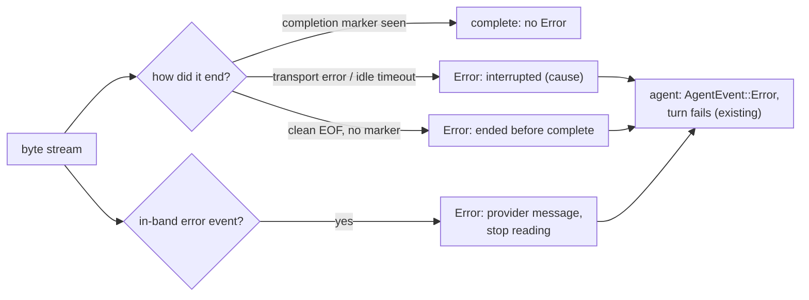

# Cut-off responses must not look complete — spec

**Date:** 2026-11-09 · **Branch:** `fix/stream-transport-error` · **Found by:** PR #83 work

## 1. The problem

The OpenAI-compatible, Anthropic and Ollama readers end the event stream the same way for
a finished response and for a broken one:

```rust
Some(Err(_)) | None => { /* parse what is left of the buffer */ return None; }
```

- **Transport errors are swallowed.** A connection reset, a body cut before its end, or a
  timeout ends the stream with no `ProviderEvent::Error`. The agent loop treats the end of
  the stream as the end of the answer, so a cut-off answer is saved and shown as complete;
  a tool call whose arguments were still streaming is silently dropped.
- **A clean end without the provider's completion marker** (`[DONE]` / `finish_reason`,
  `message_stop`, `"done": true`) is not noticed either.
- **Errors sent inside the stream are ignored.** After the `200` headers, providers report
  failures as stream events: OpenAI-compatible `data: {"error": {...}}` (OpenRouter adds
  `finish_reason: "error"` and then `[DONE]`), Anthropic `event: error`
  (`overloaded_error`), Ollama `{"error": "..."}`. All three parsers drop them, and with
  OpenRouter the following `[DONE]` turns the failure into a normal `Done`.
- **Long answers are cut at 120 s.** The clients use `reqwest::ClientBuilder::timeout(120 s)`,
  which is a *total* deadline that runs until the response body has finished. Any answer
  that streams for more than two minutes (a slow local model, a long generation) is cut
  off mid-stream, and because of the first point it looks complete.

The agent loop already handles `ProviderEvent::Error` (it sends `AgentEvent::Error` and
ends the turn with `AgentError::Provider`); the readers never send it.



## 2. Contract

Completion markers: **OpenAI-compatible** `data: [DONE]` or any chunk with a non-null
`finish_reason` other than `"error"`; **Anthropic** `message_stop`; **Ollama** a line with
`"done": true`.

| # | Requirement | Test |
|---|---|---|
| S1 | **Transport error before completion** (connection closed before the end of the body, reset, read timeout): the reader delivers the events already parsed from complete lines, then emits exactly one `ProviderEvent::Error` and ends. The message names the provider (`openai` / `anthropic` / `ollama`), says the response was interrupted, and includes the underlying cause with its source chain (so a timeout says "timed out"). No `Done` after it. All three adapters | Raw chunked server sends some complete events, then closes the socket without the terminating chunk: tokens before the cut arrive, then one `Error`, no `Done` |
| S2 | **Clean end before completion:** the body ends normally but no completion marker was seen → after the remaining buffer is parsed, one `Error` saying the response ended before it was complete. All three adapters | Server sends complete events and the terminating chunk, but no marker: `Error`, no `Done`. Control: the same body plus the marker ends without `Error` |
| S3 | **Completion wins:** once the completion marker has been received, a later transport error or a missing `[DONE]` produces no `Error` | OpenAI: `finish_reason: "stop"` then socket closed before `[DONE]` → `Done`, no `Error`. Anthropic: `message_stop` then reset → no `Error` |
| S4 | **In-band errors:** OpenAI-compatible chunk with a top-level `error` object, or `finish_reason: "error"`; Anthropic `error` event; Ollama line with a top-level `error` → one `Error` carrying the provider's message (e.g. `Overloaded`, `Provider disconnected unexpectedly`). Events before it are delivered; the reader stops after it, so a following `[DONE]` / `message_stop` produces no `Done` | One body per format, including OpenRouter's shape (error + `finish_reason: "error"` + `[DONE]`) |
| S5 | **Idle limit, not a total deadline:** a response that keeps sending data more often than the idle limit is never cut off however long it runs; no data for longer than the idle limit is a transport error (S1, "timed out"). Default idle limit 120 s, connect timeout unchanged (10 s). `http_client_timeout()` returns the idle limit. New `with_idle_timeout(Duration) -> Self` on `OpenAiProvider`, `AnthropicProvider`, `OllamaProvider` | Idle 1 s: a body streamed over about 3 s with a piece every 200 ms completes with no `Error`; a 2 s stall after the first event gives `Error` containing "timed out" within a few seconds. Existing `http_timeout_contract.rs` still passes |
| S6 | **No caching of failed responses:** `CachingProvider` does not store a response that contains an `Error` event, so the same request goes to the provider again | Inner provider yields `[Token, Error]` then `[Token, Done]`: two calls reach it; the second result is cached |
| S7 | **End to end:** through the `hone` binary, a cut-off OpenAI-compatible response is reported as a provider error (non-zero exit, error event in `--json`), not as a successful answer | Binary test with a mock server whose body stops before completion |

Unchanged: framing, event parsing for well-formed responses, `Done` semantics on success,
`ProviderEvent`, the agent loop's handling of `Error`, the connect timeout.

## 3. Test harness

`crates/hone-providers/tests/stream_utf8_split.rs` has a raw chunked HTTP/1.1 server. It
needs a few more behaviours: a delay before a piece (S5), closing the socket without the
terminating `0\r\n\r\n` chunk (S1, S3), and a normal end (S2). Moving the server into a
shared test module (`tests/common/`) is fine.

## 4. Behaviour changes

- A cut-off response now fails the turn (TUI error line, non-zero exit in one-shot and
  `--json`) instead of being saved as a complete answer. For the benchmark this turns
  silently truncated runs into visible provider errors.
- Answers longer than two minutes are no longer cut off.

## 5. Out of scope (follow-ups)

- Retrying a stream that fails before its first event (the agent retries only the initial
  request).
- `hone spec` ignores `Error` events and keeps partial text.
- The OpenAI reader accepts only `data: ` with a space; the Anthropic reader splits blocks on
  `\n\n` only. `queue_client` frame decoding and the stdio readers (see
  `stream-utf8-split-spec.md` §4).
