# Multi-byte characters split across stream chunks — spec

**Date:** 2026-11-09 · **Branch:** `fix/stream-utf8-split` · **Found by:** PR #82 work

## 1. The problem

The three HTTP adapters read the response body with `response.bytes_stream()` and decode
each network chunk on its own:

| Adapter | Site | Framing |
|---|---|---|
| OpenAI-compatible | `adapters/openai.rs` `match std::str::from_utf8(&chunk)` | SSE, one `data: ` line per event |
| Anthropic | `adapters/anthropic.rs` `match std::str::from_utf8(&chunk)` | SSE, blocks ending in a blank line |
| Ollama | `adapters/ollama.rs` `match std::str::from_utf8(&chunk)` | newline-delimited JSON |

Chunk boundaries are set by the network (TCP segments, HTTP chunked encoding, proxies), not
by characters. When a chunk ends in the middle of a multi-byte UTF-8 character (Polish
`ą` = 2 bytes, `€` / CJK = 3 bytes, emoji = 4 bytes), `from_utf8` fails for that chunk *and*
the next one, and both are **dropped whole** with only a `debug!` line. The result:

- text silently missing from the answer;
- an SSE line cut in half: the start of one event and the end of another are lost, so the
  surviving halves don't parse and more events disappear;
- tool-call argument fragments lost, so the arguments JSON is broken or wrong.

A single genuinely invalid byte (a misbehaving proxy or server) also drops the whole chunk
it arrives in, together with every valid event in that chunk.

`hone-core/src/queue_client.rs` is not affected: it buffers bytes and decodes only complete
`\n\n`-terminated frames.

```mermaid
%%{init: {"themeVariables": {"fontSize": "13px"}, "flowchart": {"nodeSpacing": 25, "rankSpacing": 30, "padding": 8}, "sequence": {"actorMargin": 30, "messageMargin": 25, "boxMargin": 6}, "gantt": {"barHeight": 16, "barGap": 3}}}%%
flowchart LR
  subgraph Before
    C1["chunk 1: ...Za&#x017C;&#xC3;"] -->|"from_utf8 fails"| X1["dropped"]
    C2["chunk 2: &#xB3;&#x107; ...\\n"] -->|"from_utf8 fails"| X2["dropped"]
  end
  subgraph After
    D1["chunk 1"] --> DEC["decoder: emit valid prefix,<br/>carry incomplete tail (&le; 3 bytes)"]
    D2["chunk 2"] --> DEC
    DEC --> BUF["text buffer &rarr; line / block parser (unchanged)"]
  end
```

## 2. Contract

"The text the parser sees" below means the text appended to the adapter's line/block buffer.
"Same events" means the same `ProviderEvent` sequence (tokens concatenated for comparison,
since token boundaries may follow chunk boundaries).

| # | Requirement | Test |
|---|---|---|
| U1 | **OpenAI-compatible:** a streamed response in which 2-, 3- and 4-byte characters are split across HTTP chunks yields exactly the original text: no character or event is lost | Raw HTTP server sending the SSE body in pieces cut inside `ą`, `€`/`中` and an emoji (each internal offset of the 4-byte one); concatenated `Token` text equals the expected string; `Done` arrives |
| U2 | **Anthropic:** same as U1 for the Messages SSE format | Same, Anthropic `content_block_delta` / `text_delta` events |
| U3 | **Ollama:** same as U1 for NDJSON | Same, Ollama `message.content` lines |
| U4 | **Tool-call arguments** with non-ASCII values split mid-character arrive intact (OpenAI `tool_calls[].function.arguments` deltas; Anthropic `input_json_delta`) | The `ToolCall` event's arguments parse as JSON and equal the expected value (e.g. `{"path":"zażółć.txt"}`) |
| U5 | **Any chunking gives the same result:** delivering the whole body one byte per chunk gives the same events as delivering it in one chunk, for all three adapters | One-byte-per-chunk vs single-chunk, same body with multi-byte text (and for OpenAI/Anthropic a tool call) |
| U6 | **Invalid bytes don't drop their chunk:** a byte sequence that is not UTF-8 (e.g. `0xFF`) inside an event is replaced by U+FFFD; the rest of that chunk and the following events are kept. The decoded text equals `String::from_utf8_lossy` of the whole body | A chunk containing `"ab" 0xFF "cd"` inside one event's text plus a second complete event: tokens `ab\u{FFFD}cd` and the second event both arrive |
| U7 | **End of stream:** if the body ends with an incomplete multi-byte sequence, it is flushed as U+FFFD (no panic, no hang); complete events before it are still delivered | Body whose last line is complete except for a trailing lone lead byte; earlier events arrive, stream ends |

Unchanged: framing (line / blank-line splitting), event parsing, `Done` handling, the
non-UTF-8 `debug!` log may stay or go, `ProviderEvent` and all public types.

Implementation note (not a requirement): one small decoder in `adapters/http_common.rs`
shared by the three adapters — append the longest valid prefix, keep an incomplete trailing
sequence (at most 3 bytes) for the next chunk, replace invalid sequences with U+FFFD as
`from_utf8_lossy` does, flush on end of stream.

## 3. Test harness

`wiremock` returns the body in one piece, so it cannot reproduce the bug. The tests need a
small raw HTTP/1.1 server on `127.0.0.1:0` (tokio `TcpListener`) that reads the request
(headers + `Content-Length` body), answers `200` with `Transfer-Encoding: chunked` and the
right `Content-Type`, writes each piece as its own HTTP chunk, then `0\r\n\r\n`. Hyper's
chunked decoder yields each HTTP chunk as its own `Bytes`, so the split points reach the
adapter as written. The red phase proves it: the tests must fail on the current code.

## 4. Out of scope (follow-ups)

- A transport error in the middle of the stream (`Some(Err(_))`) is treated as a normal end:
  the stream stops without an `Error` event, so a cut-off answer looks complete.
- The OpenAI reader only accepts `data: ` with a space; the SSE spec also allows `data:`.
- The Anthropic reader splits blocks on `\n\n` only, not `\r\n\r\n`.
- `hone-core` `queue_client::parse_sse_data_lines` handles splits (it frames on bytes) but
  does `from_utf8(raw).unwrap_or("")`, so one invalid byte drops its whole frame; it also
  frames on `\n\n` only.
- Line-based stdio readers (`cli_common.rs`, `claude_cli.rs`, `hone-mcp` stdio client, the
  ACP transport, the MCP/ACP servers) handle splits, but one invalid byte is a hard error:
  the turn ends, the persistent Claude process is tombstoned, or the MCP call fails. Fix:
  `read_until(b'\n')` plus lossy decoding.
