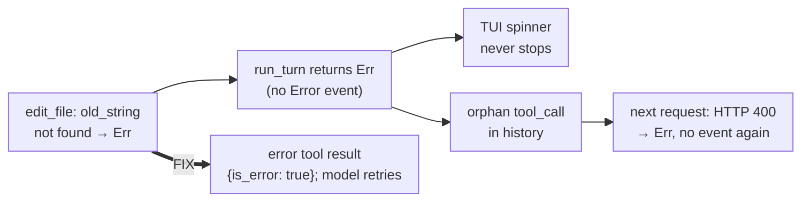

# Tool errors end turns silently — spec

**Date:** 2026-11-09 · **Branch:** `fix/tool-error-turn` · **Found by:** the PR #78 review (follow-up list)

## 1. The bug

A tool that returns `Err` — e.g. `edit_file` with an `old_string` that isn't in the file
(`hone-tools/src/file/edit.rs`) — aborts the whole turn:

- **Sequential path** (`agent.rs` `Err(e) => return Err(e)` after `dispatch_with_recovery`): no
  `ToolCallEnd`, no tool result in the history, and every later call in the batch is skipped.
- **Parallel path** (`agent.rs` `Err(e) => return Err(e)` after `dispatch_parallel`): the
  `ToolCallEnd` was sent, but no tool result is added and the turn aborts.
- **No terminal event.** `run_turn` returns `Err` without sending `AgentEvent::Error`. The same is
  true for `BudgetExceeded` at the start of a turn and for a provider request that fails after
  retries (`retry(..).await?`). Only a streamed `ProviderEvent::Error` sends one.

Effects: the TUI's simple-turn forwarder waits for `Done`/`Error` that never comes, so the spinner
runs forever; `honed` SSE streams end with no terminal event; the history keeps an assistant
`tool_call` with no result, so the **next** request is rejected by the provider (HTTP 400) —
which again returns `Err` with no event.

## 2. Contract

| # | Requirement | Test |
|---|---|---|
| T1 | **A tool error is a result, not a turn failure (sequential path).** On `Err(AgentError::Tool{..})`: send `ToolCallEnd { is_error: true, result: {"error": "<message>"} }` (redacted like other results); add a tool-result message with the same JSON; record an egress entry; fire `PostToolUse` with `is_error: true`; continue with the next call, then call the model again | Scripted provider: turn 1 asks for a write-type tool that returns `Err(ExecutionFailed{"old_string not found"})`, turn 2 answers "recovered" → `run_turn` is `Ok("recovered")`; one `ToolCallEnd{is_error:true}` naming the error; the provider's second request contains a tool result for that call id (no orphan) |
| T2 | **Same on the parallel (read-only) path.** A read-only call that returns `Err` gets an error tool result; the batch's other calls keep theirs; the turn continues | Two read-only calls in one batch, the first returns `Err` → both ids have tool results in the second request; turn `Ok` |
| T3 | **One terminal event per failed turn.** Every `Err` that `run_turn` / `run_turn_content` return, other than `Cancelled`, is preceded by **exactly one** `AgentEvent::Error` (budget exceeded at the start, provider request failure after retries, streamed provider error — which already sends one and must not send a second) | Budget already exceeded → `Err(BudgetExceeded)` and exactly one `Error`; provider whose `complete()` returns `Err` → exactly one `Error`; provider that streams `ProviderEvent::Error` → exactly one `Error`. For both `run_turn` and `run_turn_content` |
| T4 | **No orphan on any remaining `Err` exit inside a tool batch.** If any non-tool error still returns from inside a batch, unanswered calls first get an error result (generalise `cancel_pending_calls` to take the reason text) | Covered by code review; add a test if a reachable path remains |
| T5 | **TUI forwarders always end the turn.** If `spawn_agent_turn` / `spawn_medium_turn` reach the end of the stream without forwarding `Done` or `Error` — turn `Err` (including `Cancelled` from a dead actor) or a panicked turn task — they send one `Error` (e.g. "agent stopped unexpectedly: …"). User cancel (Esc) is unaffected: the forwarder is aborted before this point | Provider whose `complete()` panics → `tx` receives an `Error` within a timeout (spinner can't hang) |
| T6 | **One-shot prints a failure once.** `run_one_shot` / `run_one_shot_content` print the `Error` event and exit non-zero without also printing the same error through `anyhow` | Manual check or a seam if cheap |

Unchanged: `Cancelled` sends no event (nobody is listening); `ToolNotFound` already becomes an
error result; a policy deny / user deny / skip already produces a result.

## 3. Behaviour changes to call out

- The model now sees tool failures and can retry (e.g. re-read the file and fix `old_string`)
  instead of the run dying. This affects **`hone --json`**, which the harness-compare benchmark
  arms use: Hone runs will recover from failed edits. No pre-registration exists yet, so this
  lands before any measured run; note it in the CHANGELOG.
- `hone --json` reports the failure in its `"error"` field (it already parses `Error` events).
- `honed` SSE streams of failed runs end with an `error` event.

## 4. Out of scope

- A panic inside the agent actor kills it for the rest of the session (every later turn returns
  `Cancelled`). T5 makes the failure visible; restarting the actor is a follow-up.
- `hone --json` reports `cost_usd: 0.0` for a failed turn (it reads `TurnResult`); could use
  `session_spend()` — follow-up.

## 5. Review round 1: required changes

| # | Finding | Requirement | Test |
|---|---|---|---|
| U1 | **B1a** error results skip redaction in the egress preview and the `PostToolUse` payload (git stderr can carry credentialed remote URLs; `--audit` + `HONE_POLICY_BUILTINS=1` would write them in clear) | `record_tool_error` redacts once, as the `Ok` path does, and uses that value for the egress preview, the hook payload and the history message | Error-result versions of `policy_p25_agent.rs` `egress_log_previews_are_redacted_when_builtins_are_on` and `post_tool_use_hook_payload_is_redacted…`: a tool `Err` whose message contains a secret → neither the egress preview nor the hook payload contains it |
| U2 | **B1b** error results skip the injection scan (MCP servers control their error text) | Same `InjectionDetector::scan_tool_result`, metric, egress `injection_risk` label and SECURITY prefix as the `Ok` path | A tool `Err` with injection-like text → the history message starts with the SECURITY prefix and the egress entry carries the risk label |
| U3 | A failed parallel `read_file` now counts as a read for the read-before-edit guard | Record the read only on `Ok` in the parallel result loop | Parallel `read_file` that fails, then `edit_file` of the same path → the guard still injects its read |
| U4 | `hone --json` reports `usage: null` and `cost_usd: 0` for a failed turn, so the benchmark records 0 tokens for failed Hone runs | `run_json_mode` fills `usage` and `cost_usd` from `AgentHandle::session_spend()` (one fresh agent per run, so session = run) whatever the result | Seam: a pure fn building the JSON from (turn result, collected events, session spend) — failed turn after one model call → `usage.input/output` non-zero, `cost_usd > 0`, `success: false` |
| U5 | Nits | Parallel error egress entries use the measured `duration_ms`; the medium forwarder reports a dead actor as "agent stopped unexpectedly: …" like the simple one; one-shot / `--json` failures exit 1 through a typed "already reported" error mapped in `main`, so `mcp_manager.shutdown()` still runs | Medium dead-actor message; others by review |

Notes (no change here): request-level failures inside the orchestrator now also emit `Error`, so
the TUI and `honed` `/orchestrate` may show a worker's error next to "orchestration failed: …";
the desktop app marks the run finished on any `error` event but its relay keeps reading, so it
does not disconnect or cancel. Follow-up: pair `--json` `tool_calls` names by id, not arrival order.
