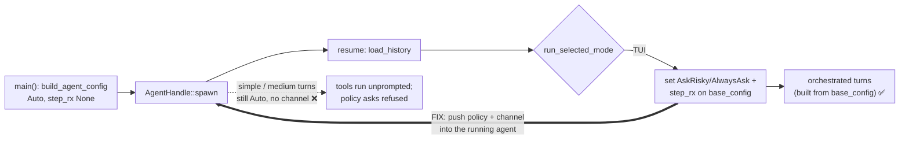

# TUI approval channel fix — spec

**Date:** 2026-11-09 · **Branch:** `fix/tui-approval-channel` · **Docs anchor:** [`permissions-and-sandbox.md#known-issue-tui`](../permissions-and-sandbox.md#known-issue-tui)

## 1. The bug

`bins/hone/src/main.rs` spawns the session agent (`AgentHandle::spawn(base_config.clone())`) in
`main()` with `approval_policy: Auto` and `step_rx: None` (`build_agent_config`). The TUI branch of
`run_selected_mode` later sets `AskRisky` / `AlwaysAsk` and a step channel on `base_config`, but
only orchestrated turns are built from `base_config`. Simple and medium turns (`spawn_agent_turn`,
`spawn_medium_turn`, and the inline `@agent` variants) run on the pre-spawned agent, so:

- write and shell tools run without prompting, and `--step` does nothing;
- permission-policy `ask` rules fail closed (`requires approval (rule <id>)`) as if headless.



## 2. The fix

### 2.1 `hone-core`: let a running agent receive a step channel

- New actor command `AgentCommand::SetStepChannel { rx }` and public setter
  `AgentHandle::set_step_channel(&self, rx: Option<Arc<tokio::sync::Mutex<mpsc::Receiver<StepAction>>>>)`.
  Fire-and-forget like `set_approval_policy`; the actor sets `agent.config.step_rx = rx`.
  Commands are FIFO, so a setter awaited before `run_turn` takes effect for that turn.
- `None` clears the channel (asks fail closed again).

### 2.2 `hone-core`: AutoApprove mode skips the approval-policy pause

`AgentMode::AutoApprove` (Shift+Tab "auto") today changes only the tool registry. Once the
TUI prompts, it must mean what its name says:

- In `AutoApprove`, `ToolApprovalPolicy::requires_approval` is **not consulted**: no
  `ToolCallPaused`, the tool runs.
- The **permission policy is unchanged**: `deny` still refuses and `ask` still prompts (or fails
  closed without a channel). AutoApprove never weakens policy rules.
- `Build` and `Plan` behave as before.
- This includes `AlwaysAsk` (`--step`): switching to AutoApprove later in the session is the
  newer, explicit choice, so it wins and nothing pauses for approval-policy reasons.
- The check goes at the approval gate in `Agent::run_turn` (`if !policy_prompted &&
  requires_approval(..)`, ~`agent.rs:1774`); the policy gate runs earlier and is untouched.

### 2.3 `bins/hone`: wire approvals into the pre-spawned agent

Extract the TUI wiring from `run_selected_mode` into:

```rust
/// Interactive approval wiring for the TUI: AskRisky (or AlwaysAsk with --step)
/// plus a step channel, applied to BOTH `base_config` (orchestrated turns) and
/// the already-running `agent` (simple/medium turns). Returns the sender the App uses.
async fn wire_tui_approvals(
    agent: &AgentHandle,
    base_config: &mut AgentConfig,
    step: bool,
) -> tokio::sync::mpsc::Sender<hone_proto::StepAction>
```

It must **not respawn** the agent: resumed history (`hone session resume <name>`) already lives in
it. `run_selected_mode` calls it in the TUI branch and passes the sender to `run_tui`.

Headless paths (`hone "prompt"`, `--json`, `--recipe`, `--plan`, `--orchestrate`, `--ensemble`)
are untouched: `Auto`, no channel, asks fail closed.

## 3. Test contract (red first)

| # | Where | Asserts |
|---|---|---|
| 1 | `crates/hone-core/tests/tui_approval_wiring.rs` | Agent spawned `Auto`/no channel; after `set_approval_policy(AskRisky)` + `set_step_channel(Some)`, a write-tool call emits `ToolCallPaused`; replying `Deny` means the tool never runs (no file) and the tool result is the denial |
| 2 | same | Agent spawned with a policy `ask` rule and no channel; after `set_step_channel(Some)`, the call emits `ApprovalRequired` and `Proceed` lets it run (instead of `requires approval`) |
| 3 | same | `set_step_channel(None)` after `Some` → the policy ask is refused again (fail closed) |
| 4 | same | `AskRisky` + channel + `set_mode(AutoApprove)` → write tool runs, no `ToolCallPaused` |
| 5 | same | `AutoApprove` + policy `ask` rule + channel → `ApprovalRequired` still emitted (mode never bypasses policy); `AutoApprove` + `deny` rule → refused |
| 6 | `bins/hone/src/main.rs` `mod tests` | `wire_tui_approvals(step=false)` on a pre-spawned `Auto` agent: `base_config` gets `AskRisky{[]}` + `step_rx`; `agent.approval_policy()` is `AskRisky`; a turn via `spawn_agent_turn` pauses on a write tool and `Deny` through the returned sender stops it |
| 7 | same | `step=true` → `AlwaysAsk`; a **read-only** tool call pauses |
| 8 | same | History loaded before wiring (`load_history`) is still present after wiring (guards against a respawn fix) |

## 4. Docs to update with the fix

Remove the known-bug text and describe the fixed behaviour in: `docs/permissions-and-sandbox.md`
(lines ~25, ~148–149, the `#known-issue-tui` warning: replace with a short "fixed in" note so old
links still land), `docs/architecture.md:169`, `docs/configuration.md:255` and `:765`,
`docs/getting-started.md:266` (and say what AutoApprove does at `:143`), plus a CHANGELOG entry.

## 5. Out of scope (follow-ups)

- Orchestrated turns ignore the Shift+Tab mode (mode changes reach only the `AgentHandle`, not
  `base_config`), so Plan/AutoApprove don't apply to them. Pre-existing.
- "Approve always" given on a simple turn isn't shared with orchestrated turns (separate configs).
  Pre-existing.
- Built-in personas list tools the registry drops (`configuration.md:610`). Separate bug.
