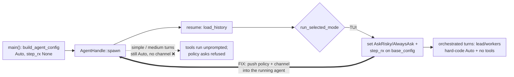
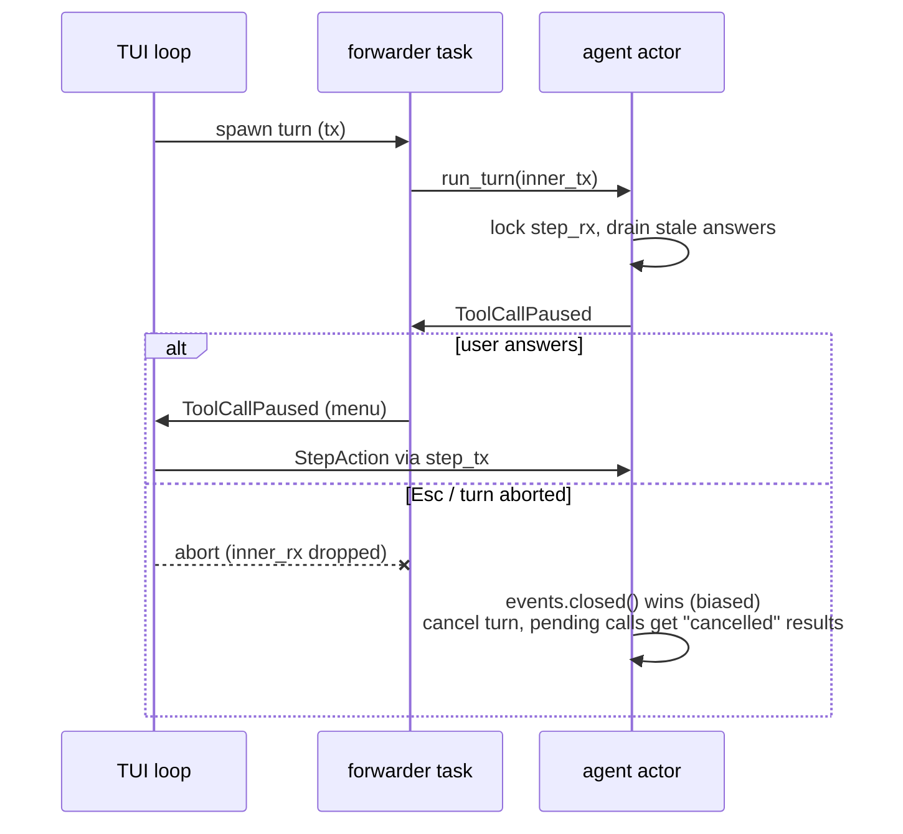

# TUI approval channel fix — spec

**Date:** 2026-11-09 · **Branch:** `fix/tui-approval-channel` · **Docs anchor:** [`permissions-and-sandbox.md#known-issue-tui`](../permissions-and-sandbox.md#known-issue-tui)

## 1. The bug

`bins/hone/src/main.rs` spawns the session agent (`AgentHandle::spawn(base_config.clone())`) in
`main()` with `approval_policy: Auto` and `step_rx: None` (`build_agent_config`). The TUI branch of
`run_selected_mode` later sets `AskRisky` / `AlwaysAsk` and a step channel on `base_config`, but
nothing that runs tools reads them. Simple and medium turns (`spawn_agent_turn`,
`spawn_medium_turn`, and the inline `@agent` variants) run on the pre-spawned agent, and
orchestrated turns build lead and worker configs that hard-code `Auto`, no channel and an
**empty tool registry** (`orchestrator.rs` `build_lead_config` / `build_worker_config`), so they
never run tools at all. As a result:

- write and shell tools run without prompting, and `--step` does nothing;
- permission-policy `ask` rules fail closed (`requires approval (rule <id>)`) as if headless.



## 2. The fix

### 2.1 `hone-core`: let a running agent receive a step channel

- New actor command `AgentCommand::SetStepChannel { rx }` and public setter
  `AgentHandle::set_step_channel(&self, rx: Option<Arc<tokio::sync::Mutex<mpsc::Receiver<StepAction>>>>)`.
  Fire-and-forget like `set_approval_policy`; the actor sets `agent.config.step_rx = rx`.
  Commands are FIFO, so a setter awaited before `run_turn` takes effect for that turn.
- `None` clears the channel (asks fail closed again).

### 2.2 `hone-core`: AutoApprove mode skips the approval-policy pause

`AgentMode::AutoApprove` (Shift+Tab "auto") today changes only the tool registry. Once the
TUI prompts, it must mean what its name says:

- In `AutoApprove`, `ToolApprovalPolicy::requires_approval` is **not consulted**: no
  `ToolCallPaused`, the tool runs.
- The **permission policy is unchanged**: `deny` still refuses and `ask` still prompts (or fails
  closed without a channel). AutoApprove never weakens policy rules.
- `Build` and `Plan` behave as before.
- This includes `AlwaysAsk` (`--step`): switching to AutoApprove later in the session is the
  newer, explicit choice, so it wins and nothing pauses for approval-policy reasons.
- The check goes at the approval gate in `Agent::run_turn` (`if !policy_prompted &&
  requires_approval(..)`, ~`agent.rs:1774`); the policy gate runs earlier and is untouched.

### 2.3 `bins/hone`: wire approvals into the pre-spawned agent

Extract the TUI wiring from `run_selected_mode` into:

```rust
/// Interactive approval wiring for the TUI: AskRisky (or AlwaysAsk with --step)
/// plus a step channel, applied to BOTH `base_config` (orchestrated turns) and
/// the already-running `agent` (simple/medium turns). Returns the sender the App uses.
async fn wire_tui_approvals(
    agent: &AgentHandle,
    base_config: &mut AgentConfig,
    step: bool,
) -> tokio::sync::mpsc::Sender<hone_proto::StepAction>
```

It must **not respawn** the agent: resumed history (`hone session resume <name>`) already lives in
it. `run_selected_mode` calls it in the TUI branch and passes the sender to `run_tui`.

Headless paths (`hone "prompt"`, `--json`, `--recipe`, `--plan`, `--orchestrate`, `--ensemble`)
are untouched: `Auto`, no channel, asks fail closed.

## 3. Test contract (red first)

| # | Where | Asserts |
|---|---|---|
| 1 | `crates/hone-core/tests/tui_approval_wiring.rs` | Agent spawned `Auto`/no channel; after `set_approval_policy(AskRisky)` + `set_step_channel(Some)`, a write-tool call emits `ToolCallPaused`; replying `Deny` means the tool never runs (no file) and the tool result is the denial |
| 2 | same | Agent spawned with a policy `ask` rule and no channel; after `set_step_channel(Some)`, the call emits `ApprovalRequired` and `Proceed` lets it run (instead of `requires approval`) |
| 3 | same | `set_step_channel(None)` after `Some` → the policy ask is refused again (fail closed) |
| 4 | same | `AskRisky` + channel + `set_mode(AutoApprove)` → write tool runs, no `ToolCallPaused` |
| 5 | same | `AutoApprove` + policy `ask` rule + channel → `ApprovalRequired` still emitted (mode never bypasses policy); `AutoApprove` + `deny` rule → refused |
| 6 | `bins/hone/src/main.rs` `mod tests` | `wire_tui_approvals(step=false)` on a pre-spawned `Auto` agent: `base_config` gets `AskRisky{[]}` + `step_rx`; `agent.approval_policy()` is `AskRisky`; a turn via `spawn_agent_turn` pauses on a write tool and `Deny` through the returned sender stops it |
| 7 | same | `step=true` → `AlwaysAsk`; a **read-only** tool call pauses |
| 8 | same | History loaded before wiring (`load_history`) is still present after wiring (guards against a respawn fix) |

## 4. Docs to update with the fix

Remove the known-bug text and describe the fixed behaviour in: `docs/permissions-and-sandbox.md`
(lines ~25, ~148–149, the `#known-issue-tui` warning: replace with a short "fixed in" note so old
links still land), `docs/architecture.md:169`, `docs/configuration.md:255` and `:765`,
`docs/getting-started.md:266` (and say what AutoApprove does at `:143`), plus a CHANGELOG entry.

## 5. Out of scope (follow-ups)

- Orchestrated turns ignore the Shift+Tab mode (mode changes reach only the `AgentHandle`, not
  `base_config`), so Plan/AutoApprove don't apply to them. Pre-existing.
- "Approve always" given on a simple turn isn't shared with orchestrated turns (separate configs).
  Pre-existing.
- Built-in personas list tools the registry drops (`configuration.md:610`). Separate bug.

## 6. Review round 1: required changes (contract for round 2)

The reviewer confirmed that once the long-lived actor can pause, it can wedge and fail open.
Each item below is a requirement with a test.



| # | Finding | Requirement | Test |
|---|---|---|---|
| R1 | **C1** medium turns wedge: `spawn_medium_turn` stops reading at the first `Done`, but `SelfRefineLoop` then runs critique and refine turns on the same channel | `spawn_medium_turn` forwards until the refine task ends (`inner_rx` returns `None`). Intermediate `Done`s are not forwarded; exactly one terminal `Done` is sent at the end, with `usage` and `cost_usd` summed over all rounds | Provider script: turn 1 text, turn 2 a non-APPROVED critique, turn 3 a write call → `ToolCallPaused` reaches `tx` within a timeout; exactly one `Done` reaches `tx` |
| R2 | **C2** cancel wedges the actor | (a) One wait helper for both the policy ask (`ask_user`) and the approval gate: acquire the `step_rx` lock and wait for the answer inside a `biased` `select!` whose first branch is `events.closed()`; after taking the lock and **before** emitting `ApprovalRequired`/`ToolCallPaused`, drain stale buffered answers with `try_recv`. (b) If the turn's event receiver is closed (nobody can answer), the turn is **cancelled**: every not-yet-answered tool call in the current batch gets a `"cancelled"` tool result (so the history has no orphan `tool_call`), then `run_turn` returns `AgentError::Cancelled`. Also check `events.is_closed()` before each model call. (c) `spawn_agent_turn` / `spawn_medium_turn` stop forwarding when the outer `tx` is closed or a send fails (dropping `inner_rx`). Inline `@agent` wrappers abort their inner turn task when they are aborted (drop guard) | Abort the `spawn_agent_turn` handle before the provider emits a write call → a second `run_turn` on the same handle completes within a timeout and the write never ran; same through the inline-wrapper path; stale `Proceed` buffered before a pause is not applied to it |
| R3 | **C3** gate fails open when the step channel closes; **m2** phantom pause with no channel | Approval gate: `recv()` → `None` is a **denial** (`"approval channel closed"`), the tool does not run. Approval required but no channel: **denial** (`"no approval channel"`), and no `ToolCallPaused` is emitted. Matches `ask_user`. Existing tests that relied on "no channel → runs" are updated to the new contract | Pause, drop the sender → tool never runs, result is a denial; `AskRisky` + no channel + write → denied, no `ToolCallPaused` |
| R4 | **M1** typing can answer the menu | In `hone-tui` `App`, a menu key counts only if pressed ≥ 400 ms after the menu opened **and** ≥ 400 ms after the previous keystroke. A key that fails this goes to the normal input handler (typed text is kept, and cannot approve). Esc always means Skip. Space no longer approves (only `y`/Enter, as documented). Needs a time seam (e.g. `handle_key_at(key, now)` / `handle_agent_event_at(ev, now)`) | Typing `"add a test"` at 50 ms intervals across the menu opening → no `StepAction` sent and the text reaches the input; `y` after a 500 ms pause → `Proceed` |
| R5 | **M2** `/permit` round-trips to the actor inside the UI loop | New fire-and-forget `AgentHandle::approve_tools(Vec<String>)` (actor applies `approve_always` per name). `/permit` uses it. No `AgentHandle` call that awaits an actor reply remains in the TUI select loop | `approve_tools` while a turn is paused returns immediately (timeout) and applies after the turn |
| R6 | **M3** a denied write still triggers the automatic test run | Test verification counts only code-modifying calls that actually ran: a non-error `ToolCallEnd` whose result is not `{"skipped": true}`, matched to its `ToolCallStart` by id | Denied and skipped `write_file` → no verification; successful one → verification |
| R7 | **m1** under `--step`, reads leave the parallel path and are no longer recorded by the read-before-edit guard | Record successful `read_file` on the sequential path too | `AlwaysAsk`: approved `read_file` then `edit_file` of the same file → no synthetic `read_file` |
| R8 | **m3** "approve always" scope | The gate uses `call.name`, not the name the TUI sends. `/permit` help says it applies for the rest of the session. With `--step` (`AlwaysAsk`), `a` approves once (documented) | `ApproveAlways("other_tool")` on a `write_file` pause allow-lists `write_file`, not `other_tool` |

Docs (m4): orchestrated workers have no tools, so they never prompt; `--step` doesn't cover the
read-before-edit guard's own read or the automatic test run; the automatic test run after an
approved edit is **not prompted and not sandboxed** (follow-up: route it through the shell tool).

Out of scope, recorded as follow-ups: call-id correlation in `StepAction`; a real cancellation
token for `RunTurn`; restoring the inline `@agent` prompt/tools when its turn is cancelled; gating
the automatic test run.
