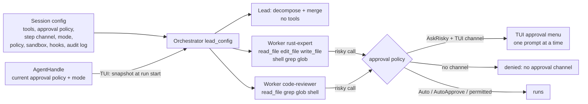

# Orchestrator workers get tools — spec

Branch `fix/worker-tools`. Contract for the TDD rounds: rows W1–W25.

## Problem

An orchestrated run (a prompt the classifier calls complex, or a `/plan` Run)
splits the work into subtasks for specialist agents (`rust-expert`,
`code-reviewer`, …). Every worker is built with an empty `ToolRegistry`
(`crates/hone-core/src/orchestrator.rs`, `build_worker_config`), so it can't
read, search, edit or run anything: it answers in text, from the subtask
description alone. The agent definitions already say which tools each
specialist should have (`tools: [read, edit, write, shell, grep, glob]`), but
nothing uses that list for workers.

Two more defects sit on the same path:

- **The tool names in the built-in agent files don't match the tools.** The
  files say `read`, `write`, `edit`; the tools are `read_file`, `write_file`,
  `edit_file`. `filtered_registry` drops unknown names, so today an
  `@rust-expert` turn (TUI) and a distributed worker (`honed`) get only
  `shell`, `grep`, `glob`.
- **A fixed 300 s per-worker timeout.** Harmless for text-only workers; a
  worker that runs `cargo test` or waits for you to approve a command needs
  longer, and a timed-out worker's approval prompt would stay on screen.

## Principle

**A worker gets no more than the session's main agent has.** Its tools are
the session's tools narrowed by its agent definition; it runs under the
session's approval policy, approval channel, mode, permission policy, sandbox,
hooks and audit log. The lead (decompose and merge) keeps no tools.

## Rows

### Core (`hone-core`)

| Row | Behaviour |
|---|---|
| W1 | **Workers get tools.** A worker's registry is `filtered_registry(&lead_config.tools, def.tools)` for its agent definition. An empty `tools:` list, or an agent name not in the registry, gives the whole `lead_config.tools` (as for the main agent). Visible in the tool definitions the worker sends to the provider. |
| W2 | **The lead keeps no tools.** Decompose and merge requests carry no tool definitions, even when `lead_config.tools` is full. Lead config otherwise unchanged (Auto, no step channel, no hooks, no audit log). |
| W3 | **Short tool names resolve.** In `filtered_registry`, `read` → `read_file`, `write` → `write_file`, `edit` → `edit_file`. Real names still work; a list may mix both; a name that resolves to nothing is skipped with a warning (as now); listing a tool twice (`read` and `read_file`) registers it once. Applies everywhere `filtered_registry` is used (workers, TUI `@agent`, `honed` executor). |
| W4 | **Approvals follow the session.** A worker takes `approval_policy` and `step_rx` from `lead_config`. With `AskRisky` and a step channel, a risky call pauses (`ToolCallPaused` on the run's event channel) and runs or not per the `StepAction` answer. With `AskRisky` and no channel, it is denied (`denied: no approval channel`) and the worker carries on. With `Auto`, it runs. A tool in `always_allowed` runs without a pause. |
| W5 | **Mode follows the session.** `lead_config.mode`: `Build` → worker in `Build`; `AutoApprove` → worker in `AutoApprove` (no approval pauses; the permission policy still applies); `Plan` → worker registry narrowed to read-only tools (`read_only_registry` after W1's filter) and the worker in `Build`, so no worker writes a plan file and no `PlanSaved` event is sent. |
| W6 | **Policy, sandbox, hooks and audit log follow the session.** A worker takes `policy`, `sandbox`, `sandbox_policy`, `hooks` and `egress_log` from `lead_config` (a policy `deny` rule blocks a worker's call; a `PreToolUse` hook runs for it; its calls are in the audit log). An agent definition's own `sandbox:` profile is **not** applied in-process (it could loosen the session's sandbox). |
| W7 | **Parallel workers ask one at a time.** Workers that share a step channel never have two approval prompts outstanding: the second worker's `ToolCallPaused` comes only after the first worker's answer. Each answer reaches the worker that asked (a `Deny` for worker A doesn't deny worker B's call). |
| W8 | **Optional worker timeout.** `Orchestrator::without_worker_timeout()` turns off the per-worker timeout; a worker then runs until it ends or the run is dropped. The default stays 300 s and `with_worker_timeout(secs)` still works. |

### `AgentHandle`

| Row | Behaviour |
|---|---|
| W9 | **`AgentHandle::mode() -> Option<AgentMode>`** returns the agent's current mode: the config's mode at spawn, then the last `set_mode`; `None` if the actor has stopped. (Mirrors `approval_policy()`.) |

### TUI (`bins/hone`, `spawn_orchestrated_turn`)

| Row | Behaviour |
|---|---|
| W10 | **The run uses the agent's current approval policy and mode.** Inside the spawned task, before building the orchestrator, the config takes `agent.approval_policy().await` and `agent.mode().await` (on `None`, the config keeps its own mode). So "always" answers given earlier in the session, earlier `/permit`s and `/mode` changes reach the workers. Done in the task, not in the UI loop (never wait on the actor from the UI loop). |
| W11 | **No per-worker timeout in the TUI.** `spawn_orchestrated_turn` builds the orchestrator with `without_worker_timeout()`; Esc stops the run. `hone --orchestrate` and the web server keep the 300 s default. |
| W12 | **A worker's tool calls reach the TUI.** `ToolCallStart`, `ToolCallPaused`, `ApprovalRequired` and `ToolCallEnd` from a worker are forwarded to the TUI channel; a `StepAction` sent on the session's step channel answers a worker's pause; the run still ends with exactly one `Done` (G14 of the plan-gate spec). |

### Shared "always" (W13–W17, added at the user's request)

An "always" answer means "for this session": it covers the main agent and
every worker of every orchestrated run, whichever of them asked. Today an
"always" lives on the one agent that asked (`approve_always` on its own
`approval_policy`, rule entries in its own `policy_session_approved`).

| Row | Behaviour |
|---|---|
| W13 | **`SessionApprovals`** (`hone-core`, public, `Send + Sync`): the "always" answers of one session — tool names approved for the approval-policy pause, and the policy-gate session-approval entries (`session_approval_entries`). Every `Agent` has one: its own, new, by default; `Agent::with_session_approvals(Arc<SessionApprovals>)` replaces it with a shared one; `AgentHandle::session_approvals() -> Option<Arc<SessionApprovals>>` returns the actor's (`None` if the actor has stopped). Agents never share one unless it is attached explicitly (two `AgentHandle`s, e.g. two server sessions, don't). |
| W14 | **"Always" is recorded.** An `ApproveAlways` answer at the approval-policy pause records the tool name, and one at a policy `ask` prompt records the rule's entries, in the agent's `SessionApprovals` — as well as where they go today. |
| W15 | **"Always" is honoured.** Before each tool call's gates, the agent takes in its `SessionApprovals`: tool names through `approve_always` on its approval policy (so `Auto` and `AlwaysAsk` behave as now: `--step` still asks every time), and entries into its policy session approvals (so the policy gate, the read filter and the read-before-edit guard see them). A call it covers runs without a prompt. |
| W16 | **Workers of a run share one.** The orchestrator attaches one `SessionApprovals` to every worker: its own by default (so workers share even outside the TUI), or the one passed to `Orchestrator::with_session_approvals`. A worker that was going to ask — including one waiting for its turn on the step channel — checks again once it holds the channel, before it sends a prompt, and doesn't ask if an "always" given meanwhile now covers the call (another worker's "always" for the same tool, or entries that now clear the policy rule). It never re-checks after it has sent a prompt. |
| W17 | **The TUI shares the session agent's.** `spawn_orchestrated_turn` attaches `agent.session_approvals().await` to the orchestrator (in the spawned task, like W10). So an "always" given to a worker covers the run's other workers, later runs and the main agent's later turns; an "always" given to the main agent — including for a policy `ask` rule — covers the workers. |

### Review round 1 (W18–W22)

| Row | Behaviour |
|---|---|
| W18 | **An `@agent` persona's tool list reaches orchestrated runs.** When an inline `@agent` with a `tools:` list narrows the session agent's tools for a turn that is classified complex, the orchestrated run's config gets the same narrowed registry, so its workers narrow from it: a worker never has a tool the persona's turn doesn't. (Review B1: workers narrowed from the full session registry.) |
| W19 | **A stopped agent fails closed.** If the session agent's actor has stopped (`mode()` or `session_approvals()` is `None`), `spawn_orchestrated_turn` sends exactly one `Error` ("orchestration failed: the agent has stopped") and starts no lead or worker call. (Review S1: it fell back to `AskRisky`/`Build`.) |
| W20 | **Exact tool names win over aliases.** `filtered_registry` looks a name up as given first and uses the alias only when no tool has that exact name: an MCP tool called `write` is kept for `tools: [write]`. (Review S2.) |
| W21 | **A key in the approval menu stops the turn.** <kbd>x</kbd> in the approval menu denies the paused call, closes the menu and cancels the turn the way <kbd>Esc</kbd> does when no menu is open (an orchestrated run stops: its workers are dropped and no further menus open for it). The menu's key hints list it. Like the other letter keys, it counts only after the menu's 400 ms guard. (Review S4: with workers queued to ask, each <kbd>Esc</kbd> skipped one call and the next menu opened at once.) |
| W22 | **The server's run config stays Plan mode.** A test pins that `POST /orchestrate` builds its run config in `AgentMode::Plan`, so its workers are read-only. (Review S5.) |

### Commands end with their call (W23–W25, added at the user's request)

Today a shell command keeps running when its tool call ends early: the shell
tool runs `sh -c` through `Command::output()`, and dropping that future (Esc,
a worker timeout, a stopped orchestrated run, or the tool's own `timeout_ms`)
leaves the process and everything it started running. `sh -c "cargo test"`
keeps building and testing after Esc. The TUI's post-turn test run
(`test_loop` `run_cmd`) is the same.

| Row | Behaviour |
|---|---|
| W23 | **The shell tool's command ends with its call** (`hone-tools`). On unix each command runs in its own process group (the group the sandbox wrapper, `sh` and everything they start belong to), with stdin closed (`Stdio::null()`; today it is inherited despite `output()`'s docs, so in the TUI a command that reads stdin waits on the terminal until it times out). If the call ends before the command does — its future is dropped, or `timeout_ms` passes (still `ToolError::Timeout`) — the whole group gets `SIGKILL`, including grandchildren such as a backgrounded `(sleep 1; touch f) &`. A command that finishes normally is left alone, as now. Children are reaped (no zombies). Elsewhere, the direct child is killed. |
| W24 | **The TUI's post-turn test run ends with its turn.** `test_loop`'s test command runs the same way (one shared helper), so <kbd>Esc</kbd> during the test run kills it. |
| W25 | **hone's exit kills running commands.** A process-wide registry tracks running command groups; `hone_tools` exposes a function that kills them all. The TUI calls it when it exits (quit, <kbd>Ctrl</kbd>+<kbd>C</kbd>, SIGINT) and on SIGTERM and SIGHUP (which it now handles like SIGINT). One-shot runs (`-p`, `--orchestrate`) handle SIGINT, SIGTERM and SIGHUP by killing running commands and exiting with 128 + the signal number. Without this, moving commands out of hone's process group (W23) would let them outlive hone, because the terminal's <kbd>Ctrl</kbd>+<kbd>C</kbd> and hangup no longer reach them. |

## What each entry point gets

| Entry point | Tools a worker can use | Risky calls |
|---|---|---|
| TUI (complex prompt, `/plan` Run) | its agent's list, from the session's tools | asked in the TUI, one at a time; read-only tools in Plan mode; no pause in AutoApprove mode or once permitted |
| `hone --orchestrate` | its agent's list, from the session's tools | run without asking (the session is `Auto`, like `hone -p`); the permission policy applies |
| Web UI / `POST /orchestrate` | read-only (`read_file`, `grep`, `glob`): the server's run config is in Plan mode | none |
| `honed` distributed worker | unchanged (`AgentExecutor`), but W3 now gives it `read_file`, `edit_file`, `write_file` | unchanged |

## Out of scope (follow-ups)

- **Parallel workers can edit the same file.** Ready subtasks still run in
  parallel (up to 4). A `write_file` from one worker can overwrite another's
  edit. The planner is asked to order dependent subtasks; nothing enforces
  `scope`.
- **The approval menu doesn't say which worker asks** (`ToolCallPaused` has no
  agent field).
- **Worker tool output streams into one message** with the other workers'
  text, as today.
- **No test run after an orchestrated turn** (`maybe_run_test_verification`
  runs only after simple and medium turns).
- **`/budget` doesn't cap workers**; `hone --orchestrate` and the server keep the
  300 s worker timeout, which a long build can hit.
- **An agent definition's `sandbox:` profile** is not applied to in-process
  workers (W6).
- **A worker for an agent name not in the registry** (a planner typo) gets the
  whole session registry, as the main agent has; least privilege would give it
  read-only tools (review N3).
- **Other commands hone runs** (`!command` in the TUI, hooks, a recipe's
  `test_cmd`) still run as before; Esc doesn't stop a `!command`.
- **A command that starts its own session or process group** (`setsid`,
  some daemons) escapes the group kill.
- **The approval policy and mode are taken when the run starts**: switching to
  Plan mode mid-run doesn't stop running workers from writing.
