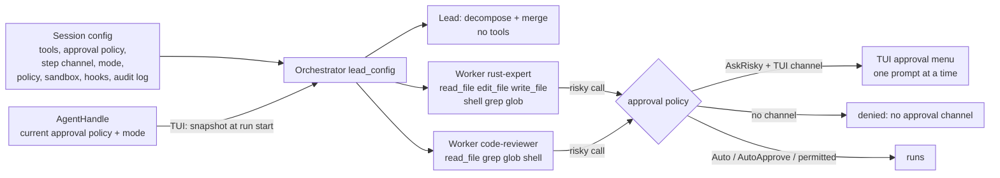

# Orchestrator workers get tools — spec

Branch `fix/worker-tools`. Contract for the TDD rounds: rows W1–W12.

## Problem

An orchestrated run (a prompt the classifier calls complex, or a `/plan` Run)
splits the work into subtasks for specialist agents (`rust-expert`,
`code-reviewer`, …). Every worker is built with an empty `ToolRegistry`
(`crates/hone-core/src/orchestrator.rs`, `build_worker_config`), so it can't
read, search, edit or run anything: it answers in text, from the subtask
description alone. The agent definitions already say which tools each
specialist should have (`tools: [read, edit, write, shell, grep, glob]`), but
nothing uses that list for workers.

Two more defects sit on the same path:

- **The tool names in the built-in agent files don't match the tools.** The
  files say `read`, `write`, `edit`; the tools are `read_file`, `write_file`,
  `edit_file`. `filtered_registry` drops unknown names, so today an
  `@rust-expert` turn (TUI) and a distributed worker (`honed`) get only
  `shell`, `grep`, `glob`.
- **A fixed 300 s per-worker timeout.** Harmless for text-only workers; a
  worker that runs `cargo test` or waits for you to approve a command needs
  longer, and a timed-out worker's approval prompt would stay on screen.

## Principle

**A worker gets no more than the session's main agent has.** Its tools are
the session's tools narrowed by its agent definition; it runs under the
session's approval policy, approval channel, mode, permission policy, sandbox,
hooks and audit log. The lead (decompose and merge) keeps no tools.

## Rows

### Core (`hone-core`)

| Row | Behaviour |
|---|---|
| W1 | **Workers get tools.** A worker's registry is `filtered_registry(&lead_config.tools, def.tools)` for its agent definition. An empty `tools:` list, or an agent name not in the registry, gives the whole `lead_config.tools` (as for the main agent). Visible in the tool definitions the worker sends to the provider. |
| W2 | **The lead keeps no tools.** Decompose and merge requests carry no tool definitions, even when `lead_config.tools` is full. Lead config otherwise unchanged (Auto, no step channel, no hooks, no audit log). |
| W3 | **Short tool names resolve.** In `filtered_registry`, `read` → `read_file`, `write` → `write_file`, `edit` → `edit_file`. Real names still work; a list may mix both; a name that resolves to nothing is skipped with a warning (as now); listing a tool twice (`read` and `read_file`) registers it once. Applies everywhere `filtered_registry` is used (workers, TUI `@agent`, `honed` executor). |
| W4 | **Approvals follow the session.** A worker takes `approval_policy` and `step_rx` from `lead_config`. With `AskRisky` and a step channel, a risky call pauses (`ToolCallPaused` on the run's event channel) and runs or not per the `StepAction` answer. With `AskRisky` and no channel, it is denied (`denied: no approval channel`) and the worker carries on. With `Auto`, it runs. A tool in `always_allowed` runs without a pause. |
| W5 | **Mode follows the session.** `lead_config.mode`: `Build` → worker in `Build`; `AutoApprove` → worker in `AutoApprove` (no approval pauses; the permission policy still applies); `Plan` → worker registry narrowed to read-only tools (`read_only_registry` after W1's filter) and the worker in `Build`, so no worker writes a plan file and no `PlanSaved` event is sent. |
| W6 | **Policy, sandbox, hooks and audit log follow the session.** A worker takes `policy`, `sandbox`, `sandbox_policy`, `hooks` and `egress_log` from `lead_config` (a policy `deny` rule blocks a worker's call; a `PreToolUse` hook runs for it; its calls are in the audit log). An agent definition's own `sandbox:` profile is **not** applied in-process (it could loosen the session's sandbox). |
| W7 | **Parallel workers ask one at a time.** Workers that share a step channel never have two approval prompts outstanding: the second worker's `ToolCallPaused` comes only after the first worker's answer. Each answer reaches the worker that asked (a `Deny` for worker A doesn't deny worker B's call). |
| W8 | **Optional worker timeout.** `Orchestrator::without_worker_timeout()` turns off the per-worker timeout; a worker then runs until it ends or the run is dropped. The default stays 300 s and `with_worker_timeout(secs)` still works. |

### `AgentHandle`

| Row | Behaviour |
|---|---|
| W9 | **`AgentHandle::mode() -> Option<AgentMode>`** returns the agent's current mode: the config's mode at spawn, then the last `set_mode`; `None` if the actor has stopped. (Mirrors `approval_policy()`.) |

### TUI (`bins/hone`, `spawn_orchestrated_turn`)

| Row | Behaviour |
|---|---|
| W10 | **The run uses the agent's current approval policy and mode.** Inside the spawned task, before building the orchestrator, the config takes `agent.approval_policy().await` and `agent.mode().await` (on `None`, the config keeps its own mode). So "always" answers given earlier in the session, earlier `/permit`s and `/mode` changes reach the workers. Done in the task, not in the UI loop (never wait on the actor from the UI loop). |
| W11 | **No per-worker timeout in the TUI.** `spawn_orchestrated_turn` builds the orchestrator with `without_worker_timeout()`; Esc stops the run. `hone orchestrate` and the web server keep the 300 s default. |
| W12 | **A worker's tool calls reach the TUI.** `ToolCallStart`, `ToolCallPaused`, `ApprovalRequired` and `ToolCallEnd` from a worker are forwarded to the TUI channel; a `StepAction` sent on the session's step channel answers a worker's pause; the run still ends with exactly one `Done` (G14 of the plan-gate spec). |

## What each entry point gets

| Entry point | Tools a worker can use | Risky calls |
|---|---|---|
| TUI (complex prompt, `/plan` Run) | its agent's list, from the session's tools | asked in the TUI, one at a time; read-only tools in Plan mode; no pause in AutoApprove mode or once permitted |
| `hone orchestrate` | its agent's list, from the session's tools | run without asking (the session is `Auto`, like `hone -p`); the permission policy applies |
| Web UI / `POST /orchestrate` | read-only (`read_file`, `grep`, `glob`): the server's run config is in Plan mode | none |
| `honed` distributed worker | unchanged (`AgentExecutor`), but W3 now gives it `read_file`, `edit_file`, `write_file` | unchanged |

## Out of scope (follow-ups)

- **Parallel workers can edit the same file.** Ready subtasks still run in
  parallel (up to 4). A `write_file` from one worker can overwrite another's
  edit. The planner is asked to order dependent subtasks; nothing enforces
  `scope`.
- **The approval menu doesn't say which worker asks** (`ToolCallPaused` has no
  agent field).
- **An "always" answer to a worker's prompt covers only that worker**
  (`approve_always` on its own config): sibling workers and the session's
  later turns ask again.
- **Worker tool output streams into one message** with the other workers'
  text, as today.
- **No test run after an orchestrated turn** (`maybe_run_test_verification`
  runs only after simple and medium turns).
- **`/budget` doesn't cap workers**; `hone orchestrate` and the server keep the
  300 s worker timeout, which a long build can hit.
- **An agent definition's `sandbox:` profile** is not applied to in-process
  workers (W6).
- **Session "always" approvals of policy `ask` rules** are per agent: a worker
  asks again even if the main agent was told "always".
