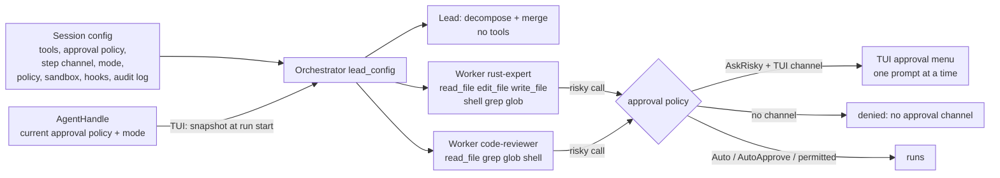

# Orchestrator workers get tools — spec

Branch `fix/worker-tools`. Contract for the TDD rounds: rows W1–W49.

## Problem

An orchestrated run (a prompt the classifier calls complex, or a `/plan` Run)
splits the work into subtasks for specialist agents (`rust-expert`,
`code-reviewer`, …). Every worker is built with an empty `ToolRegistry`
(`crates/hone-core/src/orchestrator.rs`, `build_worker_config`), so it can't
read, search, edit or run anything: it answers in text, from the subtask
description alone. The agent definitions already say which tools each
specialist should have (`tools: [read, edit, write, shell, grep, glob]`), but
nothing uses that list for workers.

Two more defects sit on the same path:

- **The tool names in the built-in agent files don't match the tools.** The
  files say `read`, `write`, `edit`; the tools are `read_file`, `write_file`,
  `edit_file`. `filtered_registry` drops unknown names, so today an
  `@rust-expert` turn (TUI) and a distributed worker (`honed`) get only
  `shell`, `grep`, `glob`.
- **A fixed 300 s per-worker timeout.** Harmless for text-only workers; a
  worker that runs `cargo test` or waits for you to approve a command needs
  longer, and a timed-out worker's approval prompt would stay on screen.

## Principle

**A worker gets no more than the session's main agent has.** Its tools are
the session's tools narrowed by its agent definition; it runs under the
session's approval policy, approval channel, mode, permission policy, sandbox,
hooks and audit log. The lead (decompose and merge) keeps no tools.

## Rows

### Core (`hone-core`)

| Row | Behaviour |
|---|---|
| W1 | **Workers get tools.** A worker's registry is `filtered_registry(&lead_config.tools, def.tools)` for its agent definition. An empty `tools:` list gives the whole `lead_config.tools` (as for the main agent); an agent name not in the registry gets read-only tools (W26). Visible in the tool definitions the worker sends to the provider. |
| W2 | **The lead keeps no tools.** Decompose and merge requests carry no tool definitions, even when `lead_config.tools` is full. Lead config otherwise unchanged (Auto, no step channel, no hooks, no audit log). |
| W3 | **Short tool names resolve.** In `filtered_registry`, `read` → `read_file`, `write` → `write_file`, `edit` → `edit_file`. Real names still work; a list may mix both; a name that resolves to nothing is skipped with a warning (as now); listing a tool twice (`read` and `read_file`) registers it once. Applies everywhere `filtered_registry` is used (workers, TUI `@agent`, `honed` executor). |
| W4 | **Approvals follow the session.** A worker takes `approval_policy` and `step_rx` from `lead_config`. With `AskRisky` and a step channel, a risky call pauses (`ToolCallPaused` on the run's event channel) and runs or not per the `StepAction` answer. With `AskRisky` and no channel, it is denied (`denied: no approval channel`) and the worker carries on. With `Auto`, it runs. A tool in `always_allowed` runs without a pause. |
| W5 | **Mode follows the session.** `lead_config.mode`: `Build` → worker in `Build`; `AutoApprove` → worker in `AutoApprove` (no approval pauses; the permission policy still applies); `Plan` → worker registry narrowed to read-only tools (`read_only_registry` after W1's filter) and the worker in `Build`, so no worker writes a plan file and no `PlanSaved` event is sent. |
| W6 | **Policy, sandbox, hooks and audit log follow the session.** A worker takes `policy`, `sandbox`, `sandbox_policy`, `hooks` and `egress_log` from `lead_config` (a policy `deny` rule blocks a worker's call; a `PreToolUse` hook runs for it; its calls are in the audit log). An agent definition's own `sandbox:` profile is **not** applied in-process (it could loosen the session's sandbox). |
| W7 | **Parallel workers ask one at a time.** Workers that share a step channel never have two approval prompts outstanding: the second worker's `ToolCallPaused` comes only after the first worker's answer. Each answer reaches the worker that asked (a `Deny` for worker A doesn't deny worker B's call). |
| W8 | **Optional worker timeout.** `Orchestrator::without_worker_timeout()` turns off the per-worker timeout; a worker then runs until it ends or the run is dropped. The default stays 300 s and `with_worker_timeout(secs)` still works. |

### `AgentHandle`

| Row | Behaviour |
|---|---|
| W9 | **`AgentHandle::mode() -> Option<AgentMode>`** returns the agent's current mode: the config's mode at spawn, then the last `set_mode`; `None` if the actor has stopped. (Mirrors `approval_policy()`.) |

### TUI (`bins/hone`, `spawn_orchestrated_turn`)

| Row | Behaviour |
|---|---|
| W10 | **The run uses the agent's current approval policy and mode.** Inside the spawned task, before building the orchestrator, the config takes `agent.approval_policy().await` and `agent.mode().await` (since W19/W32: one `run_settings()` read, and a stopped agent is an error). So "always" answers given earlier in the session, earlier `/permit`s and `/mode` changes reach the workers. Done in the task, not in the UI loop (never wait on the actor from the UI loop). |
| W11 | **No per-worker timeout in the TUI.** `spawn_orchestrated_turn` builds the orchestrator with `without_worker_timeout()`; Esc stops the run. `hone --orchestrate` and the web server keep the 300 s default. |
| W12 | **A worker's tool calls reach the TUI.** `ToolCallStart`, `ToolCallPaused`, `ApprovalRequired` and `ToolCallEnd` from a worker are forwarded to the TUI channel; a `StepAction` sent on the session's step channel answers a worker's pause; the run still ends with exactly one `Done` (G14 of the plan-gate spec). |

### Shared "always" (W13–W17, added at the user's request)

An "always" answer means "for this session": it covers the main agent and
every worker of every orchestrated run, whichever of them asked. Today an
"always" lives on the one agent that asked (`approve_always` on its own
`approval_policy`, rule entries in its own `policy_session_approved`).

| Row | Behaviour |
|---|---|
| W13 | **`SessionApprovals`** (`hone-core`, public, `Send + Sync`): the "always" answers of one session — tool names approved for the approval-policy pause, and the policy-gate session-approval entries (`session_approval_entries`). Every `Agent` has one: its own, new, by default; `Agent::with_session_approvals(Arc<SessionApprovals>)` replaces it with a shared one; `AgentHandle::session_approvals() -> Option<Arc<SessionApprovals>>` returns the actor's (`None` if the actor has stopped). Agents never share one unless it is attached explicitly (two `AgentHandle`s, e.g. two server sessions, don't). |
| W14 | **"Always" is recorded.** An `ApproveAlways` answer at the approval-policy pause records the tool name, and one at a policy `ask` prompt records the rule's entries, in the agent's `SessionApprovals` — as well as where they go today. |
| W15 | **"Always" is honoured.** Before each tool call's gates, the agent takes in its `SessionApprovals`: tool names through `approve_always` on its approval policy (so `Auto` and `AlwaysAsk` behave as now: `--step` still asks every time), and entries into its policy session approvals (so the policy gate, the read filter and the read-before-edit guard see them). A call it covers runs without a prompt. |
| W16 | **Workers of a run share one.** The orchestrator attaches one `SessionApprovals` to every worker: its own by default (so workers share even outside the TUI), or the one passed to `Orchestrator::with_session_approvals`. A worker that was going to ask — including one waiting for its turn on the step channel — checks again once it holds the channel, before it sends a prompt, and doesn't ask if an "always" given meanwhile now covers the call (another worker's "always" for the same tool, or entries that now clear the policy rule). It never re-checks after it has sent a prompt. |
| W17 | **The TUI shares the session agent's.** `spawn_orchestrated_turn` attaches `agent.session_approvals().await` to the orchestrator (in the spawned task, like W10). So an "always" given to a worker covers the run's other workers, later runs and the main agent's later turns; an "always" given to the main agent — including for a policy `ask` rule — covers the workers. |

### Review round 1 (W18–W22)

| Row | Behaviour |
|---|---|
| W18 | **An `@agent` persona's tool list reaches orchestrated runs.** When an inline `@agent` with a `tools:` list narrows the session agent's tools for a turn that is classified complex, the orchestrated run's config gets the same narrowed registry, so its workers narrow from it: a worker never has a tool the persona's turn doesn't. (Review B1: workers narrowed from the full session registry.) |
| W19 | **A stopped agent fails closed.** If the session agent's actor has stopped (`mode()` or `session_approvals()` is `None`), `spawn_orchestrated_turn` sends exactly one `Error` ("orchestration failed: the agent has stopped") and starts no lead or worker call. (Review S1: it fell back to `AskRisky`/`Build`.) |
| W20 | **Exact tool names win over aliases.** `filtered_registry` looks a name up as given first and uses the alias only when no tool has that exact name: an MCP tool called `write` is kept for `tools: [write]`. (Review S2.) |
| W21 | **A key in the approval menu stops the turn.** <kbd>x</kbd> in the approval menu denies the paused call, closes the menu and cancels the turn the way <kbd>Esc</kbd> does when no menu is open (an orchestrated run stops: its workers are dropped and no further menus open for it). The menu's key hints list it. Like the other letter keys, it counts only after the menu's 400 ms guard. (Review S4: with workers queued to ask, each <kbd>Esc</kbd> skipped one call and the next menu opened at once.) |
| W22 | **The server's run config stays Plan mode.** A test pins that `POST /orchestrate` builds its run config in `AgentMode::Plan`, so its workers are read-only. (Review S5.) |

### Commands end with their call (W23–W25, added at the user's request)

Today a shell command keeps running when its tool call ends early: the shell
tool runs `sh -c` through `Command::output()`, and dropping that future (Esc,
a worker timeout, a stopped orchestrated run, or the tool's own `timeout_ms`)
leaves the process and everything it started running. `sh -c "cargo test"`
keeps building and testing after Esc. The TUI's post-turn test run
(`test_loop` `run_cmd`) is the same.

| Row | Behaviour |
|---|---|
| W23 | **The shell tool's command ends with its call** (`hone-tools`). On unix each command runs in its own process group (the group the sandbox wrapper, `sh` and everything they start belong to), with stdin closed (`Stdio::null()`; today it is inherited despite `output()`'s docs, so in the TUI a command that reads stdin waits on the terminal until it times out). If the call ends before the command does — its future is dropped, or `timeout_ms` passes (still `ToolError::Timeout`) — the whole group gets `SIGKILL`, including grandchildren such as a backgrounded `(sleep 1; touch f) &`. A command that finishes normally is left alone, as now. Children are reaped (no zombies). Elsewhere, the direct child is killed. |
| W24 | **The TUI's post-turn test run ends with its turn.** `test_loop`'s test command runs the same way (one shared helper), so <kbd>Esc</kbd> during the test run kills it. |
| W25 | **hone's exit kills running commands.** A process-wide registry tracks running command groups; `hone_tools` exposes a function that kills them all. The TUI calls it when it exits (quit, <kbd>Ctrl</kbd>+<kbd>C</kbd>, SIGINT) and on SIGTERM and SIGHUP (which it now handles like SIGINT). One-shot runs (`hone "prompt"`, `--orchestrate`) handle SIGINT, SIGTERM and SIGHUP by killing running commands and exiting with 128 + the signal number (amended by W37: they re-raise the signal; and by W41: an ignored signal stays ignored). Without this, moving commands out of hone's process group (W23) would let them outlive hone, because the terminal's <kbd>Ctrl</kbd>+<kbd>C</kbd> and hangup no longer reach them. |

### Made-up agent names (W26, added at the user's request)

| Row | Behaviour |
|---|---|
| W26 | **A worker for an agent name not in the registry gets read-only tools**: `read_only_registry` of what it would otherwise get (the session's tools, after W18's persona narrowing and W5's mode), with a `tracing::warn!` naming the agent. It still runs, with the lead's system prompt as now. An agent that is in the registry with an empty or missing `tools:` list still gets every session tool. The planner's own fallback plan (`single_subtask_plan`) uses the first registered agent, so it is unaffected unless the registry is empty. (Review N3: a typo such as `rust_expert` gave a worker every tool.) |

### Review round 2 (W27–W32)

| Row | Behaviour |
|---|---|
| W27 | **The cancel drain answers what it drops.** When <kbd>Esc</kbd> or <kbd>x</kbd> cancels a turn, the TUI loop still drops queued events so no menu opens for the cancelled run, but each `ToolCallPaused` it drops is answered with `StepAction::Deny("turn cancelled")` on the step channel, so whoever holds the step lock (e.g. a post-turn fix run, which isn't the cancelled task) is released instead of waiting forever. Queued `Done` events still update the session's cost and token counts. (Review 2 S1: a dropped prompt could wedge the session.) |
| W28 | **An "always" at a policy `ask` prompt also covers the risky-tool pause.** When the permission gate clears an `ask` rule only because of a session "always" (the agent's own or shared, W13), the approval-policy pause is skipped for that call, as it is when the user answers the policy prompt within the same call. With `AlwaysAsk` (`--step`) the pause still asks. (Review 2 S2: under `AskRisky`, the TUI default, other workers were still asked.) |
| W29 | **"Always" is recorded before the step channel is released.** The answering agent records the tool name or policy entries in its `SessionApprovals` while it still holds the step lock, so a worker waiting for the lock always sees it (W16 holds on the multi-thread runtime). Under `AlwaysAsk` nothing is recorded for the approval pause. `SessionApprovals`' recording methods are `pub(crate)`: code outside `hone-core` can't grant an "always". (Review 2 S3, nits 2 and 3: a queued worker sometimes asked again.) |
| W30 | **Built-in agent files list real tool names** (`read_file`, `write_file`, `edit_file`), so a connected MCP tool named `read`, `write` or `edit` never replaces a built-in persona's file tools. The aliases (W3, W20) remain for user agent files. (Review 2 S4.) |
| W31 | **<kbd>x</kbd> aborts first, and needs an empty input box.** <kbd>x</kbd> acts only when the input box is empty (like <kbd>a</kbd> and <kbd>Enter</kbd>). The TUI loop aborts the current turn first, then answers the paused call with `Deny`, so a paused call from another task is answered too. (Best effort: `abort()` only requests cancellation, so a denied worker may begin its next model call before it is dropped; it can't run a risky call without another approval.) (Review 2 nit 1; amends W21.) |
| W32 | **One snapshot of the run settings.** `AgentHandle::run_settings() -> Option<RunSettings>` returns the approval policy, mode and session approvals in one actor round trip; `spawn_orchestrated_turn` uses it, and `None` is W19's error. No `AskRisky` fallback is left. (Review 2 nit 4; amends W10, W17, W19.) |

### Which worker is asking (W33–W34, added at the user's request)

| Row | Behaviour |
|---|---|
| W33 | **Approval events name the worker.** `AgentEvent::ToolCallPaused` and `AgentEvent::ApprovalRequired` gain `worker: Option<WorkerRef>` (`hone-proto`; `WorkerRef { task_id, agent }`), serialized only when set (`#[serde(default, skip_serializing_if = "Option::is_none")]`), so the JSON for the main agent's events is unchanged and old payloads without it still parse. An orchestrator worker's approval events carry its subtask id and agent name (set on the worker's `Agent` by the orchestrator, e.g. `Agent::with_worker(WorkerRef)`); the main agent's carry `None`. Both the approval-policy pause and a policy `ask` prompt are tagged. |
| W34 | **The TUI's approval menu shows it.** When the paused call has a `worker`, the menu shows a line naming it — the agent and the subtask id, plus the subtask's description when the TUI has it from that worker's `WorkerStarted`, cut to fit the menu width. A main-agent prompt shows no such line, as now. The worker named belongs to the call being asked about (a later prompt from another worker replaces it). |

### Web UI workers can ask (W35–W36, added at the user's request)

The user chose the full version: today `POST /orchestrate` has no approval
channel and its run config is in Plan mode, so web workers are read-only and
never ask.

| Row | Behaviour |
|---|---|
| W35 | **`POST /orchestrate` step mode** (`hone-server`). `OrchestrateRequest` gains `request_id: Option<String>` and `approval_policy: Option<ToolApprovalPolicy>` with `/run`'s rules: step mode is on when `approval_policy` is given and isn't `Auto`; then `request_id` is required (400 without it), a `request_id` already in use gives 409, and the run is registered in the run registry for its whole life, so `POST /run/{request_id}/step` answers its prompts. In step mode the run config is in `Build` mode with that approval policy and the run's step channel: workers get their agent's tools from the server's set (`read_file`, `write_file`, `edit_file`, `glob`, `grep`, `shell`; W26 still makes made-up agents read-only), a risky call sends `tool_call_paused` with `worker` (W33), workers ask one at a time and share "always" answers within the run (W16), and there is no per-worker timeout (a person answers; a client that disconnects cancels the run). Without step mode (no `approval_policy`, or `Auto`) nothing changes: Plan mode, read-only workers, 300 s timeout (W22). `?dry_run=true` ignores both fields and registers nothing. |
| W36 | **The web UI asks for it and names the worker** (`apps/webui`). The `tool_call_paused` and `approval_required` event types gain an optional `worker: { task_id, agent }`. The approval dialog shows a line naming the worker — agent, subtask id, and the subtask's description from the run's `worker_started` events — and nothing for the main agent. With step mode on, an orchestrated run (Run on the plan preview) sends a `request_id` and `approval_policy: { AskRisky: { always_allowed: [] } }`, as `/run` does, and the dialog's answers go to `/run/{request_id}/step`; with it off, and for `?dry_run=true`, it sends neither. Verified by `npm run build` (`tsc --noEmit` + `vite build`); the web UI has no test runner. |

### Review round 3 (W37–W40)

| Row | Behaviour |
|---|---|
| W37 | **One-shot runs die by the signal.** On SIGINT, SIGTERM or SIGHUP a one-shot run kills its running commands, then restores the signal's default action and re-raises it, so hone ends *by* the signal (a calling shell script stops on <kbd>Ctrl</kbd>+<kbd>C</kbd>, as before W25); `exit(128 + n)` is only the fallback if re-raising returns. The handler lives in `hone_tools` next to `kill_running_commands` (the binary needs no `libc`). (Review 3 S1: hone exited normally with 130 and `for f in *; do hone "fix $f"; done` carried on.) |
| W38 | **Every mode that runs commands kills them on exit.** The one-shot handlers are installed for every non-TUI mode that can run the shell tool, including `--ensemble` and `--recipe` (installed before their branches). `honed` calls `kill_running_commands()` in its shutdown path and also shuts down on SIGHUP. `run_command` disarms its guard only when the wait succeeded, so a failed wait still kills the group on drop. (Review 3 S2 and nit 2.) |
| W39 | **<kbd>Esc</kbd> stops the post-turn test run.** With the TUI idle, an empty input box, and the previous turn's task (the post-turn test run and any fix turns it starts) still running, <kbd>Esc</kbd> aborts that task — killing its test command (W24) — and says so in a system line. With text in the input box, <kbd>Esc</kbd> clears it, as now. (Review 3 S3: the test run started after the turn's `Done`, when <kbd>Esc</kbd> only cleared the input.) |
| W40 | **Approval menu polish.** The key-hint footer stays visible however short the terminal (the argument lines are cut first) and long argument lines wrap; the worker line marks the planner-written description as quoted task text (e.g. in quotes and a muted style); the App forgets earlier workers' descriptions on `PlanCreated`. (Review 3 nits 6–8.) |

### Review round 4 (W41–W47)

| Row | Behaviour |
|---|---|
| W41 | **An ignored signal stays ignored.** `hone` (one-shot and TUI) and `honed` install a handler for SIGINT, SIGTERM or SIGHUP only if that signal isn't ignored when they start: under `nohup` (SIGHUP ignored) or as a background job (SIGINT ignored) the signal keeps being ignored, as before W25. One helper in `hone_tools` decides it (`sigaction` with a null new action, checking for `SIG_IGN`). (Review 4 S1: `nohup hone --orchestrate …` and `nohup honed` died on hangup.) |
| W42 | **The approval menu always shows what a call touches.** Short identifying fields (`path`, `file_path`, `command`, `url`, `pattern`) are shown before the others, and every value is capped at a few wrapped rows with "… (N more chars)", so a long `content` or `new_string` can't push the target path out of view. (Review 4 S2: sorted keys put `content` before `path`; W40's wrapping then hid the path.) |
| W43 | **The web dialog ignores clicks for 400 ms** after a prompt is shown and after each click, like the TUI's guard, so a human double-click can't answer the next worker's prompt. (Review 4 S3: the in-flight check only covered the same prompt.) |
| W44 | **An `@agent` persona is restored even when its turn is aborted.** The inline wrapper's restore (system prompt and tools) also runs when the wrapper task is aborted — by <kbd>Esc</kbd> during the turn or W39's <kbd>Esc</kbd> during the post-turn work. (Review 4 S4.) |
| W45 | **Esc really stops a running fix turn.** The post-turn task gives its fix turns an event channel it owns (as `spawn_agent_turn` does), so aborting it closes the channel and the agent cancels the fix turn, including its pending tool calls. W39's system line reads "Stopped the post-turn test run and any fixes." (the App can't tell cheaply which was running). (Review 4 S5: aborting only dropped the wait; the actor finished the fix turn.) |
| W46 | **Web UI approval races.** The dialog opens only on `tool_call_paused` (`approval_required` is information, as in the TUI), so one server prompt never shows two dialogs; a failed answer keeps the dialog open for a retry unless the response is 2xx, 404 or 410; a closing stream resets the active run id only if it is still that run's. (Review 4 web 1–3.) |
| W47 | **Server input checks** (older bugs W35 touches). A `request_id` on `/run` or `/orchestrate` must be 1–128 characters of `A-Z a-z 0-9 - _` (400 otherwise), because `/run` names its provenance file after it and `../` escaped the provenance directory. `max_workers` must be at least 1 (400 for 0, which panicked in `chunks(0)`). |

### Review round 5 (W48–W49)

| Row | Behaviour |
|---|---|
| W48 | **<kbd>Esc</kbd> kills the main agent's running command.** In the agent loop, a tool call's dispatch races the turn's event channel closing (biased to the close): when the caller goes away (<kbd>Esc</kbd> aborts the TUI's turn task and drops its receiver; a worker or fix turn is dropped), the dispatch future is dropped, so `run_command`'s guard kills the command's process group (W23) and the turn ends cancelled instead of waiting for the command. Applies to every tool call, so W45 also cancels mid-tool. (Review 5 F1, reproduced: the actor kept running `sh` for 3.8 s after <kbd>Esc</kbd> and its grandchild survived.) |
| W49 | **Small approval-safety fixes.** In the TUI menu, identifying fields (`command`, `url`, …) get a larger cap than bulk fields (so a long command isn't cut after six rows); in the web dialog, focus moves to the dialog when a new prompt replaces the shown one (so <kbd>Enter</kbd>/<kbd>Space</kbd> can't approve it through the previously clicked button), and the `approval_required` note is an info note, not an error. The `signal_ignored` tests reset SIGHUP/SIGINT/SIGTERM to their defaults in the child before applying their own ignore list, so they pass when `cargo test` itself runs with signals ignored. (Review 5 nits.) |

## What each entry point gets

| Entry point | Tools a worker can use | Risky calls |
|---|---|---|
| TUI (complex prompt, `/plan` Run) | its agent's list, from the session's tools | asked in the TUI, one at a time; read-only tools in Plan mode; no pause in AutoApprove mode or once permitted |
| `hone --orchestrate` | its agent's list, from the session's tools | run without asking (the session is `Auto`, like a one-shot `hone "prompt"`); the permission policy applies |
| Web UI / `POST /orchestrate` | without step mode: read-only (`read_file`, `grep`, `glob`), the run config is in Plan mode; with step mode (W35): its agent's list from the server's tools | without step mode: none; with it: asked in the web UI's dialog, one at a time |
| `honed` distributed worker | unchanged (`AgentExecutor`), but W3 now gives it `read_file`, `edit_file`, `write_file` | unchanged |

## Out of scope (follow-ups)

- **Parallel workers can edit the same file.** Ready subtasks still run in
  parallel (up to 4). A `write_file` from one worker can overwrite another's
  edit. The planner is asked to order dependent subtasks; nothing enforces
  `scope`.
- **The desktop app** (`apps/hone-desktop`) doesn't show the `worker` field.
- **Worker tool output streams into one message** with the other workers'
  text, as today.
- **No test run after an orchestrated turn** (`maybe_run_test_verification`
  runs only after simple and medium turns).
- **`/budget` doesn't cap workers**; `hone --orchestrate` and the server keep the
  300 s worker timeout, which a long build can hit.
- **An agent definition's `sandbox:` profile** is not applied to in-process
  workers (W6).
- **Other commands hone runs** (`!command` in the TUI, hooks, a recipe's
  `test_cmd`) still run as before; Esc doesn't stop a `!command`.
- **A command that starts its own session or process group** (`setsid`,
  some daemons) escapes the group kill.
- **The approval policy and mode are taken when the run starts**: switching to
  Plan mode mid-run doesn't stop running workers from writing.
- **Commands that need the terminal** (an ssh passphrase, a git credential
  prompt reading `/dev/tty`) stop in their own process group until the
  tool's timeout; <kbd>Ctrl</kbd>+<kbd>Z</kbd> in a one-shot run suspends hone
  but not its command.
- **A hard kill of hone** (`kill -9`) leaves its commands running.
- **The planner's raw JSON** is shown as assistant text in the web UI (and the
  TUI) while an orchestrated run plans; workers' text runs together in one
  message.
- **`honed` graceful shutdown** waits for a connected step-mode run's stream (also
  `/run`'s); a client that disconnects leaves an orchestrated run starting its
  remaining subtasks and merge; `/orchestrate` mints its own provenance session id,
  so `/provenance/{request_id}/verify` doesn't find a step-mode orchestrated run.
