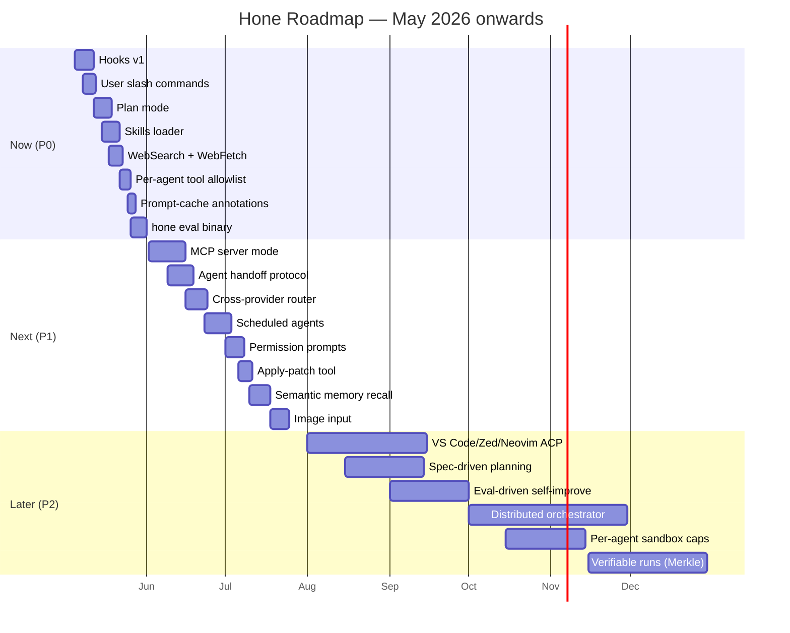
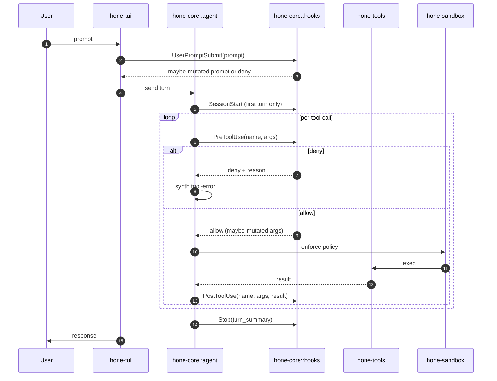

# Hone Competitive Analysis — May 2026

**Author:** AI researcher (Quick Mode)
**Date:** 2026-05-02
**Scope:** Compare Hone against Claude Code CLI, OpenCode (sst/opencode), Goose (block/goose), and Cursor. Identify gaps and a 3-horizon roadmap to make Hone the best open-source coding agent + orchestrator.

---

## 1. Executive summary

The top missing capabilities, ranked by impact for "best open-source orchestrator":

1. **No hook system** (PreToolUse/PostToolUse/UserPromptSubmit/SessionStart). This is the single biggest gap. Claude Code's hooks are why teams adopt it for governance, compliance, and CI integration. Hone has agents and recipes but no deterministic shell-out at lifecycle points.
2. **No first-class plan mode**. Claude Code's plan mode (read-only investigation that produces an explicit plan before any write) is a killer feature for trust. Hone has `--orchestrate` but no read-only "propose a plan, wait for approval" gate.
3. **Skills layer is documented but unimplemented**. README claims "Layer 3 — Skills (HONE.md)" but no skill loader exists in code. Anthropic Skills became a major extensibility surface in late 2025; this needs to ship.
4. **Slash commands are not user-extensible**. Hone has ~6 hardcoded slash commands. Claude Code, OpenCode, and Cursor all let users drop a markdown file in `.claude/commands/` (or equivalent) to define a project-scoped slash command. Trivial win.
5. **No IDE/editor integration**. Cursor wins here; Claude Code has VS Code/JetBrains extensions; OpenCode has editor mode. Hone is terminal-only. The Anthropic Agent Client Protocol (ACP) is already a Hone provider — invert it: ship Hone *as* an ACP server and a thin VS Code/Zed/Neovim client.
6. **No web search or browser tool**. Goose, Claude Code, Cursor all ship web search. Hone has none. For research-heavy or stack-trace-debugging tasks this is table stakes.
7. **No background/scheduled agents**. Goose has recipes-as-cron; Cursor has background agents on cloud; Claude Code has `/loop`. Hone's `honed` daemon could host scheduled agents trivially given it already has SQLite + RBAC.
8. **No sub-agent declarative config**. Claude Code's `agents:` field in settings.json with tool-allowlists per agent is a clean model. Hone has `.hone/agents/*.md` but no per-agent tool restriction or per-agent model override is enforced through a single declarative file format that matches industry convention.
9. **MCP is consumer-only, not server**. Hone is an MCP client. Goose and Claude Code can both *expose* themselves as MCP servers so other agents can call into them. This is what unlocks "agent of agents" orchestration across vendors.
10. **No eval harness as a first-class artifact**. Hone has SWE-bench numbers but no `hone eval` command for users to run local evals against their own task sets. OpenCode and Goose are moving here; this is a moat for an "orchestrator" positioning.

---

## 2. Current Hone capabilities

Hone is a privacy-first Rust coding agent with 13 workspace crates: `hone-{cache, proto, config, sandbox, providers, tools, mcp, index, memory, core, recipes, server, tui}` plus `hone` and `honed` binaries. It already covers an unusually wide surface for an open-source agent: kernel sandboxing (Seatbelt + Landlock), 7 provider adapters + OpenAI-compatible passthrough + ACP, MCP client, encrypted memory (AES-256-GCM, Argon2id, BM25 lexical recall), tree-sitter semantic indexing, real LSP bridges (rust-analyzer, pyright, tsserver, gopls), DAG orchestrator with checkpoint/resume in `hone-core/src/checkpoint.rs`, ensemble + RALPH + self-refine + reviewer + test-verify loops, YAML recipes (9 built-in), 12 built-in agents with `@agent-name` inline dispatch and filesystem overlays (`~/.config/hone/agents` + `.hone/agents`), TDD watch mode, hunk-by-hunk review, session switcher, status bar with cost, context injection (CallGraph default, 95% on SWE-bench v1 sample), HTTP/2+SSE daemon with RBAC, audit logging, rate limiting.

What Hone does NOT have (verified by grep):
- No hook system (`PreToolUse`/`PostToolUse`/etc. — zero matches in source)
- No Skills loader (only mentioned in README; `crates/hone-core/src/` has no `skills.rs` and no skill-loading logic)
- No user-extensible slash commands (`crates/hone-tui/src/commands.rs` has hardcoded `Command` enum with ~6 variants)
- No plan mode (no `plan_mode` symbol)
- No web search / browser / WebFetch tool (`crates/hone-tools/src/` has only `file/`, `git/`, `lsp/`, `screen/`, `shell/`)
- No scheduled/cron/background agents
- No MCP *server* mode
- No IDE extension
- No eval harness binary (only `benchmarks/persona_eval.py`)

---

## 3. Competitor feature matrix

Legend: ✅ shipped • ⚠️ partial • ❌ missing

| Feature | Hone | Claude Code | OpenCode | Goose | Cursor |
|---|---|---|---|---|---|
| Open source | ✅ MIT/Apache | ❌ | ✅ MIT | ✅ Apache | ❌ |
| Terminal TUI | ✅ ratatui | ✅ ink/React | ✅ Bubble Tea | ✅ + Electron | ❌ (IDE) |
| IDE extension (VS Code) | ❌ | ✅ | ⚠️ via lsp | ❌ | ✅ native |
| IDE extension (JetBrains) | ❌ | ✅ | ❌ | ❌ | ⚠️ |
| Multi-agent orchestrator | ✅ DAG+ensemble | ⚠️ subagents | ⚠️ task tool | ⚠️ subagents | ⚠️ |
| Sub-agent declarative file | ⚠️ md files | ✅ settings.json | ✅ agent.json | ✅ recipes | ✅ rules |
| Per-subagent tool allowlist | ❌ | ✅ | ✅ | ✅ | ⚠️ |
| Hook system (Pre/Post tool, etc.) | ❌ | ✅ 8 events | ✅ (similar) | ❌ | ❌ |
| User-defined slash commands | ❌ | ✅ `.claude/commands/` | ✅ | ⚠️ recipes | ⚠️ |
| Plan mode (read-only proposal) | ❌ | ✅ | ✅ | ❌ | ⚠️ ask mode |
| Skills (auto-loaded MD playbooks) | ❌ docs only | ✅ | ⚠️ | ⚠️ | ✅ rules |
| MCP client | ✅ | ✅ | ✅ | ✅ 70+ | ✅ |
| MCP server (expose self) | ❌ | ✅ | ⚠️ | ✅ | ❌ |
| Web search | ❌ | ✅ | ✅ | ✅ | ✅ |
| Web fetch / browser | ❌ | ✅ WebFetch | ⚠️ | ✅ playwright | ✅ |
| Computer use / vision | ❌ | ⚠️ | ❌ | ⚠️ | ⚠️ |
| LSP code intelligence | ✅ embedded | ⚠️ via tools | ⚠️ | ⚠️ | ✅ |
| Tree-sitter semantic index | ✅ pgvector | ❌ | ⚠️ | ❌ | ✅ |
| Memory (cross-session) | ✅ encrypted | ✅ CLAUDE.md | ⚠️ AGENTS.md | ✅ | ✅ rules |
| Sandboxing | ✅ kernel | ⚠️ container | ⚠️ | ❌ | ⚠️ |
| Audit log | ✅ JSONL | ⚠️ | ⚠️ | ⚠️ | ❌ |
| Multi-provider | ✅ 7+ | ❌ Claude only | ✅ many | ✅ 30+ | ✅ several |
| Local models (Ollama) | ✅ | ❌ | ✅ | ✅ | ❌ |
| Cost tracking live | ✅ status bar | ✅ /cost | ⚠️ | ✅ | ⚠️ |
| Sessions / resume | ✅ SQLite | ✅ | ✅ | ✅ | ✅ |
| Recipes / workflows | ✅ 9 YAML | ⚠️ commands | ⚠️ | ✅ recipes | ⚠️ |
| Scheduled / background agents | ❌ | ✅ /loop | ❌ | ⚠️ | ✅ cloud |
| TDD watch mode | ✅ `:tdd` | ❌ | ❌ | ❌ | ❌ |
| Hunk-level review mode | ✅ `:review` | ⚠️ | ⚠️ | ❌ | ✅ |
| Eval harness (user-runnable) | ⚠️ python | ❌ | ⚠️ | ⚠️ | ❌ |
| Web UI / browser client | ✅ basic | ❌ | ❌ | ❌ | ❌ |
| Remote daemon | ✅ honed | ❌ | ❌ | ⚠️ | ✅ cloud |
| Multi-user / RBAC | ✅ | ❌ | ❌ | ❌ | ✅ teams |
| Encrypted memory | ✅ AES-GCM | ❌ | ❌ | ❌ | ❌ |
| Spec-driven planning | ❌ | ⚠️ | ❌ | ⚠️ | ⚠️ |
| Image input | ❌ | ✅ | ⚠️ | ⚠️ | ✅ |
| Voice / audio input | ❌ | ❌ | ❌ | ⚠️ | ⚠️ |
| Prompt caching aware | ⚠️ | ✅ | ⚠️ | ⚠️ | ✅ |

---

## 4. Per-competitor deep dive

### 4.1 Claude Code CLI

The current high-water mark for hooks and skills. **Hooks** fire at 8 lifecycle points (`PreToolUse`, `PostToolUse`, `UserPromptSubmit`, `SessionStart`, `SessionEnd`, `Stop`, `SubagentStop`, `Notification`); they can block tool calls, mutate prompts, or shell out for compliance. **Skills** are auto-loaded markdown playbooks with YAML frontmatter that the model decides to invoke, much richer than slash commands. **Sub-agents** are declared in `settings.json` with per-agent tool allowlists and model overrides. **Slash commands** are user-extensible via `.claude/commands/<name>.md`. **Plan mode** (Shift+Tab cycle) is read-only investigation that produces a plan before any write — the safety story Hone needs. **`/loop`** runs an agent on a recurring goal until a stop condition. **MCP** is bidirectional (consumer + server). What Hone already does better: kernel sandboxing, encrypted memory, multi-provider, ratatui performance, multi-agent DAG orchestration with checkpoint/resume, web UI.

### 4.2 OpenCode (sst/opencode)

Aggressively iterating on the TUI. **Provider-agnostic** like Hone. **Plan mode** ships natively. **User slash commands** via project files. **Hooks** in their config. **agent.json** for sub-agents with tool allowlists. **Mode-switching** between build and plan is one-keystroke. Their biggest UX win is a snappier renderer with diff cards and better handling of long tool outputs (collapsible, with token counts). What Hone already does better: Rust performance, DAG orchestrator with ensemble + RALPH + reviewer, kernel sandboxing, encrypted memory, semantic index, recipes-as-YAML, real LSP bridges, daemon mode.

### 4.3 Goose (block/goose)

Strongest in **extensions** (their term for MCP servers) and **multi-provider** (30+ providers via litellm-style routing). **Recipes** are first-class YAML, similar to Hone's. **Goose Desktop** (Electron) gives a non-terminal UX for non-engineers. **Tutorials/playbooks** are heavily invested in. **Goose can act as an MCP server** so other agents can call it. **Smart context summarization** kicks in automatically near context limits. What Hone already does better: kernel sandboxing, encrypted memory, DAG orchestration with ensemble/RALPH, semantic indexer, multi-user daemon with RBAC, observability (Agent Rail + reports), TDD/review modes.

### 4.4 Cursor

A different category (IDE, not CLI), but the **agent + IDE marriage** is what makes it stick. **Composer** is a multi-file edit agent with diff-first UX. **Background agents** (cloud-hosted) run while you continue working. **`.cursorrules`** is the project-scoped system-prompt overlay every agent now ships. **Tab autocomplete** is a different product, but Cursor's positioning of "agent + autocomplete + IDE" creates lock-in. **MCP** support is solid. **Image input** for screenshots-to-code. What Hone already does better: open source, multi-provider, kernel sandbox, no telemetry, runs anywhere a terminal does, multi-agent orchestrator, encrypted memory.

---

## 5. Gap analysis by theme

### 5.1 Agent orchestration

Hone is *ahead* here. DAG orchestrator (`hone-core/src/orchestrator.rs`), ensemble (`ensemble.rs`), RALPH (`ralph_loop.rs`), reviewer (`reviewer.rs`), self-refine (`self_refine.rs`), test-verify loop (`test_loop.rs`), checkpoint/resume (`checkpoint.rs`), agent registry with hierarchical filesystem overlays (`agent_registry.rs`).

**Gaps:**
- No **per-agent tool allowlist enforcement** in the agent definition file (`agent_def.rs`). Claude Code's `tools: [Read, Grep]` is the standard — Hone parses it but enforcement is loose.
- No **agent handoff protocol** — orchestrator decomposes top-down, but a worker cannot say "hand this back to the supervisor for a different worker." OpenAI Swarm and Anthropic's sub-agent tool model both support this.
- No **inter-agent message bus**. Orchestrator collects results; agents do not stream events to each other. Useful for "researcher streams findings, coder consumes them as they arrive."
- No **visualizer** for the DAG run (would slot into Agent Rail).

### 5.2 Extensibility (MCP, hooks, skills, plugins, recipes)

The biggest gap surface.

| | Status | Note |
|---|---|---|
| MCP client | ✅ | `crates/hone-mcp/` |
| MCP server (expose Hone) | ❌ | Add to `hone-server/` or new `hone-mcp-server/` |
| Hooks | ❌ | Need `hone-core/src/hooks.rs` + 6-8 event points |
| Skills | ❌ | README claims it; no loader exists |
| User slash commands | ❌ | `commands.rs` has hardcoded enum |
| Recipes | ✅ | `crates/hone-recipes/` |
| Plugins (binary extensions) | ❌ | Not strictly needed if MCP + hooks land |

### 5.3 Context engineering

Hone is *strong*: hierarchical skeleton + CallGraph (95% SWE-bench v1 sample), BM25 memory recall, tree-sitter index over pgvector, doom-loop detector, context-budget graceful abort, output-truncation retry, adaptive complexity router.

**Gaps:**
- **No prompt-caching awareness.** Anthropic's `cache_control` blocks (5-min and 1-hour) are how Claude Code keeps cost down on long sessions. Hone's `hone-providers/anthropic.rs` should annotate static system prompt + memory index + skeleton with `cache_control` to claim 90% discount on cached tokens.
- **No automatic context summarization at threshold.** Hone has graceful abort at 95%; Goose summarizes earlier turns to keep going. Add a `summarize_oldest_n_turns` strategy to `hone-core/src/context.rs` triggered at 70%.
- **No retrieval cache for memory.** Each turn re-runs BM25; cache last query → ids in `hone-cache`.
- **No semantic memory recall** (only BM25). pgvector is already a dependency for `hone-index` — bring it to memory recall too.

### 5.4 Tooling depth

| Tool | Hone | Notes |
|---|---|---|
| Read/Write/Edit | ✅ | `hone-tools/src/file/` |
| Shell exec | ✅ | sandboxed |
| Grep / Glob | ✅ | via ignore + walkdir |
| Git ops | ✅ | git2 |
| LSP (4 langs) | ✅ | rust-analyzer, pyright, tsserver, gopls |
| Tree-sitter symbols | ✅ | rust + python |
| Web search | ❌ | needs Tavily / Brave / Exa adapter |
| Web fetch | ❌ | needs reqwest+readability extractor |
| Browser (playwright) | ❌ | optional; via MCP fine |
| Image read | ❌ | need multimodal pass-through to providers |
| Notebook (Jupyter) | ❌ | nbformat parse |
| Apply patch (unidiff) | ⚠️ | review_mode handles hunks but no `apply_patch` tool surfaced to model |
| Diff viewer | ✅ | `:review` |

### 5.5 Workflow

| | Status |
|---|---|
| Slash commands hardcoded | ⚠️ ~6 commands |
| User-extensible slash commands | ❌ |
| Plan mode | ❌ |
| TDD watch | ✅ |
| Review hunk-by-hunk | ✅ |
| Scope clarification | ✅ |
| Recipes (YAML) | ✅ |
| Background / scheduled | ❌ |
| Spec-driven (write spec → impl) | ❌ |

### 5.6 UX

| | Status |
|---|---|
| TUI (ratatui) | ✅ fast |
| Vim mode | ✅ |
| Web UI | ✅ basic single-page |
| IDE plugin | ❌ |
| Mobile / notifications | ❌ (terminal bell only) |
| Image / screenshot paste | ❌ |
| Output collapsing | ⚠️ |
| Theme system | ✅ |
| Keybindings discoverable | ✅ Ctrl+? |

### 5.7 Multi-provider

Hone is the best in class on breadth (Anthropic, OpenAI, Ollama, Claude CLI, Gemini CLI, ACP, OpenAI-compat passthrough). But:

- **No model router** — choose model per-task based on cost/latency/capability. `hone-core/src/complexity.rs` routes by complexity tier but always inside one provider. Add cross-provider routing: simple → DeepSeek/Qwen, medium → Sonnet, complex → Opus.
- **No cost-aware fallback.** If Anthropic 529s, fall back to OpenAI with same prompt. Trivial in `hone-providers`.
- **No structured-output mode.** OpenAI/Anthropic both have JSON mode / strict schemas; Hone parses tool calls but does not request strict schemas.
- **No prompt caching toggling.** As noted above.

### 5.8 Safety & governance

Hone is *ahead* of every competitor here: kernel sandbox (Seatbelt/Landlock), AES-256-GCM encrypted memory, RBAC, audit log, egress log. The remaining gap:

- **No permission prompt UX** like Claude Code's "do you want to allow `rm -rf /tmp/foo`? [y/n/always]". Hone has command classification (`hone-tools/src/shell/`) but no interactive prompt before destructive actions in interactive mode.
- **No allowlist persistence** ("always allow `cargo test`"). Should land in `~/.config/hone/permissions.toml`.
- **No secret scrubbing** in audit logs / session reports (env-var values, API keys in shell args).
- **No supply-chain verification** for MCP servers (signed manifests, capability declarations).

### 5.9 Reproducibility

| | Status |
|---|---|
| Sessions saved | ✅ SQLite |
| Resume by name | ✅ |
| Replay (re-run identical inputs) | ❌ |
| Deterministic seeds across runs | ⚠️ temperature=0 only |
| Eval harness (binary) | ❌ |
| Snapshot artifacts | ⚠️ session reports |
| Test against task suite | ⚠️ python script |

---

## 6. Recommended roadmap

### 6.1 Now (next 4 weeks) — close the table-stakes gap

1. **Hooks v1 — `hone-core/src/hooks.rs`** (highest ROI single feature).
   - Events: `PreToolUse`, `PostToolUse`, `UserPromptSubmit`, `SessionStart`, `SessionEnd`, `Stop`, `SubagentStop`, `OnError`.
   - Config: `~/.config/hone/hooks.toml` + `.hone/hooks.toml` (overlay like agents).
   - Hook = shell command receiving JSON on stdin, returning JSON on stdout (`{deny: bool, message: string, mutated_input: any}`).
   - Wire in `hone-core/src/agent.rs` turn loop and `hone-core/src/orchestrator.rs` worker-spawn site.
   - Safety: hooks run inside the same sandbox policy as tools.
2. **User-extensible slash commands** in `crates/hone-tui/src/commands.rs`.
   - Discover `.hone/commands/*.md` and `~/.config/hone/commands/*.md`.
   - YAML frontmatter: `description`, `args`, `model?`, `agent?`, `tools?`.
   - Body is the prompt template with `{{args}}` substitution.
3. **Plan mode** as a first-class agent state in `hone-core/src/agent.rs`.
   - Toggle with `Shift+Tab` in TUI (cycles: Build → Plan → Auto-approve).
   - In Plan mode: tool registry filtered to read-only (`read_file`, `grep`, `lsp_*`, `git_log`, `memory_read`).
   - Final assistant turn writes to `.hone/plans/<timestamp>.md`; user runs `hone --plan <file>` to execute.
   - Use existing `plan_store.rs` as the persistence layer.
4. **Skills loader** in `hone-core/src/skills.rs`.
   - Discover `.hone/skills/<name>/SKILL.md` (and `~/.config/hone/skills/`).
   - YAML frontmatter: `description`, `triggers` (regex on user prompt), `tools`, `model?`.
   - Inject the skill body into system prompt when triggered (or always, if `always: true`).
   - This finally backs the README's "Layer 3" claim.
5. **WebSearch + WebFetch tools** in `crates/hone-tools/src/web/`.
   - WebSearch: pluggable backend (Tavily, Brave, Exa) via env (`HONE_WEBSEARCH_PROVIDER`, `HONE_WEBSEARCH_KEY`).
   - WebFetch: reqwest + `readability` (port `mozilla/readability` heuristics) → markdown.
   - Both go through the egress audit log and are denied by default in offline sandbox profiles.
6. **Per-agent tool allowlist enforcement** in `hone-core/src/agent_registry.rs`.
   - When dispatching `@agent-name`, build a `ToolRegistry` filtered to the agent's `tools:` list.
   - Reject tool calls outside the allowlist with a synthesized tool-error so the model self-corrects.
7. **Prompt-caching annotations** in `crates/hone-providers/src/anthropic.rs`.
   - Mark static system prompt block + memory index block + skeleton block with `cache_control: ephemeral` (5-min) on every request.
   - Gate behind `[providers.anthropic] prompt_cache = true`.
8. **`hone eval` binary** in `bins/hone/` (or new `bins/hone-eval/`).
   - Read a `tasks.toml` (path, prompt, success-check command).
   - Run each task in a fresh session with `--ephemeral`, capture pass/fail + tokens + cost.
   - Emit `report.json` + markdown summary. Backbone for CI regression on agent quality.

### 6.2 Next (1–3 months) — open the orchestrator moat

1. **MCP server mode** in a new `crates/hone-mcp-server/` (or extend `hone-server`).
   - Expose Hone's tool registry, agents, recipes as MCP tools.
   - Lets Claude Code, Cursor, Goose call into Hone — making Hone the *hub* of a multi-agent network. This is the killer feature for "orchestrator of orchestrators."
2. **Agent handoff protocol** in `hone-core/src/orchestrator.rs`.
   - New tool `handoff(target_agent, payload, reason)` available to workers.
   - Supervisor receives the handoff and re-routes to the named agent.
   - Implements OpenAI-Swarm-style routing on top of Hone's DAG.
3. **Cross-provider model router** in `hone-core/src/complexity.rs`.
   - Tier table: cost / latency / quality per provider+model.
   - Policy: `route_policy = "cheapest" | "fastest" | "balanced" | "quality"`.
   - Auto-fallback on 5xx/429.
4. **Background / scheduled agents** in `crates/hone-server/`.
   - SQLite table `scheduled_runs(id, cron_expr, recipe_or_prompt, agent, last_run, status)`.
   - tokio-cron-scheduler tick loop in `honed`.
   - CLI: `hone schedule add --cron "0 9 * * *" --recipe daily-security-audit`.
   - Uses existing checkpoint/resume infra so long runs survive daemon restarts.
5. **Permission prompts + persistent allowlist** in `hone-tui/src/app.rs` + new `hone-config/src/permissions.rs`.
   - On destructive shell command: block, show prompt, options [allow once / always for this command / deny].
   - Persist to `~/.config/hone/permissions.toml`.
   - Bypass with `--yolo` flag for power users (already implied by current behavior; just make it explicit).
6. **Apply-patch tool** in `crates/hone-tools/src/file/patch.rs`.
   - Accept unified diff input from the model; apply atomically with rollback on conflict.
   - Drastically reduces token cost vs full-file rewrites for big files.
7. **Semantic memory recall** (pgvector) in `crates/hone-memory/`.
   - Currently BM25 only. Add embedding column + cosine recall, hybrid-rank with BM25 (RRF fusion).
   - Reuses the pgvector pool already in `hone-index`.
8. **Image input** in `crates/hone-providers/`.
   - Support `image_url` / `base64` content blocks for Anthropic + OpenAI.
   - Add `paste_image` event in TUI (capture clipboard PNG via `arboard` — already a dep).

### 6.3 Later (3–12 months) — moonshots that define "best"

1. **Native VS Code + Zed + Neovim extensions** that speak ACP to a local `honed`.
   - Hone is already an ACP *client* — invert it: ship `hone-acp-server` as a new bin in `bins/`.
   - Editors get the full Hone orchestrator + sandbox + memory without re-implementing any of it.
   - This is the path to compete with Cursor without building a fork of VS Code.
2. **Spec-driven planning** (Kiro-style).
   - New flow: `hone spec "build user auth"` → produces `requirements.md` + `design.md` + `tasks.md` → user approves → `hone --spec` executes.
   - Implementation is mostly composing existing pieces (clarify + recipes + plan mode + orchestrator).
3. **Eval-driven self-improvement loop**.
   - Nightly cron in `honed`: run `hone eval` against a versioned task suite, store results, auto-bisect regressions against prompt/skeleton changes.
   - Becomes the most credible signal of agent quality in the open-source space — nobody else publishes regression-tracked SWE-bench-style numbers continuously.
4. **Distributed multi-machine orchestrator**.
   - Today the DAG runs in one process. Make workers schedulable across multiple `honed` instances over the existing HTTP/2+SSE transport.
   - Use case: 10 workers across 5 machines, each running on its own sandbox/policy.
5. **Capability-typed sandbox profiles** per agent.
   - Today sandbox is one global policy. Per-agent capabilities: `security-auditor` is read-only-everywhere; `tdd-workflow` can write only `tests/**`; `data-engineer` can hit `*.csv` but not `.env`.
   - Foundation already exists in `hone-sandbox`; needs an integration layer in `hone-core/src/agent.rs`.
6. **Verifiable agent runs** (cryptographic provenance).
   - Hash inputs+model+tool-outputs into a Merkle log; sign with a session key.
   - Audit log becomes a tamper-evident chain. Differentiator for regulated industries.
7. **MCP marketplace inside `hone configure`**.
   - Curated list of MCP servers with one-line install. Goose has the lead here; copy and improve.
8. **Multimodal input pipeline** (screenshots, audio, video).
   - Screenshots already implied by image input above. Audio in via whisper.cpp (local). Video frame-sampling for screen-recording-driven debugging.
9. **Local fine-tune loop** that converts session reports + outcomes into LoRA fine-tunes for Ollama models — closes the data flywheel for users with privacy constraints.

---

## 7. Diagrams

### 7.1 Where the proposed features slot into Hone's crate structure

```mermaid
graph TB
    subgraph New["NEW crates / modules (proposed)"]
        Hooks["hone-core/src/hooks.rs<br/>(P0)"]
        Skills["hone-core/src/skills.rs<br/>(P0)"]
        UserSlash["hone-tui/src/user_commands.rs<br/>(P0)"]
        PlanMode["hone-core/src/plan_mode.rs<br/>(P0)"]
        WebTools["hone-tools/src/web/<br/>(P0)"]
        EvalBin["bins/hone-eval/<br/>(P0)"]
        Patch["hone-tools/src/file/patch.rs<br/>(P1)"]
        McpServer["crates/hone-mcp-server/<br/>(P1)"]
        Sched["hone-server/src/scheduler.rs<br/>(P1)"]
        Router["hone-core/src/router.rs<br/>(P1)"]
        Perms["hone-config/src/permissions.rs<br/>(P1)"]
        SemMem["hone-memory: pgvector recall<br/>(P1)"]
        AcpServer["bins/hone-acp-server/<br/>(P2)"]
        Spec["hone-recipes: spec-driven<br/>(P2)"]
        DistOrch["hone-server: distributed<br/>(P2)"]
    end

    subgraph Existing["Existing crates"]
        Core["hone-core"]
        Tools["hone-tools"]
        TUI["hone-tui"]
        Server["hone-server"]
        Mcp["hone-mcp"]
        Memory["hone-memory"]
        Providers["hone-providers"]
        Recipes["hone-recipes"]
        Config["hone-config"]
        Sandbox["hone-sandbox"]
        Index["hone-index"]
    end

    Hooks --> Core
    Skills --> Core
    PlanMode --> Core
    Router --> Core
    UserSlash --> TUI
    WebTools --> Tools
    Patch --> Tools
    EvalBin --> Core
    McpServer --> Mcp
    Sched --> Server
    Perms --> Config
    SemMem --> Memory
    AcpServer --> Server
    Spec --> Recipes
    DistOrch --> Server

    Core --> Sandbox
    Memory --> Index
    Providers -. prompt cache .-> Core

    style Hooks fill:#ff9
    style Skills fill:#ff9
    style UserSlash fill:#ff9
    style PlanMode fill:#ff9
    style WebTools fill:#ff9
    style EvalBin fill:#ff9
    style Patch fill:#9cf
    style McpServer fill:#9cf
    style Sched fill:#9cf
    style Router fill:#9cf
    style Perms fill:#9cf
    style SemMem fill:#9cf
    style AcpServer fill:#fcf
    style Spec fill:#fcf
    style DistOrch fill:#fcf
```

Yellow = Now (P0). Blue = Next (P1). Pink = Later (P2).

### 7.2 Roadmap timeline (Gantt)

### 7.3 Hook event flow (proposed)

---

## 8. Risks & open questions

### 8.1 Risks

- **Hook system complexity creep.** Claude Code hooks are powerful but also a footgun (infinite loops, slow shells). Mitigation: per-hook timeout (default 5s), max-depth recursion guard, hook-disable flag in `--ephemeral`/`--no-hooks` mode.
- **Skills colliding with agents and recipes.** Three overlapping extensibility surfaces is too many. Consider unifying: an "agent" has optional skills it loads automatically; a recipe is a multi-step agent invocation. Document the decision tree before shipping skills.
- **Prompt caching tied to provider quirks.** Anthropic's `cache_control` is non-standard; OpenAI has automatic caching with no annotation; Ollama has none. Build the API as an internal abstraction so the rest of the codebase does not branch per-provider.
- **MCP server mode opens an attack surface.** If Hone exposes its tools as MCP, those tools now run on behalf of *any* MCP-connected agent. Require explicit opt-in per-tool, RBAC token, audit log. Default off.
- **Distributed orchestrator is a different product.** Be careful not to bolt this on prematurely; finish single-machine excellence first.
- **VS Code extension is a multi-month investment** with its own ecosystem learning curve. Validate demand first via a Neovim/Zed prototype (smaller surface area, ACP works natively in Zed).

### 8.2 Open questions

- **What is Hone's positioning?** "Best open-source coding agent" and "best open-source orchestrator" pull in different directions. The agent positioning argues for IDE integration + eval-driven quality; the orchestrator positioning argues for MCP server + handoff protocol + distributed runs. Pick one as the primary KPI for the next 6 months.
- **Should plan mode and orchestrator merge?** A plan is exactly a DAG. The orchestrator already produces DAGs. Could plan mode just be "run the orchestrator with auto-execute=false"?
- **Memory eviction strategy.** Hone has BM25 recall and auto-decay, but at scale (10K+ memories) BM25 over the full corpus per turn is expensive. Need to prove the budgeted index render scales — measure on a synthetic 50K-memory corpus.
- **Are recipes pulling weight?** With hooks + plan mode + skills landed, recipes overlap heavily with all three. Audit usage telemetry (or anecdotes) — they may end up being a deprecated path.
- **What's the minimal eval suite?** SWE-bench v1 is great but slow ($5-15 + hours). Need a 10-task, 5-minute, $0.20 smoke suite that runs on every commit.
- **Open question on Goose convergence.** Goose has been moving toward MCP-everything; if Hone goes MCP-server it should not look like a worse Goose. Differentiator must be Rust performance + kernel sandbox + multi-agent depth.

---

## 9. Acting on this report

For each P0 item the user can spawn a focused implementation agent with:

- a one-paragraph spec (lifted from §6.1)
- the exact crate/file path to land it
- an acceptance test (e.g., "running `hone "build foo"` with a hook that returns `{deny:true, message:'no'}` blocks the first tool call and surfaces the message").

The roadmap is intentionally aggressive: P0 is 4 weeks of focused work for one engineer. P1 is 8 weeks. P2 is the next year.
