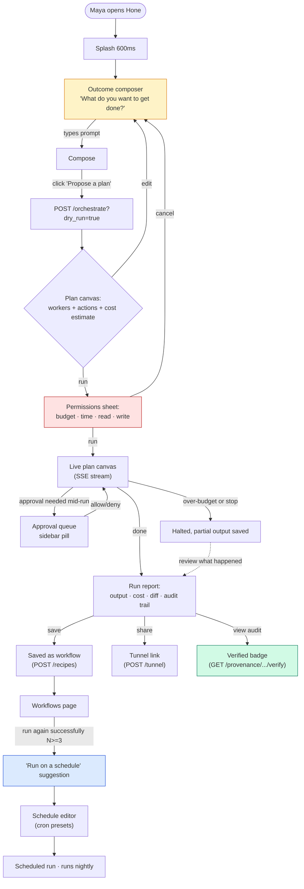
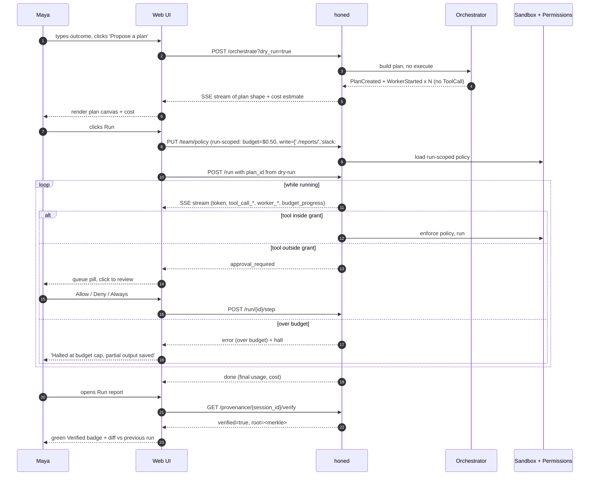

# Hone GUI — Designing for Non-CLI Operators

**Author:** ai-researcher (Quick Mode)
**Date:** 2026-05-08
**Scope:** A *critique and extension* of `priv/hone-gui-design-2026-05.md` and `priv/webui-design.md`, focused on the surfaces required to make Hone usable as an **agentic orchestration product** for product managers, ops analysts, designers, and domain experts who do not run `make`, `cargo`, or anything in a terminal.
**What this doc is NOT:** another component-tree dump (see `priv/webui-design.md`), another competitive matrix (see `docs/research/competitive-analysis-2026-05.md`), or a re-statement of the desktop shell decision (see `priv/hone-gui-design-2026-05.md`). It assumes those exist and builds on them.

---

## 1. Audience model

The persona is **"Maya, a product ops lead at a 60-person SaaS."** She owns three workflows that today require pinging engineers: pulling a weekly funnel report from the data warehouse, writing release notes from a list of merged PRs, and triaging customer-success tickets into Linear. She has used Notion AI and ChatGPT, paid for Claude Pro for four months, and gave up on Zapier because "the if/else nodes get unreadable after step five." She has a Mac. She has never opened Terminal.app voluntarily. She thinks "MCP" is a Marvel character.

Maya does not want to design a multi-agent plan. She wants to **describe an outcome** — *"every Monday at 9am, summarize last week's merged PRs by team and post to #releases"* — and have Hone (a) propose a plan, (b) tell her what it will cost and what it will touch, (c) run it, and (d) let her undo or pause if it goes sideways. The current TUI/web UI is built for an engineer who already knows what an "agent" or a "tool call" is and is typing prompts. Maya needs the *opposite*: she should rarely see prompts, never see JSON, and always see plain English with one clearly-labeled "Run" button.

### Vocabulary mapping

What Hone calls these things vs what Maya calls them. Every label in the GUI for non-CLI users should use the right column.

| Hone term | What it is in code | Maya-facing label | Why |
|---|---|---|---|
| Agent | `crates/hone-core/src/agent_registry.rs` — built-in + filesystem-overlaid Markdown personas (12 built-ins) | **Specialist** ("Reviewer specialist", "Researcher specialist") | "Agent" connotes autonomy and risk. "Specialist" implies a person you'd hand a defined task to. |
| Tool / tool call | `crates/hone-tools/` — `read_file`, `shell.run`, `lsp_diagnostics`, etc. | **Action** ("read a file", "run a shell command", "search the web") | "Tool" leaks the LLM-jargon abstraction; "action" is what the user thinks happens. |
| MCP server | External process speaking Model Context Protocol; catalog at `/mcp/marketplace` (`crates/hone-server/src/mcp_routes.rs:38-`) | **Connection** ("Slack connection", "GitHub connection") | Same word Notion / Zapier / Make use. "MCP" is meaningless to her. |
| Worker / sub-task | `WorkerStarted` / `WorkerCompleted` events from the orchestrator (`crates/hone-proto/src/event.rs:95-105`) | **Step** | A worker IS a step in a plan; calling it a worker exposes the multi-process implementation. |
| Plan / `TaskPlan` | `PlanCreated` event (`event.rs:93`); plan files in `.hone/plans/<ts>.md` | **Workflow** (when saved) / **plan** (transient, for the current run) | Workflow is the saved/reusable thing. Plan is what the agent proposes for *this* run. Same word the rest of the SaaS world uses. |
| Recipe | `crates/hone-recipes/src/types.rs:4` — YAML-defined multi-step sequence (9 built-ins under `crates/hone-recipes/recipes/`) | **Workflow template** | Identical to Notion / Linear / Zapier vocabulary. |
| Sandbox profile | Seatbelt/Landlock policy in `hone-sandbox` | **Permissions** ("can read your repo", "cannot send email") | "Sandbox" sounds like a kid's toy. "Permissions" is what every iOS user understands. |
| Provenance log | Append-only Merkle chain in `crates/hone-provenance/`; surfaced at `/provenance/{id}/verify` (`crates/hone-server/src/provenance_routes.rs`) | **Audit trail** | Lawyer/compliance word she'll have heard from her CISO. |
| Step mode / `StepAction` | `crates/hone-proto/src/event.rs:151` (Proceed/Skip/ApproveAlways/Deny) | **Ask before each action** (toggle) | Verb-noun, no jargon. |
| Governance / `TeamPolicy` | `crates/hone-server/src/governance.rs:30` (`allowed_models`) | **Spending and access rules** | Implies money + people, which is correct. |
| Tunnel | `bore` reverse-tunnel in `crates/hone-server/src/tunnel.rs` | **Share link** | Same metaphor as Loom / Figma. |
| Run / turn | `POST /run` (`routes.rs:63`) | She never sees this word. The button says **Run** or **Try it**. | |

If a future ticket says "rename the agent dropdown to 'Specialist'", that is the right call. The repo internals can stay agent-centric; the **outward-facing strings** should follow Maya's column.

---

## 2. The 6 highest-leverage UI surfaces missing today

Ranked by how much each one moves Maya from "I bounced after 90 seconds" to "I trust this with my Monday-morning report." Each surface ends with the daemon endpoint(s) it consumes — which are **already shipping** unless flagged.

### Surface 1 — Outcome composer (the front door for every non-CLI user)

**Problem.** The current entry point is `<ChatPanel>` (`apps/webui/src/components/ChatPanel.tsx:65`) — a textarea with slash-command autocomplete. Maya types "summarize last week's PRs", hits enter, and a wall of streaming text starts. She does not know what's happening, what it will cost, what it will touch, or how to stop it before it does. The cost meter in `<StatusBar>` updates *during* the run, not before. By the time she sees the bill she's already paid it.

**Proposed surface.** A two-step **Outcome → Plan → Run** composer that lives in front of the chat panel:

1. **Outcome** (textarea): "What do you want to get done?" Free text. Examples carousel below: "Summarize last week's PRs", "Find broken links on docs.example.com", "Triage the 12 newest Zendesk tickets into Linear."
2. **Plan preview** (after a "Propose a plan" button click — *not* automatic execution): the daemon emits a `PlanCreated` + `WorkerStarted×N` *but with no actual tool execution*. The composer renders each worker as a card in a vertical list with: the specialist's name, the actions it will take (parsed from tool args), the connections it will use, an estimated token + USD cost (from `cache_read` / `cache_creation` in `TokenUsage`), and the permissions it needs. Three buttons at the bottom of the plan: **Edit** (re-prompt), **Run** (execute), **Save as workflow** (persist to recipe YAML).
3. **Run** (live): the existing `<WorkerProgressPanel>` (`apps/webui/src/components/WorkerProgressPanel.tsx:9`) becomes the active surface. Each worker card from step 2 is now the *same* card with a status dot.

**Why Maya needs it.** Without a plan-preview gate she cannot pre-approve the work. With it, she has the same decision moment she has when she clicks "Generate" in Midjourney: she sees the parameters before she pays.

**Daemon endpoints consumed.** Existing `POST /run` (`crates/hone-server/src/routes.rs:63`) for the actual run; existing `POST /orchestrate` (`routes.rs:65`) for the plan emission (today this also executes — the proposed change is a `dry_run: true` query param so the planner emits `PlanCreated` + worker cards but stops short of `ToolCallStart`). One small daemon change. That gate is the highest-ROI thing on this list.

### Surface 2 — Plan canvas (the live status mental model)

**Problem.** `<WorkerProgressPanel>` today is a vertical list of rows. Each row shows agent name, task id, status dot, cost. That is fine for a single linear plan. The orchestrator already produces a **DAG** (`crates/hone-core/src/orchestrator.rs` — see `competitive-analysis-2026-05.md §5.1` calling out that no visualizer exists). When Maya's plan has a researcher fanning out to three parallel summarizers and then merging, a vertical list hides the structure entirely. She cannot see "are these two running in parallel or in series" — and that is exactly the question she has when something feels slow.

**Proposed surface.** A **plan canvas** rendered as a left-to-right flow graph (mermaid-ish, but interactive). Nodes = workers (agent name as title, action verb beneath). Edges = `parent_task_id` dependencies from the plan. Each node has a status dot mirroring `WorkerProgressPanel`'s color logic (`WorkerProgressPanel.tsx:86-92`). Hovering a node opens a popover with the worker's tool calls (parsed from the `tool_call_start` / `tool_call_end` events that *already stream*) and its incremental cost. Clicking a node deep-links to that worker's tool log.

**Layout.** Replaces the chat-only single-pane layout with a two-row layout: canvas on top (collapses to the existing list when ≤ 3 workers and no fan-out), conversation/tool-log on bottom. The ratio is the same `--split-ratio` machinery `<SplitGutter>` already implements.

**Why Maya needs it.** Static plans are abstract; live plans are reassuring. The single most common reaction to a hung agent is "is it stuck or is it just slow?" — the canvas answers that in one glance.

**Daemon endpoints consumed.** No new endpoints. All required data is already on the SSE wire — `PlanCreated`, `WorkerStarted`, `WorkerCompleted`, `BudgetProgress` (`event.rs:93-113`). The graph layout is a client-side render of events the daemon emits today. **Caveat:** edges (parent-child) are not in `PlanCreated` today — `subtask_count` is just an integer. The plan structure needs to be added to the event payload (or fetched from a new `GET /run/{id}/plan` route). One small daemon change.

### Surface 3 — Permissions sheet (the "what can it touch" gate)

**Problem.** Today's `<ApprovalModal>` (`apps/webui/src/components/ApprovalModal.tsx:26`) is *per-tool-call*: when a worker tries to write a file, a modal pops with the tool name, raw JSON args, and Allow / Deny / Always-allow / Skip buttons. This is correct for an engineer — wrong for Maya. She gets the modal *seventeen times* during one run and either rage-quits or click-fatigues into "Always allow" on a destructive tool.

The existing governance surface is also engineer-shaped: `TeamPolicy` (`crates/hone-server/src/governance.rs:30`) is a list of `allowed_models`. There is no UI for "this run can spend at most $0.50", "this run cannot send Slack messages", or "this run cannot write outside `./reports/`."

**Proposed surface.** A **Permissions sheet** shown *once* before the run starts (between Surface 1's "Run" click and the actual execution):

- **Spending limit** (slider): default $0.50. Hard cap; daemon halts at limit (the orchestrator already has `BudgetProgress`/`budget_usd` plumbing — what's missing is enforcement on hit).
- **Time limit** (slider): default 5 minutes.
- **Can read** (checkboxes derived from the planned tool calls): "files in this project", "the public web", "your Slack", "your GitHub". Disabled checkboxes for read-only data sources Maya hasn't connected.
- **Can write** (checkboxes, all *off* by default): "files in `./reports/`", "post to Slack #releases", "create Linear tickets". The plan from Surface 1 pre-suggests the minimum set the workflow needs; Maya can revoke any of them and the agent has to ask for approval mid-run if it tries.
- **When in doubt** (radio): "Pause and ask me" (default), "Skip and continue", "Stop the whole run".

**Why Maya needs it.** Per-call modals are a cognitive tax that turns into rubber-stamping. A single up-front sheet is the same UX as iOS app-install permissions or Stripe Connect — she's used to it, she'll read it once, and it stays out of the way mid-run.

**Daemon endpoints consumed.** Existing `GET /team/policy` and `POST /team/policy` (`crates/hone-server/src/governance_routes.rs:15`). The `TeamPolicy` struct needs to be widened beyond `allowed_models` to include the four classes above (sandbox capabilities, budget, time). Mostly a daemon-side change; the GUI just edits a richer struct. The per-call `<ApprovalModal>` stays — it now only fires for things outside the up-front grant, which should be rare.

### Surface 4 — Connections gallery (the no-code MCP surface)

**Problem.** Hone supports 70+ MCP servers (per `competitive-analysis-2026-05.md §4.3`) and exposes a marketplace at `GET /mcp/marketplace` (`crates/hone-server/src/mcp_routes.rs`). There is **no GUI for it.** No webui component lists `apps/webui/src/components/`. Maya does not know what an MCP server is. Even if she did, install today means writing JSON to `.hone/mcp.json` (per the comment in `mcp_routes.rs:5` — "install/uninstall happens GUI-side via Tauri commands that write back to the project's `.hone/mcp.json`") and she does not have a `.hone/`.

**Proposed surface.** A **Connections** page (left-rail icon, "🔌"). Browser pattern (Slack App Directory / Notion Connections):

- Card grid with logo, name, one-sentence description, "Connect" button.
- Categories: Communication (Slack, Discord, email), Code (GitHub, GitLab), Data (Postgres, Snowflake), Knowledge (Notion, Confluence), Web (search, fetch).
- "Connect" opens a per-connection form derived from the MCP server's declared env vars / auth flow — the daemon already knows the env-vars list from `mcp.json`. For OAuth ones the daemon should host the redirect (P1 work, not P0).
- Connected items show a green dot and "used by N workflows."
- The `Authorization` header / token storage stays in the daemon; the GUI never sees the secret. (Hone already strips `env` from the GUI-facing `InstalledServer` — `mcp_routes.rs:20`.)

**Why Maya needs it.** This is the difference between "Hone is a chatbot that knows about my repo" and "Hone is the connective tissue between every SaaS I already pay for." It is also Goose's most-praised feature — and Goose has no kernel sandbox under it, which Hone does, which means **Hone can credibly let Maya install a community MCP server without us also having to email her about a CVE in three weeks.**

**Daemon endpoints consumed.** Existing `GET /mcp/marketplace`, `GET /mcp/installed` (`mcp_routes.rs`). Install/disable currently has no daemon route — `mcp_routes.rs:5` says install happens "GUI-side via Tauri commands." For the *web UI* (not Tauri), one new endpoint is needed: `POST /mcp/installed` and `DELETE /mcp/installed/{name}` writing to the same `.hone/mcp.json`. The OAuth callback host is its own scope (P1).

### Surface 5 — Workflow library (recipes, but as Maya-shaped UI)

**Problem.** Hone has 9 built-in YAML recipes under `crates/hone-recipes/recipes/` (bug-fix, code-review, documentation, migration, onboarding, performance-optimization, refactor, security-audit, tdd-feature) and a `Recipe { name, steps: Vec<RecipeStep>, ... }` type at `crates/hone-recipes/src/types.rs:4`. There is also a `GET /recipes` endpoint (`routes.rs:68`). **Zero of this is in the web UI.** Even an engineer cannot browse recipes from the GUI today.

For Maya, recipes are the load-bearing primitive: she does not want to *compose* a workflow, she wants to *pick* one. She's used to Zapier templates, Notion templates, GitHub Actions starters. This is the muscle memory.

**Proposed surface.** A **Workflows** page (left-rail icon, "📚"):

- Top: "Run a workflow" — card grid of installed recipes. Each card: title, description, one-line "what it does", an estimated cost badge (median of past runs, if any), a "Run" button that opens an inputs form generated from the recipe's `{{template_vars}}` (e.g., `bug-fix.yaml` references `{{test_command}}` — Maya gets a labeled text field).
- Middle: "Saved from a chat" — workflows Maya saved via Surface 1 step 3.
- Bottom: "Browse community" — a curated list (P1; static JSON v1).

The recipe YAML is the storage format; the GUI never shows YAML to Maya. When she saves a workflow, the GUI generates the YAML and `POST`s it (new endpoint: `POST /recipes` writing to `~/.config/hone/recipes/`).

**Why Maya needs it.** This is the path from "I described one outcome once" to "I have a button I press every Monday morning." Without it, Hone is a chatbot. With it, Hone is automation.

**Daemon endpoints consumed.** Existing `GET /recipes` and `GET /recipes/{name}` (`routes.rs:68-69`). New: `POST /recipes` (save) and a `POST /recipes/{name}/run` shorthand that wraps `/run` with the templated prompt. Both are small.

### Surface 6 — Run history with replay + audit (the trust-recovery surface)

**Problem.** `<SessionSelector>` (`apps/webui/src/components/SessionSelector.tsx`) lists sessions by id and first-prompt-as-title. After Maya runs the same weekly report four times she has four sessions with the same title, no way to compare them ("did the cost go up?"), no way to see what changed in the *output* week-over-week, no way to share a finished report with her boss without copy-paste, and crucially — no way to **prove what the agent did and didn't do** if her boss asks.

The **audit trail** for that already exists. `crates/hone-provenance/` writes a Merkle hash chain. `GET /provenance/{id}/verify` (`crates/hone-server/src/provenance_routes.rs`) re-hashes the chain. None of this is in the web UI.

**Proposed surface.** A **Runs** page (left-rail icon, "📜"):

- Left rail: list of past runs grouped by workflow (so the four weekly-report runs cluster).
- Each run row: timestamp, status (succeeded/failed/cancelled/over-budget), cost, tokens, "View report" button.
- Run detail: rendered output (the final assistant message + any artifacts written), a "Diff with previous run" button (uses the existing `<SideBySideDiff>`), a "Replay" button that re-runs the *same plan* on fresh inputs (uses checkpoint/resume — `hone-core/src/checkpoint.rs`), an "Audit trail" button that opens a verifiable view of every action taken with a green "Verified" or red "Tampered" badge from `GET /provenance/{id}/verify`.
- "Share" button generates a public read-only link via the existing `bore` tunnel (`POST /tunnel`, `tunnel_routes.rs`).

**Why Maya needs it.** Three reasons stacked: (1) week-over-week diff is the *output* of her job (compare this week's PR list to last week's), (2) the audit trail is what convinces her CISO to let her use Hone at all, (3) replay is what gives her confidence to schedule it (Surface 7 in `priv/hone-gui-design-2026-05.md §6` — scheduled agents — is meaningless without a "did last night's run succeed" page).

**Daemon endpoints consumed.** Existing `GET /sessions` (`routes.rs:82`), `GET /sessions/{id}`, `GET /provenance/{id}` (`provenance_routes.rs`), `GET /provenance/{id}/verify`, `POST /tunnel` (`tunnel_routes.rs`). New: `POST /sessions/{id}/replay` to re-execute a saved plan (small). The diff view is pure client-side over two session reports.

### Honourable mentions (cut for ranking)

- **Scheduled runs UI.** The daemon already has the storage primitive (`crates/hone-server/src/scheduler.rs:120` — `add(name, cron_expr, action_json, agent)` with full croner validation). What's missing is route exposure (no `/schedules` route in `routes.rs`) and a UI. **High value but blocked behind Surface 5** — there's no point scheduling runs if there's no Workflows page to schedule from. Land Surface 5 first.
- **Cost forecast.** The plan preview (Surface 1) covers the v1 of this. A separate "show me my month-to-date spend" page is nice but not load-bearing for Maya's first session.
- **Agent registry browser** (cited as a differentiator in `priv/hone-gui-design-2026-05.md §6.4`). Maya does not care which "specialist" runs. The plan canvas (Surface 2) shows it incidentally; a dedicated page is engineer-flavored and can wait.

---

## 3. The trust ladder

A non-CLI user grants trust in steps. If Hone skips a rung Maya bails. The right framing is **what does she need to see at each rung to climb to the next.** Each rung maps to existing or shipping primitives — almost nothing here is new code, it is *new presentation* of code that already exists.

| Rung | Maya's question | What the GUI shows | Hone primitive backing it |
|---|---|---|---|
| **0. Will this open?** | "Will this app work after I download it?" | Splash → Outcome composer with one prompt example pre-filled. No daemon discovery prompt, no API key gate, no "create your first project". | First-run wizard (`priv/hone-gui-design-2026-05.md §7 phase 1b`); managed-sidecar mode (Mode A in §5.3) |
| **1. Does it understand me?** | "Did it correctly interpret what I asked for?" | The plan preview (Surface 1) shows each step in plain English ("read the last week of merged PRs", "draft a Markdown summary", "post to Slack"). She can re-prompt before it runs. | `POST /orchestrate` with `dry_run` (proposed), `PlanCreated` + `WorkerStarted` events (`event.rs:93-99`) |
| **2. Will it cost me my budget?** | "How much will this cost?" | Plan preview shows estimated USD + tokens per step and total. Permissions sheet (Surface 3) has a hard cap slider. Status bar (`apps/webui/src/components/StatusBar.tsx`) shows live spend. | `BudgetProgress` event (`event.rs:108`); `TokenUsage` (event.rs:5-10) with cache fields |
| **3. Will it touch things I didn't grant?** | "Will it post to Slack without asking?" | Permissions sheet (Surface 3) requires explicit grants per write-class action. Mid-run pop-ups are *only* for things outside the grant. The persistent left-rail "Approvals" badge shows pending count. | `ApprovalModal.tsx`; `StepAction::ApproveAlways` (`event.rs:160`); `TeamPolicy` widened |
| **4. Can I stop it if it goes wrong?** | "How do I cancel?" | Single Stop button in the plan canvas top bar. ESC anywhere. The existing `DELETE /sessions/{id}/turns/{turn_id}` cancel route is already designed (`priv/webui-design.md §4`). | Cancel route + an explicit "halted by user" terminal status |
| **5. Can I undo what it did?** | "Did it overwrite my file?" | Two-tier undo: (a) in-app revert for any file the agent wrote (the diff card in `<SideBySideDiff>` keeps the old hunk); (b) for connection-side writes (Slack post, Linear ticket), a "What was changed" report with one-click Undo if the connection's MCP server exposes a delete capability. | `<SideBySideDiff>` (`apps/webui/src/components/SideBySideDiff.tsx`); per-MCP-server capability declarations |
| **6. Can I prove what it did?** | "If my boss asks, can I show them?" | Runs page → Audit trail → green "Verified" badge from `GET /provenance/{id}/verify`. | `crates/hone-provenance/`; `provenance_routes.rs` |
| **7. Will I trust it tomorrow without me watching?** | "Can I schedule it?" | After three successful manual runs of the same workflow, the GUI surfaces "Run this on a schedule" inline. Schedule editor uses cron under the hood but the form has presets (Daily 9am, Weekdays 9am, Weekly Mondays). | `crates/hone-server/src/scheduler.rs:120` — `add(name, cron_expr, ...)` already shipping (no route yet) |

**Design rule that falls out of the ladder:** Maya should never see a rung-N affordance before she's earned rung N-1. Specifically: **do not show the "Run on a schedule" button until the user has run the workflow at least once successfully.** This is the same pattern Notion uses for surfacing automations.

---

## 4. Mermaid diagrams

### 4.1 User journey — outcome to scheduled workflow

### 4.2 New surfaces against existing daemon endpoints

```mermaid
flowchart LR
    subgraph GUI["Web UI / Tauri shell (SolidJS)"]
        OC[Outcome composer<br/>NEW]
        PC[Plan canvas<br/>NEW]
        PS[Permissions sheet<br/>NEW]
        Conn[Connections gallery<br/>NEW]
        WF[Workflows page<br/>NEW]
        Runs[Runs page<br/>NEW]
        Sched[Schedule editor<br/>NEW]
        WPP["WorkerProgressPanel<br/>(exists, becomes plan canvas)"]
        Diff["SideBySideDiff<br/>(exists)"]
        AM["ApprovalModal<br/>(exists, fewer pop-ups)"]
        SB["StatusBar<br/>(exists)"]
    end

    subgraph DaemonExisting["honed — existing routes"]
        Run["POST /run<br/>routes.rs:63"]
        Orch["POST /orchestrate<br/>routes.rs:65"]
        Step["POST /run/{id}/step<br/>routes.rs:64"]
        Sess["GET /sessions<br/>routes.rs:82"]
        Recipes["GET /recipes<br/>routes.rs:68"]
        Mcp["GET /mcp/marketplace<br/>+ /mcp/installed"]
        Prov["GET /provenance/{id}/verify<br/>provenance_routes.rs"]
        Gov["GET/POST /team/policy<br/>governance_routes.rs:15"]
        Tun["POST /tunnel<br/>tunnel_routes.rs"]
        Sandbox["GET /sandbox/policies<br/>routes.rs:72"]
    end

    subgraph DaemonProposed["honed — new / extended routes"]
        OrchDry["POST /orchestrate?dry_run<br/>EXTEND"]
        PlanShape["GET /run/{id}/plan<br/>NEW (DAG shape)"]
        SaveRecipe["POST /recipes<br/>NEW"]
        RunRecipe["POST /recipes/{name}/run<br/>NEW"]
        Replay["POST /sessions/{id}/replay<br/>NEW"]
        InstallMcp["POST/DELETE /mcp/installed<br/>NEW"]
        SchedRoutes["GET/POST/DELETE /schedules<br/>NEW (storage exists, scheduler.rs)"]
        WidePolicy["TeamPolicy widened<br/>EXTEND (sandbox+budget+time)"]
    end

    OC --> OrchDry
    OC --> Run
    PC --> PlanShape
    PC --> Orch
    PC -.->|reuses| WPP
    PS --> WidePolicy
    PS --> Sandbox
    PS -.-> AM
    Conn --> Mcp
    Conn --> InstallMcp
    WF --> Recipes
    WF --> SaveRecipe
    WF --> RunRecipe
    Runs --> Sess
    Runs --> Prov
    Runs --> Replay
    Runs --> Tun
    Runs -.-> Diff
    Sched --> SchedRoutes

    style OC fill:#fef3c7
    style PC fill:#fef3c7
    style PS fill:#fee2e2
    style Conn fill:#fef3c7
    style WF fill:#fef3c7
    style Runs fill:#fef3c7
    style Sched fill:#fef3c7
    style OrchDry fill:#fde68a
    style PlanShape fill:#fde68a
    style SaveRecipe fill:#fde68a
    style RunRecipe fill:#fde68a
    style Replay fill:#fde68a
    style InstallMcp fill:#fde68a
    style SchedRoutes fill:#fde68a
    style WidePolicy fill:#fde68a
```

### 4.3 Trust-ladder gates as a sequence

---

## 5. Recommended cut — if we ship 2 things in 4 weeks, ship these

### Pick #1 — Outcome composer + plan preview gate (Surface 1)

**Smallest viable version:**

- One new view at `apps/webui/src/views/Outcome.tsx` (or fold into `App.tsx` as the default route).
- Uses *existing* `POST /orchestrate` with one new query param `?dry_run=true`. The orchestrator emits `PlanCreated` + `WorkerStarted` events synthesized from the plan it built, then *halts before any `ToolCallStart`*. This is a small daemon change in `crates/hone-server/src/agent_executor.rs` and the orchestrator entry point.
- Render the plan as the *existing* `<WorkerProgressPanel>` (`apps/webui/src/components/WorkerProgressPanel.tsx:9`) but in "preview mode" — same rows, no live status dot, an "Estimated cost: $0.XX" line at the bottom, two big buttons: **Edit prompt** / **Run for real**.
- "Run for real" calls `POST /run` with the original prompt and a flag to skip re-planning.
- **No** plan canvas (DAG view) in this slice; just the existing vertical worker list. Canvas is Surface 2 and can land in a follow-up.
- **No** widened TeamPolicy yet. The plan preview *displays* the implied permissions ("will write 1 file in ./reports/", "will call slack:post_message") but does not yet enforce a per-run grant. That makes this slice landable without a daemon-side `TeamPolicy` rewrite.

**Why this one first.** It is the single highest-conversion change for the non-CLI user. Without it, Maya cannot evaluate the agent before paying for it; with it, she can. Every other surface in this doc is improved by it because they all *consume* the same plan-preview data.

**Acceptance test.** A non-engineer can type "summarize last week's merged PRs from this repo into a Markdown file" in a web UI, see four worker rows with action verbs and an estimated cost, click Run, and end up with the file on disk — without ever seeing the word "tool", "agent", or "MCP."

### Pick #2 — Workflows page (Surface 5)

**Smallest viable version:**

- New page at `apps/webui/src/views/Workflows.tsx`. Topbar gets a "📚 Workflows" button.
- List uses *existing* `GET /recipes` (`crates/hone-server/src/routes.rs:68`). Each recipe is a card with name, description (from `RecipeStep` summary), Run button.
- Run button opens a **form** generated from `{{template_vars}}` parsed out of the YAML's prompt fields. Submit posts to `POST /run` with the templated prompt — no new daemon route needed for v1 (skip `/recipes/{name}/run` shorthand).
- Save-as-workflow from Surface 1's plan preview: add a third button "Save as workflow" that prompts for a name, generates the recipe YAML client-side (a single "literal prompt" step is fine for v1), and writes it via a tiny new `POST /recipes` route to `~/.config/hone/recipes/{name}.yaml`. This *is* a new route but it's ~30 lines.
- No community gallery in v1.
- No schedule editor in v1 (it would dangle without successful-run history).

**Why this one second.** It is what turns Hone from "I tried Hone yesterday" into "I use Hone every Monday." Without it, Maya's first successful run is also her last. With it, she has a button. Buttons are the unit of habit.

**Acceptance test.** After running an outcome successfully via Pick #1, a non-engineer can click "Save as workflow", give it a name, and find that workflow on the Workflows page on her next visit, with a Run button that re-executes it with the same plan shape.

**What this 4-week slice deliberately leaves out.** Plan canvas (Surface 2 — uses *existing* `<WorkerProgressPanel>` instead), Permissions sheet (Surface 3 — relies on `<ApprovalModal>` for now), Connections gallery (Surface 4 — no MCP UI), Runs page (Surface 6 — keeps `<SessionSelector>`), scheduling (no UI). Each of those is a follow-up sprint. The two picks above are the *gateway*; everything else compounds.

---

## 6. Anti-recommendation — what NOT to build

1. **Do not build a no-code workflow builder with drag-drop nodes.** Hone's recipe DSL (`crates/hone-recipes/src/types.rs:4`) is already a better workflow primitive than what a drag-drop UI would produce in 6 months. Maya does not need to *author* workflows from scratch — she needs to *describe an outcome and save the resulting plan as a workflow*. Surface 1 + Surface 5 give her that without a single drag-drop node. Zapier-style canvases are where people go to die after step 5; we have observational evidence (Maya literally said this in §1) that they fail. The recipes-from-conversation path is strictly better.

2. **Do not build a prompt library / prompt marketplace.** Maya does not want to read prompts. Workflows hide prompts behind outcome descriptions; that's the right abstraction. A prompt library leaks the LLM jargon we're trying to bury.

3. **Do not build a per-tool-call inline approval UX with smarter modals.** The current `<ApprovalModal>` is correct for engineers; making it "smarter" for non-engineers is the wrong direction. The right direction is **fewer modals, granted up-front via the Permissions sheet**. Do not ship an "intelligent grouping of tool approvals" feature; ship the up-front grant.

4. **Do not build a separate "Hone for product managers" SKU/UI/brand.** The web UI must serve both engineers and Maya. The cuts in this doc (Outcome composer in front of `<ChatPanel>`, vocabulary mapping in §1) are *additive* — engineers can still hit "/" to drop into the chat surface they have today. Forking the brand is the same trap Cursor avoided by not splitting "Cursor for designers" out of Cursor.

5. **Do not invest in a visual MCP-server-builder UI.** We do not own the MCP servers; the community does. Our job is to make the *catalog* discoverable (Surface 4), not to ship a wizard that authors them. That's a 6-month project that competes with the upstream ecosystem.

6. **Do not optimize for mobile-first.** Maya is on her Mac. Mobile is a 2027 problem. Current PWA support (`apps/webui/README.md` Phase 3A) is enough; do not add a separate React Native shell.

7. **Do not surface the distributed-orchestrator routes (`/distributed/plans/*`, `crates/hone-server/src/distributed_routes.rs:79`) to non-CLI users.** Distributed-multi-machine is a power-user differentiator (engineer audience) but for Maya it is pure cognitive cost. Keep those routes admin-only and ungated by the GUI router for now.

---

## 7. Open questions for the senior engineer to weigh in on

1. **Should `POST /orchestrate?dry_run=true` halt before `ToolCallStart` or before `WorkerStarted`?** Halting before `WorkerStarted` is cheaper but gives the user no per-step cost estimate (because the planner hasn't itemized which tools each worker will call). Halting before `ToolCallStart` requires the workers to *fake-execute* — they decide which tools they would call but return without invoking them. The latter is more honest but ~3x more model tokens. Recommendation: halt-before-`WorkerStarted` for v1, document that cost estimates are coarse, instrument to learn actual error.
2. **Run-scoped vs persistent governance.** The Permissions sheet (Surface 3) wants per-run grants, but `TeamPolicy` (`governance.rs:30`) is a single global. Is the right model (a) a per-run override that doesn't persist, (b) saving the grant onto the workflow recipe, or (c) widening `TeamPolicy` to a stack? Pick now because the plan preview UI depends on the answer.
3. **Where does the recipe save when there is no `.hone/`?** Maya doesn't have a project. `~/.config/hone/recipes/` is the obvious answer but the existing recipe loader (`crates/hone-recipes/src/parser.rs`) may or may not look there — verify.
4. **Should `dry_run` be a query param or a separate `POST /plan` route?** Separate route is cleaner REST but adds a code path; query param is uglier but reuses everything. Lean separate route if the daemon team will be the ones implementing it.
5. **Does the team have an opinion on the audience-first vocabulary in §1?** Renaming "Agent" → "Specialist" in user-facing strings is small but a cultural decision (and reviewers may push back). Worth deciding before any UI strings are written.

---

## Appendix — files referenced

- `apps/webui/src/components/WorkerProgressPanel.tsx:9`
- `apps/webui/src/components/ApprovalModal.tsx:26`
- `apps/webui/src/components/ChatPanel.tsx:65`
- `apps/webui/src/components/SettingsPanel.tsx:27`
- `apps/webui/src/components/SideBySideDiff.tsx`
- `apps/webui/src/components/SessionSelector.tsx`
- `apps/webui/src/types/events.ts:12-49`
- `crates/hone-proto/src/event.rs:53-146` (`AgentEvent` enum)
- `crates/hone-proto/src/event.rs:151-167` (`StepAction` enum)
- `crates/hone-server/src/routes.rs:39-92` (router composition)
- `crates/hone-server/src/agent_executor.rs`
- `crates/hone-server/src/governance.rs:30` (`TeamPolicy`)
- `crates/hone-server/src/governance_routes.rs:11-15`
- `crates/hone-server/src/mcp_routes.rs`
- `crates/hone-server/src/sandbox_routes.rs`
- `crates/hone-server/src/provenance_routes.rs`
- `crates/hone-server/src/scheduler.rs:120` (`add(name, cron_expr, ...)`)
- `crates/hone-server/src/distributed_routes.rs:79-118`
- `crates/hone-server/src/collaborative_routes.rs:13-16`
- `crates/hone-server/src/tunnel_routes.rs:14`
- `crates/hone-recipes/src/types.rs:4` (`Recipe`)
- `crates/hone-recipes/recipes/bug-fix.yaml` (sample)
- `priv/hone-gui-design-2026-05.md` (companion doc — desktop shell)
- `priv/webui-design.md` (companion doc — web UI design)
- `docs/research/competitive-analysis-2026-05.md` (prior gap analysis)
