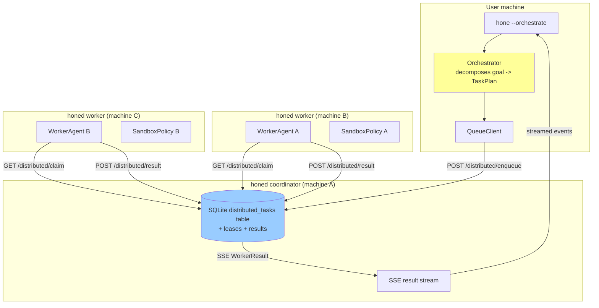
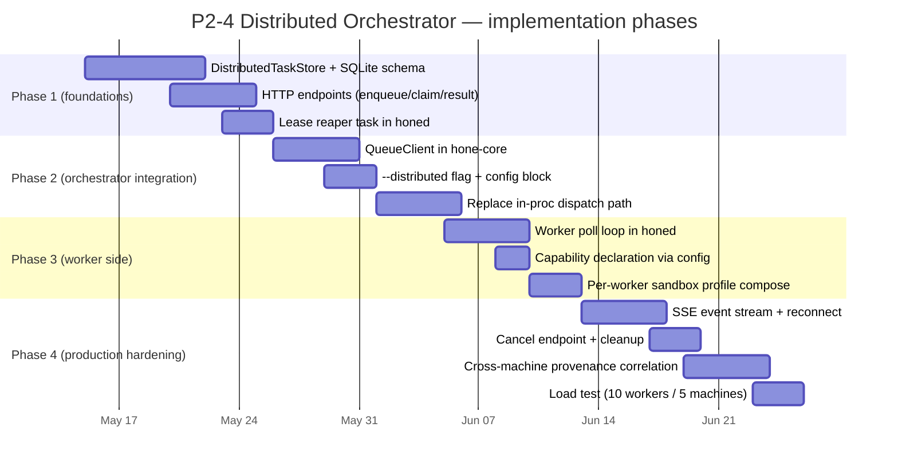
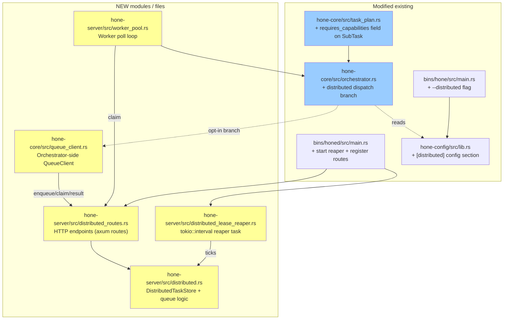

# P2-4 Distributed Orchestrator — Architecture Proposal

**Status:** proposal — no code yet
**Date:** 2026-05-03
**Scope:** Make Hone's DAG orchestrator schedulable across multiple `honed` instances over the existing HTTP/2+SSE transport, so a single user request can fan out to N workers running on M physical machines.
**Source:** [docs/research/competitive-analysis-2026-05.md §6.3 item 4](competitive-analysis-2026-05.md)

---

## 1. Goals & non-goals

### Goals

1. A user kicks off a DAG (via `--orchestrate` or a recipe). The DAG decomposition is unchanged from today; what changes is that workers can be **scheduled across remote `honed` instances** instead of all running in-process.
2. Each remote worker can have its **own sandbox profile** (P2-5 lands this per-AgentDef; the distributed scheduler honours it).
3. **Fault tolerance**: if a worker dies mid-task, the task is re-claimed by another worker; the user sees the final result regardless.
4. **No new heavyweight dependencies**: SQLite is the queue backbone (it's already the scheduler store from P1-4), HTTP+SSE is already the daemon transport.
5. **Backward compatible**: single-process orchestration keeps working with zero config changes. Distributed mode is opt-in via a `[distributed]` config section.

### Non-goals (deferred follow-ups)

- Cross-region / WAN deployment (we assume LAN or VPN; latency budgets target ≤50ms RTT).
- Cryptographic worker identity beyond the existing `HONE_AUTH_TOKEN` bearer (mTLS is a future upgrade).
- Resource-aware bin packing (CPU/RAM utilisation as scheduling input). v1 routes by capability tags only.
- Live worker autoscaling (spawning new `honed` instances on demand). v1 uses a static pool.
- Result merging strategy changes — we reuse the existing in-process orchestrator's merge pass once all `WorkerResult`s come back.

---

## 2. Architectural choices

Three patterns considered; **C wins** for Hone's scale and existing tooling.

| Pattern | Pros | Cons | Verdict |
|---|---|---|---|
| **A. Coordinator-Worker (master-worker)** | Simplest mental model. One node holds the DAG, hands tasks to workers via RPC. | Single point of failure. No partition tolerance. Restart loses in-flight tasks. | Reject |
| **B. Peer-to-peer with leader election (Raft-lite)** | Fault-tolerant. No single coordinator. | Requires implementing Raft (or pulling in `openraft` — heavy dep). Overkill for ≤10 workers on a LAN. | Reject |
| **C. Durable shared queue (push tasks to SQLite, workers pull)** | Workers are stateless. Crashes recover via lease expiry. SQLite is already a workspace dep. Coordinator-less scheduling. | Slight read-amplification (workers poll). Lease expiry needs care to avoid double-execution. | **Accept** |

### Why C fits Hone

- The P1-4 `ScheduleStore` already shows the SQLite-as-coordinator pattern works.
- The existing `TaskPlan` decomposition stays in one process; only the **per-task dispatch** crosses the network.
- "Worker died" = "lease expired"; recovery is the queue noticing and re-handing the task. No leader election needed.

---

## 3. System overview



**Key insight:** the coordinator role is just "the honed instance whose SQLite the orchestrator points its `QueueClient` at". Any honed instance can play that role. Workers don't need to know the coordinator's identity beyond the URL — they just poll the queue endpoints.

---

## 4. Data model — extensions to existing types

### 4.1 New SQLite tables (mirror the `scheduler.rs` pattern)

```sql
CREATE TABLE IF NOT EXISTS distributed_tasks (
    id           TEXT PRIMARY KEY,           -- uuid v7, == SubTask.id
    plan_id      TEXT NOT NULL,              -- groups all subtasks of one TaskPlan
    subtask_json TEXT NOT NULL,              -- serialised SubTask (see below)
    state        TEXT NOT NULL,              -- queued | leased | done | failed | timed_out
    leased_by    TEXT,                       -- worker_id, NULL when state != leased
    lease_expires_at INTEGER,                -- unix epoch micros, NULL when state != leased
    created_at   INTEGER NOT NULL,
    completed_at INTEGER,
    attempts     INTEGER NOT NULL DEFAULT 0
);
CREATE INDEX idx_dist_tasks_state_created ON distributed_tasks(state, created_at);
CREATE INDEX idx_dist_tasks_plan ON distributed_tasks(plan_id);
CREATE INDEX idx_dist_tasks_lease_expiry ON distributed_tasks(lease_expires_at) WHERE state = 'leased';

CREATE TABLE IF NOT EXISTS distributed_results (
    task_id      TEXT PRIMARY KEY REFERENCES distributed_tasks(id),
    worker_id    TEXT NOT NULL,
    status       TEXT NOT NULL,              -- completed | failed | timed_out
    response     TEXT NOT NULL,
    error_msg    TEXT,
    tokens_input INTEGER NOT NULL,
    tokens_output INTEGER NOT NULL,
    cost_usd     REAL NOT NULL,
    completed_at INTEGER NOT NULL
);

CREATE TABLE IF NOT EXISTS distributed_workers (
    id              TEXT PRIMARY KEY,        -- worker_id, e.g. "honed-machine-b-1"
    capabilities    TEXT NOT NULL,           -- JSON array of tags: ["python", "rust", "gpu"]
    last_heartbeat  INTEGER NOT NULL,
    sandbox_profile TEXT                     -- optional JSON SandboxProfile this worker runs under
);
```

### 4.2 SubTask gains a `requires_capabilities` hint

```rust
// crates/hone-core/src/task_plan.rs — additive change
pub struct SubTask {
    // ... existing fields ...
    /// Capability tags the worker must declare to be eligible.
    /// Empty = any worker.
    #[serde(default)]
    pub requires_capabilities: Vec<String>,
}
```

The orchestrator's `decompose` step (LLM-driven) can be prompted to emit these tags ("python-expert needs python", "tdd-workflow needs git"); a static lookup based on `agent` name suffices for v1.

### 4.3 New types for the queue interface

```rust
// crates/hone-server/src/distributed.rs (proposed location)

pub struct WorkerId(pub String);

pub struct ClaimedTask {
    pub task_id: String,
    pub plan_id: String,
    pub subtask: SubTask,
    pub lease_expires_at: DateTime<Utc>,  // when this worker must report or lose the lease
}

pub struct CompletionPayload {
    pub task_id: String,
    pub worker_id: WorkerId,
    pub status: WorkerStatus,           // existing enum from task_plan.rs
    pub response: String,
    pub usage: TokenUsage,
    pub cost_usd: f64,
}

pub struct DistributedTaskStore { pool: SqlitePool }

impl DistributedTaskStore {
    pub async fn enqueue(&self, plan_id: &str, subtasks: Vec<SubTask>) -> Result<()>;

    /// Atomic claim: pick one queued task whose dependencies are all done
    /// AND whose required capabilities are a subset of `worker_capabilities`,
    /// flip it to `leased`, set lease expiry to now + lease_duration.
    /// Returns None if nothing is eligible.
    pub async fn claim_one(
        &self,
        worker_id: &WorkerId,
        worker_capabilities: &[String],
        lease_duration: Duration,
    ) -> Result<Option<ClaimedTask>>;

    pub async fn complete(&self, payload: CompletionPayload) -> Result<()>;

    /// Background job: any task whose lease has expired flips back to queued
    /// and increments attempts. Tasks whose attempts >= max_attempts become failed.
    pub async fn reap_expired_leases(&self, max_attempts: u32) -> Result<usize>;

    /// Returns when ALL tasks in this plan are in a terminal state (done/failed/timed_out).
    pub async fn await_plan_complete(&self, plan_id: &str) -> Result<Vec<WorkerResult>>;
}
```

---

## 5. Wire protocol — HTTP endpoints on `honed`

All endpoints are added under `/distributed/`. Existing auth (`HONE_AUTH_TOKEN` bearer) applies. Existing rate limiter applies.

### 5.1 Coordinator-side (called by the orchestrator)

| Method | Path | Purpose |
|---|---|---|
| `POST` | `/distributed/plans/:plan_id/enqueue` | Body: `Vec<SubTask>`. Inserts queued rows. |
| `GET`  | `/distributed/plans/:plan_id/events` | SSE stream of `WorkerResult` events as tasks complete; closes when plan is fully terminal. |
| `GET`  | `/distributed/plans/:plan_id/status` | Snapshot: counts per state. |

### 5.2 Worker-side (called by remote `honed` workers polling for work)

| Method | Path | Purpose |
|---|---|---|
| `POST` | `/distributed/workers/:worker_id/heartbeat` | Body: `{capabilities, sandbox_profile?}`. Upserts the worker row, refreshes `last_heartbeat`. |
| `POST` | `/distributed/workers/:worker_id/claim` | Body: `{capabilities}`. Returns 200 with `ClaimedTask` body, or 204 No Content when nothing eligible. |
| `POST` | `/distributed/workers/:worker_id/results/:task_id` | Body: `CompletionPayload`. Marks task done. Idempotent on `(worker_id, task_id)` so retries are safe. |
| `POST` | `/distributed/workers/:worker_id/extend-lease/:task_id` | For long-running tasks; bumps `lease_expires_at` if the worker still owns the lease. |

### 5.3 Lease semantics

- Default lease: 60 seconds.
- Workers must heartbeat every 30 seconds (via `extend-lease`) on long tasks.
- Coordinator runs `reap_expired_leases` every 15 seconds (a `tokio::interval` task in `honed` startup).
- A task that has been re-leased `max_attempts` (default 3) times without successful completion becomes `failed` with a synthetic error so the orchestrator can surface it.

---

## 6. End-to-end lifecycle

```mermaid
sequenceDiagram
    autonumber
    participant U as User CLI
    participant O as Orchestrator (in-proc)
    participant C as honed (coordinator)
    participant W1 as honed (worker 1)
    participant W2 as honed (worker 2)

    U->>O: hone --orchestrate "build auth"
    O->>O: decompose into TaskPlan { 3 subtasks }
    O->>C: POST /distributed/plans/p1/enqueue (3 subtasks)
    C->>C: INSERT 3 distributed_tasks (state=queued)
    O->>C: GET /distributed/plans/p1/events (SSE open)

    par
        loop poll
            W1->>C: POST /distributed/workers/w1/claim {caps:[rust]}
            C->>W1: ClaimedTask T1 (lease 60s)
            W1->>W1: run @rust-expert subtask T1
            W1->>C: POST /distributed/workers/w1/results/T1 (Completed)
            C->>O: SSE WorkerResult T1
        end
    and
        loop poll
            W2->>C: POST /distributed/workers/w2/claim {caps:[python]}
            C->>W2: 204 No Content (T2 needs python; not eligible because deps not done OR no python tasks queued yet)
        end
    end

    Note over W1,W2: T1 done -> T2 deps satisfied -> T2 becomes claimable

    W2->>C: POST /distributed/workers/w2/claim
    C->>W2: ClaimedTask T2
    W2->>W2: run subtask T2
    W2->>W2: process crashes mid-task
    Note over C: 60s later, lease expires
    C->>C: reap_expired_leases: T2 -> queued, attempts+=1
    W1->>C: POST claim
    C->>W1: ClaimedTask T2 (now eligible to W1 too if caps overlap)
    W1->>C: POST results/T2 (Completed)
    C->>O: SSE WorkerResult T2

    Note over O,C: T3 deps satisfied -> claimed -> completed (steps elided)

    C->>O: SSE WorkerResult T3
    C->>O: SSE close (plan terminal)
    O->>O: merge_results(workers) -> OrchestratorResult
    O-->>U: final response + cost summary
```

**Notable invariants:**

- Step 14: dependency satisfaction check happens at **claim time**, not at enqueue time. This is what lets workers join late and immediately pick up newly-eligible tasks.
- Step 19–22: lease expiry IS the recovery mechanism. No special-case "is the worker dead" RPC. The queue notices via the absence of completion within the lease window.
- Idempotent results: if a worker reports completion just as the coordinator was about to reap the lease, the `complete` endpoint sees state=leased+correct worker_id and accepts it. If the lease was already reaped and the task re-leased to someone else, the late completion is rejected with 409 Conflict and discarded — the second worker's result is canonical.

---

## 7. Fault-tolerance matrix

| Failure | Detection | Recovery |
|---|---|---|
| Worker process crash mid-task | Lease expires after 60s without `extend-lease` | `reap_expired_leases` flips state back to queued; another worker claims it on next poll |
| Worker network partition | Same as crash from coordinator's POV | Same |
| Coordinator restart | Orchestrator's SSE connection drops; reconnect via `GET /events` resumes from current state | In-flight leased tasks naturally expire if their owners can't reach the coordinator either |
| User CLI cancellation | Orchestrator drops SSE | Tasks continue executing; `POST /distributed/plans/:id/cancel` (future) flips remaining queued/leased tasks to `failed` |
| Task hits `max_attempts` | reap counts it | State → `failed` with synthetic message; orchestrator surfaces in OrchestratorResult |
| Worker reports both completion AND crashes before TCP ack | `complete` endpoint must be idempotent on `(task_id, worker_id)` | Second POST returns 200 OK; row already `done` |
| Two workers race on the same task (impossible with proper claim logic, but defensive) | `complete` checks `state=leased AND leased_by=this_worker` | Loser sees 409 Conflict, discards result |

---

## 8. Security model

- **Auth**: every `/distributed/*` endpoint requires `Authorization: Bearer <HONE_AUTH_TOKEN>`. Existing middleware covers this.
- **Worker identity**: `worker_id` is self-asserted in the URL path; the coordinator trusts the bearer token to mean "anyone with this token may act as any worker". For multi-tenant deployments, a future per-worker token table would be needed; out of scope for v1.
- **Sandboxing per worker**: each worker process runs under its declared `SandboxPolicy` (P2-5 per-agent profiles compose with this — the worker honours the stricter of the agent profile and its own machine policy).
- **Provenance**: each worker writes a row into the existing P2-6 `ProvenanceLog` for its task, hash-chained to the previous entry on that worker. Cross-worker provenance correlation (a Merkle tree across workers) is a follow-up.
- **Audit**: existing `EgressLog` records every tool call on every worker, locally. Cross-worker aggregation is via existing `hone reports` UX.
- **No code transport**: the queue carries `SubTask` (a description + agent-name reference + acceptance tests). Workers load agent definitions from their own `~/.config/hone/agents/` and `.hone/agents/` overlays — no code is shipped over the wire. This keeps the attack surface tight and makes per-worker policy customisation trivial.

---

## 9. Implementation phases (4 PRs, sequential)



Each phase is a separate PR; phases 1–3 are blocking, phase 4 items are independent and can ship in any order.

**Estimated total: ~6 weeks of focused work for one engineer**, matching the report's "1–3 months" P1/P2 estimate.

---

## 10. Where the code lives



Yellow = NEW. Blue = additive change to existing.

---

## 11. Testing strategy

| Test surface | Approach |
|---|---|
| `DistributedTaskStore` unit tests | sqlx in-memory pool, mirror the `scheduler.rs` pattern. Cover claim atomicity, lease expiry, capability filtering, dependency satisfaction at claim time. ~25 tests. |
| HTTP endpoints | `axum::Router::test_with_uri()` style — no real network. ~12 tests covering each endpoint's happy path + auth rejection + 204/409 responses. |
| Worker poll loop | Mock the HTTP client; assert poll cadence + back-off + completion submission. ~6 tests. |
| End-to-end orchestrator | Spin up 1 coordinator + 2 worker `honed` instances on `tokio::io::duplex` pipes (no real network); run a 3-task plan; assert all complete. ~3 tests. |
| Chaos | Spin up 3 workers, kill one mid-task, assert the task gets re-claimed and completes. ~2 tests. |
| Load | NOT in unit tests — separate `benchmarks/distributed_load.py` script that spawns N real workers and measures throughput. |

Total: ~50 unit/integration tests over 4 PRs, mirroring the per-PR test density of P0/P1/P2 work shipped earlier.

---

## 12. Open questions

1. **Orchestrator location**: should the orchestrator (which decomposes the goal into a TaskPlan) ALSO be distributable, or always run in the user's process? v1 says "in-proc orchestrator + remote workers" because the decomposition is small/cheap; the workers are where the cost lives. Worth revisiting if SWE-bench-scale planning becomes the bottleneck.

2. **Capability discovery**: should workers self-report capabilities (declared in their config) or should the coordinator infer them from the agent definitions each worker has loaded? v1 says "self-report" — simpler, more honest. v2 could cross-check.

3. **Backpressure**: what if 100 tasks are queued but only 2 workers exist? Today: tasks just sit in `queued` state. No backpressure signal to the user. Consider emitting a "queue depth" metric on the SSE stream so the CLI can warn.

4. **Dependency cycles in the DAG**: caught at decompose time (existing `task_plan.rs` validation). The distributed scheduler doesn't need to handle this — it would manifest as no task ever becoming claimable.

5. **Worker-to-worker tool calls**: a worker on machine B might need to call a tool that only works on machine A (e.g., a local LSP server). v1 says "agents are responsible for picking workers with the right capabilities" — no transparent cross-machine tool dispatch. v2 could add it via a `forward_to: <worker_id>` field on tool results.

6. **Plan persistence across coordinator restarts**: today the orchestrator holds the TaskPlan in memory. With the queue on SQLite, the plan is implicitly durable (every subtask is a row), so a coordinator restart can resume by re-opening SSE on the plan_id. The orchestrator's in-memory state (merge buffer, etc.) needs to be made resumable — partially covered by P0's `checkpoint.rs`.

7. **Lease duration tuning**: 60s is a guess. Should it be per-task based on a complexity hint? Probably yes in v2; v1 keeps a single global default.

8. **Cost accounting across workers**: `OrchestratorResult.total_cost_usd` is the sum of `WorkerResult.cost_usd`, which is reported by each worker. Workers must use the same `PricingEntry` table the user expects, OR the coordinator re-prices using its own table on receipt. v1 trusts the worker; v2 re-prices for auditability.

---

## 13. Decision

**Recommendation: ship the 4-PR sequence above starting with Phase 1 (`DistributedTaskStore` + HTTP endpoints + lease reaper).**

Phase 1 is ~3 weeks of work, gives a usable single-machine multi-process orchestrator (you can run a "remote" worker on the same machine as the coordinator for development), and has a clean acceptance test: spin up a 2-process setup with 1 coordinator + 1 worker; run a 3-task plan; verify all 3 results come back via SSE.

Phases 2–4 are then straightforward extensions; if any one phase reveals a fundamental problem (e.g., SQLite write contention at >50 workers), the design can pivot to a Redis-backed queue without touching the orchestrator/QueueClient interface.

Ship Phase 1 standalone. Iterate.
