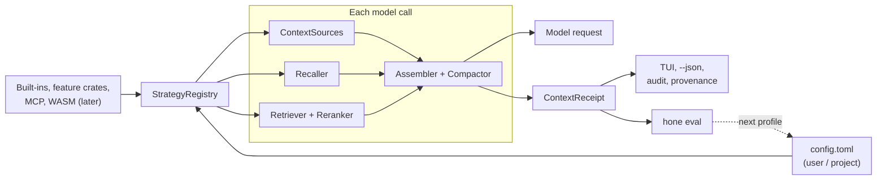
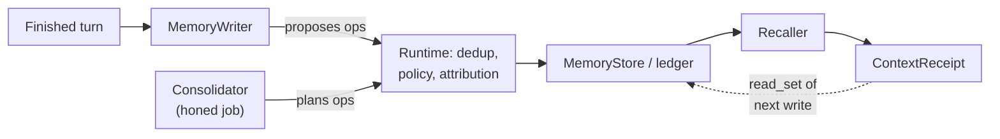
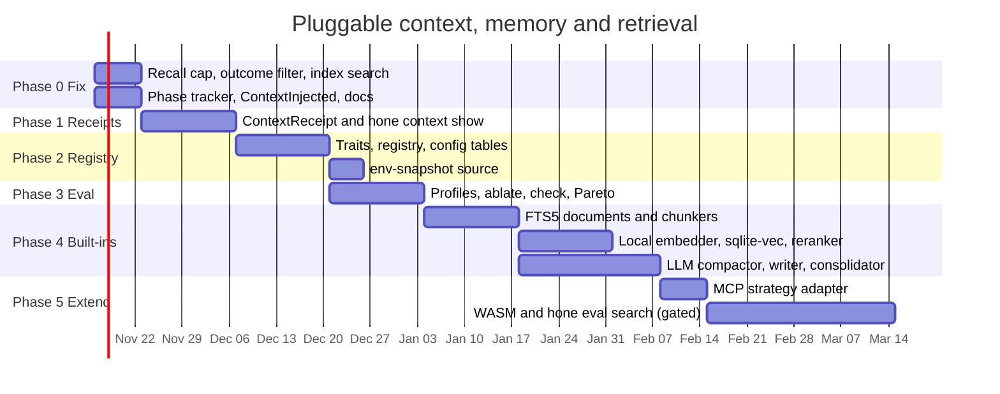

# Pluggable context, memory and retrieval — November 2026

**Question.** How should Hone let users swap the algorithms that decide what the
model sees? That covers context construction and compression; memory write,
consolidation and recall; retrieval (indexing, chunking, embeddings, rerankers,
hybrid search); and the planner, critic, router and tool-selection steps around
the loop. What does arXiv:2603.28052 add to the answer?

**What I did.**
- Read the paper in full (26-page PDF) and the reference code's harness interface.
- Read the code on `main` at `a0aa3ed` (this worktree).
- Ran small probes against this worktree's `hone-memory` and `hone-index` crates
  (§3.2). I did not run the full agent loop.

This doc does not repeat `competitive-analysis-2026-05.md` or
`hermes-agent-comparison-2026-05.md`. Their picks (Curator, hard-capped memory,
trajectory export) stand, and appear below only where they plug into a slot.

## Summary

- **The paper** is Meta-Harness (Lee et al., Stanford/MIT/KRAFTON, March 2026).
  It argues that the harness, meaning the code that decides "what to store,
  retrieve, and show to the model", matters as much as the model. It then shows a
  coding agent can improve harnesses automatically when it can read the raw code,
  scores and execution traces of every earlier attempt. Its sharpest ablation:
  raw traces beat scores plus summaries by about 15 points of median accuracy.
- **Hone has three real seams today:**
  - `MemoryStore` (a trait);
  - `Embedder` (a trait);
  - `SkeletonStrategy` (an enum).

  Everything else is inline code chosen by environment variables and CLI flags,
  not by `config.toml`: prompt layout, history compression, memory-write rules,
  recall fusion, index search, and the mapping from tier to strategy.
- **Several shipped pieces do nothing.** I checked each one in code; the first
  three I also confirmed by running a probe.
  - Per-turn memory recall only looks at the 5 newest memories.
  - Outcome logs come back as "memories".
  - The repo index matches nothing for a plain-English prompt, so the tier-2
    injection step never fires.
  - Phase-aware compaction is never fed tool calls.
  - `embedder` is `None` everywhere, so hybrid recall never runs.
  - `AgentEvent::ContextInjected` is never sent.
  - The README still claims a pgvector index.
- **Recommendation.** Work in this order:
  1. Fix the broken pieces.
  2. Add *context receipts*.
  3. Put each component behind a trait, select it in `config.toml`, and ship
     built-ins that wrap today's code.
  4. Extend `hone eval` to compare strategy profiles with receipts.

  New algorithms (FTS5, local embeddings, rerankers, LLM compaction,
  consolidation) come after the tooling that can measure them.

| # | Recommendation | What changes for a user | Value | Effort |
|---|---|---|---|---|
| 1 | Fix the inert pieces (§4.2) | Old memories are found again; outcome logs stop appearing as memories; plain-English prompts pull in relevant code; compaction follows task phase | High | S |
| 2 | Context receipts (§4.3) | `hone context show` and `--json` list every block sent to the model, the strategy that made it, and its sources (memory ids, file hashes) | High | S–M |
| 3 | Trait boundaries + `config.toml` selection (§4.4–4.5) | `[context]`, `[memory]` and `[retrieval]` tables replace env vars; `hone strategies` shows what is active and which file chose it | High | M |
| 4 | `hone eval` strategy profiles (§4.6) | Run your own tasks under two or more profiles. Get pass rate, cost, context tokens, a Pareto table and receipts per run | High | M |
| 5 | SQLite FTS5 lexical index for memory and documents (§4.7) | Recall is uncapped and fast; markdown and notes become searchable, which non-coding agents need | High | M |
| 6 | Optional local embeddings, hybrid fusion, reranker (§4.7) | `--features local-embed` gives offline semantic recall; hybrid is a config switch, measured per model | Medium | M |
| 7 | Writer and consolidator strategies on the memory ledger (§4.7) | Choose trigger-based or LLM extraction; nightly consolidation in `honed`; every merge reversible | Medium | M–L |
| 8 | Planner, critic, router and tool-selection strategies (§4.9) | Choose what each complexity tier runs, which critic checks answers, and which tools each call sees | Medium | M |
| 9 | MCP adapter for third-party strategies (§4.8) | Plug in a team wiki, vector DB or GraphRAG server as a retriever | Medium | S–M |
| 10 | WASM strategies + Meta-Harness-style search (§5, Phase 5) | `hone eval search` proposes and scores candidate strategies, keeping full receipts | Research | L |

Effort: S is at most 1 week, M is 2–3 weeks, L is 4+ weeks, all for one engineer.

---

## 1. The paper: Meta-Harness (arXiv:2603.28052)

### 1.1 Bibliographic data

- **Citation.** Y. Lee, R. Nair, Q. Zhang, K. Lee, O. Khattab, C. Finn,
  "Meta-Harness: End-to-End Optimization of Model Harnesses,"
  arXiv:2603.28052v1 [cs.AI], 30 Mar 2026, CC BY 4.0 [1].
- **Affiliations.** Stanford, MIT, KRAFTON.
- **Links.** Project page: <https://yoonholee.com/meta-harness/>. Code (MIT):
  <https://github.com/stanford-iris-lab/meta-harness>; its README calls it a
  cleaned-up version that has only been checked to run [42]. The optimized
  TerminalBench-2 harness is a separate artifact repo.

### 1.2 Claims

1. Changing only the harness around a fixed model can change benchmark results
   several-fold. The paper cites a 6× gap from another study.
2. Existing text optimizers fit harness search poorly because they compress
   feedback too much. Some are memoryless, some see only scalar scores, and some
   see only short templates or LLM summaries. Table 1 of the paper estimates the
   context per optimisation step: 0.002–0.026 Mtok for OPRO, TextGrad,
   AlphaEvolve, GEPA, Feedback Descent and TTT-Discover, against up to 10 Mtok
   for Meta-Harness.
3. An agentic proposer with filesystem access to all prior candidates' source
   code, scores and execution traces finds better harnesses, in fewer
   evaluations, than those optimizers.

### 1.3 Method

- **Objective.** For a fixed model *M* and task distribution *X*, find
  *H\** = argmax_H E_{x∼X, τ∼p_M(H,x)} r(τ, x). With several objectives, such as
  accuracy and context cost, keep a Pareto frontier.
- **Loop (Algorithm 1).**
  1. Seed a population with baseline harnesses and evaluate them.
  2. Store each candidate's code, scores and traces in its own directory.
  3. The proposer (Claude Code with Opus 4.6) inspects the directory with `grep`
     and `cat`.
  4. It writes *k* new harnesses.
  5. Each candidate must pass an interface check before full evaluation.
  6. Repeat.

  There is no parent-selection rule and no fixed mutation operator. A typical
  run evaluates about 60 harnesses over 20 iterations. Each harness is one
  Python file of 100–1,000 lines.
- **Access pattern.** In the TerminalBench-2 run the proposer read a median of
  82 files per iteration: 41% harness source, 40% traces, 6% score files.
- **Interface.** The reference code's text-classification harness is a small
  abstract class (`reference_examples/text_classification/memory_system.py` in
  [42]):
  - `predict(input) -> (answer, metadata)`;
  - `learn_from_batch(results)`;
  - `get_state()` / `set_state()` for checkpoints;
  - `get_context_length()`;
  - a `call_llm` wrapper that records each prompt's length and hash.

### 1.4 Results

| Domain | Setup | Result |
|---|---|---|
| Online text classification | GPT-OSS-120B; LawBench, Symptom2Disease, USPTO-50k; 20 iterations × 2 candidates | 48.6% average accuracy vs ACE 40.9% (+7.7) and MCE 40.0%, using 11.4K extra context tokens vs 50.8K and 28.5K. Reached the final accuracy of OpenEvolve and TTT-Discover within 4 evaluations. On 9 unseen datasets: 73.1% vs ACE 70.2%, best on 6 of 9 |
| Retrieval-augmented math | BM25 over a 535K-problem corpus; 250-problem search set; 40 iterations, 109 candidates; test set of 200 IMO-level problems | 38.8% average pass@1 vs 34.1% with no retrieval (+4.7), 37.5% plain BM25 and 38.1% dense k=5. Improved all five models; dense k=1 and random few-shot regressed on several |
| TerminalBench-2 | 89 tasks; seeded from Terminus 2 and Terminus-KIRA | Opus 4.6: 76.4% vs Terminus-KIRA 74.7% (2nd among Opus 4.6 agents). Haiku 4.5: 37.6% vs Goose 35.5% (1st among Haiku 4.5 agents) |

**Interface ablation** (Table 3, text classification, median / best accuracy):

| Proposer sees | Median | Best |
|---|---|---|
| Scores only | 34.6 | 41.3 |
| Scores + LLM summaries | 34.9 | 38.7 |
| Full traces | 50.0 | 56.7 |

Even the median full-trace candidate beat the best candidate from either
ablation. Against other optimizers (Table 4, search-set median / best):

| Optimizer | Median | Best |
|---|---|---|
| Meta-Harness | 50.0 | 56.7 |
| OpenEvolve | 39.1 | 43.3 |
| TTT-Discover | 34.1 | 45.6 |
| Best-of-N | 34.0 | 44.2 |
| GEPA | 32.6 | 40.2 |

### 1.5 What the discovered harnesses do

These are concrete, swappable strategies, which is why they matter here.

- **Draft–verify classification.** Retrieve the 5 nearest labelled examples and
  draft a label. Then retrieve 5 "confirmers" with that label and 5
  "challengers" with other labels, and decide. Below 5 stored examples it falls
  back to plain few-shot. This is a two-stage retrieval whose second query
  depends on the model's own draft.
- **Label-primed query.** List the label space, add one query-relevant example
  per label (TF-IDF), then add contrastive pairs of similar examples with
  different labels.
- **Math retrieval.** A lexical router (keywords and regex) sends each problem
  to one of four BM25 policies. Each policy has its own candidate count, dedup,
  rerank by lexical score and difficulty, and an adaptive *k*. A math-aware
  tokenizer keeps LaTeX tokens whole.
- **TerminalBench-2.** An "environment bootstrap": one compound shell command
  before the first model call collects the working directory, the `/app`
  listing, installed languages, package managers and memory. It has a 15 s
  timeout and fails silently. It adds about 80 lines to Terminus-KIRA and gains
  on 7 of 89 tasks.
- **The proposer's own lesson** (logged in Appendix A): early candidates bundled
  prompt edits with control-flow fixes and regressed. The winner was a purely
  additive change.

### 1.6 Caveats (mine)

- Only one proposer was tested (Claude Code + Opus 4.6); the authors say so.
- TerminalBench-2 search and final evaluation used the same 89 tasks. The paper
  frames this as "discovery" and reports regex audits for task-string leakage.
- The tables report no confidence intervals or significance tests. Math numbers
  average 3 samples per problem, and the +1.3-point gain over plain BM25 is
  small.
- The abstract says "five held-out models". The body says the harness was
  selected with GPT-OSS-20B, and the other four models were unseen during
  search.
- It is expensive: up to 10 Mtok of diagnostics per evaluation, and a few hours
  of wall-clock time per run.
- Units differ: Table 2 counts extra context in thousands of tokens, Table 9 in
  thousands of characters.
- The math search set is 250 problems in Section 4.2 but "88 problems" in
  Appendix D's tips.

### 1.7 What it means for Hone

| Paper finding | Consequence for Hone |
|---|---|
| Harness code is a first-class lever | Make context, memory and retrieval components named, swappable and measured, the way `[[routing]]` already does for models |
| Raw traces beat summaries for diagnosis | Receipts must record raw sources (ids, hashes, scores) for each model call, plus a hash of the exact request. A summary is not enough |
| Even the reference code searches behind a small fixed interface | An interface with swappable implementations is the right unit. Hone's traits map onto the same verbs: recall/assemble (`predict`), write/consolidate (`learn_from_batch`), snapshot (`get_state`) |
| BM25 plus a good policy beat dense retrieval on average; dense regressed on some models | Keep lexical as the default; make embeddings opt-in and measure them per model |
| An additive environment snapshot was the safe winner; bundled edits confounded | Ship an `env-snapshot` context source. Make `hone eval` change one slot at a time by default |
| Small, hard search sets (50–100 items, about 50 full evaluations) and cheap interface checks | Add `hone eval --check` and small task suites |
| Pareto frontier, not one score | Report pass rate against context tokens and cost |

**Tension.** The paper argues against fixed design spaces: it searches whole
programs, not slots. A registry of slots is a narrower space. It is still the
right first step: users get stable, auditable choices, and every later search
needs a stable interface and a scorer. The WASM and MCP routes in Phase 5 leave
room for whole-program candidates later.

---

## 2. Related work

| Work | What it does | Relevance to Hone |
|---|---|---|
| MemGPT / Letta [2]; sleep-time compute [3] | Pages information between the context window and external memory through function calls. Sleep-time compute precomputes over context offline | Hone's memory index plus `memory_read` is already on-demand paging. Add an `index-only` recaller, and run consolidation as a `honed` job between sessions |
| A-MEM [4] | Zettelkasten notes with LLM-written attributes and links; new notes can update old ones | An `llm-link` consolidator. Its links map onto the Belief Ledger's `memory_edges`; its rewrites must become supersession events |
| Mem0 [5] | Extracts candidate facts, compares them with similar memories, then chooses ADD / UPDATE / DELETE / NOOP. Reports 91% lower p95 latency and >90% token savings vs full context on LOCOMO | An `llm-extract` writer to replace English trigger phrases. DELETE must become a tombstone |
| Generative Agents [7] | Retrieval score combines recency, importance and relevance; periodic reflection | A `recency-weighted` recaller built on Hone's existing `weight` and `created_at` columns |
| GraphRAG [8], HippoRAG and HippoRAG 2 [9], [10], RAPTOR [11] | Build structure at index time: entity graph with community summaries; knowledge graph with Personalized PageRank; recursive summary tree | Costly offline indexing. Better as plugins than defaults. Their summaries must keep `derived_from` chunk ids |
| Contextual retrieval [23]; late chunking [24] | Prepend 50–100 tokens of LLM-written context to each chunk before embedding and BM25, then rerank. Top-20 retrieval failure fell from 5.7% to 1.9% in Anthropic's tests | A `contextual` chunker option. It costs model calls at index time, so receipts must record the generator model |
| ACE [13]; MCE [14] | Context as an evolving playbook updated by small deltas, to avoid "context collapse". MCE co-evolves context-engineering skills and artifacts | A consolidator that edits by delta, never by full rewrite. MCE is close to the Curator from the hermes doc. Both were Meta-Harness baselines |
| MemEvolve / EvolveLab [15]; ALMA [16] | Meta-evolve memory architectures. EvolveLab splits 12 memory systems into encode, store, retrieve and manage stages; ALMA searches memory designs written as code | Direct evidence for the trait split below: encode ≈ `MemoryWriter`, store ≈ `MemoryStore`, retrieve ≈ `Recaller`, manage ≈ `Consolidator` |
| DSPy [17] and GEPA [18] | Declarative modules plus optimizers that compile prompts and demos; GEPA evolves prompts from reflective feedback | The model for separating a module from its optimizer. GEPA is one of the compressed-feedback optimizers that Meta-Harness beats in its setting |
| Component registries: LlamaIndex [34], LangGraph [35], Haystack [36], Rig [37], Swiftide [38] | A retriever followed by an ordered chain of postprocessors and rerankers; a `BaseStore` with optional index config; components saved to and loaded from YAML; a Rust `VectorStoreIndex` trait; Rust indexing pipelines with chunkers and batch embedders | Precedents for Hone's trait shapes and config-driven selection. Rig and Swiftide show idiomatic Rust shapes. Haystack's file round-trip is what `hone eval` profiles need |

Also relevant:

- **Context-engineering practice.** The survey [12] and Anthropic's post [22]
  cover compaction, clearing old tool results, note-taking outside the window,
  and sub-agents that return condensed results. Hone already does the first
  two by hand.
- **RLM [21]** treats a long prompt as an environment the model explores; a
  `recursive` context strategy is plausible later.
- **Lost in the Middle [25]** is the basis of Hone's middle-zone reordering.
- **Evaluation.** LongMemEval [26] and Ragas [27] give memory and RAG
  evaluation designs.
- **Retrieval critics.** Self-RAG [28] and CRAG [29].
- **Token-level compression.** LLMLingua [30].
- **Memory taxonomy and decay.** CoALA [31] (taxonomy); MemoryBank [32]
  (forgetting curve, the idea behind Hone's decay).
- **Temporal memory.** Zep/Graphiti [6] keeps a bi-temporal knowledge graph
  that links facts to the episodes they came from. The pivot doc already lists
  it as prior art; here it is a candidate `recaller` plugin, not a built-in.
- **Agent-design search.** ADAS [19] and AFlow [20].
- **Adaptive retrieval [33]** finds that retrieval helped reasoning mostly when
  the model chose *not* to use it. That supports on-demand recall over
  always-inject for reasoning-heavy tasks.

---

## 3. Where Hone is today

### 3.1 Component map

| Component | What exists (file) | Seam today | Selected by | Hard-coded |
|---|---|---|---|---|
| Prompt assembly | `hone-core/src/agent.rs:1253–1311` builds the skills block, recalls memories and runs injection. `:1404–1449` inserts them | None | — | Fixed order: system prompt (with memory index) → "Relevant Memories" system message → Skills system message → history. The injection block is prefixed to the first user message |
| Repo context injection | `context_injector.rs`, three tiers; `SkeletonStrategy` enum (`Flat`, `DependencyGraph`, `CallGraph`, `Hybrid`, `Adaptive`, default `Adaptive`) at `:69`; `hierarchical_skeleton.rs` | Enum, not a trait | `--skeleton-strategy`, `HONE_SKELETON_STRATEGY`, `--no-inject` / `HONE_NO_INJECTION` (`bins/hone/src/main.rs:1067–1081`) | 2,000-token budget and 0.4 gap threshold (`with_defaults`, `:276`); runs on turn 1 only. `ContextInjector::new` reads the env var itself (`:263`) as well as `main.rs` |
| History compression | `context.rs` `ContextManager` | `ContextConfig` struct, no trait | Model-name substring table `ContextConfig::for_model` (`:87`); `HONE_CONTEXT_WINDOW` | Compression ages 5 and 10; recent window 3–7; dedup of tool results over 500 chars; drop-oldest; `[session history: …]` marker; BM25 middle-zone reordering (`relevance.rs`); 95% emergency summary (`agent.rs:1374`) |
| Memory storage | `MemoryStore` trait (`hone-memory/src/store.rs`); `SqliteStore`, `EncryptedStore`, `InMemoryStore` | Yes | `--encrypted-memory` | Schema v3; `record` is `INSERT OR REPLACE` |
| Memory write | `classify_turn` English trigger-phrase tables (`memory_worthy.rs:130`) → `Agent::record_memory` (`agent.rs:871`), which dedups with `find_similar(body, 0.8)` then upserts. `AdaptiveClassifier::record_outcome` writes `Outcome` rows (`learning.rs:97`) | No | — | Trigger phrases; 0.8 trigram threshold. No memory-write tool for the model |
| Consolidation | Decay ×0.95 at most once per 24 h when the store opens; hard delete of expired rows (`sqlite_store.rs:350–366`) | No | — | Factor and interval. No merge, summary or cap |
| Recall | `Agent::fetch_relevant_memories` (`agent.rs:782`): BM25 top 5 (`bm25.rs`, k1 = 1.5, b = 0.75), optional cosine top 5, RRF fusion with k = 60. Memory index rendered into the system prompt (`main.rs:2803`); `memory_read` tool | `Embedder` trait (`embedding.rs:29`) | `AgentConfig.embedder`, `None` at all 9 non-test construction sites | Top 5; RRF k |
| Workspace index | `hone-index`: tree-sitter symbol extraction for Rust and Python (`parser.rs`); `SqliteIndex` stores name, kind, file and line | No | Always on when the index opens | CLI walks `.rs` files only (`main.rs:2478`). `SqliteIndex::search` is `name LIKE '%query%'`, scored 1.0 / 0.8 / 0.5 (`sqlite_index.rs:163`). No chunks, document text, embeddings or vectors |
| Planner | `Orchestrator::decompose` (`orchestrator.rs:304`): fixed prompt, at most 5 subtasks, JSON output. Lead and workers get `memory_store: None` (`:821`, `:911`) | Agent registry for worker personas | `--orchestrate`, Complex tier | Prompt text |
| Router | `ComplexityClassifier::classify` keyword and length rules (`complexity.rs:36`); optional `AdaptiveClassifier::suggest_tier` | `[[routing]]` picks a *model* per tier (`hone-config/src/resolve.rs:542`) | `config.toml` | Tier → execution strategy, in the TUI: Simple runs a plain turn, Medium runs `SelfRefineLoop::new(2)` (`main.rs:1427`), Complex runs the orchestrator |
| Critics | `SelfRefineLoop`, `ReviewerAgent`, `TestVerificationLoop`, `AgentEnsemble`, doom-loop detector | Separate structs, no shared trait | CLI flags, tier | Rounds and prompts |
| Tools | `Tool` trait and immutable `ToolRegistry` (`hone-tools/src/traits.rs`, `registry.rs`); MCP client using `tools/list` and `tools/call` only | Yes | Built in `main.rs` | Every schema is sent on every call (`ToolRegistry::schemas`); no per-turn selection |
| Skills | `SkillRegistry` with regex triggers (`skills.rs`) | Struct | — | `skills: None` at `main.rs:1131` and `hone-server/src/agent_executor.rs:166`, as the August audit found |
| Eval | `hone eval` (`hone-eval/src/runner.rs`); `benchmarks/harness-compare` arms `hone-inject`, `hone-noinject`, `hone-callgraph` | — | Tasks TOML | The runner builds `AgentConfig` with an empty `ToolRegistry`, no memory, no index and `inject_context: false` (`runner.rs:99–133`). It cannot compare context or memory strategies |
| Receipts | `AgentEvent::MemoryRecalled` (friendly key plus 80-char snippet); `AgentEvent::ContextInjected` (`hone-proto/src/event.rs:197`) | — | — | `ContextInjected` is rendered by the TUI (`hone-tui/src/app.rs:2699`) but never emitted. `ProvenanceEvent` has no context variant, and only `honed` writes provenance chains. Audit-log `SpanKind` has no context span |

### 3.2 Defects I verified

I built a scratch crate with path dependencies on this worktree's `hone-memory`
and `hone-index`; nothing was written to the repo. Defects 1–3 were confirmed by
running it; 4–7 by reading code.

1. **Recall only ranks the newest `limit` rows.**
   - The code: `SqliteStore::recall` sets
     `effective_limit = query.limit.min(MAX_RECALL_CORPUS)`
     (`sqlite_store.rs:436–440`), then runs
     `SELECT … ORDER BY created_at DESC LIMIT effective_limit` and BM25-ranks
     only those rows.
   - The intent: the doc comment at `:21–26` and a comment at `main.rs:2800`
     both say the cap is 5,000 rows.
   - The effect: the agent asks for `limit: 5`, so BM25 sees the 5 newest
     memories and nothing older.
   - Probe: one relevant memory plus 5 newer unrelated ones. `limit 5` returns
     `[]`; `limit 50` returns the relevant one.
   - Why tests miss it: existing tests use `limit: 10` with at most 3 rows.
2. **Outcome logs leak into recall.** `fetch_relevant_memories` queries with
   `kind: None`, so `Outcome` rows match. The TUI writes them after turns
   (`main.rs:3599`) with the task text in the content. Probe: an `Outcome` row
   came back for a prompt that matched its task text.
3. **Index search fails on plain-English prompts.** Probe: `"fix the login bug"`
   → 0 hits; `"login"` → 1 hit. Effects:
   - Tier-2 confidence is `Low` for nearly every prompt, so the "Potentially
     relevant code" block never appears.
   - `find_relevant_files` (`hierarchical_skeleton.rs:447`) and the Hybrid
     skeleton lose their index signal and fall back to matching words in file
     paths.
   - Docs and `ContextInjected.bm25_hits` call these scores BM25; they are
     substring tiers.
4. **Phase-aware compaction is never fed.** `ContextManager::notify_tool_call`
   (`context.rs:294`) has no caller outside tests. Its tool-name tables also
   expect `run_tests` and `apply_diff`, which are not Hone tools: the real tool
   is `apply_patch`, and tests run through `shell`.
5. **`ContextInjected` is never emitted.** It is defined and rendered, but
   hone-core never sends it.
6. **Semantic recall is dead code.** No production `Embedder` exists, and every
   non-test `AgentConfig` sets `embedder: None`. Stored vectors also carry no
   model id. If someone switches embedders later, vector spaces mix silently:
   cosine returns 0.0 on a dimension mismatch in release builds, and gives
   meaningless scores for two different models of the same dimension.
7. **The pgvector claim is wrong.**
   - `README.md:248` says "PostgreSQL+pgvector for semantic index".
   - `docs/architecture.md:238` correctly says that index is deferred, and no
     vector code exists.
   - `competitive-analysis-2026-05.md` (lines 66, 138, 144) repeats the claim.
     So does the hermes doc's capability list, which is still untracked in the
     main checkout.

**FTS5 is available now.** SQLite FTS5 is compiled into the bundled SQLite
(`libsqlite3-sys` 0.30.1 sets `SQLITE_ENABLE_FTS5`). The probe ran a `bm25()`
query through sqlx successfully, so a SQL-side lexical index needs no new
dependency.

### 3.3 Takeaway

Hone has more context machinery than most open agents:

- skeleton strategies;
- graduated compression;
- typed memory with an index;
- hybrid-recall plumbing;
- a doom-loop detector.

Two problems block pluggability. First, the components are not separable:
choices are spread across `agent.rs`, `context.rs`, env vars and CLI flags.
Second, the receipts that would show what each component contributed are
missing or never sent. Several components are also quietly inert. Making them
pluggable before fixing that would let users choose between strategies that do
not work, with no way to see it.

---

## 4. Recommendations

### 4.1 Design principles

1. **Fix before you abstract.** The default strategy must work and be measured
   before alternatives are offered.
2. **Receipts before choice.** Every strategy reports what it produced and from
   which sources, in a form `hone eval` and `hone memory blame` can read.
3. **Built-ins wrap today's code.** The default profile must produce
   byte-identical requests to today's behaviour; a golden test enforces it.
4. **Config, not code, for selection.** Use `config.toml` with the same trust
   split as `[[routing]]`: the user file is trusted, the project file is not.
5. **Strategies propose; the runtime applies.** Memory writers and
   consolidators return operations. The store applies them, so attribution,
   policy and reversibility stay in one place.

### 4.2 R1: Fix the inert pieces (week 1)

Each fix is a small PR with a failing test first. The §3.2 probes are the red
tests.

| Fix | Change | What the user sees |
|---|---|---|
| Recall corpus | Fetch up to `MAX_RECALL_CORPUS` rows for non-empty queries (`sqlite_store.rs:436`), or move ranking into an FTS5 table (§4.7) | Memories older than the last five are recalled |
| Outcome filter | Add `exclude_kinds` to `MemoryQuery` and filter in SQL. `fetch_relevant_memories` excludes `Outcome` | "Relevant Memories" stops showing `outcome:tier=…` lines |
| Index search | Tokenise the prompt and match names per token, or index names, paths and doc comments in FTS5. Index Python too (`main.rs:2478` walks `.rs` only). Rename "BM25" in events and docs until it is BM25 | Plain-English prompts pull in relevant symbols; Hybrid and Adaptive skeletons rank files by code, not file names |
| Phase tracker | Call `self.context.notify_tool_call(&call.name)` in dispatch. Map `apply_patch` and `shell` commands that run tests | Exploration output is compacted when editing starts, as documented |
| Emit `ContextInjected` | Send it from `agent.rs` after injection (`:1282`) | The TUI's injection line appears |
| Docs | Correct `README.md:248` and `competitive-analysis-2026-05.md`, and the hermes doc before it is committed | No false storage claim |

Fixes 3 and 4 change model inputs. Re-run the `hone-inject` arm of
`harness-compare` before and after, under its pre-registration rules.

### 4.3 R2: Context receipts

**What a user gets.**
- `hone context show [--session ID] [--turn N]` prints, for each model call:
  every block, the strategy that produced it, the config file that chose that
  strategy, tokens used, sources with scores, and what was retrieved but cut for
  budget.
- `--json` streams the same data as `context_assembled` events.
- `honed` provenance chains gain a matching entry.

**Types.** These live in `hone-proto` because they ride on `AgentEvent` and
`ProvenanceEvent`:

```rust
pub struct StrategyId {
    pub slot: String,          // "recaller", "compactor", "context.skeleton", …
    pub name: String,          // "bm25", "hybrid", "mcp:team-wiki"
    pub version: String,       // crate version, or plugin-reported version
    pub config_sha256: String, // hash of the resolved TOML table
}

#[serde(tag = "kind", rename_all = "snake_case")]
pub enum SourceRef {
    Memory { id: String, version: Option<u64> },      // version = ledger head, once it lands
    File { path: PathBuf, sha256: String, lines: Option<(u32, u32)> },
    Chunk { index: String, chunk_id: String, sha256: String },
    ToolResult { call_id: String, sha256: String },
    Message { index: usize, sha256: String },
    Command { argv: Vec<String>, sha256: String },    // e.g. env-snapshot output
    Opaque { plugin: String, note: String },          // a plugin gave no stable id
}

pub struct ContextReceipt {
    pub turn: u32,
    pub call: u32,                       // model call within the turn
    pub request_sha256: String,          // hash of the serialized messages + offered tool names
    pub blocks: Vec<BlockReceipt>,
    pub dropped: Vec<SourceRef>,         // retrieved, then cut by the budget
    pub compaction: Vec<CompactionStep>, // what was summarised or removed, and into what
    pub tools_offered: Vec<String>,
}

pub struct BlockReceipt {
    pub slot: Slot, // SystemPrompt | MemoryIndex | Recall | Skills | Injection | Retrieval | History
    pub strategy: StrategyId,
    pub selected_from: Option<PathBuf>, // like TurnModel.routed_from; None = built-in default
    pub tokens: u32,
    pub sources: Vec<(SourceRef, Option<f32>)>,
    pub duration_ms: u32,
}

pub struct CompactionStep {
    pub strategy: StrategyId,
    pub replaced: Vec<SourceRef>,
    pub derived: SourceRef,
}
```

**Where it goes.**
- `AgentEvent::ContextAssembled(ContextReceipt)` for the TUI, `--json` and SSE.
- One line in `.hone/audit.jsonl` under a new `SpanKind::Context`.
- `ProvenanceEvent::ContextAssembled { receipt_sha256, strategies, sources }` in
  `honed` chains. This is a pure addition to the serde-tagged enum, like the
  `MemoryOp` variant in the pivot doc.

Receipts carry ids and hashes, not text: content stays where it already lives
(transcript, memory store), and redaction is untouched.

**Why first.** The recall receipt is exactly the `read_set` that the Belief
Ledger design in `traceable-memory-pivot-2026-08.md` (§5.1) needs on every write.
It is also what `hone eval` scores retrieval from. Building it once serves both.

### 4.4 R3: Trait boundaries

Each trait goes where its data already lives, so no new crate is needed at
first. Every trait has `fn id(&self) -> &StrategyId`.

**Context** (`hone-core/src/strategy/`):

```rust
pub struct TurnView<'a> {
    pub prompt: &'a str,
    pub turn: u32,
    pub history: &'a [Message],
    pub working_dir: &'a Path,
    pub budget_tokens: u32,
}

pub struct ContextBlock {
    pub slot: Slot,
    pub text: String,
    pub sources: Vec<(SourceRef, Option<f32>)>,
}

#[async_trait]
pub trait ContextSource: Send + Sync {
    fn id(&self) -> &StrategyId;
    fn cadence(&self) -> Cadence; // Once (before the first call) | EachTurn
    async fn gather(&self, view: &TurnView<'_>) -> Result<Vec<ContextBlock>, StrategyError>;
}

#[async_trait]
pub trait Compactor: Send + Sync {
    fn id(&self) -> &StrategyId;
    /// Shrink `history` to `budget` tokens. Every replaced message is listed
    /// in the returned steps together with what replaced it.
    async fn compact(&self, history: &mut Vec<Message>, budget: u32) -> Vec<CompactionStep>;
}
```

An `Assembler` orders blocks: stable blocks first so the prompt-cache prefix
holds, then a budget per slot. Today's insert positions (`agent.rs:1420–1448`)
become the default assembler.

Compaction moves from inside `ContextManager::add_message` to the top of each
loop iteration, so an LLM-based compactor can be async. The built-in
`graduated` compactor wraps today's synchronous code unchanged.

**Memory** (`hone-memory`; the writer goes in `hone-core` because it reads
turns):

```rust
pub struct RecallQuery<'a> {
    pub text: &'a str,
    pub k: usize,
    pub exclude_kinds: &'a [MemoryKind],
    pub scope: Option<&'a str>,
}

#[async_trait]
pub trait Recaller: Send + Sync {
    fn id(&self) -> &StrategyId;
    async fn recall(&self, store: &dyn MemoryStore, q: &RecallQuery<'_>)
        -> Result<Vec<ScoredMemory>, MemoryError>;
}

#[async_trait]
pub trait MemoryWriter: Send + Sync { // in hone-core
    fn id(&self) -> &StrategyId;
    /// Propose writes from one finished turn. The runtime applies them
    /// (dedup, policy, ledger), so every write is attributed.
    async fn propose(&self, turn: &TurnRecord) -> Vec<MemoryCandidate>;
}

pub enum MemoryOp {
    Add(Memory),
    Supersede { old: String, new: Memory },
    Tombstone { id: String, reason: String },
    Link { from: String, to: String, rel: String },
    Reweight { id: String, weight: f64 },
}

#[async_trait]
pub trait Consolidator: Send + Sync {
    fn id(&self) -> &StrategyId;
    /// Read the store and return operations; never mutate it directly.
    async fn plan(&self, store: &dyn MemoryStore, now: u64) -> Result<Vec<MemoryOp>, MemoryError>;
}
```

Because consolidators only plan, `hone memory consolidate --dry-run` can show
the operations before anything changes. When the ledger lands, each operation
becomes one attributed, revertible ledger event.

`MemoryStore` stays the storage backend, as it is today.

**Retrieval** (`hone-index`, which gains a dependency on `hone-memory` for
`Embedder`):

```rust
pub struct Document { pub uri: String, pub text: String, pub sha256: String, pub lang: Option<String> }
pub struct Chunk { pub id: String, pub doc_uri: String, pub range: Range<usize>, pub text: String, pub sha256: String }
pub struct Hit { pub source: SourceRef, pub text: String, pub score: f32, pub by: StrategyId }

pub trait Chunker: Send + Sync {
    fn id(&self) -> &StrategyId;
    fn chunk(&self, doc: &Document) -> Vec<Chunk>;
}

#[async_trait]
pub trait Retriever: Send + Sync {
    fn id(&self) -> &StrategyId;
    async fn retrieve(&self, query: &str, k: usize) -> Result<Vec<Hit>, IndexError>;
}

#[async_trait]
pub trait Reranker: Send + Sync {
    fn id(&self) -> &StrategyId;
    async fn rerank(&self, query: &str, hits: Vec<Hit>, k: usize) -> Result<Vec<Hit>, IndexError>;
}
```

- **Hybrid search** is a `Retriever` that composes other retrievers and fuses
  their results with the existing `rrf_fuse` (`hone-memory/src/embedding.rs:86`).
- **`Embedder`** stays in `hone-memory` and gains `fn model_id(&self) -> &str`.
  Stored vectors record `embedding_model`, and recallers ignore vectors from
  another model.
- **Schema.** The pivot reserved schema v4 for the ledger. Add the
  `embedding_model` column in that migration or in v5, not separately.

### 4.5 R3: Registry and `config.toml` selection

**Registry** (`hone-core/src/strategy/registry.rs`):

```rust
type Factory<T> = Arc<dyn Fn(&toml::Table, &StrategyDeps) -> Result<Arc<T>, StrategyError> + Send + Sync>;

pub struct StrategyRegistry { /* one name → Factory map per slot */ }

impl StrategyRegistry {
    pub fn with_builtins() -> Self;
    pub fn register_recaller(&mut self, name: &str, origin: Origin, f: Factory<dyn Recaller>);
    // … one register_* per slot
    pub fn build(&self, sel: &StrategySelection, deps: &StrategyDeps)
        -> Result<ResolvedStrategies, StrategyError>;
    pub fn list(&self) -> Vec<(Slot, String, Origin)>; // Origin = Builtin | Feature(name) | Plugin(name)
}
```

- **Dependencies.** `StrategyDeps` carries the memory store, index, provider
  dispatch (for LLM-based strategies), working directory, sandbox and egress
  log.
- **Registration is explicit.** Built-ins register in `with_builtins()`. Feature
  crates register under `#[cfg(feature = "…")]` in `bins/hone`. There is no
  link-time magic, so the list of what can run is auditable.
- **One field in `AgentConfig`.** `ResolvedStrategies` replaces today's
  scattered fields (`inject_context`, `skeleton_strategy`, `embedder`, `index`)
  as one field, `strategies: Arc<ResolvedStrategies>`. Its `Default` reproduces
  today's behaviour, so the nine construction sites change once.

**Config** (`hone-config`). New optional tables are parsed as plain data:
`StrategySelection` holds, per slot, a name, its parameter table and the file it
came from. Validation happens in `resolve`, as it does for `[[routing]]`, and
`hone-config` does not depend on the registry.

```toml
# ~/.config/hone/config.toml — user file, trusted
[context]
sources      = ["memory-index", "recall", "skills", "skeleton", "env-snapshot"]
compactor    = "graduated"       # graduated | clear-tool-results | llm-summary | none
budget_ratio = 0.6               # overrides the per-model table

[context.skeleton]
use        = "adaptive"          # flat | dependency-graph | call-graph | hybrid | adaptive
max_tokens = 2000

[context.env-snapshot]
timeout_secs = 15

[memory]
writer        = "triggers"       # triggers | llm-extract | tool | off
recaller      = "fts5"           # bm25 | fts5 | hybrid | recency-weighted | index-only
consolidate   = ["dedup", "decay"]
top_k         = 5
exclude_kinds = ["outcome"]

[memory.decay]
factor      = 0.95
every_hours = 24

[retrieval]
chunker  = "symbols"             # symbols | markdown | fixed | contextual
lexical  = "fts5"
embedder = "fastembed:bge-small-en-v1.5"   # needs a build with --features local-embed
reranker = "none"                # none | cross-encoder | llm
fusion   = "rrf"

[[plugins]]                      # user file only
name   = "team-wiki"
slot   = "retriever"
via    = "mcp"                   # mcp | wasm
server = "wiki"                  # a server in your MCP config
tool   = "search"
require_sources = true           # drop hits that carry no id or uri
```

```toml
# <repo>/.hone/config.toml — project file, untrusted
[context.skeleton]
use = "call-graph"

[memory]
top_k = 3
```

**Rules.**

- **Precedence.** CLI flag, then env var, then the config layers. The config
  layers use the same order as `[[routing]]`. Today's flags and env vars keep
  working, now mapped onto the same selection.
- **Project file (untrusted).** It may choose among built-in names and lower
  budgets. It may not add `[[plugins]]`, endpoints or remote embedders. This
  mirrors the rule that ignores `fallback_models` in a project file
  (`resolve.rs:500–512`): a repository should not decide where your memory text
  goes.
- **Unknown names fail.** An unknown strategy name is an error naming the file
  and line, consistent with `deny_unknown_fields`.
- **`hone strategies`** prints each slot, the active strategy, its origin
  (built-in, feature or plugin) and the file that chose it. It warns when a
  per-turn source sits before a stable block and would break prompt caching.

### 4.6 R4: `hone eval` for strategies

**Fix the runner first.** Today it disables tools, memory, index and injection,
so it cannot measure any of this.

**Changes:**

1. **Real agent config.** Build the agent as the CLI does, with the sandbox and
   an `Auto` approval policy. Each (profile, task, repeat) gets a fresh copy of
   any memory fixture, so runs do not leak into each other.
2. **Profiles.** Each profile is a partial `config.toml` overlay. `--ablate A:B`
   generates profiles that each change one slot from A towards B. That is the
   paper's lesson about confounded edits.
3. **New task fields.**
   - `setup_memories`: a JSONL fixture.
   - `expect_sources`: memory ids or file paths, scored as recall@k and MRR from
     receipts.
   - `repeats`.
   - Checks can read `$HONE_EVAL_RUN_DIR/transcript.jsonl`, so memory and
     non-coding tasks can be graded.
4. **Grep-friendly output** (paper Appendix D):
   `eval-runs/<stamp>/<profile>/<task>/r<n>/{config.resolved.toml, receipts.jsonl, transcript.jsonl, score.json}`,
   plus `summary.md` and `pareto.json`.
5. **Statistics.**
   - Per profile: pass rate with a bootstrap 95% interval, mean cost, mean
     context tokens (from receipts), recall@k.
   - Against the baseline profile: paired comparisons.
   - A Pareto table of pass rate against context tokens.
   - Small suites cannot show small effects. With 20 tasks, the interval on a
     pass-rate difference is often ±15–25 points, and the report says
     "not distinguishable" when it spans zero. Public claims stay with
     `harness-compare` and its pre-registration.
6. **`--check`.** Instantiate every selected strategy and run it once on a tiny
   fixture, as the paper does before expensive evaluations.
7. **History.** `EvalRunStore` records the profile name and config hash, so
   `RegressionBisector` can attribute a regression to a strategy change.

```toml
# eval/memory-recall.toml
[[profiles]]
name = "baseline"                # your config.toml as-is

[[profiles]]
name = "fts5-recall"
memory.recaller = "fts5"

[[tasks]]
id = "recall-test-runner"
setup_memories = "fixtures/team-prefs.jsonl"
prompt = "Run the tests for this crate."
success_check = "grep -q 'cargo nextest' \"$HONE_EVAL_RUN_DIR/transcript.jsonl\""
expect_sources = ["mem-0193"]
repeats = 3
```

### 4.7 R5–R7: Built-ins worth shipping

Each built-in lands only with an eval report against the current default.

| Slot | Built-in | Notes | Default? |
|---|---|---|---|
| Context source | `memory-index`, `recall`, `skills`, `skeleton:*` | Today's code. `skills` becomes reachable once its source is wired | Yes (except skills) |
| Context source | `env-snapshot` | Paper B.3: OS, working directory listing, available toolchains, package managers; 15 s timeout; fails silently. Useful for general agents, not just coding. Good first new built-in to prove the interface | Off at first; on if eval agrees |
| Context source | `retrieval` | Workspace documents through the `Retriever` slot | Off |
| Compactor | `graduated` (today), `clear-tool-results`, `llm-summary`, `none` | `llm-summary` uses a cheap model, keeps the last *n* messages, and records `replaced` and `derived` in its `CompactionStep` | `graduated` |
| Writer | `triggers` (today), `llm-extract`, `tool`, `off` | `llm-extract` is Mem0-style [5]. `tool` adds a `memory_write` tool (MemGPT style [2]), which records the tool call as the write's principal. Trigger phrases are English-only today | `triggers` |
| Recaller | `bm25` (fixed), `fts5`, `hybrid`, `recency-weighted`, `index-only` | `fts5` ranks in SQL with no corpus cap. `hybrid` needs an embedder. `recency-weighted` follows Generative Agents [7]. `index-only` skips per-turn injection and relies on the memory index and `memory_read` [2], [33] | `fts5` after eval |
| Consolidator | `dedup`, `decay` (today), `cap`, `llm-merge` | `cap` is the hermes doc's hard cap. `llm-merge` follows A-MEM [4] and ACE [13] with delta edits, and runs as a `honed` job [3]. It stays off until tombstones and supersession land | `dedup` + `decay` |
| Chunker | `symbols`, `markdown`, `fixed`, `contextual` | Extend `symbols` with doc comments and bodies. `contextual` follows [23] and costs model calls at index time | `symbols` + `markdown` |
| Lexical | `fts5` (new), `like` (today) | Remove `like` once `fts5` is measured | `fts5` |
| Embedder | `none`, `fastembed:<model>` (feature `local-embed`), `ollama:<model>`, `openai-compatible` | Remote embedders are allowed from the user file only, and their calls go to the egress log | `none` |
| Vector store | Row scan (today's `recall_semantic`), `sqlite-vec` (feature) | sqlite-vec is pre-v1 [39], but it keeps the single-file SQLite story | Row scan |
| Reranker | `none`, `cross-encoder` (fastembed `TextRerank` [40], feature), `llm` | `llm` records its model, prompt hash and scores | `none` |
| Fusion | `rrf` (exists), `weighted` | — | `rrf` |

**Embeddings stay opt-in.** The paper's math table shows dense retrieval losing
on some models where BM25 did not. Local-first privacy and cost point the same
way.

### 4.8 Third-party strategies: how to plug them in

| Mechanism | Good for | Isolation | Cost to Hone | Receipt quality | Verdict |
|---|---|---|---|---|---|
| Rust crate behind a Cargo feature, registered explicitly in `bins/hone` | Heavy native dependencies (ONNX, sqlite-vec); vetted built-ins | None (in-process) | A rebuild per feature; CI must cover the feature matrix | Full (shared types) | Phase 4 |
| Out of process, as an MCP tool with a fixed JSON contract | Any language; existing vector DBs, wikis, GraphRAG or HippoRAG servers | Separate process. Reuses `timeout_ms`, process groups and parallel connect (PRs #91, #92) | Small: an adapter over `hone-mcp`, which already supports the `tools/call` it needs | As good as the plugin's ids: hits without ids become `Opaque`, and `require_sources` drops them | Phase 5, first |
| WASM component (wasmtime + WIT world `hone:strategy`) | Pure functions: rerank scoring, chunking, compaction policy, routing predicates; machine-generated candidates | Strong: no host access unless granted | A large dependency (wasmtime) and WIT versioning. Zed shows this works [41] | Full, with deterministic replay | Phase 5, later, for search |
| Dynamic library (`cdylib` + `libloading`) | — | None. Rust's ABI is unstable, and a crash takes the agent down | — | — | Reject; Zed rejected native extensions for the same reason [41] |

**MCP contract.** A retriever plugin is an MCP tool that takes
`{query, k, filters?}` and returns
`{hits: [{id, uri?, text, score, sha256?}], version}`. `hone strategies --check`
validates the shape at startup, which is the paper's interface-validation step.

### 4.9 R8: Planner, critic, router and tool selection

These follow the same registry pattern. Their value is medium, because the
evidence for alternatives is thinner than for retrieval and memory.

```toml
[agent.tiers]                    # today hard-coded in the TUI
simple  = "single"
medium  = "self-refine"          # single | self-refine | test-loop | review | ensemble
complex = "orchestrate"

[agent.critic]
use    = "test-loop"             # self-refine | test-loop | review | none
rounds = 2

[agent.tools]
select = "top-k"                 # all | agent-allowlist | top-k
k      = 12
always = ["read_file", "shell", "memory_read"]
```

- **`TierClassifier`.**
  - Built-ins: `rules` (today's `ComplexityClassifier`), `adaptive`
    (`learning.rs`), `llm` (a cheap model).
  - The receipt records the tier and why it was chosen.
- **`Critic`.**
  - Signature: `async fn critique(&self, task, answer, trace) -> Verdict`,
    where `Verdict` is `Accept` or `Revise(feedback)`.
  - Built-ins wrap `SelfRefineLoop`, `TestVerificationLoop` and
    `ReviewerAgent`.
  - Deterministic critics, such as test exit codes, give better receipts than
    LLM self-critique. Prefer them for audited runs.
- **`Planner`.**
  - Built-ins: `json-decompose` (today's `Orchestrator::decompose`) and
    `single`.
  - Separately, workers should get the shared memory store. Today it is `None`;
    see the pivot doc §2.1.
- **`ToolSelector`.**
  - Built-ins: `all` (today); `agent-allowlist` (agent definitions already have
    a `tools` field, `agent_def.rs:38`); `top-k`, which ranks tool descriptions
    lexically against the prompt and always includes an `always` list.
  - This matters with many MCP servers, because every schema is sent on every
    call. The receipt's `tools_offered` makes each choice visible.

### 4.10 Where pluggability helps or hurts "Agents With Receipts"

**How it helps.**
- Receipts plus profiles let an operator show which strategy produced which
  context, and what changing it did, on their own tasks.
- The recall receipt supplies the Belief Ledger's `read_set`.
- Operators who must explain behaviour can pick conservative, deterministic
  strategies (lexical recall, no LLM rewriting) and prove they were used.

**How it can hurt, and the mitigations:**

| Risk | Example | Mitigation |
|---|---|---|
| Opaque sources | An MCP retriever returns text with no ids | `SourceRef::Opaque` in the receipt; `require_sources = true`; `hone context show` flags it |
| Derived text loses lineage | `llm-summary` or `llm-merge` condenses 12 items into one | `CompactionStep { replaced, derived }`; `MemoryOp::Supersede`; the ledger's `derives` edges |
| Non-determinism | LLM reranker or extractor | Record model, prompt hash and scores; repeat in eval; replay reads receipts instead of re-ranking |
| Data egress | A remote embedder sends memory text to a third party | User file only; logged in the egress log; policy can deny; warn when combined with `--encrypted-memory` |
| Vector-space drift | The embedder changes | Store `embedding_model`; skip mismatched vectors; `hone memory reembed` |
| Untrusted repository | A project `.hone/config.toml` names a plugin | Project files choose built-ins only |
| Smarter writers spread poison | `llm-extract` turns injected tool output into "facts" | Writers propose and the runtime applies; `SourceClass` and admission modes from the pivot design |
| Cost from cache misses | A per-turn block placed before the stable prefix | The assembler keeps stable blocks first; `hone strategies` warns |

**Claim discipline.** Keep the pivot doc's wording. Receipts record what the
runtime assembled and from which recorded sources. They do not prove which
parts the model relied on.

### 4.11 Not recommended

- **A general pipeline DSL** in the style of LlamaIndex or Haystack graphs.
  Fixed slots plus an ordered `sources` list cover the need, and a DSL adds
  surface without evidence.
- **Embeddings or rerankers on by default** (see §4.7).
- **GraphRAG, HippoRAG or RAPTOR as built-ins.** Their indexing is costly and
  domain-specific; offer them as MCP plugins.
- **Postgres or pgvector.** They are deferred in the November plan, and
  sqlite-vec keeps storage in one file.
- **LLM strategies that rewrite memory or context in place.** ACE documents
  "context collapse" from iterative rewriting [13], and in-place rewrites
  destroy receipts.

---

## 5. Phased plan

Each phase ends with something a user can run.

| Phase | Weeks | Ships | Exit check |
|---|---|---|---|
| 0. Fix | 1 | R1: the six fixes in §4.2, red test first | The §3.2 probes pass; the `hone-inject` arm is re-run |
| 1. Receipts | 2 | R2 for today's code paths; `hone context show`; `ContextAssembled` in events, the audit log and `honed` provenance | A TUI session's receipts list memory ids, the skeleton strategy and files; chain verification still passes |
| 2. Registry | 2 | R3: traits, registry, config tables, flag and env mapping, `hone strategies`, first new source `env-snapshot` | The default profile gives byte-identical requests to Phase 1 on a fixed fixture (golden test) |
| 3. Eval | 2 | R4: profiles, `--ablate`, `--check`, memory fixtures, run directories, Pareto, CIs; a 20-task starter suite including non-coding tasks | One report comparing `bm25` vs `fts5` recall and `adaptive` vs `call-graph` skeletons |
| 4. Built-ins | 4–6 | R5–R7: FTS5 document index with markdown and fixed chunkers; `local-embed` with sqlite-vec and hybrid; cross-encoder reranker; `llm-summary`; `llm-extract`; consolidation job in `honed` once the ledger's first slice lands | Each built-in merges with its eval report |
| 5. Extend | later | MCP strategy adapter; WASM strategies; `hone eval search` (Meta-Harness-style proposer over a search split, with a held-out test split) | Gated on Phases 1–4 and on the pivot's validation gates |

**Coordination with the memory pivot.**
- Consolidators that merge or delete wait for tombstones and supersession, the
  ledger's first slice.
- Schema v4 is reserved for the ledger; `embedding_model` joins that migration
  or v5.
- If the pivot's day-30 or day-60 gates fail, Phases 0–3 still stand on their
  own.

### 5.1 Target architecture



*Figure 1a. Read path.* Strategies are chosen in `config.toml` and built by one
registry from built-in, feature, MCP or WASM implementations. Every model call
produces a receipt, which feeds the UI, the audit trail and `hone eval`.



*Figure 1b. Memory path.* Writers and consolidators only propose operations. The
runtime applies them, so dedup, policy and attribution stay in one place. The
recall receipt becomes the `read_set` of the next write in the Belief Ledger
design.

### 5.2 Schedule



*Figure 2.* Phases 0–3 are about seven weeks for one engineer. Phase 4 items
merge one by one, each with an eval report.

---

## 6. Open questions and what I could not verify

- **No end-to-end run.** I did not run the agent loop or `harness-compare`. The
  probes exercised library functions only, so how much defects 1–4 cost in
  task success is unmeasured.
- **Paper statistics.** The paper reports no confidence intervals in the tables
  I read, and its TerminalBench-2 search and test sets are the same. Its code
  release says it has only been checked to run. I read its harness interface,
  not its full search loop.
- **Ecosystem crates.** I did not pin or test versions of fastembed, sqlite-vec
  or wasmtime. sqlite-vec says it is pre-v1, and search results disagreed about
  fastembed's latest version.
- **FTS5 performance.** Speed and quality against the in-Rust BM25 are not
  measured.
- **Embeddings in Phase 4.** Whether `hybrid` beats `fts5` on Hone users' memory
  is an empirical question; Phase 3 exists to answer it.
- **Coding-heavy evidence.** The memory and retrieval evidence above comes
  mostly from chat, QA and benchmark tasks. Hone's non-coding uses (scheduled
  `honed` jobs, research agents) need their own small suites.

---

## References

[1] Y. Lee, R. Nair, Q. Zhang, K. Lee, O. Khattab, and C. Finn, "Meta-Harness: End-to-End Optimization of Model Harnesses," arXiv:2603.28052, 2026. <https://arxiv.org/abs/2603.28052>

[2] C. Packer, S. Wooders, K. Lin, V. Fang, S. G. Patil, I. Stoica, and J. E. Gonzalez, "MemGPT: Towards LLMs as Operating Systems," arXiv:2310.08560, 2023. <https://arxiv.org/abs/2310.08560>

[3] K. Lin, C. Snell, et al., "Sleep-time Compute: Beyond Inference Scaling at Test-time," arXiv:2504.13171, 2025. <https://arxiv.org/abs/2504.13171>

[4] W. Xu, Z. Liang, et al., "A-MEM: Agentic Memory for LLM Agents," in Proc. NeurIPS, 2025; arXiv:2502.12110. <https://arxiv.org/abs/2502.12110>

[5] P. Chhikara, D. Khant, et al., "Mem0: Building Production-Ready AI Agents with Scalable Long-Term Memory," arXiv:2504.19413, 2025. <https://arxiv.org/abs/2504.19413>

[6] P. Rasmussen, P. Paliychuk, et al., "Zep: A Temporal Knowledge Graph Architecture for Agent Memory," arXiv:2501.13956, 2025. <https://arxiv.org/abs/2501.13956>

[7] J. S. Park, J. C. O'Brien, et al., "Generative Agents: Interactive Simulacra of Human Behavior," arXiv:2304.03442, 2023. <https://arxiv.org/abs/2304.03442>

[8] D. Edge, H. Trinh, et al., "From Local to Global: A Graph RAG Approach to Query-Focused Summarization," arXiv:2404.16130, 2024. <https://arxiv.org/abs/2404.16130>

[9] B. Jiménez Gutiérrez, Y. Shu, et al., "HippoRAG: Neurobiologically Inspired Long-Term Memory for Large Language Models," in Proc. NeurIPS, 2024; arXiv:2405.14831. <https://arxiv.org/abs/2405.14831>

[10] B. Jiménez Gutiérrez, Y. Shu, et al., "From RAG to Memory: Non-Parametric Continual Learning for Large Language Models," in Proc. ICML, 2025; arXiv:2502.14802. <https://arxiv.org/abs/2502.14802>

[11] P. Sarthi, S. Abdullah, et al., "RAPTOR: Recursive Abstractive Processing for Tree-Organized Retrieval," arXiv:2401.18059, 2024. <https://arxiv.org/abs/2401.18059>

[12] L. Mei, J. Yao, et al., "A Survey of Context Engineering for Large Language Models," arXiv:2507.13334, 2025. <https://arxiv.org/abs/2507.13334>

[13] Q. Zhang, C. Hu, et al., "Agentic Context Engineering: Evolving Contexts for Self-Improving Language Models," in Proc. ICLR, 2026; arXiv:2510.04618. <https://arxiv.org/abs/2510.04618>

[14] H. Ye, X. He, et al., "Meta Context Engineering via Agentic Skill Evolution," arXiv:2601.21557, 2026. <https://arxiv.org/abs/2601.21557>

[15] G. Zhang, H. Ren, et al., "MemEvolve: Meta-Evolution of Agent Memory Systems," arXiv:2512.18746, 2025. <https://arxiv.org/abs/2512.18746>

[16] Y. Xiong, S. Hu, and J. Clune, "Learning to Continually Learn via Meta-learning Agentic Memory Designs," arXiv:2602.07755, 2026. <https://arxiv.org/abs/2602.07755>

[17] O. Khattab, A. Singhvi, et al., "DSPy: Compiling Declarative Language Model Calls into Self-Improving Pipelines," arXiv:2310.03714, 2023. <https://arxiv.org/abs/2310.03714>

[18] L. A. Agrawal, S. Tan, et al., "GEPA: Reflective Prompt Evolution Can Outperform Reinforcement Learning," in Proc. ICLR, 2026; arXiv:2507.19457. <https://arxiv.org/abs/2507.19457>

[19] S. Hu, C. Lu, and J. Clune, "Automated Design of Agentic Systems," in Proc. ICLR, 2025; arXiv:2408.08435. <https://arxiv.org/abs/2408.08435>

[20] J. Zhang, J. Xiang, et al., "AFlow: Automating Agentic Workflow Generation," arXiv:2410.10762, 2024. <https://arxiv.org/abs/2410.10762>

[21] A. L. Zhang, T. Kraska, and O. Khattab, "Recursive Language Models," arXiv:2512.24601, 2025. <https://arxiv.org/abs/2512.24601>

[22] P. Rajasekaran, E. Dixon, C. Ryan, and J. Hadfield, "Effective context engineering for AI agents," Anthropic Engineering, 29 Sep. 2025. <https://www.anthropic.com/engineering/effective-context-engineering-for-ai-agents>

[23] Anthropic, "Introducing Contextual Retrieval," Anthropic Engineering, Sep. 2024. <https://www.anthropic.com/engineering/contextual-retrieval>

[24] M. Günther, I. Mohr, et al., "Late Chunking: Contextual Chunk Embeddings Using Long-Context Embedding Models," arXiv:2409.04701, 2024. <https://arxiv.org/abs/2409.04701>

[25] N. F. Liu, K. Lin, et al., "Lost in the Middle: How Language Models Use Long Contexts," Trans. ACL, 2024; arXiv:2307.03172. <https://arxiv.org/abs/2307.03172>

[26] D. Wu, H. Wang, et al., "LongMemEval: Benchmarking Chat Assistants on Long-Term Interactive Memory," in Proc. ICLR, 2025; arXiv:2410.10813. <https://arxiv.org/abs/2410.10813>

[27] S. Es, J. James, et al., "Ragas: Automated Evaluation of Retrieval Augmented Generation," arXiv:2309.15217, 2023. <https://arxiv.org/abs/2309.15217>

[28] A. Asai, Z. Wu, et al., "Self-RAG: Learning to Retrieve, Generate, and Critique through Self-Reflection," arXiv:2310.11511, 2023. <https://arxiv.org/abs/2310.11511>

[29] S.-Q. Yan, J.-C. Gu, et al., "Corrective Retrieval Augmented Generation," arXiv:2401.15884, 2024. <https://arxiv.org/abs/2401.15884>

[30] H. Jiang, Q. Wu, et al., "LLMLingua: Compressing Prompts for Accelerated Inference of Large Language Models," in Proc. EMNLP, 2023; arXiv:2310.05736. <https://arxiv.org/abs/2310.05736>

[31] T. R. Sumers, S. Yao, K. Narasimhan, and T. L. Griffiths, "Cognitive Architectures for Language Agents," TMLR, 2024; arXiv:2309.02427. <https://arxiv.org/abs/2309.02427>

[32] W. Zhong, L. Guo, et al., "MemoryBank: Enhancing Large Language Models with Long-Term Memory," arXiv:2305.10250, 2023. <https://arxiv.org/abs/2305.10250>

[33] S. Shakya, A.-R. Hartl, et al., "Adaptive Retrieval helps Reasoning in LLMs — but mostly if it's not used," arXiv:2602.07213, 2026. <https://arxiv.org/abs/2602.07213>

[34] LlamaIndex, "Node Postprocessor" (module guide). <https://developers.llamaindex.ai/python/framework/module_guides/querying/node_postprocessors/>

[35] LangChain, "LangGraph stores" (documentation). <https://docs.langchain.com/oss/python/langgraph/stores>

[36] deepset, "Haystack: Serializing Pipelines" (documentation). <https://docs.haystack.deepset.ai/docs/serialization>

[37] Rig, `rig-core` crate documentation (`VectorStoreIndex`). <https://docs.rs/rig-core>

[38] bosun-ai, "Swiftide" (repository). <https://github.com/bosun-ai/swiftide>

[39] A. Garcia, "sqlite-vec" (repository). <https://github.com/asg017/sqlite-vec>

[40] Anush008, "fastembed-rs" (repository). <https://github.com/Anush008/fastembed-rs>

[41] Zed Industries, "Extensible Language Support in Zed — Part 1," Zed blog. <https://zed.dev/blog/language-extensions-part-1>

[42] Stanford IRIS Lab, "meta-harness" (repository, MIT license). <https://github.com/stanford-iris-lab/meta-harness>
