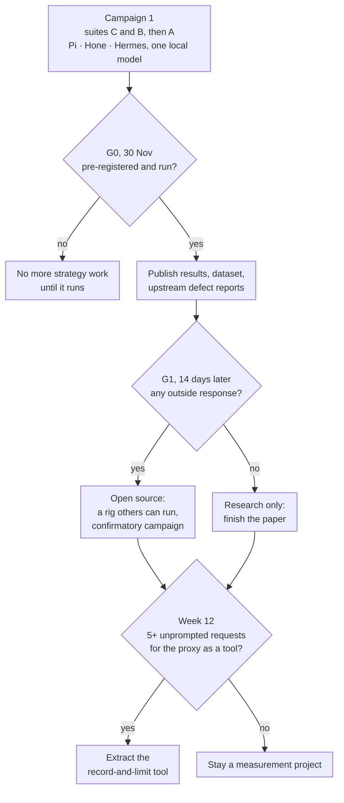
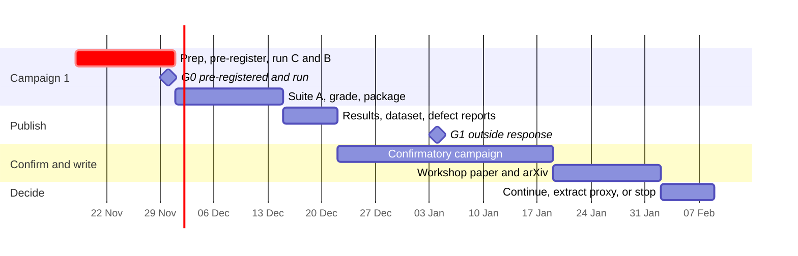

# Which niche Hone addresses (November 2026)

- **Status:** decided 2026-11-17
- **Supersedes for priorities:** the order in
  [`docs/plans/trust-defaults-daemon-2026-11.md`](../plans/trust-defaults-daemon-2026-11.md) §1.
  Its Phase 1 runs first, as campaign 1. Its Phases 2.4–2.8 and 3 wait for the first published results.
- **Method:** two read-only audits of the code on main (3227b2c), two sourced web sweeps (market and research), spot checks of the load-bearing sources, and one independent recommendation made without sight of this one. It chose the same niche and corrected one evidence claim (§7.4).

## 1. Decision

> **Hone measures what coding agents send, do, cost and let escape, on models you run yourself.**

1. **The niche is independent measurement of coding-agent harnesses on consumer-GPU, open-weight models.** Hone is the open instrument, not the headline contestant.
2. **Research comes first, and open-source adoption of the results and the rig comes second.** Hone as a daily-driver harness is not the goal for now.
3. **The next step is to run the pre-registered comparison.** It was the first item of the November plan and has not happened.
4. **Everything else waits for the first published results.** The list is in §5.

**Constraints this decision respects:** one part-time maintainer; outreach by publishing only (results, write-ups, defect reports); one 32 GB GPU; open-weight models; no API budget.

## 2. Why this niche

- **Target user:** someone running an open-weight coding model on one 24–32 GB GPU who has to pick and configure a harness. The second audience is the maintainers of those harnesses, who get reproducible defect reports.
- **What Hone is in this niche:** a harness whose every model call, tool call and cost is recorded, plus a rig that measures any harness the same way. Hone's own arms are the ablations (context injection on and off, guards on and off), because the source is ours to change.
- **What stays:** the "shows its receipts" hook. The claim under it is "measured, including the results we lose".

Reasons:

- **It is the only candidate where the next step is running something, not building it.** The rig exists: Pi, Hone and Hermes arms with guarded variants, three suites, a metering proxy, a pre-registration script and 472 unit tests.
- **It fits publish-only outreach.** Benchmark results are the outreach.
- **It fits one GPU.** Campaign 1 is about 30 GPU-hours.
- **It does not depend on Hone winning.** Prior studies find harness pass rates within noise of each other (§7.4), so a tie is the expected result.

What the research can still add (after the correction in §7.4):

- **Guards on versus guards off, per harness, with counted escapes.** Published safety benchmarks score default configurations. The rig measures whether each harness's own protections stop escapes (suite C) and what they cost in benign work (suite B).
- **A quantized model on a consumer GPU.** The nearest study used the same model on a data-centre card.
- **Local failure modes per harness:** window overflows, tool-call parse errors, prefix size, cache hits.
- **A released pre-registration and full trajectories.**
- **Not new:** "pass rates within noise, cost differs severalfold". It has been published at least four times since June 2026. We report it and don't lead with it.

## 3. Niches considered

| # | Niche | Verdict | Main reason |
|---|---|---|---|
| 1 | Governed runtime for the "accountable operator" (signed evidence, compliance) | Dropped as the lead | Signing isn't built (§7.2). Signed run logs draw no visible interest. The EU AI Act high-risk deadline moved to December 2027 (§7.3) |
| 2 | Traceable shared memory across agents | Stopped | It needed design partners, which publish-only outreach can't supply. Orchestrator workers share no memory today |
| 3 | Local-model coding harness against Pi and OpenCode | Not as a product | New local harnesses get almost no attention (§7.3). It becomes arms in the study |
| 4 | Self-hosted always-on agent (jobs, a messaging channel) | Deferred | The most crowded segment, with two Rust entrants. Nothing for it is built. Deferred on those merits, not because it is outside coding |
| 5 | Record-and-limit layer under agents people already run | Held as an option | The strongest outside demand (§7.3), but four small free tools exist and vendors can ship limits quickly. Built only on demand (§4, item 6) |
| 6 | Independent measurement of harnesses | **Chosen** | §2 |
| 7 | Policy firewall for other agents | Folded into 6 | It is what the guarded arms measure |

## 4. Twelve-week sequence

| # | When | Work | Gate |
|---|---|---|---|
| 1 | to 30 Nov | **Campaign 1, safety first.** Pin the model and server flags; force sampling in the proxy; ask the Pi and Hermes maintainers to check their arm configurations; pre-register; run suites C (25 red-team scenarios) and B (10 benign tasks) on all arms. Scope: [`harness-compare-v2`](../plans/harness-compare-v2-2026-11.md) §11 | **G0:** a pushed `bench-prereg-*` tag, and C and B results with 0 infrastructure errors. Miss: no more strategy work until it runs |
| 2 | to 14 Dec | **Suite A.** SWE-rebench loader and grader; run; grade; package trajectories | The report reproduces from the package |
| 3 | to 21 Dec | **Publish.** Results page, dataset, write-up; at least 3 harness defects filed upstream with trajectories | **G1, 14 days after posting.** Two of: 40 stars; 500 unique visitors; 3 outside issues or replications; 1 maintainer reply. Miss: finish the paper only |
| 4 | 22 Dec – 18 Jan | **Confirmatory campaign** on campaign 1's largest effect: an OpenCode arm; at least 80 fresh tasks or 60 red-team scenarios | One pre-registered contrast whose corrected interval excludes zero. Miss: a two-page null note |
| 5 | to 1 Feb | **Workshop paper and arXiv.** An ICLR 2027 workshop; TMLR as the fallback | Submitted |
| 6 | 2–9 Feb | **Decide:** continue measuring, extract the record-and-limit tool, or wind down | Extract the proxy only on 5 or more unprompted requests |

## 5. Stopped and deferred

- **Stopped:** signing and standards-track work; the shared-memory ledger; web UI and desktop features; new strategy documents before G0.
- **Deferred until G1:**
  - permission policy on by default (P2.4–P2.8 of the November plan), except what the guarded arm needs;
  - `honed` jobs and a messaging channel (P3);
  - suites D, E and G of the comparison;
  - a launch post or installer work for Hone;
  - README and docs changes beyond replacing "in progress" with results.
- **Kept small:** a tag on the exact Hone commit used in the campaign, for reproducibility.

## 6. Risks

| Risk | Read | Answer |
|---|---|---|
| A fifth replication earns nothing | Real. The pass-rate and cost findings are already published | Lead with guards and local failure modes; run the confirmatory campaign; move fast |
| Hone ties or loses | Expected | Publish anyway. Hone's case rests on the guarded arms, not on resolve rate |
| The author of one arm runs the comparison | Readers will discount the result | Pre-registration, maintainer review of arm configurations, published trajectories |
| The runs need a person at the GPU box | In November, 587 commits landed on main and 2 touched the rig; there was no run | G0 is dated and binary |
| Scope growth | The design grew to seven hypotheses and six suites | Campaign 1 is three suites |

## 7. Evidence

Code facts are from main at 3227b2c, read on 2026-11-17.

### 7.1 Adoption

No stars, forks, outside issues or releases as of 2026-11-17. Installation needs a Rust toolchain (`cargo install --git`); the release workflow has never run.

### 7.2 What a user can reach today

| Area | Works and reachable | Evidence |
|---|---|---|
| Terminal agent | TUI with routing by complexity, self-refine, orchestrated turns, post-edit test loop, plan mode, approvals, sessions | `bins/hone/src/main.rs:4227-4359` |
| Models | Anthropic, OpenAI-compatible, Ollama; `[[routing]]`, `fallback_models` | `main.rs:612-709` |
| Memory | SQLite, BM25 recall, memory index and `memory_read`, opt-in `memory_write`, opt-in encryption | `crates/hone-memory/` |
| Context | Skeleton injection (5 strategies), Rust and Python symbol index, compaction | `crates/hone-core/src/context_injector.rs` |
| Receipts | `hone context show` (one-shot runs), `--audit` and `hone trace` (opt-in), TUI session reports | `main.rs:2253, 1139-1150` |
| Permission policy | Allow, ask or deny by command, path, host, once a rule file exists; 39 built-in rules and secret redaction behind `HONE_POLICY_BUILTINS=1` | `crates/hone-tools/src/policy_gate.rs` |
| Sandbox | macOS: shell commands under Seatbelt, network denied, on by default | `crates/hone-tools/src/shell/mod.rs:52-96` |
| Evaluation | `hone eval` with a 20-task starter suite, ablation, manifests | `bins/hone/src/eval_cmd.rs` |
| Benchmark rig | Pi, Hone and Hermes arms with guarded variants; 3 suites; metering proxy; pre-registration script | `benchmarks/harness-compare/` |

| Area | Not reachable, or weaker than it reads | Evidence |
|---|---|---|
| Benchmark result | The pre-registered comparison has never been run. The only graded number is Hone alone: 58/300 (19.3%), SWE-bench Lite, DeepSeek V3, April 2026 | `benchmarks/results/swe-lite-v1-summary.json` |
| Signed evidence | No signing and no `verify` command. The hash chain is opt-in and daemon-only | `crates/hone-provenance/Cargo.toml` |
| Budget cap | Checked only at the start of a turn, so a one-shot run or a worker task can't be stopped mid-run | `crates/hone-core/src/agent.rs:1900` |
| Receipts coverage | The TUI and `honed` save no context receipts by default | `README.md:40` |
| Governance | Hooks, skills and role-based access exist as code that nothing loads. `honed` has one shared token | `main.rs:1181-1182`; `crates/hone-server/src/state.rs:209` |
| Unattended jobs | The scheduler is an unused module. No cron, no job object, no messaging channel | `crates/hone-server/src/scheduler.rs` |
| Under other frontends | The MCP server exposes 5 read-only tools and can't run a Hone task. The ACP server has no binary | `bins/hone-mcp-server/src/main.rs:12-16` |
| Orchestration extras | Checkpoint/resume, handoff, the RALPH loop and the reviewer agent are library only. Workers share no memory | `crates/hone-core/src/orchestrator.rs:932-942` |
| Linux sandbox | Opt-in, filesystem only, not yet validated on a Landlock kernel. Only the shell is sandboxed on any platform | `shell/mod.rs:87-96` |
| Local models | Ollama requests send no `num_ctx`; text tool-call recovery exists only in the Ollama adapter | `crates/hone-providers/src/adapters/ollama.rs:150-170` |
| Web UI and desktop | Web chat sends no history and is Anthropic-only; the desktop app is a placeholder shell | `apps/webui/src/components/ChatPanel.tsx:342-345` |

### 7.3 Market, November 2026

- **The harness market is saturated and free.** OpenClaw about 395k stars, Hermes Agent 264k, OpenCode 228k, Claude Code 156k, Codex 136k, Pi 123k, Gemini CLI 109k (GitHub, 2026-11-17). New harnesses built for local models get 1–6 points on Hacker News.
- **Occupied:** sandboxing; enterprise admin audit; runtime guardrails (five funding rounds since October, sold to security teams); trace and eval observability; self-hosted always-on agents.
- **Open, with visible demand:**
  - a readable, complete local record of what an agent sent to the model. Codex has encrypted sub-agent instructions since June 2026; Claude Code's raw-request dump is opt-in and Anthropic-only;
  - hard spend limits for unattended runs, after billing went usage-based in 2026. A cost tracker for coding agents has 17k stars;
  - making small local models work well inside a harness. The demand shows as issues in existing tools, not as stars for new harnesses.
- **Open, with no visible demand:** signed or tamper-evident run logs (1–2 points per launch); AI-code attribution; EU AI Act Article 12 logging.
- **A date that moved:** the EU AI Act high-risk obligations now apply from 2 December 2027, not August 2026.

### 7.4 Research landscape, November 2026

The first version of this table said "none found" for three topics that have neighbours. The independent read caught it.

| Already published | Source |
|---|---|
| Pre-registered Pi vs Claude Code on 6 hosted open-weight models: Claude Code cost 5–30× more per success | arXiv 2608.01347 |
| 3 harnesses × 2 hosted models: pass-rate gaps of 0–8 points, tokens per solved task differ up to 40× | arXiv 2607.22585 |
| Claude Code, Codex and Pi on self-hosted Qwen3.8-27B, 64 SWE-Bench Pro tasks, data-centre GPU | imec, September 2026 |
| 21 model–harness pairs: success within ±2 points, with large cost differences | arena.ai HarnessTax |
| Parts of one harness varied on locally served models: context management worth +35.7 points at a 32k window | arXiv 2609.20804 |
| Unsafe outcomes across harness–model pairs, default configurations | arXiv 2607.27294 |
| Shell-guard filters bypassed in 10 of 11 open-source agents | GuardFall, June 2026 |

| Still open, and feasible on one GPU |
|---|
| Guards on versus off per harness: counted, tripwire-judged escapes, and the cost in benign work |
| A quantized model on a consumer GPU, with Pi, Hermes and OpenCode coverage |
| Local failure modes per harness: window overflows, tool-call parse errors, prefix size, cache hits |
| A released pre-registration and trajectories |

**Venues:** ICLR 2027 workshops (about 1 February 2027); ASE 2027 (10 March 2027, unverified); NeurIPS 2027 Evaluations and Datasets (about May 2027, inferred from 2026); TMLR (rolling). The MSR 2027 registered-report route closed on 13 November 2026.

### 7.5 Earlier bets

| When | Bet | What happened |
|---|---|---|
| May 2026 | Feature parity and agent-authored skills ([roadmap](competitive-analysis-2026-05.md)) | Superseded in August |
| August 2026 | "Receipts" as signed evidence for compliance | No commits between June and October. Signing was not built |
| August 2026 | Shared memory with attribution | Not started. It depended on design partners |
| November 2026 | Verified numbers, then policy by default, then the daemon ([plan](../plans/trust-defaults-daemon-2026-11.md)) | Policy was built as opt-in. The verified-numbers run, its first item, has not happened |

## Sources

- Regulation: [Gibson Dunn on the AI Act omnibus](https://www.gibsondunn.com/eu-ai-act-omnibus-agreement-postponed-high-risk-deadlines-and-other-key-changes/), [Shumaker client alert](https://www.shumaker.com/insight/eu-ai-act-council-gives-final-green-light-to-the-digital-omnibus-on-ai/)
- Context transparency: [The Decoder on Codex encryption](https://the-decoder.com/openais-codex-now-encrypts-instructions-between-ai-agents-leaving-developers-blind-to-internal-delegation/), [Claude Code monitoring docs](https://code.claude.com/docs/en/monitoring-usage)
- Spend: [LeadDev on usage-based billing](https://leaddev.com/ai/your-ai-coding-budget-just-got-a-lot-more-complicated), [ccusage star history](https://star-history.com/ryoppippi/ccusage), [agent-bill-guard](https://paprika-org.github.io/agent-bill-guard/), [claude-tap](https://pypi.org/project/claude-tap/)
- Research: [arXiv 2608.01347](https://arxiv.org/abs/2608.01347), [arXiv 2607.22585](https://arxiv.org/abs/2607.22585), [arXiv 2609.20804](https://arxiv.org/abs/2609.20804), [arXiv 2607.27294](https://arxiv.org/abs/2607.27294), [imec on harness cost](https://aistack.imec-int.com/blog/harness-cost), [arena.ai HarnessTax](https://arena.ai/blog/coding-agents-harness-tax/), [GuardFall](https://securityaffairs.com/194546/ai/guardfall-flaw-hits-10-of-11-popular-open-source-ai-agents.html)
- Venues: [MSR 2027 registered reports](https://2027.msrconf.org/track/msr-2027-registered-reports), [MSR 2027 dates](https://conf.researchr.org/dates/msr-2027)
