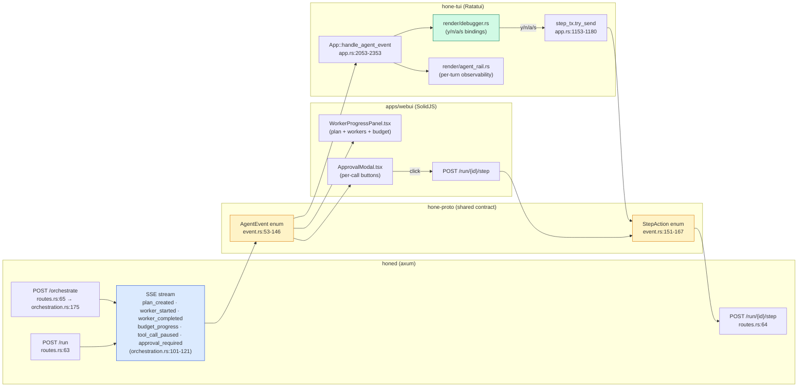
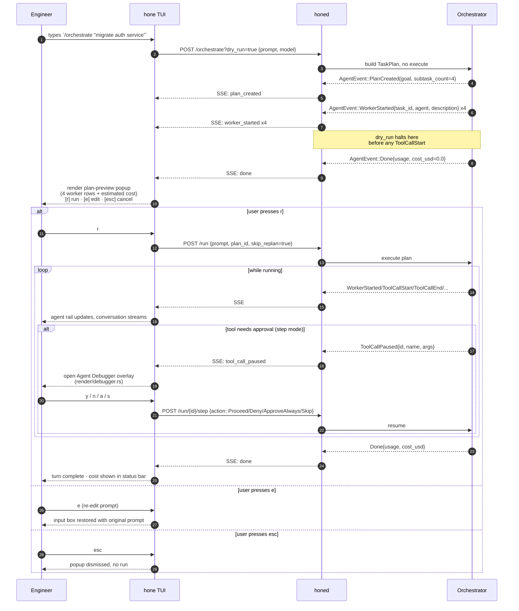

# TUI Orchestration — Porting the GUI's Surfaces into Ratatui

**Author:** ai-researcher (Quick Mode follow-up)
**Date:** 2026-05-08
**Companion to:** `docs/research/gui-for-non-cli-users-2026-05.md` (Maya / non-CLI user surfaces)
**What this doc is NOT:** another competitive matrix (`docs/research/competitive-analysis-2026-05.md`), or a re-explanation of the AgentEvent vocabulary (`crates/hone-proto/src/event.rs:53-146`).

---

## 1. Audience overlap

The GUI doc models **Maya** (product ops, never opens Terminal). This doc is about a strict superset: anyone who *also* lives in `tmux` and would resent context-switching to a browser to approve a tool call. Concretely the overlap is the SRE who runs `hone` in a tmux pane while debugging a production incident, the staff dev who wants the cost-preview gate before approving `/orchestrate "migrate the auth service"`, and the platform engineer pair-programming with a junior who wants to *show* the plan before kicking it off — none of them want to fish their cursor out of vim to click a SolidJS button. The Maya audience does not overlap at all (she will never run `hone`); the overlap is *engineers who have already adopted the agentic-orchestration mental model from the GUI but who interact with the daemon via TTY*. Roughly: every existing `hone` TUI user, plus a thin slice of GUI users who alt-tab into iTerm for the actual run. The TUI doesn't need a vocabulary mapping (Maya's column from the GUI doc §1.1) — engineers can read `WorkerStarted` and `tool_call_paused`. It does need the same gates (plan preview, budget cap, mid-run halt, audit verification), reskinned as Ratatui widgets.

---

## 2. Surface-by-surface portability

The TUI today already consumes every relevant `AgentEvent` variant — `app.rs:2053-2353` dispatches `Token`, `ToolCallStart`, `ToolCallEnd`, `ApprovalRequired`, `PlanCreated`, `WorkerStarted`, `WorkerCompleted`, `BudgetProgress`, `ModelInfo`, `ContextInjected`, `MemoryRecalled`, `ToolCallPaused`, `PlanSaved`, with a `_ => {}` forward-compat arm. The infrastructure for orchestration UI **already exists**; the question is which surfaces add presentation worth building.

| # | GUI surface | Verdict | Houses in (existing TUI module) | Rationale |
|---|---|---|---|---|
| 1 | **Outcome composer + plan-preview gate** | **Direct port** | New popup over `crates/hone-tui/src/render/conversation.rs`; trigger via `crates/hone-tui/src/commands.rs` (add `Command::Orchestrate(prompt)`) | The plan preview is just a list of `WorkerStarted` event cards rendered before any `ToolCallStart` fires. The `App::handle_agent_event` arms at `app.rs:2222` (`PlanCreated`) and `app.rs:2232` (`WorkerStarted`) already exist — the TUI just needs to render those into a confirmation popup with `[r] run / [e] edit / [esc] cancel` instead of the current `messages.push(System, ...)` stub. **No new daemon work** beyond the same `?dry_run=true` extension the GUI doc proposes — the SSE stream is identical. |
| 2 | **Plan canvas (DAG)** | **Reduced port** | Replace the System-message dump in `app.rs:2237-2240` with a real `PlanTreeWidget` under `crates/hone-tui/src/render/`; reuse the `agent_rail.rs` widget pattern | A live left-to-right DAG with edge routing is a non-starter in Ratatui — the best you can do is an indented ASCII tree (see §6 mockup). For ≤ 4 workers the existing vertical list in the agent rail (`agent_rail.rs:75-100` already shows worker invocations via `TurnLedger`) is *better* than the GUI's vertical card list because of density. **Loses:** edge visualization for fan-out/fan-in; you can't see "B and C are siblings of A" at a glance, only "B and C are nested under A." For Maya that matters; for an SRE it doesn't — they'll read the `parent_task_id` in the tooltip on hover (which the TUI can show via Ctrl+J/K + Enter on a node, same as `handle_key_anatomy` at `app.rs:1092`). |
| 3 | **Permissions sheet (per-run grant)** | **Reduced port** | New full-screen overlay alongside `crates/hone-tui/src/render/debugger.rs`; bind to `:permit` ex-command in `commands.rs` | The GUI sheet is sliders + checkbox grids. In the TUI it becomes a key-value form with ↑/↓ navigation, Tab to move between groups, Space to toggle, `[$] [t]` to bump budget/time. The form maps 1:1 to the same widened `TeamPolicy` struct the GUI proposes. **Loses:** the at-a-glance scan of "what will this touch" — checkboxes are denser visually than ASCII `[x] read repo`. Mitigation: render the checked grants as a colored summary line below the form (e.g. `grants: read=repo+web write=./reports/ budget=$0.50 time=5m`). |
| 4 | **Connections gallery (MCP browser)** | **Skip** | n/a (or: thin `:mcp list` / `:mcp install <name>` ex-commands in `user_commands.rs`) | Card-grid browsing with logos is a GUI affordance. A TUI user who wants Slack MCP types `hone mcp install slack` from the shell — they don't want to navigate a Ratatui card grid. The right TUI surface is two CLI subcommands, not a panel. Daemon endpoint reuse (`GET /mcp/marketplace` at `mcp_routes.rs`) is identical, but the consumer is the `hone` CLI binary, not the TUI render loop. |
| 5 | **Workflows page (recipe library)** | **Reduced port** | New overlay using the `session_switcher.rs` pattern (`render/session_switcher.rs:15-142`); bind Ctrl+W or `:recipes` | Ratatui handles a list-with-detail-pane natively — the existing session switcher (j/k navigate, Enter to select, scrollable) is the exact widget shape needed. Calls existing `GET /recipes` (`crates/hone-server/src/discovery.rs:132`). For template-var input, fall back to `$EDITOR` (see §4 below) — far better TUI ergonomics than typing into a Ratatui textarea. **Loses:** estimated cost badge from past runs (no cost-history aggregate in the daemon yet); browse-community gallery (irrelevant for engineers — they `git clone` the recipe repo). |
| 6 | **Run history + replay + audit** | **Reduced port** | Extend `render/session_switcher.rs` to a multi-tab overlay (Sessions / Runs / Provenance); reuse `format_relative_time` already present in `session_switcher.rs:9` | Sessions list is shipped (`Ctrl+O`, `app.rs:1193-1217`). Adding a "Runs" tab that hits `GET /provenance` and a "Verify" action that hits `GET /provenance/{id}/verify` is a 2-day extension. **Loses:** SideBySideDiff visualization week-over-week (Ratatui can render a unified diff but not a navigable side-by-side — the `:review` command at `commands.rs:121` already handles unified diffs adequately); the share-link affordance is just a printed URL, not a button (and that's fine in a TTY). |
| 7 | **Scheduled runs UI** (GUI honourable mention) | **Direct port** | New ex-commands `:schedule add <name> <cron>` / `:schedule list` in `user_commands.rs` | Cron expressions are *more* TUI-native than GUI presets — engineers prefer typing `0 9 * * 1` over clicking "Weekly Mondays." Storage already exists at `crates/hone-server/src/scheduler.rs:120`. The new endpoint (`GET/POST /schedules`) the GUI doc requests is the same one the TUI consumes. |

**Net summary:** of 6 numbered GUI surfaces, **2 port directly** (composer/plan-gate, schedule add), **3 port with reduced fidelity** (plan canvas → ASCII tree, permissions sheet → form overlay, runs page → tabbed switcher), and **1 should be skipped** (MCP gallery — replace with CLI subcommands). The honourable-mention "scheduled runs" actually ports *better* in TUI than GUI because cron-as-text beats cron-as-preset for the SRE audience.

---

## 3. Shared substrate — extract `hone-orchestration-view`?

**Recommendation: do not extract a new crate. Share at the protocol layer; render twice.**

What's already shared correctly: the `AgentEvent` enum (`crates/hone-proto/src/event.rs:53-146`) is the single source of truth — both TUI and webui consume the same JSON. The `StepAction` enum (`event.rs:151-167`) is symmetrically the contract for replies. Server SSE event names (`orchestration.rs:101-121`: `plan_created`, `worker_started`, `worker_completed`, `budget_progress`, etc.) are identical for both clients. **This is the right level of sharing.** Both clients are already getting the same structural data.

What is *not* shared and arguably should be:
- **Cost formatting.** The webui uses `${budget()!.spent_usd.toFixed(4)}` (`WorkerProgressPanel.tsx:55`); the TUI uses `format!("${cost_usd:.4}")` (`app.rs:2262`). Two implementations, identical output. A shared `format_cost(usd: f64) -> String` is a **5-line function**, not a crate.
- **Plan-tree builder** (worker → parent_task_id → tree). Today the TUI's `TurnLedger::record_worker_started` (`turn_ledger.rs:348`) and the webui's Solid signal in `lib/orchestrator.ts` both reconstruct worker state from the SSE stream independently. A shared tree builder *would* be useful — but it lives most naturally in `hone-core` next to the orchestrator that emits it, not in a new view crate.
- **Approval state machine.** Already centralized: `StepAction` is in `hone-proto`, the daemon handles the protocol in `run_registry.rs`, and clients are pure presentation (the TUI dispatches via `step_tx.try_send` at `app.rs:1153`, the webui via `POST /run/{id}/step`).

**Argument against a `hone-orchestration-view` crate.** Webui rendering is SolidJS components and CSS; TUI rendering is Ratatui widgets and ANSI styling. Sharing those across the WASM boundary is a *negative*-value abstraction — you'd be hand-writing a façade that compiles to both, and neither rendering layer would benefit. The two presentation stacks are different enough (event-driven Solid signals vs immediate-mode Ratatui frames) that the right shared layer is the *event protocol*, not the render layer. The plan-tree builder, when it lands, belongs in `hone-core` (where the planner lives) and is consumed via JSON by both clients — same pattern as today.

**Argument for, and what changes the calculus.** If a third surface lands (a third-party Vim plugin, a Slackbot, an iOS shell), the duplication tax flips. At three clients, extract a `hone-orchestration-view` crate that owns: (a) the SSE → plan-tree reducer, (b) the cost formatter, (c) the budget-fraction → color band lookup. At two clients, it's a YAGNI tax.

**One shared utility worth lifting today**, regardless: `format_cost(usd: f64) -> String` and `budget_fraction(spent, budget) -> f64` should live in `hone-core` (or `hone-proto`) so both clients agree on rounding and color thresholds. That's a 30-line PR, not an architecture decision.

---

## 4. TUI-native ergonomic wins

Things the TUI can do that the GUI fundamentally cannot (or can only do clumsily). Each is a concrete bullet, not aspirational.

1. **Vim-style approval bindings (`y`/`n`/`a`/`s`) — already shipped.** `crates/hone-tui/src/app.rs:1149-1184` (`handle_key_debugger`) maps `y`/Space/Enter → `Proceed`, `a` → `ApproveAlways(<paused tool>)`, `d`/`n` → `Deny("denied by user")`, `s` → `Skip`. This is the TUI version of the GUI's `<ApprovalModal>` and it *is faster* than mouse-clicking a button. The GUI doc's recommendation to reduce per-call modals via the up-front Permissions sheet still applies, but the residual mid-run modals are already optimal in TUI.
2. **`$EDITOR` for recipe template vars and orchestration prompts.** The TUI can drop the user into `nvim` / `code -w` for any multi-line input — recipe `{{template_vars}}` (`bug-fix.yaml`'s `{{test_command}}`), the initial orchestration prompt, deny reasons. The GUI is stuck with a textarea. Add an ex-command `:edit prompt` that opens `$EDITOR`, writes back on save. Pattern already exists in `pending_interactive` (`app.rs:80, 506`) and `shell_escape.rs`.
3. **Tail-based provenance side panel.** The agent rail (`render/agent_rail.rs`) is a 18-column right-side scrollable widget tracking files/context/memory per turn. Add a 4th section "AUDIT" that streams provenance hash entries as they're written by `crates/hone-provenance/`. Live-tailing a Merkle chain in a sidebar is a TUI superpower; the GUI's "View audit trail" button is a worse UX than `tail -f`.
4. **Command palette for orchestration ops (Ctrl+K).** Already shipped (`palette_open` at `app.rs:139`, `handle_key_palette` at `app.rs:971`). Add palette entries: "Start orchestration (dry-run)", "Show plan", "Set budget", "Open permissions", "Verify provenance". The GUI's left-rail icons become palette items — equivalent affordance, faster access.
5. **`:budget` ex-command with live rebudget.** Type `:budget 0.50` mid-run to send a `TeamPolicy` patch the orchestrator picks up before the next worker dispatch. The GUI's slider is awkward; a typed dollar amount is one keystroke per character.
6. **tmux composability.** The TUI lives inside whatever pane manager the user has. Run `hone` in one pane, `tail -f .hone/plans/*.md` in another, `watch -n 1 hone provenance verify <id>` in a third. The GUI cannot offer this — it owns the whole window. This is the single largest reason the TUI persists as a first-class surface and not as "the headless mode."

---

## 5. Friction points — when to push the user to the GUI

Be honest. The TUI fundamentally cannot do these well, and pretending otherwise produces a worse product than just saying "open the web UI for this."

1. **Cost-trend sparkline graphs.** Ratatui has a `Sparkline` widget but rendering a multi-series cost timeline (week-over-week per workflow) at terminal cell resolution is a square-peg-round-hole. The GUI's eventual cost dashboard wins outright.
2. **Side-by-side diff between two recipe versions or two run outputs.** The TUI has a `:review` command and a `review_mode.rs` (451 lines), but it's a unified-diff workflow. True side-by-side requires horizontal real estate the TUI gives up to other panels. Recommend: TUI shows unified, GUI shows side-by-side, both backed by the same `GET /sessions/{a}` + `/sessions/{b}` calls.
3. **Multi-pane fan-out with > 4 concurrent workers.** The agent rail (`agent_rail.rs:27` — `RAIL_WIDTH: u16 = 18`) and the conversation pane together cap usable horizontal space. Once `subtask_count` from `PlanCreated` (`event.rs:93`) exceeds ~4, the ASCII tree becomes a wall of text and the GUI's true 2D canvas wins. The TUI should *detect* `subtask_count > 4` and render a footer hint: `Plan has 7 workers — open in web UI for canvas view (hone web open)`.
4. **MCP catalog browsing.** Already covered in §2 — replace with CLI subcommands, do not try.
5. **Drag-and-drop workflow editing.** Per the GUI doc's anti-recommendation §6.1, *neither* surface should ship this. Mentioned only because if anyone proposes it for TUI, the answer is the same as for GUI: no.
6. **Provenance graph visualization.** A Merkle chain is fundamentally tree-shaped; TUI tail-rendering it as a list (the §4.3 recommendation) is an honest reduction. If the user wants to *visualize* the chain (parent links, branches), GUI wins. The verify-the-chain-still-hashes-correctly check is identical on both.

---

## 6. Mermaid diagrams

### 6.1 Shared SSE bus — TUI and GUI as siblings



The diagram makes the architectural point: `AgentEvent` and `StepAction` in `hone-proto` are the **contract**, the SSE wire is the **transport**, and the two clients are pure presentation. No new shared crate is needed — the contract is already the shared substrate.

### 6.2 Plan-preview gate in TUI — sequence



The sequence is intentionally identical in shape to the GUI's §4.3 sequence — *because the daemon contract is the same*. Only the input modality changes.

### 6.3 ASCII mockup — plan-preview popup over the TUI

The popup overlays the conversation pane, same render layer as `render/debugger.rs` and `render/session_switcher.rs`:

```
┌─ hone ──────────────────────────────────────────────────────────[Ctrl+H]─┐
│                                                                          │
│ ┌─ Plan Preview ── claude-sonnet-4-6 ── est $0.18 ──────────────────────┐│
│ │  Goal: migrate auth service from JWT v1 to v2                         ││
│ │                                                                       ││
│ │  ▸ [t-001] researcher  : audit current /auth handlers     ~$0.04  *  ││
│ │  ▸ [t-002] coder       : draft migration in feature branch ~$0.08    ││
│ │  ▸ [t-003] reviewer    : review diff against safety checklist ~$0.04 ││
│ │  ▸ [t-004] tester      : run test suite + coverage check  ~$0.02     ││
│ │                                                                       ││
│ │  Permissions implied:                                                 ││
│ │    read   ./crates/hone-server/auth/* ./tests/auth/*                  ││
│ │    write  ./crates/hone-server/auth/* (3 files)                       ││
│ │    shell  cargo test, cargo clippy                                    ││
│ │                                                                       ││
│ │    [r] run    [e] edit prompt    [p] permissions    [esc] cancel      ││
│ └───────────────────────────────────────────────────────────────────────┘│
│                                                                          │
│ ─── Conversation ───                                                     │
│ > /orchestrate "migrate auth service from JWT v1 to v2"                  │
│                                                                          │
│ ◆ orchestrating: 4 subtasks proposed                                     │
│                                                                          │
└─[Idle] sonnet-4.6 ▮▮▮▮▮▯▯▯▯▯ 12k/200k  ─  $0.00 (preview)  ─────────────┘
```

Asterisk `*` next to t-001 marks the worker the cursor is on — j/k navigates, Enter expands to show the worker's tool list (parsed from `WorkerStarted.description` and the planner's tool-call hints). `[p]` opens the Permissions sheet (§2 row 3) before run.

### 6.4 ASCII mockup — Agent Debugger overlay (already shipped, for reference)

This is `crates/hone-tui/src/render/debugger.rs` rendering today, included to show the TUI already has the GUI's `<ApprovalModal>` equivalent, just keyboard-driven:

```
┌─ Agent Debugger — Tool Call Paused ──────────────────────────────────────┐
│                                                                          │
│  Tool: shell.run                                                         │
│                                                                          │
│  {                                                                       │
│    "command": "rm -rf .hone/plans/old/",                                 │
│    "working_dir": "/Users/wk/work/hone",                                 │
│    "timeout_secs": 30                                                    │
│  }                                                                       │
│                                                                          │
│  [y] proceed   [n/d] deny   [a] always-allow shell.run   [s] skip   [esc]│
└──────────────────────────────────────────────────────────────────────────┘
```

Bindings live in `crates/hone-tui/src/app.rs:1149-1184`. `y/n/a/s` test coverage at `crates/hone-tui/src/render/debugger.rs:104-279`.

---

## 7. Recommended cut — if TUI ships only 2 surfaces in 4 weeks

### Pick #1 — Outcome composer + plan-preview popup (Surface 1, direct port)

**Smallest viable version:**
- Add `Command::Orchestrate(prompt)` to `crates/hone-tui/src/commands.rs:3` (parse `/orchestrate <prompt>`).
- Add an `AppState::PlanPreview { goal, workers: Vec<PendingWorker>, est_cost: f64 }` variant to `app.rs:31-38` and a render function `render_plan_preview` next to `render_debugger` (`render/debugger.rs` is the closest existing pattern — full-screen overlay with footer hints).
- Daemon: same `?dry_run=true` change the GUI doc proposes in `crates/hone-server/src/orchestration.rs` — halt before `ToolCallStart` is emitted. The TUI consumes the existing `plan_created` + `worker_started` SSE events with no daemon-side rename.
- Bind `r` → `POST /run` with the preserved prompt; `e` → restore input box; `Esc` → dismiss; `p` → defer to Pick #2 (`:permit` ex-command) when it lands.
- **No** ASCII tree DAG in this slice (Surface 2 reduced port) — use a flat numbered list. Tree comes in a follow-up.

**Why this one first.** The plan-preview gate is the highest-leverage primitive *for both audiences*. For the GUI it converts Maya from "bounced after 90 seconds" to "I trust this." For the TUI it converts the engineer from "I just blindly typed `/orchestrate` and now I'm watching $0.40 stream by" to "I see four workers and the cost ceiling before I press r." Same daemon change powers both clients — when the GUI team ships their `?dry_run=true` work, the TUI gets it for free at the protocol layer.

**Acceptance test.** A user types `/orchestrate "audit the auth module for SQL injection"` in the TUI, sees a popup with N worker rows, an estimated cost, and an implied-permissions block, presses `r`, and the existing run flow takes over with no duplicate planning.

### Pick #2 — Permissions sheet + `:budget` / `:permit` ex-commands (Surface 3, reduced port)

**Smallest viable version:**
- New ex-commands in `crates/hone-tui/src/user_commands.rs`: `:budget <usd>`, `:permit read <glob>`, `:permit write <glob>`, `:permit shell <cmd-prefix>`. Each `POSTs` a partial-update to `/team/policy` (extends the existing `crates/hone-server/src/governance_routes.rs:15`).
- An overlay `:permissions` (or `[p]` from the plan-preview popup) opens a Ratatui form with:
  - Budget USD (text field, default $0.50)
  - Time limit in minutes (text field, default 5)
  - Read globs (textarea, prefilled from plan)
  - Write globs (textarea, prefilled from plan)
  - Default action when out-of-grant: radio Pause / Skip / Stop
- Submit `POST /team/policy` then transitions back to plan-preview. Cancel returns without changes.
- The existing `handle_key_debugger` (`app.rs:1149-1184`) already implements per-call mid-run overrides — `y/n/a/s`. With Pick #2 in place, those overrides fire only for things outside the up-front grant. **No work needed on the existing approval flow.**

**Why this one second** — and **why this differs from the GUI's recommended cut** (which was Outcome composer + Workflows page). The GUI's Pick #2 (Workflows) is high-leverage for Maya because she needs *one button she presses every Monday*. The TUI engineer doesn't need that button — they have shell history and `hone recipes run <name>` from the CLI. Their second-most-valuable gate is **bounded-blast-radius before a long autonomous run**: tell the agent it can spend $5 max and write only under `./reports/` and they'll let it run unattended. Without Pick #2, the engineer keeps the per-call modal cycle (which works, but is the equivalent of micromanaging) or disables step mode entirely (which is the equivalent of YOLO). Pick #2 unlocks the middle ground: trusted-but-bounded autonomy.

**Acceptance test.** A user runs the plan-preview from Pick #1, presses `[p]`, sets budget to $0.20 and write-glob to `./crates/hone-server/auth/`, presses Enter, then `r`. The orchestrator runs, halts when a worker tries to `shell.run` `rm -rf` outside the grant (escalates via existing `tool_call_paused`), and displays the existing debugger overlay. Total spend never exceeds $0.20.

**What this 4-week TUI slice deliberately leaves out.** Plan canvas DAG (Surface 2 reduced — keep flat list for now), Workflows overlay (Surface 5 — TUI users have CLI for this), Connections gallery (Surface 4 — skip permanently), Runs+audit overlay (Surface 6 — `Ctrl+O` session switcher already exists, audit verify can be a `:verify <session-id>` ex-command, neither needs a sprint), Schedule editor (Surface 7 — also a `:schedule add` ex-command, < 1 day).

**Cross-surface alignment.** Both clients ship the *same* Pick #1 (outcome composer + plan-preview gate). They diverge on Pick #2: GUI ships Workflows (recipes-as-buttons for Maya); TUI ships Permissions (run-scoped governance for the SRE). This is the right divergence — they serve different audiences past the shared gate.

---

## 8. Open questions for the senior engineer

1. **Should the TUI gate `/orchestrate` behind plan-preview by default, or only when `--preview` is passed?** Defaulting is more honest; opt-in is less disruptive to existing muscle memory. Recommendation: default on, with `/orchestrate --no-preview` for power users (and a `set` config to flip the default per-user).
2. **The `step_tx` channel is `mpsc::Sender<StepAction>` (`app.rs:168`).** The Permissions sheet needs to send a `TeamPolicy` patch *plus* a per-call `StepAction` when an out-of-grant tool is paused. Reuse the same channel with a wider event enum, or add a second `policy_tx`? Lean second channel — `StepAction` is per-tool-call; `TeamPolicy` is per-run.
3. **Where does `:budget` apply when the user is between turns?** It should apply to the next turn, not retroactively. Confirm that `crates/hone-server/src/state.rs` (the `AppState` shared across handlers) supports the per-run vs persistent split; if not, this question chains into the GUI doc's open question §7.2 (run-scoped vs persistent governance).
4. **Should the agent rail (`render/agent_rail.rs`) auto-pin when `subtask_count > 1`?** Today it's behind `Ctrl+R`. For multi-worker runs, the rail *is* the orchestration mental model — auto-showing it on `WorkerStarted` would surface the right widget without a config flag. Recommendation: auto-show, allow `Ctrl+R` to dismiss.
5. **`format_cost` and `budget_fraction` to `hone-core` — yes/no?** Argued for in §3 as a 30-line PR. Tagging the senior engineer for explicit signoff on the crate placement (alternatives: `hone-proto`, a new `hone-format` micro-crate).

---

## Appendix — files referenced

### TUI (`crates/hone-tui`)
- `src/app.rs:31-38` — `AppState::Idle / WaitingForResponse / Error`
- `src/app.rs:41-205` — `App` root state struct
- `src/app.rs:139` — `palette_open` (Ctrl+K command palette)
- `src/app.rs:164-168` — `debugger_open`, `step_tx` (step-mode channel)
- `src/app.rs:1149-1184` — `handle_key_debugger` (y/n/a/s/Space/Enter/Esc)
- `src/app.rs:1186-1191` — `set_step_tx`
- `src/app.rs:1193-1217` — `handle_key_sessions` (Ctrl+O switcher)
- `src/app.rs:2053-2353` — `handle_agent_event` (full SSE consumption)
- `src/app.rs:2222-2275` — `PlanCreated` / `WorkerStarted` / `WorkerCompleted` arms
- `src/app.rs:2277-2290` — `BudgetProgress` arm
- `src/app.rs:2338-2343` — `ToolCallPaused` arm
- `src/commands.rs:3-129` — `Command` enum + parser
- `src/layout.rs:1-39` — `LayoutMode { SinglePane, SplitHorizontal, BottomPanel }`
- `src/render/debugger.rs:1-279` — Agent Debugger overlay (with y/n/a/s tests)
- `src/render/agent_rail.rs:25-100` — 18-col observability sidebar
- `src/render/session_switcher.rs:1-152` — pattern to reuse for Workflows / Runs overlays
- `src/turn_ledger.rs:215-410` — `TurnLedger`, `record_worker_started`, `record_worker_completed`
- `src/user_commands.rs:96-225` — `UserCommandRegistry` (filesystem-overlaid `:ex` commands)

### Daemon (`crates/hone-server`)
- `src/orchestration.rs:101-121` — SSE event-name mapping
- `src/orchestration.rs:175` — `orchestrate_handler`
- `src/routes.rs:62-92` — full route table
- `src/discovery.rs:132` — `list_recipes_handler`
- `src/governance.rs:30` — `TeamPolicy { allowed_models }`
- `src/governance_routes.rs:15` — `/team/policy` GET/POST
- `src/scheduler.rs:120` — `add(name, cron_expr, ...)` (storage exists, no route yet)

### Protocol (`crates/hone-proto`)
- `src/event.rs:53-146` — `AgentEvent` enum (16 variants)
- `src/event.rs:151-167` — `StepAction { Proceed, Skip, ApproveAlways(name), Deny(reason) }`

### Web UI (`apps/webui`)
- `src/components/WorkerProgressPanel.tsx:1-130` — sibling renderer of the same SSE stream
- `src/components/ApprovalModal.tsx` — sibling of `render/debugger.rs`

### Companion docs
- `docs/research/gui-for-non-cli-users-2026-05.md` — Maya / non-CLI surfaces (precursor)
- `docs/research/competitive-analysis-2026-05.md` — three-horizon roadmap
- `priv/hone-gui-design-2026-05.md` — Tauri shell decision
