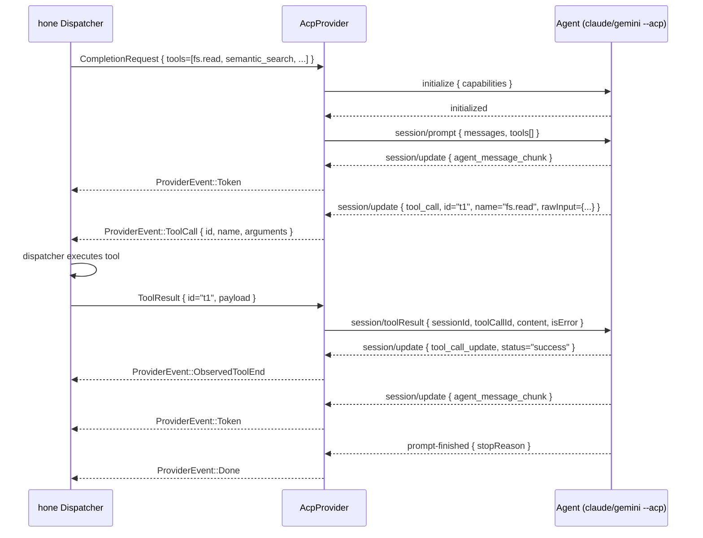

# ACP: Bidirectional Tool Dispatch

The Agent Client Protocol (ACP) lets hone drive any external agent process — `claude --acp`, `gemini --acp`, or any custom binary that speaks JSON-RPC 2.0 over stdin/stdout — and round-trip tool calls through hone's own dispatcher. This guide walks through configuring an ACP provider, what the message exchange looks like, and how to verify that tools actually round-trip end-to-end.

For the full wire-format reference, see [`docs/api/acp-protocol.md`](../api/acp-protocol.md).

## Why ACP

Before ACP, hone could only observe tool calls that an external CLI emitted (read-only). The model could ask claude-code to read a file, but hone's own native tools (its sandboxed FS, its semantic index, its MCP-backed servers) were unavailable to the agent. ACP closes the loop:

1. Hone announces its tool registry to the agent (`session/prompt.tools[]`).
2. The agent emits a `tool_call` notification.
3. Hone's dispatcher executes the tool against its own sandboxed runtime.
4. Hone returns the result via `session/toolResult`.
5. The agent continues generating with the result in scope.

The contract is symmetric: any agent that speaks ACP can use any tool hone exposes.

## Configuring an ACP provider

Edit `~/.config/hone/config.toml`:

```toml
[providers.claude_acp]
kind = "acp"
command = "claude"
args = ["--acp"]
default_model = "claude-sonnet-4-5"

[providers.gemini_acp]
kind = "acp"
command = "gemini"
args = ["--acp"]
default_model = "gemini-2.5-pro"
```

Then select it at startup:

```bash
hone --provider claude_acp
# or hot-swap mid-session:
# /configure provider claude_acp
```

## The lifecycle in one diagram



The events emitted by `AcpProvider` follow strict ordering: `Token*`, `ToolCall`, `ObservedToolEnd`, `Token*`, `Done`. `Done` is always last.

## Walkthrough: a single tool round-trip

Given an `~/.hone/tools.toml` that exposes `fs.read`, ask the agent to read a file:

```
> use fs.read to show me Cargo.toml
```

What hone sends and receives:

1. `initialize` (handshake) — caches client capabilities.
2. `session/prompt` — carries `messages` plus `tools: [{ name: "fs.read", description: "...", parameters: {schema} }, ...]`. The agent now knows what's available.
3. The model decides to call `fs.read`. The agent emits:
   ```json
   {"jsonrpc":"2.0","method":"session/update","params":{
     "sessionId":"sess_1",
     "update":{"sessionUpdate":"tool_call","id":"t1","title":"Reading Cargo.toml","kind":"fs.read","rawInput":{"path":"Cargo.toml"}}
   }}
   ```
4. Hone parses this into `ProviderEvent::ToolCall { id: "t1", name: "fs.read", arguments: {"path":"Cargo.toml"} }`. The dispatcher runs the tool against its sandbox and produces a result.
5. Hone replies with a `session/toolResult` JSON-RPC request:
   ```json
   {"jsonrpc":"2.0","id":42,"method":"session/toolResult","params":{
     "sessionId":"sess_1","toolCallId":"t1",
     "content":[{"type":"text","text":"<contents of Cargo.toml>"}],
     "isError":false
   }}
   ```
6. The agent ack's, emits `tool_call_update { status: "success" }` (surfaced as `ObservedToolEnd`), then continues streaming text tokens that reference the file content.

## Verifying tool dispatch works

The fastest end-to-end check is the integration test:

```bash
cargo test -p hone-providers --test acp_full_lifecycle -- --nocapture
```

This drives a mock ACP agent through every step of the lifecycle (schema announcement → tool call → result → continuation → done) and asserts every invariant.

For a manual smoke test against a real binary:

```bash
hone --provider claude_acp -i "use fs.read to show me README.md, then summarise it"
```

Watch for:
- A `tool_call` log line in `~/.hone/logs/<session>.log` mentioning `fs.read`.
- A matching `session/toolResult` entry.
- A final assistant message that quotes content from `README.md`.

## Tool schemas: keep them sharp

The agent's tool-selection accuracy depends on description quality. Three rules that pay off:

1. **Verb-led descriptions** — `"Read a file from the workspace"`, not `"File reading helper"`.
2. **Schema constraints** — use `enum`, `minimum`, `maximum` in the JSON Schema. Models prune options aggressively when constraints are tight.
3. **Reject silently** — when an arg fails validation, hone returns `isError: true` with a `text` block explaining what was wrong; the model usually recovers on the next turn.

## Cancellation

Issuing `Esc` (or sending `request.cancel` programmatically) propagates to the ACP provider, which sends a `session/cancel` and waits for the agent's `prompt-finished { stopReason: "cancelled" }`. Any in-flight tool dispatch is aborted; the dispatcher will not write a `session/toolResult` for a cancelled call.

## Troubleshooting

| Symptom | Likely cause | Fix |
|---|---|---|
| `supports_tools: false` in `/configure` | Old provider config loaded | `hone --provider claude_acp` (do not use the legacy `claude` provider for tool dispatch) |
| Agent never calls a tool | Schema rejected at `initialize` | Run with `RUST_LOG=hone_providers::acp=debug` and inspect the `initialize` response |
| Tool call hangs | Result channel never produced a value | Check the dispatcher log; the tool's runtime probably panicked |
| `tool_call_update` never arrives | Agent doesn't emit terminal status | Set `acp.expect_terminal_status = false` in config — `ObservedToolEnd` will be inferred from `prompt-finished` |
| `session/toolResult` errors back | `sessionId` mismatch | Ensure you're not running two parallel prompts on the same agent process |

## Related

- [`docs/api/acp-protocol.md`](../api/acp-protocol.md) — wire-format spec and message reference.
- [`docs/tutorials/providers.md`](providers.md) — provider configuration and hot-swapping.
- [`docs/tutorials/tools-and-mcp.md`](tools-and-mcp.md) — writing the tools that ACP will dispatch.
