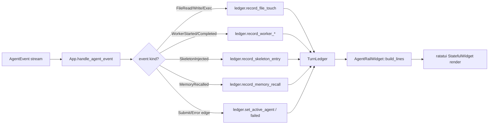

# Agent Rail — Per-Turn Observability Sidebar

The agent rail is the right-hand sidebar that surfaces what hone is *actually doing* during a turn: which files were touched, which agents are running, what context was injected, and which memories were recalled. It is the fastest way to answer "what did the model just look at?" without scrolling tool calls.

> **TL;DR**: terminal ≥100 cols wide → press **`Ctrl+R`** during any turn → watch the rail fill in.


The clip above walks through the empty-state behaviour (no provider call needed):

1. Launch hone — rail is **off** by default; only the conversation pane is visible.
2. `Ctrl+R` — rail toggles **on** in the crimson theme; all four sections appear with em-dashes because no turn has produced data yet.
3. `/theme minimal` — the same rail re-renders in pure ASCII (plain borders, no colour) — useful for `script(1)` capture, `ssh` sessions, and accessibility.
4. `/theme crimson` — back to the default look.
5. `Ctrl+R` — rail toggles **off** again; full-width conversation pane returns.
6. `/quit`.

To record the *populated* rail (live `[FILES]`, `[AGENTS]`, `[CONTEXT]`, `[MEMORY]` data) you need a working provider — see [Recording your own demo](#recording-your-own-demo) below.

## What the rail shows

The rail is 18 columns wide and renders four stacked sections:

```
╭ rail ────────────╮
│ [FILES] (live)   │  ← files touched this turn (R/W/X)
│ R src/auth.rs    │
│ W src/main.rs    │
│   2 files  3 ops │
│                  │
│ [AGENTS]         │  ← active sub-agents
│ … rust-expert    │
│ ✓ test-architect │
│                  │
│ [CONTEXT]        │  ← top BM25-ranked skeleton entries
│   call auth.rs … │
│   flat lib.rs  … │
│                  │
│ [MEMORY]         │  ← recalled memories (key + snippet)
│   auth-pattern   │
│     Use new_gen… │
╰──────────────────╯
```

Each section renders an em-dash (`—`) when it has nothing to show, so empty sections are visible (and reassuring) rather than hidden.

### Section meanings

| Section | What it tracks | When it populates |
|---|---|---|
| `[FILES]` | Every read / write / exec recorded by tool dispatch | First file touch in the turn |
| `[AGENTS]` | Active and completed sub-agents | First worker spawn (Complex tier) or turn submission (Simple/Medium) |
| `[CONTEXT]` | Skeleton entries selected by the context injector, ranked by BM25 | First context-injection call |
| `[MEMORY]` | Memories pulled by the recall pipeline (key + truncated snippet) | First successful recall |

The header gets a `(live)` badge while the turn is in progress; once the turn completes the badge disappears so you can scan the final state at a glance.

## Keybindings

| Key | Action |
|---|---|
| `Ctrl+R` | Toggle the rail on/off |
| `j` / `k` | Scroll rail down / up one line |
| `Page Down` / `Page Up` | Scroll one viewport |
| Mouse wheel | Scroll inside the rail |

The rail is suppressed automatically when the terminal is narrower than 100 columns — there isn't enough room for both a useful conversation pane and the rail. Make the window wider, then press `Ctrl+R`.

## Status glyphs in `[AGENTS]`

The AGENTS section uses single-character glyphs so each row fits in 18 columns. There are two glyph sets — coloured (default) and plain ASCII (`NO_COLOR=1` / `HONE_NO_COLOR=1`):

| State | Coloured | ASCII |
|---|---|---|
| Running | `…` | `…` |
| Succeeded | `✓` | `ok` |
| Failed | `✗` | `X` |
| Timed out | `T` | `!` |

When you submit a Simple or Medium turn (no orchestrator), the rail renders one synthetic entry for the active agent (`@<name>` or `default`) so the section is never empty during your turn. As soon as the orchestrator dispatches real workers, those replace the synthetic entry.

## Data flow

The rail is a pure read-side widget. Data flows from the agent loop into a per-turn `TurnLedger`, and the widget renders whatever the ledger has at the moment of redraw:



The ledger is sealed when the turn ends and pushed onto `completed_turns`; pressing `Ctrl+R` after the turn shows the *final* state of the just-finished turn until the next turn starts.

## Examples

### Live turn with file edits

```
╭ rail ────────────╮
│ [FILES] (live)   │
│ R src/auth.rs    │
│ R src/lib.rs     │
│ W src/auth.rs:42 │
│   2 files  3 ops │
│                  │
│ [AGENTS]         │
│ … rust-expert    │
│                  │
│ [CONTEXT]        │
│   call auth.rs … │
│   flat lib.rs  … │
│                  │
│ [MEMORY]         │
│   —              │
╰──────────────────╯
```

Note the `:42` line-range suffix on the second auth.rs entry — the rail records line ranges when tools report them (e.g. partial reads / patches).

### Completed orchestrator turn

```
╭ rail ────────────╮
│ [FILES]          │
│ R Cargo.toml     │
│ R src/lib.rs     │
│ W src/lib.rs     │
│   2 files  3 ops │
│                  │
│ [AGENTS]         │
│ ✓ rust-expert    │
│ ✓ test-architect │
│ ✗ flaky-checker  │
│                  │
│ [CONTEXT]        │
│   bm25 lib.rs    │
│                  │
│ [MEMORY]         │
│   storage-split  │
│     pgvector for │
╰──────────────────╯
```

### NO_COLOR mode

```
NO_COLOR=1 hone
```

Rounded borders become plain ASCII, glyphs become text, the `(live)` badge still appears:

```
+ rail ------------+
| [FILES] (live)   |
| R src/auth.rs    |
|   1 files  1 ops |
|                  |
| [AGENTS]         |
| ... rust-expert  |
|                  |
| [CONTEXT]        |
|   --             |
|                  |
| [MEMORY]         |
|   --             |
+------------------+
```

## Interpreting the [CONTEXT] section

Each row shows four columns:

```
  call src/auth.rs 0.91 120t
  └─┬─ └────┬────┘ └──┬─┘ └┬┘
    │       │        │    └─ token count (colored by budget)
    │       │        └────── BM25 relevance score
    │       └─────────────── path (left-truncated to keep filename)
    └─────────────────────── strategy abbreviation
```

Strategy abbreviations:

| Long name | Short |
|---|---|
| `CallGraph` | `call` |
| `Flat` | `flat` |
| `Adaptive` | `adpt` |
| `Hybrid` | `hybr` |
| `BM25` | `bm25` |

Token counts are coloured by budget tier — green under 1k, amber 1k–2k, red over 2k. In NO_COLOR mode they all render in the muted colour.

## Recording your own demo

The shipped tape at `docs/tutorials/agent-rail.tape` records the empty-state walkthrough you see at the top of this page. Re-render it with:

```bash
brew install vhs            # if not already installed
brew install gifsicle       # optional; halves the file size
vhs docs/tutorials/agent-rail.tape
gifsicle -O3 --colors 64 --lossy=80 \
    docs/assets/agent-rail-demo.gif \
    -o docs/assets/agent-rail-demo.gif    # in-place optimisation
```

Make sure the binary on `PATH` matches the source tree before recording:

```bash
cargo install --path bins/hone --force
```

To record the *populated* rail (real `[FILES]` / `[AGENTS]` / `[CONTEXT]` / `[MEMORY]` data), edit the tape:

1. Add `Setenv ANTHROPIC_API_KEY "sk-ant-..."` at the top, **or** ensure `~/.config/hone/config.toml` has a working provider.
2. After the first `Ctrl+R`, replace the `/theme` block with a prompt that touches files, e.g.

   ```
   Type "Read crates/hone-tui/src/render/agent_rail.rs and explain the AGENTS section in two sentences."
   Sleep 400ms
   Enter
   Sleep 12s
   ```

3. Re-render. The rail will fill in live as the turn dispatches.

### vhs gotchas worth knowing

- **Default rail state is OFF** — the first `Ctrl+R` *enables* the rail, not disables it.
- **Two consecutive `Ctrl+R` events with <2 s between them get merged**; vhs only emits one keystroke. Keep ≥3 s between Ctrl-key events, or interleave a `/theme` switch as in the shipped tape.
- **Terminal width drives rail visibility.** At `Width 1280` and `FontSize 13`, vhs delivers fewer than 100 cols and the rail is suppressed. Stick to `Width 1400` or larger, or drop `FontSize` to 11 to fit more cols in.
- **GIF size**: vhs writes a frame per terminal redraw, so output runs 150-200 KB before optimisation. `gifsicle -O3 --colors 64 --lossy=80` typically halves the file with no visible quality loss.

## Troubleshooting

| Symptom | Cause | Fix |
|---|---|---|
| Rail not visible after launch | The rail is **off by default** | Press `Ctrl+R` — it enables the rail rather than toggling a default-on state |
| `Ctrl+R` does nothing | Terminal narrower than 100 cols | Resize wider; check with `tput cols` |
| `[AGENTS]` is empty mid-turn | No `@agent` was used and the turn isn't Complex tier | The synthetic entry should appear — if it doesn't, your build is older than 2026-05-01; rebuild |
| `[AGENTS]` row missing entirely from empty rail | Stale `~/.cargo/bin/hone` predating the section | `cargo install --path bins/hone --force` |
| Rail flickers on every keystroke | Reduced-motion or slow terminal | Set `HONE_REDUCED_MOTION=1`; rail still updates but spinner stays static |
| Filenames truncated to garbage | Path too long for 18 cols | The rail left-truncates with `…` — only the filename is preserved; this is by design |
| `[MEMORY]` always empty | No memories recalled, or `--ephemeral` mode | Run `hone memory ls` to confirm you have stored memories; check `Ctrl+M` for the full prompt mirror |

## Related

- [`tui-keybindings-and-themes.md`](tui-keybindings-and-themes.md) — full keybinding reference, including `Ctrl+M` (prompt mirror) and `Ctrl+A` (session anatomy)
- [`memory.md`](memory.md) — how `[MEMORY]` recalls are produced
- [`debugging.md`](debugging.md) — using the rail to diagnose unexpected file touches or context injection
- `crates/hone-tui/src/render/agent_rail.rs` — widget source
- `crates/hone-tui/src/turn_ledger.rs` — per-turn ledger that feeds the widget
