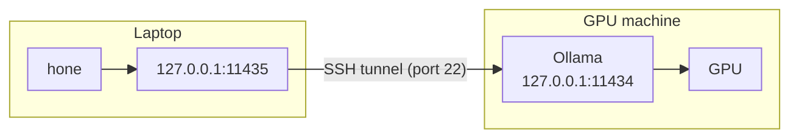

# Local Model on Another Machine (Ollama over SSH)

Run Hone on your laptop while a local model, often called a small language model (SLM),
runs on a second machine with a GPU. Hone talks to [Ollama](https://ollama.com) on that
machine through an SSH tunnel, so the model API is never open to the network.

If Ollama runs on the same machine as Hone, you don't need this page: see
[Ollama (Local Models)](providers.md#ollama-local-models).



## What you need

- **GPU machine:** Linux with a working GPU driver (`nvidia-smi` shows the card), Ollama
  installed and running as a service, and an SSH server.
- **Laptop:** Hone installed, and SSH key login to the GPU machine.

The examples use the host name `gpu-box` and the user `you`. Replace both.

## 1. On the GPU machine: pull a model that supports tools

Hone works through tool calls, so pick a model whose capabilities include `tools`:

```bash
ollama pull qwen2.5-coder:14b
ollama show qwen2.5-coder:14b      # "tools" must be listed under Capabilities
```

Choose a size that fits your GPU's memory. As one data point, `qwen3.8:27b` (17 GB on disk)
used 20.7 GB of a 32 GB card with a 32k context and ran fully on the GPU.

## 2. On the GPU machine: find where Ollama listens

```bash
ss -ltn | grep 11434
```

By default Ollama listens on `127.0.0.1:11434`. If the service sets `OLLAMA_HOST`, it
listens on that address instead, for example `172.17.0.1:11434`. Note the address: the
tunnel in step 4 must point at it.

When Ollama is not on the default address, the `ollama` command needs the address too:

```bash
OLLAMA_HOST=172.17.0.1:11434 ollama list
```

## 3. On the GPU machine: check the context length

Hone doesn't tell Ollama how much context to use. The server decides, and it rejects a
prompt that is longer than its context (Ollama 0.40 answers with error 400; a server may
also cut the prompt short without saying so).

- **Default:** Ollama picks it from the GPU's memory: 4k tokens below 24 GiB, 32k from 24 to
  48 GiB, and 256k above that
  ([Ollama: context length](https://docs.ollama.com/context-length)).
- **What Hone needs:** its system prompt and tool schemas take about 4,000 tokens before
  your prompt (4,045 input tokens for a one-line prompt in an empty folder). A 4k context
  is too small. Use 32k or more.
- **In a project with saved memories Hone sends much more,** because it adds recalled
  memories. One project sent 29,358 input tokens for a one-line prompt with a 32,768
  window. A larger context leaves more room for the work itself, and so does
  [recalling less](#keep-recalled-memories-small).

Load the model once and read the `CONTEXT` column:

```bash
ollama run qwen2.5-coder:14b "hi"
ollama ps
```

For example, `qwen3.8:27b` on a 32 GB card with Ollama 0.40:

```text
NAME           ID              SIZE     PROCESSOR    CONTEXT    RUNNER      UNTIL
qwen3.8:27b    aaee06c39dcf    17 GB    100% GPU     32768      llamacpp    4 minutes from now
```

To change it, set `OLLAMA_CONTEXT_LENGTH` for the service:

```bash
sudo systemctl edit ollama.service
```

Add these lines, save, then reload and restart:

```ini
[Service]
Environment="OLLAMA_CONTEXT_LENGTH=32768"
```

```bash
sudo systemctl daemon-reload
sudo systemctl restart ollama
```

A larger context uses more GPU memory. If `PROCESSOR` no longer says `100% GPU`, the model
is partly on the CPU and will be slow: use a smaller context or a smaller model.

## 4. On the laptop: open the tunnel

Add a host entry to `~/.ssh/config`. The address after the port number is the one from
step 2, as seen from the GPU machine:

```sshconfig
Host gpu-llm
    HostName gpu-box
    User you
    ServerAliveInterval 60
    ExitOnForwardFailure yes
    LocalForward 11435 127.0.0.1:11434
```

The laptop side uses port 11435, not 11434, because an Ollama app on the laptop would
already hold 11434.

Open the tunnel and leave it running. `-N` means no remote shell; `Ctrl+C` closes it:

```bash
ssh -N gpu-llm
```

In a second terminal, check that the laptop reaches Ollama:

```bash
curl http://127.0.0.1:11435/api/tags
```

It prints the installed models as JSON.

## 5. On the laptop: point Hone at the tunnel

Edit `~/.config/hone/config.toml` by hand:

```toml
default_model = "ollama:qwen2.5-coder:14b"

[providers.ollama]
base_url = "http://127.0.0.1:11435"
```

- **Set `default_model`.** Without a model choice Hone auto-detects a provider, and Ollama
  comes last: an API key or an installed Claude or Gemini CLI wins over it.
- **Don't run `hone configure` afterwards.** It replaces the whole file with a `[provider]`
  table.
- **Hone doesn't read `OLLAMA_HOST`.** The address comes from `base_url` only.

Then tell Hone the context length from step 3, so it compacts the conversation before the
server cuts it:

```bash
export HONE_CONTEXT_WINDOW=32768
```

Without it Hone infers the window from the model's name and assumes 128,000 tokens for a
model it doesn't know. It can then send more than the server accepts, and the request
fails with error 400. With it, Hone trims what it sends to the window.

Put the line in your shell profile to keep it. A terminal that was already open doesn't
have it: open a new one. The variable applies to every model in that shell, so if you
also use cloud models, set it per command instead: `HONE_CONTEXT_WINDOW=32768 hone ...`.

## 6. Try it

```bash
hone "Reply with exactly one word: ready"
hone "Read README.md and summarise it in one sentence"
```

The second prompt needs a tool call (`read_file`), which shows that tools work end to end.
The first answer after a pause is slower, because Ollama loads the model; it unloads a
model after 5 minutes without requests (`OLLAMA_KEEP_ALIVE` changes that).

Hone also prints this line. It is expected: a local model has no price.

```text
hone: no price for ollama:qwen2.5-coder:14b; its usage isn't counted towards cost or [budget]
```

To use another installed model for one run, pass `--model ollama:<name>`.

## Keep recalled memories small

Hone adds up to five saved memories to every prompt (`[memory] top_k`), and there is no
token limit on them. Long ones, such as saved question-and-answer conversations, can fill
a small context by themselves. In one setup five conversation memories made a one-line
prompt 32,497 input tokens; without them it was 6,905.

See what a prompt costs and what it is made of:

```bash
hone --json "Reply with exactly one word: ready"   # usage.input, and tokens per block under "context"
hone memory ls                                      # what is in the memory store
```

A large `recall` block means memories are the cause. Limit them in
`~/.config/hone/config.toml`:

```toml
[memory]
exclude_kinds = ["outcome", "conversation"]   # never recall saved conversations
# top_k = 2                                     # or recall fewer memories (default 5)
# recaller = "none"                             # or recall nothing
```

This deletes nothing, and it applies to every model. `hone strategies` shows the values in
effect. The keys are described in
[Context and memory strategies](../configuration.md#context-and-memory-strategies).

## Troubleshooting

| Symptom | What to check |
|---|---|
| `curl` through the tunnel says "Connection reset by peer" while SSH works | Nothing listens at the tunnel's target on the GPU machine. Run `ss -ltn \| grep 11434` there and put that address in `LocalForward` |
| `ssh` says "Address already in use" or exits at once | Another program on the laptop holds port 11435: `lsof -nP -iTCP:11435 -sTCP:LISTEN`. Close it or pick another port in both `LocalForward` and `base_url` |
| `ollama list` on the GPU machine says "could not connect to ollama server" | The service listens on a non-default address. Prefix the command with `OLLAMA_HOST=<address>:11434` |
| `ollama error (404): model '...' not found` | The name after `ollama:` must match `ollama list` exactly, tag included |
| `ollama error (400): the prompt is longer than the context length currently available to the model` | Hone assumed a larger context than the server uses. Set `HONE_CONTEXT_WINDOW` to the `CONTEXT` value of `ollama ps`, in the shell you run `hone` from (step 5). If the prompt is large because of recalled memories, [recall less](#keep-recalled-memories-small). If the error stays, raise `OLLAMA_CONTEXT_LENGTH` (step 3) |
| Answers are very slow | `ollama ps` shows `CPU` under `PROCESSOR`: the model doesn't fit the GPU. Use a smaller model or context, and check `nvidia-smi` for other programs using the GPU |
| `ollama error (0): error sending request for url (http://127.0.0.1:11435/api/chat)` | The tunnel is closed, for example after the laptop slept. Run `ssh -N gpu-llm` again |

## Security

- **Ollama has no login.** Anyone who can reach its port can use the model and pull or
  delete models.
- **Keep it off the network.** Leave Ollama on a loopback or other private address and use
  the tunnel. Don't set `OLLAMA_HOST=0.0.0.0` on a machine that other people can reach.
- **The tunnel is as private as your SSH login.** Port 11435 exists only on the laptop and
  only while the tunnel is open.

On a network you trust, such as a VPN between your own machines, you can skip the tunnel:
bind Ollama to that network's address and set `base_url = "http://gpu-box:11434"`.

## See also

- [Providers](providers.md): every provider Hone supports, fallback and routing
- [Configuration](../configuration.md#choosing-a-provider-and-model): how Hone picks a
  provider and model, and `HONE_CONTEXT_WINDOW`
