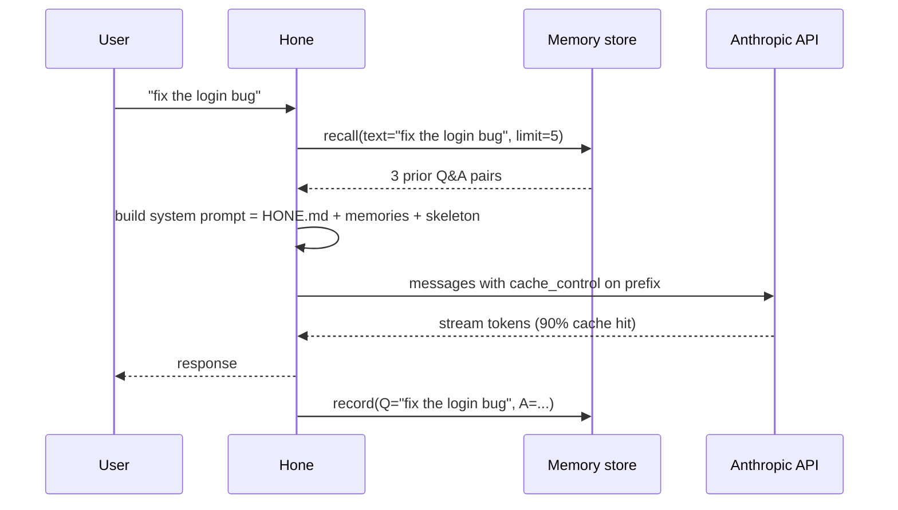

# Memory and Pass-Through Caching

This tutorial is a task-oriented walkthrough of hone's memory subsystem: what gets remembered, where it lives, how to inspect it, and how to turn it off. Pair it with [`docs/architecture/memory.md`](../architecture/memory.md) for the full design reference.

## What hone actually remembers

There are five distinct layers, and most user confusion comes from conflating them:

| Layer | What | Where | When it persists |
|---|---|---|---|
| 1. Memory store | Q&A pairs from each turn, learning outcomes | `~/.hone/memory.db` (SQLite) | Across sessions |
| 2. `HONE.md` | Project conventions you write yourself | Files in your repo | Versioned in git |
| 3. Context injection | Repo skeleton + relevant files | In-process cache | First turn only |
| 4. Prompt-cache pass-through | The prompt prefix sent to Anthropic | Anthropic's servers | ~5 minutes |
| 5. Local LRU | Cached completions | In-process | Process lifetime |

The rest of this guide walks each layer from a user's standpoint.

## Layer 1: persistent memory store

By default, every turn is recorded. The next turn's user input is matched against past content and the top 5 hits are prepended to the system prompt.

### Where the file lives

```bash
ls -la ~/.hone/memory.db
sqlite3 ~/.hone/memory.db "select count(*) from memories;"
```

If you never see the file, hone is running ephemerally — see below.

### Inspecting recalls in the TUI

The TUI exposes recalls in three places:

- **Status bar / session anatomy** (`Ctrl+A`): per-turn count of memory recalls.
- **Agent rail**: each recall is a sub-event under the turn — open the rail with `Ctrl+R`.
- **Prompt mirror** (`Ctrl+M`): preview the *exact* context sent to the model, including the `## Relevant context from memory:` block.

If a recall surprises you, `Ctrl+M` is the fastest way to see the snippet that the model saw.

### Disabling memory for a session

```bash
hone --ephemeral
```

Or set:

```bash
HONE_EPHEMERAL=1 hone
```

In ephemeral mode hone never opens `memory.db`. Q&A records are not written; nothing is recalled.

### Deleting all memories

There's no slash command for this yet. Drop the database:

```bash
rm ~/.hone/memory.db
```

Hone re-creates it on the next startup. Sessions, audit logs, and the index are kept (they live in different files).

### Selective deletion

`MemoryStore::forget(filter)` exists in the `hone-memory` crate but isn't surfaced as a CLI command. Until it is, the workaround is direct SQL:

```bash
sqlite3 ~/.hone/memory.db
sqlite> SELECT id, substr(content, 1, 60) FROM memories ORDER BY created_at DESC LIMIT 20;
sqlite> DELETE FROM memories WHERE id = '019...';
```

Tags are stored as a JSON array in the `tags` column — bulk-delete by tag with:

```sql
DELETE FROM memories WHERE tags LIKE '%"outcome"%';
```

Restart hone after editing the database; an open `SqliteStore` won't see your changes.

### Encryption (opt-in, programmatic)

`EncryptedStore<S>` wraps any `MemoryStore` with AES-256-GCM content encryption (Argon2id KDF, per-store random salt). It exists in `crates/hone-memory/src/encrypted.rs` and is fully tested, but it isn't yet exposed as a CLI flag.

To use it today you embed hone-memory in your own binary:

```rust
use hone_memory::{SqliteStore, EncryptedStore};

let inner = SqliteStore::open("~/.hone/memory.db").await?;
let store = EncryptedStore::new(inner, &passphrase).await?;
```

Properties:

- Wrong passphrase fails at first recall with a recognisable error (no silent corruption).
- Salt is persisted as a sentinel record (`__encrypted_store_salt__`); two stores with the same passphrase but different salts produce different ciphertexts.
- Search is unavoidably client-side (you can't index ciphertext); recall decrypts every record and filters in memory. Acceptable up to ~10K records.

If you want this surfaced as `--memory-passphrase` / `HONE_MEMORY_PASSPHRASE`, file an issue.

## Layer 2: HONE.md conventions

A markdown file describing project conventions. Hone reads three levels at startup and merges them additively:

| Level | Path | Priority |
|---|---|---|
| User | `~/.config/hone/HONE.md` | lowest |
| Project | `<repo-root>/HONE.md` | middle |
| Working dir | `<cwd>/HONE.md` | highest |

The merged result is prepended to the system prompt verbatim.

Use it for things you want the agent to remember **deterministically** — rules, style notes, "always run X after Y", "never do Z". Don't put per-conversation state here; that's what Layer 1 is for.

Minimum useful `HONE.md`:

```markdown
# Project: hone

## Rules
- Always run `cargo clippy -- -D warnings` after Rust changes.
- Use TDD for non-trivial work.
- Conventional commits.

## Architecture notes
- The TUI is in `crates/hone-tui/`. Theme tokens are in `theme.rs`.
- Sessions persist to `~/.hone/sessions/<id>/`.
```

Missing files are silently ignored — there's no error if you don't have one.

## Layer 3: context injection (turn 1 only)

When the agent runs with `inject_context: true` (the default for interactive mode), the **first turn** is augmented with two tiers:

1. **Skeleton** — a compact projection of the repo (file tree + symbols).
2. **Relevant files** — top-K files retrieved from `hone-index` for your question.

This is not memory — it's a deterministic projection of the current repo. It does not survive across sessions. The cache invalidates when source files change (mtime + file count check).

Tune via:

```bash
hone --skeleton-strategy compact      # paths only
hone --skeleton-strategy symbols      # paths + top-level symbols
hone --skeleton-strategy full         # paths + every public signature
hone --skeleton-strategy adaptive     # auto-select based on token budget
```

Or `HONE_SKELETON_STRATEGY=symbols hone`.

To skip injection entirely (one-shot pass through with no context):

```bash
hone --no-inject-context -i "..."
```

## Layer 4: Anthropic prompt-cache pass-through

When you use the Anthropic adapter, hone marks the prompt prefix with `cache_control: { type: "ephemeral" }`. Anthropic caches that prefix server-side for ~5 minutes; subsequent requests with the same prefix skip re-tokenisation, cutting cost (~10×) and latency (~3×).

You don't configure this — it's automatic for Anthropic, and silently absent for other providers.

What's marked as cacheable:

1. **System prompt** — emitted as a text-block array, `cache_control` on the last block.
2. **Tool schemas** — `cache_control` on the last tool entry; the entire tool array is one cached unit.
3. **Last user message** — promoted to a content-block array if it was a bare string.

Confirm cache hits in the per-turn anatomy (`Ctrl+A`) — `cached_tokens` shows how many of the input tokens hit the upstream cache.

### Why "pass-through"?

Hone does not store anything locally for this layer. It only marks the request structure so the upstream service caches. Restart hone, drop the network, switch terminals — the cache lives on Anthropic's side and persists for ~5 minutes regardless.

### What invalidates the upstream cache

- Any change to the system prompt (HONE.md edit, new memory recall, different model).
- Any change to the tool list.
- Any change in the assistant/user message history except appending.
- 5 minutes of idleness.

If you're cost-optimising, keep the system prompt stable across turns (HONE.md edits cost a full cache miss next turn).

## Layer 5: local response LRU

`CachingProvider` wraps any provider with an in-process LRU keyed on a hash of the completion request:

```rust
let cached = CachingProvider::new(inner, max_entries: 1024);
```

Off by default. Useful in deterministic test runs or replay scenarios. Not useful in normal sessions where every turn carries unique context.

## Putting it together: a typical turn



Every layer is independent and can be turned off in isolation:

| Disable layer | How |
|---|---|
| 1 | `--ephemeral` |
| 2 | Don't write `HONE.md` files |
| 3 | `--no-inject-context` |
| 4 | Switch to a non-Anthropic provider |
| 5 | Don't wrap with `CachingProvider` (default) |

## Common questions

### "Hone keeps recalling something irrelevant — why?"

Layer 1 uses naive substring matching (`lower(content) LIKE ?`). If your prompt contains the token "test" and a past Q&A contained "test", it matches. The fix is to either:

- Delete the offending memory (see "Selective deletion" above).
- Rephrase your prompt.
- Run with `--ephemeral` for the session if the noise is overwhelming.

There's no semantic recall yet — it's on the roadmap (would use the same `hone-index` embedding store as Layer 3 retrieval).

### "Why is my first turn slow?"

Layer 3 builds the skeleton on the first turn (~10 ms for medium repos, longer for large monorepos). Subsequent turns reuse the cache. If turn 1 is consistently slow:

```bash
HONE_SKELETON_STRATEGY=compact hone   # cheapest
```

Or skip injection entirely with `--no-inject-context`.

### "I edited HONE.md mid-session — does the agent see it?"

No. HONE.md is read once at startup. Restart hone for changes to take effect.

### "Does memory work with ACP providers?"

Yes — Layer 1 is provider-agnostic; Q&A is recorded after every turn regardless of provider. Layer 4 (cache_control) is Anthropic-specific, so ACP `claude --acp` sessions don't get the upstream cache directly — that's controlled by the upstream agent process.

### "I want to migrate memories to a new machine"

```bash
# On old machine:
sqlite3 ~/.hone/memory.db ".dump" > memory-export.sql

# On new machine:
sqlite3 ~/.hone/memory.db < memory-export.sql
```

`MemoryStore::export` / `import` exist programmatically but aren't yet wired to the CLI.

### "How big can the memory store get?"

SQLite handles millions of rows fine. The bottleneck is recall — the `LIKE` scan is O(n). At ~50K records you'll start to feel it. Run `decay()` periodically (or simply `DELETE FROM memories WHERE created_at < strftime('%s', 'now', '-90 days');`).

## Debugging recalls

When a recall surprises you:

1. `Ctrl+M` — open the prompt mirror; see the exact memories block sent to the model.
2. `RUST_LOG=hone_core::agent=debug hone` — every recall logs the query and the matched ids.
3. `sqlite3 ~/.hone/memory.db "select id, content from memories where lower(content) like '%KEYWORD%' order by created_at desc limit 10;"` — reproduce the recall query directly.

## Related

- [`docs/architecture/memory.md`](../architecture/memory.md) — design reference (data model, traits, cache invalidation rules, source map).
- [`docs/architecture/multi-agent-and-memory.md`](../architecture/multi-agent-and-memory.md) — how multi-agent coordination uses the memory store.
- [`docs/tutorials/security.md`](security.md) — ephemeral mode, audit logging, sandbox.
- [`docs/tutorials/providers.md`](providers.md) — which providers honor `cache_control`, fallback chains.
- [`docs/tutorials/tui-keybindings-and-themes.md`](tui-keybindings-and-themes.md) — `Ctrl+A`, `Ctrl+M`, `Ctrl+R` overlays.
