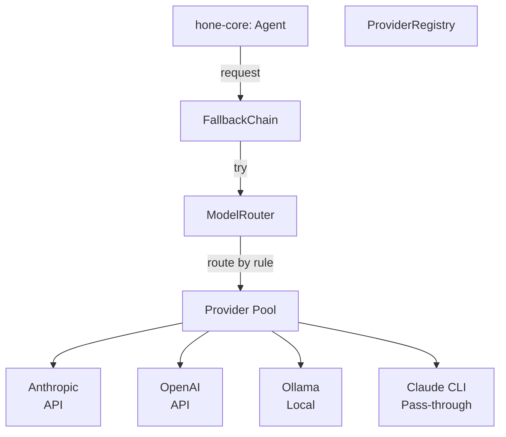

# Model Providers

Hone abstracts model access through the `ModelProvider` trait, allowing you to hot-swap providers mid-session, define fallback chains, and route different tasks to different models.

## Provider Overview

A provider is a concrete implementation of `hone_providers::ModelProvider`. It handles authentication, request formatting, streaming responses, and error handling for a specific model vendor.



## Provider Comparison

Hone supports 5 working providers. ACP is library-only for now and can't be selected from `hone` (see [ACP](acp.md)). Here's how they compare:

| Provider | Tool Calling | Streaming | Cost | Best For |
|----------|-------------|-----------|------|----------|
| **Anthropic API** | Yes | Yes | $$ | Production (most capable) |
| **OpenAI API + compatible** | Yes | Yes | $ | Budget-conscious teams, custom endpoints |
| **Ollama** | Yes | Yes | Free | Local/offline work with tool support |
| **Claude CLI (legacy stdin/stdout)** | No | Yes | Subscription | Existing CLI users without ACP |
| **Gemini CLI (legacy stdin/stdout)** | No | Yes | Free tier | No API key setup, prose-only |

## Provider Auto-Detection

Hone automatically detects and prioritizes available providers in this order:

1. `ANTHROPIC_API_KEY` env var → **Anthropic API**
2. `OPENAI_API_KEY` env var → **OpenAI API**
3. `claude` command available → **Claude CLI**
4. `gemini` command available → **Gemini CLI**
5. `OLLAMA_HOST` env var → **Ollama**
6. Fallback → **Mock provider** (for testing)

Override with `--model` or config file.

## Built-in Providers

### Anthropic API

Production-grade, most capable.

```bash
export ANTHROPIC_API_KEY="sk-ant-..."
hone --model anthropic:claude-opus-4-5
```

**Configuration** (optional, in `~/.config/hone/config.toml`):

```toml
[providers.anthropic]
model = "claude-opus-4-5"               # used when auto-detection picks Anthropic
base_url = "https://api.anthropic.com"  # optional override
api_key_env = "MY_ANTHROPIC_KEY"        # read the key from this variable, not ANTHROPIC_API_KEY
```

There is no key setting in this table. The key comes from `ANTHROPIC_API_KEY` (or the variable `api_key_env` names), or from `hone configure`, which saves it in the same file in plain text. `hone configure` replaces the whole file with just a `[provider]` table, so anything else in it, such as this table, `fallback_models`, `[[routing]]` and `[pricing]`, is lost. See [config.toml](../configuration.md#configtoml).

**Models:** any Claude model id, for example `claude-opus-5-5`, `claude-sonnet-5-5` or
`claude-haiku-5-5`. Hone's built-in prices cover every current Claude model (see
[Pricing and `[budget]`](../configuration.md#pricing-and-budget)).

### OpenAI API (and Compatible Endpoints)

Use OpenAI or any OpenAI-compatible endpoint (DeepSeek, Qwen, Kimi, OpenRouter, etc.).

```bash
export OPENAI_API_KEY="sk-..."
hone --model openai:gpt-4o
```

**For custom endpoints (DeepSeek, Qwen, Kimi, OpenRouter):**

```bash
export OPENAI_API_KEY="your-api-key"
export HONE_OPENAI_BASE_URL="https://api.deepseek.com"
export HONE_OPENAI_MODEL="deepseek-coder"
hone
```

**Configuration** (optional, in `~/.config/hone/config.toml`):

```toml
[providers.openai]
base_url = "https://api.openai.com/v1"  # or any OpenAI-compatible endpoint
model = "gpt-4o"                        # used when auto-detection picks OpenAI
api_key_env = "MY_OPENAI_KEY"           # read the key from this variable, not OPENAI_API_KEY
```

`HONE_OPENAI_BASE_URL` and `HONE_OPENAI_MODEL`, when set, win over `base_url` and `model`.

**OpenAI available models:**
- `gpt-4o` — Latest, most capable
- `gpt-4-turbo` — Previous gen
- `gpt-3.5-turbo` — Fast, cheap

**Custom endpoint examples:**
- **DeepSeek:** `https://api.deepseek.com`, model `deepseek-coder`
- **Qwen (via DeepSeek):** `https://api.deepseek.com`, model `qwen-max`
- **OpenRouter:** `https://openrouter.ai/api/v1`, any supported model
- **Self-hosted vLLM:** `http://localhost:8000/v1`, your model name

### Ollama (Local Models)

Zero-cost local inference with full tool-calling support (Ollama v0.3.0+).

```bash
ollama pull qwen2.5-coder:7b  # recommended for tool calling
ollama serve  # terminal 1
hone --model ollama:qwen2.5-coder:7b  # terminal 2
```

**Configuration** (optional, in `~/.config/hone/config.toml`):

```toml
[providers.ollama]
base_url = "http://localhost:11434"
model = "qwen2.5-coder:7b"  # used when auto-detection picks Ollama
```

Timeouts can't be changed, but a slow model isn't cut off while it keeps sending tokens (see [Timeouts](#timeouts)).

**Available models:** Any model you `ollama pull`. Run `ollama list` to see installed models.

**Tool calling:** Hone supports native function calling on models that implement the tool_calls API (Qwen 2.5 Coder, Llama 3.2+, Mistral, DeepSeek Coder). Models that output tool calls as text (Qwen 2.5 Coder in text mode) are also supported with automatic JSON parsing.

### Claude CLI Pass-Through (Generation 1)

Use your existing `claude` command-line tool.

```bash
# Requires: claude --version to work
hone --model claude-cli:claude-opus
```

**Setup:** `claude` must be on your `PATH`; there is no setting for its location. Hone runs it with permission mode `acceptEdits` unless `HONE_CLAUDE_PERMISSION_MODE` is set.

The CLI runs its own tools, outside Hone's permission rules, sandbox and receipts. With a non-empty permission policy, Hone refuses it unless `HONE_ALLOW_UNGATED_PROVIDER=1` is set (see [Permissions](../configuration.md#permissions)).

**Why use this?** You already have Claude CLI set up with credentials. Hone integrates with it directly.

### Gemini CLI Pass-Through (Generation 1)

Use Google's `gemini` command-line tool.

```bash
hone --model gemini-cli:gemini-pro
```

**Setup:** `gemini` must be on your `PATH`; there is no setting for its location. Like the Claude CLI, it runs its own tools, and Hone refuses it under a non-empty permission policy unless `HONE_ALLOW_UNGATED_PROVIDER=1` is set.

### ACP (Agent Client Protocol)

Full bidirectional tool dispatch via a persistent JSON-RPC 2.0 subprocess. Hone speaks ACP as the **client**: it announces tool schemas on `session/prompt`, dispatches incoming `tool_call` notifications through its registered tool registry, and feeds the result back via `session/toolResult` so the agent can finish the turn. Status updates land as `ProviderEvent::ObservedToolEnd` for observability.

> [!IMPORTANT]
> ACP is library-only for now: `hone` can't select an ACP provider. There is no `acp:`,
> `claude-acp:` or `gemini-acp:` model prefix and no `--acp-endpoint` flag (the prefixes
> `hone` accepts are `anthropic:`, `openai:`, `ollama:`, `claude-cli:` and `gemini-cli:`),
> and a `[providers.acp]` table with server settings makes `config.toml` fail to load. The
> rest of this section describes the `AcpProvider` in the `hone-providers` crate. See
> [ACP](acp.md).

ACP allows you to:
- Define custom tools in your own language
- Implement complex logic (not limited to JSON-RPC)
- Maintain a persistent connection to your service
- Full bidirectional tool dispatch — `session/prompt.tools[]` → `tool_call` → `session/toolResult` → `tool_call_update`

**Event lifecycle (provider → consumer):**

| ACP message | `ProviderEvent` |
|---|---|
| `session/update` with `agent_message_chunk` | `Token { text }` |
| `session/update` with `tool_call` | `ToolCall { id, name, arguments }` (`arguments` derived from `rawInput`, defaulting to `{}` when absent) |
| Caller supplies `ToolResult` via the per-request channel | Provider sends `session/toolResult` to the agent |
| `session/update` with `tool_call_update` | `ObservedToolEnd { id, result, is_error }` (status preserved verbatim; `failed`/`error` flagged case-insensitive) |
| `session/prompt` response with `stopReason: end_turn` | `Done` |

Wire-level reference: [ACP Protocol Reference](../api/acp-protocol.md). Executable contract: `crates/hone-providers/tests/acp_full_lifecycle.rs`.

For details on tool registration on the hone side, see [Tools and MCP](tools-and-mcp.md).

## Hot-Swapping Providers Mid-Session

Change providers without losing conversation history:

```
You: /model openai:gpt-4o
Assistant: Switched to gpt-4o (8192 token context). Conversation history preserved.
```

The context manager evaluates token count for the new model's limits and truncates if necessary.

**When to hot-swap:**
- Switch to a cheaper model for simple tasks
- Switch to a more capable model for complex reasoning
- Test the same prompt across providers
- Fall back to a backup provider if one fails

## Fallback Chains

Define a priority list of models. If the turn's model fails before answering (an overload or outage, a rate limit, a 5xx error, or no answer at all), the next is tried automatically. Put it at the top level of your user file, `~/.config/hone/config.toml`:

```toml
fallback_models = ["openai:gpt-4o", "ollama:llama2"]
```

There are no named chains and no `--fallback-chain` flag: `fallback_models` applies to every session on an API model, except a run with `--model`, which uses exactly that model. It is read from your user file only, and only `anthropic:`, `openai:` and `ollama:` models can be fallbacks. See [routing and fallback](../configuration.md#routing-and-fallback).

## Model Routing Rules

Hone sorts every prompt as `simple`, `medium` or `complex`. A `[[routing]]` entry picks the model for one of those tiers; a tier without an entry uses the default model.

```toml
default_model = "anthropic:claude-sonnet-4-5"  # medium turns, and any tier without a rule

[[routing]]
task = "simple"
model = "anthropic:claude-haiku-4-5"

[[routing]]
task = "complex"
model = "anthropic:claude-opus-4-5"
```

There are no rules on prompt text, turn count or spend: the tier is the only condition. `--model` turns routing off for the run, and `/model` for the rest of the session. See [routing and fallback](../configuration.md#routing-and-fallback).

## Pricing Table and Cost Tracking

Hone tracks real-time costs with a built-in price table. To add or override a model's price, in USD per million tokens, add a table to your user file, `~/.config/hone/config.toml` (a project file's prices are ignored):

```toml
[pricing."anthropic:claude-sonnet-4-5"]
input_per_million = 3.0
output_per_million = 15.0
```

`cache_read_per_million` and `cache_creation_per_million` are optional. A model with no price counts as free, and Hone says so once per model. The built-in Anthropic prices were checked against Anthropic's pricing page on 2026-11-17; Claude Haiku 5.5 is priced at its rate for prompts up to 100,000 tokens, so longer prompts are under-counted. See [Pricing and `[budget]`](../configuration.md#pricing-and-budget).

After each turn, Hone calculates cost:

```
Usage: 4521 input tokens, 312 output tokens
Cost calculation: (4521 / 1_000_000) * 3.00 + (312 / 1_000_000) * 15.00
Cost: $0.019 USD
Session total: $0.24 USD
```

Set a budget limit in `~/.config/hone/config.toml` (or `/budget 10` in the TUI):

```toml
[budget]
session_limit_usd = 10.00  # stop after spending $10
```

## Provider Health Checks

The daemon doesn't check provider health: `honed` has no health-check option (there is no `--health-check-interval`) and no `/providers/health` endpoint. `GET /health` reports only that the daemon itself is up:

```bash
curl http://localhost:7777/health
# {"status":"ok"}
```

## Timeouts

Timeouts are not configurable. The Anthropic, OpenAI and Ollama providers give up if they can't connect within 10 seconds, and fail a response that sends nothing for 120 seconds. There is no limit on a response's total time, so a long answer that keeps streaming is not cut off.

## Advanced: Provider Registry

Access the provider registry programmatically (for custom integrations):

```rust
use hone_providers::ProviderRegistry;

let registry = ProviderRegistry::from_config(config)?;

// List all available models
for provider in registry.all() {
    println!("{}: {}", provider.id(), provider.display_name());
    for model in provider.supported_models() {
        println!("  - {}", model.id);
    }
}

// Get a specific provider
let anthropic = registry.get("anthropic:claude-opus-4-5")?;
let response = anthropic.complete(request).await?;
```

See [Architecture](../architecture.md) for the full `ModelProvider` trait definition.

## Next Steps

- **Get started:** See [Getting Started](getting-started.md) to run your first session.
- **Recipes:** Use providers in [Recipes](recipes.md) to automate workflows.
- **Server:** Run the [Server and Remote](server-and-remote.md) daemon to manage multiple sessions.
- **Tools:** Extend providers with custom tools via [Tools and MCP](tools-and-mcp.md).
