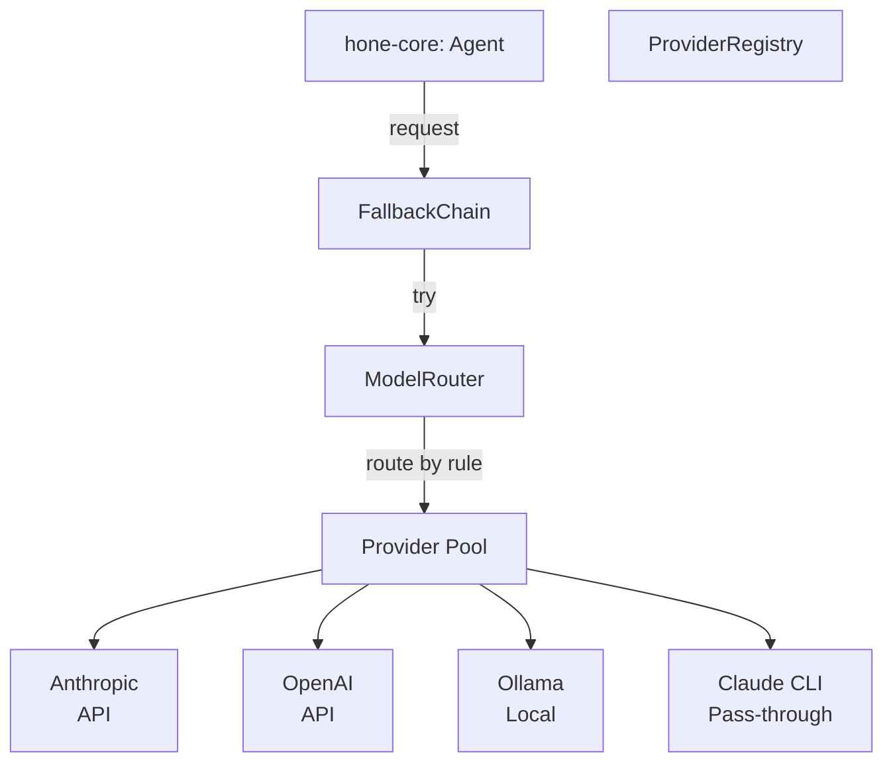

# Model Providers

Hone abstracts model access through the `ModelProvider` trait, allowing you to hot-swap providers mid-session, define fallback chains, and route different tasks to different models.

## Provider Overview

A provider is a concrete implementation of `hone_providers::ModelProvider`. It handles authentication, request formatting, streaming responses, and error handling for a specific model vendor.



## Built-in Providers

### Anthropic API

Production-grade, most capable.

```bash
export ANTHROPIC_API_KEY="sk-ant-..."
hone --model anthropic:claude-opus-4-5
```

**Configuration:**

```toml
[providers.anthropic]
api_key = "sk-ant-..."  # or env var ANTHROPIC_API_KEY
base_url = "https://api.anthropic.com"  # optional override
timeout_secs = 30
```

**Available models:**
- `claude-opus-4-5` — 200K context, best for complex tasks
- `claude-sonnet-4` — 200K context, fast general-purpose
- `claude-haiku-3-5` — 200K context, cheapest, good for simple tasks

### OpenAI API

Compatible alternative.

```bash
export OPENAI_API_KEY="sk-..."
hone --model openai:gpt-4o
```

**Configuration:**

```toml
[providers.openai]
api_key = "sk-..."  # or env var OPENAI_API_KEY
base_url = "https://api.openai.com/v1"
timeout_secs = 30
```

**Available models:**
- `gpt-4o` — Latest, most capable
- `gpt-4-turbo` — Previous gen
- `gpt-3.5-turbo` — Fast, cheap

### Ollama (Local Models)

Zero-cost local inference.

```bash
ollama pull llama2
ollama serve  # terminal 1
hone --model ollama:llama2  # terminal 2
```

**Configuration:**

```toml
[providers.ollama]
base_url = "http://localhost:11434"
timeout_secs = 300  # local models may be slower
```

**Available models:** Any model you `ollama pull`. Run `ollama list` to see installed models.

### Claude CLI Pass-Through (Generation 1)

Use your existing `claude` command-line tool.

```bash
# Requires: claude --version to work
hone --model claude-cli:claude-opus
```

**Configuration:**

```toml
[providers.claude_cli]
claude_path = "/usr/local/bin/claude"  # auto-detected if not specified
```

**Why use this?** You already have Claude CLI set up with credentials. Hone integrates with it directly.

### Gemini CLI Pass-Through (Generation 1)

Use Google's `gemini` command-line tool.

```bash
hone --model gemini-cli:gemini-pro
```

**Configuration:**

```toml
[providers.gemini_cli]
gemini_path = "/usr/local/bin/gemini"
```

### ACP (Agent Client Protocol)

Full tool support via persistent subprocess. Advanced integration for custom model servers.

```bash
hone --model acp:my-service --acp-endpoint /path/to/server/binary
```

**Configuration:**

```toml
[providers.acp]
server_path = "/path/to/acp/server"
server_args = ["--port", "9000"]
timeout_secs = 60
```

ACP allows you to:
- Define custom tools in your own language
- Implement complex logic (not limited to JSON-RPC)
- Maintain a persistent connection to your service
- Full bidirectional tool dispatch

For details, see [Tools and MCP](tools-and-mcp.md).

## Hot-Swapping Providers Mid-Session

Change providers without losing conversation history:

```
You: /model openai:gpt-4o
Assistant: Switched to gpt-4o (8192 token context). Conversation history preserved.
```

The context manager evaluates token count for the new model's limits and truncates if necessary.

**When to hot-swap:**
- Switch to a cheaper model for simple tasks
- Switch to a more capable model for complex reasoning
- Test the same prompt across providers
- Fall back to a backup provider if one fails

## Fallback Chains

Define a priority list of providers. If one fails, the next is tried automatically.

```toml
[[fallback_chains]]
name = "production"
providers = ["anthropic:claude-opus-4-5", "openai:gpt-4o", "ollama:llama2"]
retry_on = ["RateLimit", "Timeout", "ServiceUnavailable"]
retry_delay_secs = 5
max_retries = 3
```

The agent tries Anthropic first. If it rate-limits or times out, it retries after 5 seconds. After 3 failed attempts, it falls back to OpenAI. If OpenAI fails, it falls back to local Ollama.

Usage:

```bash
hone --fallback-chain production
```

Or set as default in config:

```toml
[agent]
default_fallback_chain = "production"
```

## Model Routing Rules

Route different task types to different models. Define rules by prompt pattern or turn count.

```toml
[[routing_rules]]
name = "quick_tasks"
condition = "input_length < 50"  # short prompts
provider = "anthropic:claude-haiku-3-5"

[[routing_rules]]
name = "complex_reasoning"
condition = "input_contains('analyze')"  # keyword match
provider = "anthropic:claude-opus-4-5"

[[routing_rules]]
name = "budget_conscious"
condition = "true"  # fallback: default
provider = "ollama:llama2"
```

The router evaluates conditions top-down and dispatches to the first matching provider.

Advanced condition syntax:
- `input_length < N` — number of input characters
- `input_contains('keyword')` — substring match
- `turn_count > N` — number of turns in session
- `session_cost_usd > N` — accumulated spend
- `true` — always matches (use as default)

## Pricing Table and Cost Tracking

Hone tracks real-time costs. The pricing table maps model IDs to per-token rates:

```toml
[pricing.anthropic]
"claude-opus-4-5" = { input_per_mtok = 3.00, output_per_mtok = 15.00 }
"claude-sonnet-4" = { input_per_mtok = 3.00, output_per_mtok = 15.00 }
"claude-haiku-3-5" = { input_per_mtok = 0.80, output_per_mtok = 4.00 }

[pricing.openai]
"gpt-4o" = { input_per_mtok = 2.50, output_per_mtok = 10.00 }
"gpt-4-turbo" = { input_per_mtok = 10.00, output_per_mtok = 30.00 }
"gpt-3.5-turbo" = { input_per_mtok = 0.50, output_per_mtok = 1.50 }

[pricing.ollama]
# Local models are free; all rates are 0.00
"llama2" = { input_per_mtok = 0.00, output_per_mtok = 0.00 }
```

After each turn, Hone calculates cost:

```
Usage: 4521 input tokens, 312 output tokens
Cost calculation: (4521 / 1_000_000) * 3.00 + (312 / 1_000_000) * 15.00
Cost: $0.019 USD
Session total: $0.24 USD
```

Set a budget limit:

```bash
hone --budget 10.00  # stop after spending $10
```

## Provider Health Checks

The daemon performs periodic health checks on all configured providers. Use this to monitor uptime and detect issues early:

```bash
honed --health-check-interval 60  # every 60 seconds
```

Health check results are logged and available via the HTTP API:

```bash
curl http://localhost:7777/providers/health
```

Response:

```json
{
  "anthropic:claude-opus-4-5": {
    "status": "healthy",
    "last_checked": "2026-04-05T12:34:56Z",
    "latency_ms": 45
  },
  "openai:gpt-4o": {
    "status": "rate_limited",
    "last_checked": "2026-04-05T12:34:55Z",
    "retry_after_secs": 120
  },
  "ollama:llama2": {
    "status": "unreachable",
    "last_checked": "2026-04-05T12:34:52Z",
    "error": "connection refused"
  }
}
```

## Customizing Timeouts

Each provider supports a timeout setting (default 30 seconds):

```toml
[providers.anthropic]
timeout_secs = 60  # increase for large requests

[providers.ollama]
timeout_secs = 300  # local models may be slow
```

If a request exceeds the timeout, it is cancelled and the fallback chain is triggered (if configured).

## Advanced: Provider Registry

Access the provider registry programmatically (for custom integrations):

```rust
use hone_providers::ProviderRegistry;

let registry = ProviderRegistry::from_config(config)?;

// List all available models
for provider in registry.all() {
    println!("{}: {}", provider.id(), provider.display_name());
    for model in provider.supported_models() {
        println!("  - {}", model.id);
    }
}

// Get a specific provider
let anthropic = registry.get("anthropic:claude-opus-4-5")?;
let response = anthropic.complete(request).await?;
```

See [Architecture](../architecture.md) for the full `ModelProvider` trait definition.

## Next Steps

- **Get started:** See [Getting Started](getting-started.md) to run your first session.
- **Recipes:** Use providers in [Recipes](recipes.md) to automate workflows.
- **Server:** Run the [Server and Remote](server-and-remote.md) daemon to manage multiple sessions.
- **Tools:** Extend providers with custom tools via [Tools and MCP](tools-and-mcp.md).
