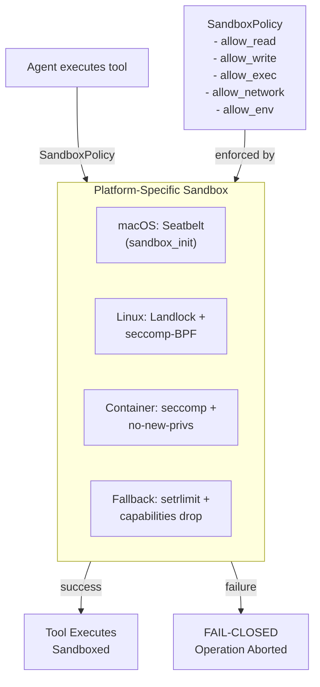
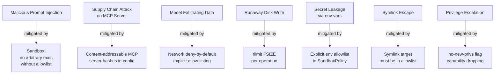

# Security: Sandboxing and Policies

Hone implements defense-in-depth security using kernel sandboxing, network policies, and audit logging. This guide covers the sandbox architecture, threat model, and how to configure security policies.

## Linux Landlock Sandbox

On Linux kernel 5.13+, Hone enforces filesystem access via the **Landlock LSM** (Linux Security Module). The sandbox is configured per-tool using fine-grained access rules.

```rust
use hone_sandbox::{SandboxPolicyBuilder, SandboxMode};
use std::path::PathBuf;

let policy = SandboxPolicyBuilder::new(SandboxMode::Manual)
    .allow_read(PathBuf::from("/tmp"))
    .allow_write(PathBuf::from("/tmp/output"))
    .build()?;
```

When a tool runs a subprocess, Landlock is applied via `pre_exec()` so the child cannot access files outside the policy:

```bash
# If tool reads /etc/passwd (not in allow_read)
Agent calls: read_file(path="/etc/passwd")
error: Permission denied (EACCES)
```

**Requirements:**
- Linux kernel 5.13+ (Landlock upstreamed in this release)
- Check kernel support: `cat /proc/sys/kernel/landlock/abi_version`
  - Output >= 1 means Landlock is available
  - No output or error means unavailable

If Landlock is unavailable, `SandboxError::Unavailable` is returned and the operation is aborted (fail-closed design):

```
error: Landlock not available on this kernel (< 5.13)
Set [sandbox] enforce = false to disable sandboxing (not recommended).
```

To require Landlock and fail if unavailable:

```toml
[sandbox]
enforce = true  # fail if Landlock not available
platform = "landlock"
```

---

## Sandbox Architecture Overview



## Sandbox Platform Matrix

| Platform | Primary | Fallback | Notes |
|---|---|---|---|
| **macOS 10.5+** | Seatbelt | `setrlimit` + `no-new-privs` | Mature, production-ready |
| **Linux 5.13+** | Landlock | seccomp-BPF + `setrlimit` | Modern, fine-grained |
| **Linux <5.13** | seccomp-BPF | `setrlimit` + `no-new-privs` | Older kernels |
| **Container** | seccomp + `no-new-privs` | `setrlimit` | Already sandboxed at OS level |
| **Windows** | Job Objects | Restricted token | Future implementation |

**Fail-closed invariant:** If the desired sandbox tier is unavailable and required by policy, the operation aborts with `SandboxError::PolicyNotMet`. There is no silent downgrade.

## SandboxPolicy

Define what each tool call is allowed to do:

```rust
pub struct SandboxPolicy {
    pub allow_read: Vec<PathBuf>,      // paths readable by tool
    pub allow_write: Vec<PathBuf>,     // paths writable by tool
    pub allow_exec: Vec<PathBuf>,      // executables callable from tool
    pub allow_network: bool,            // network access (deny by default)
    pub allow_env: Vec<String>,        // env vars exposed to tool
}
```

## Configuration

Sandbox policies are configured in `~/.config/hone/config.toml`:

```toml
[sandbox]
platform = "auto"  # auto-detect: seatbelt, landlock, seccomp, fallback

# Default policy for all tools
[sandbox.defaults]
allow_network = false  # network deny-by-default
allow_write = ["/tmp"]  # only temp writable
allow_env = ["PATH", "HOME"]  # only safe env vars

# Per-tool policies (override defaults)
[sandbox.tools.shell]
allow_read = ["{project_root}", "/usr/lib"]
allow_write = ["/tmp", "{project_root}/target"]
allow_exec = ["/bin", "/usr/bin"]
allow_network = false
allow_env = ["PATH", "HOME", "RUST_BACKTRACE"]

[sandbox.tools.git]
allow_read = ["{project_root}"]
allow_write = ["{project_root}"]
allow_exec = ["/usr/bin/git"]
allow_network = false
allow_env = ["GIT_AUTHOR_NAME", "GIT_AUTHOR_EMAIL"]

[sandbox.tools.semantic_search]
allow_network = true  # needs network to PostgreSQL
allow_read = ["{project_root}"]
allow_env = ["DATABASE_URL"]
```

**Variables:**
- `{project_root}` — expands to current working directory
- `{home}` — expands to user's home directory

## Network Policy (Deny-by-Default)

Network access is disabled by default for all tools. Enable explicitly for specific tools that need it:

```toml
[sandbox.tools.github_api]
allow_network = true  # allow for GitHub MCP

[sandbox.tools.semantic_index]
allow_network = true  # allow for PostgreSQL

# Block everything else
[sandbox.defaults]
allow_network = false
```

DNS and HTTP requests are blocked unless explicitly allowed.

## Process Resource Limits

Prevent runaway processes using `rlimit`:

```toml
[sandbox.limits]
cpu_seconds = 30      # max 30 seconds CPU per tool call
memory_mb = 512       # max 512 MB RAM
disk_mb = 1024        # max 1 GB disk writes per turn
open_files = 1024     # max 1024 open files
subprocess_count = 10 # max 10 subprocesses
```

If a process exceeds limits, it is killed:

```
error: shell tool exceeded memory limit (512 MB)
Tool execution aborted by sandbox.
```

## Environment Variable Filtering

Only allow specific environment variables to reach tool processes:

```toml
[sandbox.defaults]
allow_env = ["PATH", "HOME", "USER", "SHELL"]

[sandbox.tools.git]
allow_env = ["PATH", "HOME", "GIT_AUTHOR_NAME", "GIT_AUTHOR_EMAIL", "GIT_COMMITTER_EMAIL"]
```

Attempt to access other env vars from a tool:

```bash
$ hone -i "Print ANTHROPIC_API_KEY"
Agent calls: shell(cmd="echo $ANTHROPIC_API_KEY")
Output: (empty — variable not accessible)
```

## File System Restrictions

### Read Allowlist

Only paths in `allow_read` are readable:

```toml
[sandbox.tools.file_reader]
allow_read = ["{project_root}", "/etc/passwd"]
```

Attempt to read a disallowed path:

```
Agent calls: read_file(path="/etc/shadow")
error: access denied (path not in allowlist)
```

### Write Allowlist

Only paths in `allow_write` are writable:

```toml
[sandbox.tools.code_generator]
allow_read = ["{project_root}"]
allow_write = ["{project_root}/generated"]
```

Attempt to write outside allowlist:

```
Agent calls: write_file(path="/etc/cron.d/malicious")
error: access denied (path not in allowlist)
```

### Symlink Handling

Symlinks are followed if both source and target are in the allowlist:

```toml
[sandbox.tools.safe_reader]
allow_read = ["{project_root}", "/tmp"]

# If /tmp/link -> /etc/passwd
Agent calls: read_file(path="/tmp/link")
error: access denied (target /etc/passwd not in allowlist)
```

## Executable Restrictions

Only approved executables can be called by shell commands:

```toml
[sandbox.tools.shell]
allow_exec = ["/usr/bin/git", "/usr/bin/cargo", "/bin/cat"]
```

Attempting to call a disallowed executable:

```
Agent calls: shell(cmd="python3 -c 'print(1)'")
error: access denied (executable /usr/bin/python3 not in allowlist)
```

This prevents:
- Remote code execution via arbitrary commands
- Access to system tools that shouldn't be called
- Privilege escalation attempts

## RBAC Roles and Policies (Server Mode)

When using the daemon (`honed`), multiple users can have different permissions via role-based access control:

```toml
[rbac]
enabled = true

[[rbac.roles]]
name = "admin"
permissions = ["sessions:create", "sessions:delete", "tools:all", "mcp:all"]

[[rbac.roles]]
name = "developer"
permissions = ["sessions:create", "sessions:read", "tools:file", "tools:git", "tools:shell"]

[[rbac.roles]]
name = "viewer"
permissions = ["sessions:read", "mcp:read_only"]

[[rbac.users]]
user_id = "alice@example.com"
role = "admin"

[[rbac.users]]
user_id = "bob@example.com"
role = "developer"

[[rbac.users]]
user_id = "carol@example.com"
role = "viewer"
```

Permission meanings:
- `sessions:create` — create new sessions
- `sessions:delete` — delete sessions
- `tools:file` — use file I/O tools
- `tools:git` — use git tools
- `tools:shell` — use shell tool
- `tools:all` — use all tools
- `mcp:all` — call any MCP server
- `mcp:read_only` — only query tools (no mutation)

## Audit Logging

All tool calls, file accesses, and security events are logged:

```toml
[audit]
enabled = true
log_file = "/var/log/hone/audit.log"
log_level = "info"  # info, warn, error
```

Log entries (JSON format):

```json
{
  "timestamp": "2026-04-05T14:30:45Z",
  "session_id": "sess_abc123",
  "user": "alice@example.com",
  "event": "tool_call",
  "tool": "read_file",
  "input": {"path": "/home/alice/src/main.rs"},
  "result": "success",
  "duration_ms": 2
}
```

```json
{
  "timestamp": "2026-04-05T14:30:50Z",
  "session_id": "sess_abc123",
  "user": "alice@example.com",
  "event": "access_denied",
  "tool": "read_file",
  "input": {"path": "/etc/shadow"},
  "reason": "path not in allowlist",
  "policy": "sandbox.tools.file_reader.allow_read"
}
```

Query logs:

```bash
# All events for a session
grep "sess_abc123" /var/log/hone/audit.log | jq .

# All access denials
grep "access_denied" /var/log/hone/audit.log | jq .

# Events for a specific user
grep "alice@example.com" /var/log/hone/audit.log | jq .
```

## Memory Encryption (Encrypted Memory Feature)

Enable optional memory encryption to protect sensitive session data:

```bash
cargo build --features encrypted-memory
```

Configuration:

```toml
[memory]
encrypted = true
cipher = "aes256-gcm"
```

The encryption key is derived from a user passphrase and stored in the system keychain (via the `keyring` crate):

```bash
hone --init-encryption
# Enter passphrase: ****
# Passphrase stored securely in system keychain.
```

All session data (memories, conversation history) is encrypted at rest in the SQLite database.

## Ephemeral Mode

Run a session with all data immediately discarded after completion:

```bash
hone --ephemeral
# or
hone -E
```

In ephemeral mode:
- Session data is never persisted to disk
- No memories are recorded
- Cost tracking is not saved
- Useful for sensitive queries

---

## Memory Persistence and Encryption

By default, session memories are stored in plaintext SQLite at `~/.local/share/hone/memory.db`:

```bash
ls -la ~/.local/share/hone/
# memory.db            - unencrypted session memories
# sessions.db          - unencrypted session metadata (if HONE_SESSION_DB set)
```

**Encryption via sqlcipher is on the roadmap** for future releases. Until then, for sensitive workloads use `--ephemeral` to disable persistence entirely:

```bash
hone --ephemeral -i "Sensitive query"
```

Or clear memories manually:

```bash
rm ~/.local/share/hone/memory.db
```

## Threat Model Summary



## Best Practices

1. **Start restrictive:** Begin with minimal permissions and add as needed.

```toml
[sandbox.defaults]
allow_network = false
allow_write = []  # deny all writes by default
```

2. **Use allowlists, not denylists:** Only permit known-safe paths and executables.

3. **Enable audit logging:** Monitor what tools actually do.

```toml
[audit]
enabled = true
```

4. **Review MCP server hashes:** Verify external tool integrity.

```toml
[[mcp_servers]]
name = "github"
command = "npx"
args = ["@modelcontextprotocol/server-github"]
hash = "sha256:abc123..."  # verify before running
```

5. **Rotate secrets regularly:** If an API key is exposed, rotate it immediately.

6. **Use ephemeral mode for sensitive prompts:**

```bash
hone -E -i "Analyze this sensitive document"
```

## Troubleshooting

### Sandbox Not Available

```
error: sandbox policy not met (Seatbelt unavailable on this macOS version)
```

Check your platform:

```bash
rustc --print sysroot
uname -r  # Linux kernel version
```

Update to a supported OS version, or disable sandboxing (not recommended):

```toml
[sandbox]
enforce = false  # WARNING: disables security
```

### File Access Denied

```
error: access denied (path not in allowlist)
```

Add the path to the tool's allowlist:

```toml
[sandbox.tools.file_reader]
allow_read = ["/new/path"]
```

### Tool Process Killed (Resource Limit)

```
error: shell tool process killed (exceeded memory limit)
```

Increase the limit:

```toml
[sandbox.limits]
memory_mb = 1024  # was 512
```

Or optimize the tool to use less memory.

## Next Steps

- **Getting started:** See [Getting Started](getting-started.md) to run your first session.
- **Tools:** Configure tool sandboxes in [Tools Guide](tools-and-mcp.md).
- **Server:** Secure the daemon in [Server Guide](server-and-remote.md).
