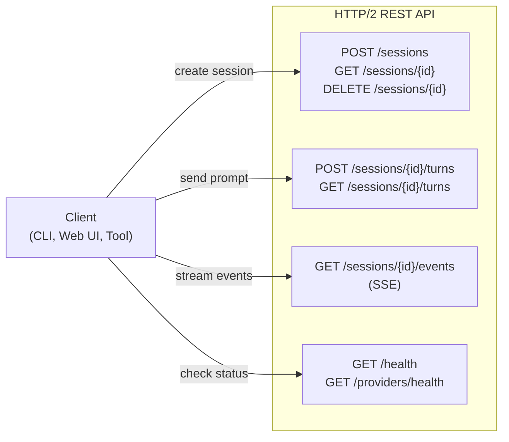

# Server and Remote Access

Hone can run as a daemon (`honed`) that exposes an HTTP/2 REST API with Server-Sent Events (SSE) for real-time streaming. This enables remote access, web UIs, and integration with other services.

## Starting the Daemon

```bash
honed --port 7777
```

The daemon listens on `http://localhost:7777`.

**Configuration via config.toml:**

```toml
[server]
host = "0.0.0.0"  # listen on all interfaces
port = 7777
auth_token = "your-bearer-token"  # optional auth
enable_https = true
cert_path = "/path/to/cert.pem"
key_path = "/path/to/key.pem"
```

**Configuration via environment:**

```bash
HONE_SERVER_PORT=7777 \
HONE_SERVER_AUTH_TOKEN="secret" \
honed
```

## REST API Overview

The daemon provides these endpoints:



### Session Management

#### Create Session

```bash
curl -X POST http://localhost:7777/sessions \
  -H "Content-Type: application/json" \
  -H "Authorization: Bearer YOUR_TOKEN" \
  -d '{
    "model": "anthropic:claude-opus-4-5",
    "system_prompt": "You are a helpful assistant"
  }'
```

Response:

```json
{
  "session_id": "sess_abc123",
  "model": "anthropic:claude-opus-4-5",
  "created_at": "2026-04-05T14:30:00Z"
}
```

#### Get Session Info

```bash
curl http://localhost:7777/sessions/sess_abc123 \
  -H "Authorization: Bearer YOUR_TOKEN"
```

Response:

```json
{
  "session_id": "sess_abc123",
  "model": "anthropic:claude-opus-4-5",
  "created_at": "2026-04-05T14:30:00Z",
  "turns_count": 5,
  "cost_usd": 0.34,
  "status": "active"
}
```

#### Delete Session

```bash
curl -X DELETE http://localhost:7777/sessions/sess_abc123 \
  -H "Authorization: Bearer YOUR_TOKEN"
```

Returns `204 No Content` on success.

### Running Turns

#### Send Prompt

```bash
curl -X POST http://localhost:7777/sessions/sess_abc123/turns \
  -H "Content-Type: application/json" \
  -H "Authorization: Bearer YOUR_TOKEN" \
  -d '{
    "input": "What is 2 + 2?"
  }'
```

Response (immediate, before streaming):

```json
{
  "turn_id": "turn_001",
  "session_id": "sess_abc123",
  "status": "streaming"
}
```

The actual response streams via Server-Sent Events (see below).

#### Get Turn History

```bash
curl http://localhost:7777/sessions/sess_abc123/turns \
  -H "Authorization: Bearer YOUR_TOKEN"
```

Response:

```json
{
  "turns": [
    {
      "turn_id": "turn_001",
      "role": "user",
      "content": "What is 2 + 2?"
    },
    {
      "turn_id": "turn_001",
      "role": "assistant",
      "content": "The answer is 4."
    }
  ]
}
```

## Server-Sent Events (SSE)

Connect to the SSE endpoint to receive real-time streaming:

```bash
curl http://localhost:7777/sessions/sess_abc123/events \
  -H "Authorization: Bearer YOUR_TOKEN"
```

The connection stays open and receives events as they happen:

```
event: token
data: {"text": "The"}

event: token
data: {"text": " answer"}

event: token
data: {"text": " is"}

event: token
data: {"text": " 4"}

event: tool_call_start
data: {"id": "tool_001", "name": "shell"}

event: tool_call_end
data: {"id": "tool_001", "result": {"output": "..."}, "is_error": false}

event: done
data: {"usage": {"input_tokens": 45, "output_tokens": 12}, "cost_usd": 0.0012}
```

### Event Types

| Event | Payload | Description |
|---|---|---|
| `token` | `{"text": string}` | A single token from the model |
| `tool_call_start` | `{"id": string, "name": string}` | Tool call started |
| `tool_call_end` | `{"id": string, "result": object, "is_error": bool}` | Tool call result |
| `done` | `{"usage": {...}, "cost_usd": float}` | Turn complete |
| `error` | `{"message": string}` | Error occurred |

### Replaying Events

The SSE endpoint replays all events from the session start, allowing clients to connect late or reconstruct the conversation:

```bash
# Connect after the conversation started
curl http://localhost:7777/sessions/sess_abc123/events?from=turn_003
```

Only events from `turn_003` onward are sent.

## Authentication

The daemon supports bearer token authentication. When `auth_token` is set in config, all requests must include it:

```bash
curl -H "Authorization: Bearer your-token" http://localhost:7777/sessions
```

Without the header or with an incorrect token:

```
HTTP/1.1 401 Unauthorized
{"error": "missing or invalid authorization"}
```

## Tunnel Support for Remote Access

Access the daemon over the internet securely using a tunnel.

### Built-in Tunnel

Hone has built-in tunnel support (Cloudflare Tunnel, Ngrok, etc.):

```bash
honed --enable-tunnel --tunnel-provider cloudflare
```

The daemon prints a public URL:

```
Daemon started on http://localhost:7777
Tunnel: https://hone-abc123.trycloudflare.com
Share this URL to allow remote access.
```

Remote clients can now use:

```bash
HONE_SERVER_URL=https://hone-abc123.trycloudflare.com hone
```

### Manual Tunnel (Ngrok)

Alternatively, use Ngrok manually:

```bash
# Terminal 1: start daemon
honed

# Terminal 2: tunnel
ngrok http 7777
```

Ngrok gives you a public URL. Use it in the Hone client:

```bash
hone --server-url https://abc123.ngrok.io --auth-token "your-token"
```

## Health Checks

Check daemon and provider health:

```bash
curl http://localhost:7777/health
```

Response:

```json
{
  "status": "healthy",
  "version": "0.1.0",
  "uptime_secs": 3600,
  "sessions_active": 2
}
```

Check provider health:

```bash
curl http://localhost:7777/providers/health \
  -H "Authorization: Bearer YOUR_TOKEN"
```

Response:

```json
{
  "providers": [
    {
      "id": "anthropic:claude-opus-4-5",
      "status": "healthy",
      "latency_ms": 42,
      "last_checked": "2026-04-05T14:30:00Z"
    },
    {
      "id": "ollama:llama2",
      "status": "healthy",
      "latency_ms": 1250
    },
    {
      "id": "openai:gpt-4o",
      "status": "rate_limited",
      "retry_after_secs": 60
    }
  ]
}
```

## Web PWA

Hone includes a web-based UI (Progressive Web App) that connects to the daemon:

```bash
# Daemon starts on port 7777
honed --port 7777

# Open browser to localhost
# The PWA is served by the daemon
open http://localhost:7777
```

The web UI provides:
- Session management
- Real-time chat interface
- Cost tracking
- Session history
- Markdown rendering

## Persistent Sessions with SQLite

By default, sessions are stored in memory and lost when the daemon restarts. To persist sessions across restarts, configure a SQLite database:

```bash
HONE_SESSION_DB=~/.local/share/hone/sessions.db honed
```

Or via config.toml:

```toml
[storage]
sessions_db = "~/.local/share/hone/sessions.db"
```

When `HONE_SESSION_DB` is set:
- New sessions are persisted immediately
- Sessions survive daemon restarts
- Session history is queryable via the API

Without this setting, sessions live only in memory for the duration of the daemon process.

---

## Real Bore Tunnel

Hone can automatically use the [Bore](https://github.com/ekzhang/bore) CLI for reverse tunneling. Bore is simpler and lighter-weight than Cloudflare Tunnel or Ngrok.

Install Bore:

```bash
cargo install bore-cli
```

Run the daemon — it auto-detects Bore on PATH:

```bash
honed
```

The daemon detects `bore` in PATH and uses `BoreTunnelManager` to spawn it as a subprocess. The tunnel URL is printed on startup:

```
Daemon started on http://localhost:7777
Tunnel: https://tunnel-abc123.bore.pub
Share this URL to allow remote access.
```

If `bore` is not on PATH, the daemon falls back to `MockTunnelManager` (local-only access). No error is thrown — tunneling is optional.

---

## Graceful Shutdown

The daemon handles `SIGINT` and `SIGTERM` gracefully, draining in-flight requests before exiting:

```bash
# Start daemon
honed

# In another terminal, send signal
kill -TERM <pid>
```

The daemon will:
1. Stop accepting new requests
2. Wait for in-flight requests to complete (with timeout)
3. Close all active SSE connections gracefully
4. Flush session data to disk (if persisted)
5. Exit cleanly

This ensures clients receive complete responses and no data is lost mid-operation.

---

## Rate Limiting

All endpoints are rate-limited at **100 requests per minute per client** (identified by `X-Forwarded-For` or source IP). Clients exceeding the limit receive `429 Too Many Requests`.

To configure rate limiting when embedding the server in your own application:

```rust
use hone_server::AppState;

let state = AppState::default()
    .with_rate_limiter(100, std::time::Duration::from_secs(60));
```

---

## Collaborative Sessions

The daemon supports multiple users working in the same session (experimental).

#### Join Session

```bash
curl -X POST http://localhost:7777/sessions/sess_abc123/join \
  -H "Authorization: Bearer YOUR_TOKEN" \
  -d '{"user_id": "user_123", "name": "Alice"}'
```

#### Leave Session

```bash
curl -X POST http://localhost:7777/sessions/sess_abc123/leave \
  -H "Authorization: Bearer YOUR_TOKEN" \
  -d '{"user_id": "user_123"}'
```

Collaborators see each other's prompts and the agent's responses in real-time via SSE. Useful for pair programming, code reviews, and team problem-solving.

## Daemon Configuration

Full config.toml example:

```toml
[server]
host = "0.0.0.0"
port = 7777
auth_token = "bearer_token_here"
enable_https = false
enable_tunnel = false

[server.tunnel]
provider = "cloudflare"
auth_token = "cf_token"

[providers.anthropic]
api_key = "sk-ant-..."

[providers.ollama]
base_url = "http://localhost:11434"

[[mcp_servers]]
name = "github"
command = "npx"
args = ["@modelcontextprotocol/server-github"]
env = { GITHUB_TOKEN = "ghp_..." }
```

Start with custom config:

```bash
honed --config ~/.config/hone/config.toml
```

## Running Multiple Daemons

Run multiple daemons with different models for workload distribution:

```bash
# Terminal 1: fast responses
honed --port 7777 --model ollama:llama2

# Terminal 2: high quality
honed --port 7778 --model anthropic:claude-opus-4-5

# Terminal 3: budget conscious
honed --port 7779 --model openai:gpt-3.5-turbo
```

Route requests to different daemons based on needs:

```bash
# Fast response for simple tasks
hone --server-url http://localhost:7777 -i "Quick question"

# High quality for complex tasks
hone --server-url http://localhost:7778 -i "Analyze this complex code"
```

## Systemd Service

Run the daemon as a system service (Linux):

```ini
# /etc/systemd/system/honed.service
[Unit]
Description=Hone Agent Daemon
After=network.target

[Service]
Type=simple
User=hone
ExecStart=/usr/local/bin/honed --config /etc/hone/config.toml
Restart=on-failure
StandardOutput=journal
StandardError=journal

[Install]
WantedBy=multi-user.target
```

Enable and start:

```bash
sudo systemctl enable honed
sudo systemctl start honed
sudo systemctl status honed
```

View logs:

```bash
sudo journalctl -u honed -f
```

## Next Steps

- **Getting started:** See [Getting Started](getting-started.md) to run your first session.
- **Providers:** Configure remote providers in [Providers Guide](providers.md).
- **Tools:** Use remote tools via [Tools Guide](tools-and-mcp.md).
- **Security:** Secure your daemon in [Security Guide](security.md).
