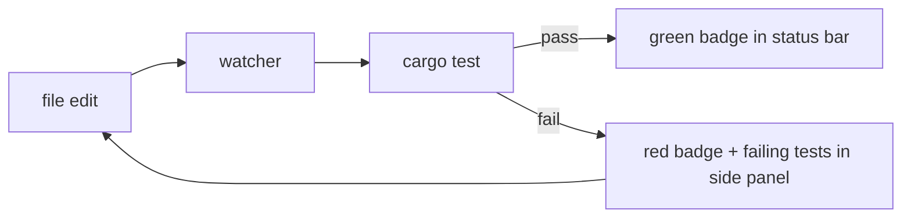

# TDD with Hone

Hone treats Test-Driven Development as a first-class workflow. This guide covers two complementary modes: the interactive `/tdd` watcher and the bundled `tdd-feature` recipe for full Red-Green-Refactor automation.

## When to use which

| Mode | Best for | Workflow |
|---|---|---|
| `/tdd` watcher | You write the tests yourself; you want hone to run them on save and surface failures inline | Manual: you stay in the driver's seat |
| `tdd-feature` recipe | You want the agent to author the tests AND the implementation, with separation of concerns | Automated: hone drives the loop |
| `bug-fix` recipe | You have a reproducible bug and want a regression test → fix → verify pipeline | Automated: regression-first |

## Mode 1: the `/tdd` watcher

The `/tdd` slash command starts a file watcher that re-runs your test command whenever any tracked file changes. It's lightweight — no agent involvement until you ask for it.

### Starting the watcher

```
/tdd
```

With no argument, hone auto-detects the test command:

| Detected file | Default test command |
|---|---|
| `Cargo.toml` | `cargo test` |
| `package.json` with `"test"` script | `npm test` |
| `pyproject.toml` or `pytest.ini` | `pytest` |
| `go.mod` | `go test ./...` |
| `Makefile` with a `test` target | `make test` |

To override:

```
/tdd cargo test --workspace
/tdd pytest -x tests/test_auth.py
```

### What the watcher does



The status bar gains a TDD badge: green when the suite passes, red when any test fails, with a count of failing tests. Failing tests appear in a side panel; click (or scroll-and-Enter) to expand the failure output.

### Stopping

```
/tdd off
```

Or `/tdd stop` — both work.

### Asking the agent to fix a failure

While the watcher is red, ask:

```
> the watcher shows test_login_rejects_blank_password failing — fix it
```

The agent reads the failing output (already in scope), reads the relevant source, and proposes a fix. Save the fix; the watcher re-runs; if green, you're done. If still red, the failure feeds back automatically — no manual copy-paste.

## Mode 2: the `tdd-feature` recipe

This is the full automated loop. Hone takes a feature description and runs five steps:

```yaml
name: tdd-feature
description: Implement a feature using Test-Driven Development
steps:
  - name: understand
    prompt: "Read the relevant code and understand the current architecture. Summarize what you find."
  - name: red
    prompt: "Write failing tests that describe the desired behavior. Run them to confirm they fail."
  - name: green
    prompt: "Write the minimum code to make the tests pass. Do not add extra features."
  - name: refactor
    prompt: "Refactor the implementation for clarity and quality. All tests must still pass."
  - name: verify
    prompt: "Run all tests one final time. Report the results."
test_cmd: "cargo test"
```

### Running it

```bash
hone --recipe tdd-feature -i "add a /export-session command that writes the conversation to ./export.json"
```

Or interactively, after launching `hone`:

```
/recipe tdd-feature
> add a /export-session command that writes the conversation to ./export.json
```

### What you get

Each step's transcript is saved under `~/.hone/sessions/<id>/recipes/tdd-feature/<step>.md` so you can review the agent's reasoning at every stage.

The `test_cmd` field is enforced — if the `green` step finishes with a failing suite, hone refuses to advance to `refactor` and surfaces the failure. The recipe explicitly aborts rather than papering over a red bar.

## Mode 3: the `bug-fix` recipe (regression-first)

```yaml
name: bug-fix
steps:
  - name: reproduce
    prompt: "Read the bug report and reproduce the issue. Identify the failing behavior."
  - name: regression-test
    prompt: "Write a regression test that captures the bug. Verify it fails."
  - name: fix
    prompt: "Write the minimal fix. Do not refactor surrounding code."
  - name: verify
    prompt: "Run all tests. The regression test should now pass along with all existing tests."
test_cmd: "cargo test"
```

Same shape as `tdd-feature`, but with a bias toward minimal scope: the agent is instructed not to refactor surrounding code while fixing the bug — that's a separate, follow-up cycle.

## Discipline: keep the test author and implementer separate

Hone's strongest TDD pattern uses two different agents — one writes the test, a different one writes the implementation. The reason: when the same agent does both, the tests unconsciously match the implementation rather than the contract.

This is built into the inline `@`-agent dispatch:

```
> @test-architect write failing tests for /export-session that pin: writes ./export.json, JSON has "messages" array, exits cleanly on permission errors

[tests appear, all red]

> @rust-expert read the test file as the spec and implement /export-session — do NOT modify the tests

[implementation appears, suite goes green]

> @code-reviewer-quick review the diff
```

The contract is enforced socially: the rust-expert is told "tests are the spec; do not modify them." If a test is wrong, send it back to the test-architect — never let the implementer rewrite the contract to match its implementation.

## Speed: make `cargo test` fast

TDD is only viable if the inner loop is sub-30-seconds. Three tactics:

1. **Run a single crate**: `/tdd cargo test -p hone-tui --lib`. Workspaces with 30+ crates are too slow at the workspace level.
2. **Run a single test**: while iterating on one failure: `/tdd cargo test -p hone-tui --lib theme_switch_reads_toml_on_switch`.
3. **`cargo nextest`**: install it once (`cargo install cargo-nextest`); it parallelises better than `cargo test`. Then: `/tdd cargo nextest run -p hone-tui`.

## Capturing the loop in CI

Once you're done locally, the same `test_cmd` works in CI:

```yaml
# .github/workflows/test.yml
- run: cargo test --workspace
```

If a recipe was the entry point, save the recipe under `recipes/` and add a CI step:

```yaml
- run: hone --recipe tdd-feature -i "$FEATURE_DESC" --non-interactive
```

`--non-interactive` suppresses the TUI and prints transcripts to stdout, so CI logs capture the agent's chain of reasoning.

## Common pitfalls

| Pitfall | Fix |
|---|---|
| Tests in `tdd-feature` pass on the first iteration | The `red` step didn't actually run them. Add `Run them to confirm they fail.` to the `red` prompt — already in the bundled recipe. |
| `green` step adds extra features | Reword the prompt: `Write the minimum code to make the tests pass. No additional features. No extra tests. No edge-case handling beyond what the tests pin.` |
| `refactor` step breaks tests | The agent needs to re-run after every change. Add `After each change, run cargo test and verify all tests pass before continuing.` |
| Watcher misses changes | File system events on macOS over network volumes (NFS, SSHFS) can drop. Use `/tdd off` and re-run manually or restart the watcher. |
| Agent rewrites the test file in `green` | Explicit instruction in the prompt: `You may not modify any file under tests/ or any file matching *_test.go, *test.rs, *.spec.ts.` |

## Related

- [`docs/tutorials/recipes.md`](recipes.md) — full recipe DSL reference (conditional steps, output capture, sub-recipes).
- [`docs/tutorials/tools-and-mcp.md`](tools-and-mcp.md) — the file-watch and shell tools the watcher uses internally.
- [`docs/tutorials/debugging.md`](debugging.md) — when the suite stays red and you need to dig in.
