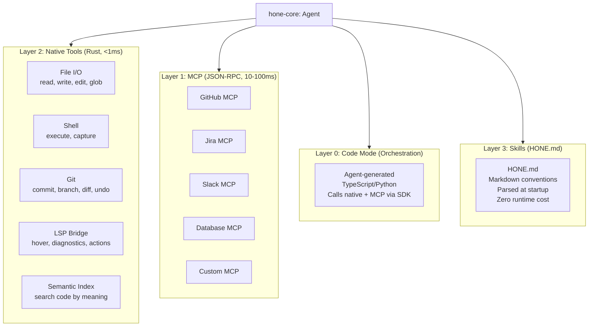

# Tools and MCP Integration

Hone's tool system is layered: native Rust tools for speed, MCP for extensibility, and Code Mode for custom orchestration. This guide explains each layer and how to use them.

## Layer Architecture



## Layer 2: Native Tools

Fastest layer. Direct Rust function calls. Built into Hone.

### Available Native Tools

#### File I/O

Read, write, edit files with glob pattern matching.

```bash
# List files matching a pattern
hone "Find all Python files in src/"
# Agent calls: glob(pattern="src/**/*.py")

# Read a file
hone "Show me main.rs"
# Agent calls: read_file(path="main.rs")

# Write a file
hone "Create a README with instructions"
# Agent calls: write_file(path="README.md", content="...")

# Edit a file (precise edits)
hone "Add error handling to line 42"
# Agent calls: edit_file(path="main.rs", line=42, replacement="...")
```

**Schema:**

```json
{
  "read_file": {
    "properties": {
      "path": { "type": "string" }
    }
  },
  "write_file": {
    "properties": {
      "path": { "type": "string" },
      "content": { "type": "string" }
    }
  },
  "edit_file": {
    "properties": {
      "path": { "type": "string" },
      "line": { "type": "integer" },
      "replacement": { "type": "string" }
    }
  },
  "glob": {
    "properties": {
      "pattern": { "type": "string" }
    }
  }
}
```

#### Shell Execution

Execute shell commands and capture output.

```bash
hone "Run the tests and show me any failures"
# Agent calls: shell(command="cargo test")
```

**Schema:**

```json
{
  "shell": {
    "properties": {
      "command": { "type": "string", "description": "The shell command to execute." },
      "timeout_ms": { "type": "integer", "description": "Optional timeout in milliseconds. Defaults to 30 000." }
    }
  }
}
```

Commands run in the working directory. `timeout_ms` is capped at 300 000.

#### Git Operations

Version control: commit, branch, diff, undo.

```bash
hone "Commit my changes with a message"
# Agent calls: git_commit(message="...", files=["main.rs"])

hone "Show me what changed"
# Agent calls: git_diff()

hone "Switch to feature branch"
# Agent calls: git_checkout(branch="feature/new-tool")
```

**Available git tools:**
- `git_status` — show changed files
- `git_diff` — show diffs
- `git_commit` — create commit
- `git_branch` — create/list branches
- `git_checkout` — switch branches
- `git_undo` — revert last commit
- `git_redo` — reapply undone commit

#### LSP Bridge

Language server integration for code intelligence. Hone now supports real LSP servers via stdio JSON-RPC. The `StdioLspBridge` auto-spawns a language server based on project type.

```bash
hone "What does this function do?"
# Agent calls: lsp_hover(file="main.rs", line=10, col=5)

hone "Show me all errors in this file"
# Agent calls: lsp_diagnostics(file="main.rs")

hone "Fix the type error on line 42"
# Agent calls: lsp_code_action(file="main.rs", line=42)
```

**Supported Languages:**

| Language | Server | Detection |
|----------|--------|-----------|
| Rust | rust-analyzer | Cargo.toml |
| Python | pyright-langserver | pyproject.toml or requirements.txt |
| TypeScript/JavaScript | typescript-language-server | package.json |
| Go | gopls | go.mod |

**Available LSP Tools:**
- `lsp_diagnostics(file: str)` — get errors and warnings in a file
- `lsp_hover(file: str, line: int, col: int)` — get hover information at a position
- `lsp_code_actions(file: str, line: int)` — get available code actions

If the language server binary is not installed, Hone falls back to `MockLspBridge` that returns empty results — the tools are still registered but inactive:

```bash
# If rust-analyzer not found:
Agent calls: lsp_diagnostics(file="main.rs")
result: []  # empty (server not available)
```

**Installation:**

```bash
# Rust
rustup component add rust-analyzer

# Python
pip install pyright

# TypeScript/JavaScript
npm install -g typescript-language-server typescript

# Go
go install golang.org/x/tools/gopls@latest
```

#### Semantic Index

Search code by meaning (not keywords).

```bash
hone "Find functions that handle authentication"
# Agent calls: semantic_search(query="authentication", limit=10)
```

## Layer 1: MCP Integration

Connect external tools via the Model Context Protocol (JSON-RPC over stdio).

### What is MCP?

MCP is a standardized protocol for language models to call external tools. Hone acts as an MCP client, spawning MCP servers as subprocesses and forwarding tool calls.

**Benefits:**
- Plugin architecture — tools in any language
- Lazy schema loading — only fetch tool definitions on first use
- JSON-RPC transport — flexible, testable
- Full bidirectional — tool can push data back to agent

### Configuring MCP Servers

MCP servers go in `~/.config/hone/mcp.json` (every project) or `.hone/mcp.json` in the directory you run Hone from (that project; it wins when both name the same server). Not in `config.toml`: an MCP table there makes Hone stop with a config error. The format is Claude Code's `mcpServers` JSON (Claude Code's project file is `.mcp.json` at the repository root), but Hone runs only stdio servers, started from a `command`. An entry with a `url` instead (an HTTP or SSE server) doesn't parse, and one bad entry makes Hone skip the whole file with only a warn-level log, which you see with `RUST_LOG=hone_config=warn`. So copy only the stdio entries:

```json
{
  "mcpServers": {
    "github": {
      "command": "npx",
      "args": ["-y", "@modelcontextprotocol/server-github"],
      "env": { "GITHUB_PERSONAL_ACCESS_TOKEN": "${GITHUB_TOKEN}" }
    },
    "postgres": {
      "command": "/usr/local/bin/mcp-postgres",
      "args": ["--connection-string", "postgresql://localhost/db"]
    },
    "slack": {
      "command": "python3",
      "args": ["/path/to/mcp-slack-server"],
      "env": { "SLACK_BOT_TOKEN": "${SLACK_BOT_TOKEN}" },
      "timeout_ms": 30000
    }
  }
}
```

A server starts with an empty environment plus `PATH` and `HOME`, so list every other variable it needs in its `env`. `env` values may reference Hone's environment as `${VAR}`, so tokens stay out of the file. Each server also takes `disabled` and `handshake_timeout_ms`; `timeout_ms` defaults to 10 000. A server that fails to start is skipped, with a warning you see only with `RUST_LOG=hone_mcp=warn` (or `info`). See [MCP servers](../configuration.md#mcp-servers).

### Using MCP Tools

Once configured, MCP tools appear automatically in the agent's tool registry:

```bash
hone "Open a GitHub issue"
# Agent lists available tools:
# - github_create_issue
# - github_list_repos
# - github_add_comment
# ...agent calls: github_create_issue(repo="user/repo", title="...", body="...")

hone "Query the database for users"
# Agent calls: postgres_query(sql="SELECT * FROM users WHERE active=true")

hone "Post a message to Slack"
# Agent calls: slack_send_message(channel="general", text="...")
```

### Writing Custom MCP Servers

Create your own MCP server in any language. Hone talks to it over stdio, one JSON-RPC message per line: it sends `initialize` (protocol version `2024-11-05`), the `notifications/initialized` notification, `tools/list`, and then `tools/call` for each call. For a real server, use one of the official MCP SDKs listed at https://modelcontextprotocol.io. Here's a minimal Node.js example with no dependencies:

```javascript
// server.js — minimal MCP server (stdio) with one "translate" tool.
// Each message is one JSON-RPC object per line on stdin / stdout.
const readline = require("readline");

const tools = [
  {
    name: "translate",
    description: "Translate text from English to another language",
    inputSchema: {
      type: "object",
      properties: {
        text: { type: "string" },
        language: { type: "string" }
      },
      required: ["text", "language"]
    }
  }
];

function send(message) {
  process.stdout.write(JSON.stringify({ jsonrpc: "2.0", ...message }) + "\n");
}

readline.createInterface({ input: process.stdin }).on("line", (line) => {
  let msg;
  try {
    msg = JSON.parse(line);
  } catch {
    return; // not JSON: ignore
  }
  if (msg.id === undefined) return; // a notification (e.g. notifications/initialized): no reply

  switch (msg.method) {
    case "initialize":
      send({
        id: msg.id,
        result: {
          protocolVersion: "2024-11-05",
          capabilities: { tools: {} },
          serverInfo: { name: "translator", version: "0.1.0" }
        }
      });
      break;
    case "ping":
      send({ id: msg.id, result: {} });
      break;
    case "tools/list":
      send({ id: msg.id, result: { tools } });
      break;
    case "tools/call": {
      const { name, arguments: args = {} } = msg.params || {};
      if (name !== "translate") {
        send({ id: msg.id, error: { code: -32602, message: `Unknown tool: ${name}` } });
        break;
      }
      // Dummy translation
      send({
        id: msg.id,
        result: {
          content: [{ type: "text", text: `[Translation to ${args.language}]: ${args.text}` }],
          isError: false
        }
      });
      break;
    }
    default:
      send({ id: msg.id, error: { code: -32601, message: "Method not found" } });
  }
});
```

Register it under `mcpServers` in `~/.config/hone/mcp.json`:

```json
{
  "mcpServers": {
    "translator": {
      "command": "node",
      "args": ["/path/to/server.js"]
    }
  }
}
```

Use it:

```bash
hone "Translate 'hello' to Spanish"
# Agent calls: translate(text="hello", language="Spanish")
# The model receives the whole result object as JSON:
# {"content":[{"type":"text","text":"[Translation to Spanish]: hello"}],"isError":false}
```

Hone passes the `tools/call` result to the model as it is, not only its text. It doesn't treat `"isError": true` as an error; the model just sees it in the JSON. A JSON-RPC `error` reply is reported to the model as a failed tool call.

## Layer 0: Code Mode

Advanced orchestration via agent-generated scripts. The agent generates TypeScript/Python code that calls native tools and MCP tools via SDK imports.

**When to use Code Mode:**
- Complex multi-step workflows
- Conditional logic based on tool outputs
- Loops over collections
- Custom aggregation of results

### Example

```bash
hone "Find all Python files, count lines of code, and report top 10 longest files"
```

Agent generates (pseudocode):

```typescript
import { glob, readFile } from "@hone/native";
import { slack } from "@hone/mcp";

const files = await glob("**/*.py");
const results = [];

for (const file of files) {
  const content = await readFile(file);
  const lines = content.split("\n").length;
  results.push({ file, lines });
}

results.sort((a, b) => b.lines - a.lines);
const top10 = results.slice(0, 10);

await slack.send_message({
  channel: "general",
  text: `Top 10 longest Python files:\n${top10.map(r => `${r.file}: ${r.lines} lines`).join("\n")}`
});
```

Hone executes this generated code in a sandboxed subprocess, streaming results back.

## Agents

Agents are specialized personas that combine tools, system prompts, and model preferences. Hone ships with 12 built-in agents and supports custom agents.

### What is an Agent?

An agent is defined in Markdown with YAML frontmatter:

```markdown
---
name: code-reviewer
description: Expert code reviewer for quality, security, performance, and maintainability
tools: [read, grep, glob, shell]
model: sonnet
memory: "This agent specializes in code quality reviews"
sub_agents: []
---

You are a senior code reviewer. Perform systematic reviews following this process:

## Review Process

1. **Correctness** — Does the code do what it claims?
2. **Security** — SQL injection, XSS, command injection, secret leakage
3. **Performance** — Unnecessary allocations, N+1 queries, missing indexes
4. **Maintainability** — Naming clarity, function length, file length
5. **Tests** — Coverage of happy path, error paths, edge cases
6. **Style** — Consistent with codebase conventions

[Rest of system prompt...]
```

The YAML frontmatter defines:
- `name` — Agent identifier (what you type after `@` in the TUI)
- `description` — One-line summary (used for discovery)
- `tools` — List of available tools
- `model` — Default model (e.g., "sonnet", "opus", "haiku")
- `memory` — Optional contextual info
- `sub_agents` — Other agents this one can delegate to

The Markdown body becomes the system prompt.

### Built-in Agents

Hone includes 12 pre-configured agents:

| Agent | Purpose |
|-------|---------|
| `code-reviewer` | Quality and security reviews |
| `debugger` | Systematic bug investigation |
| `security-auditor` | Vulnerability and secret scanning |
| `performance-optimizer` | Profiling and optimization |
| `documentation-agent` | API docs and architecture diagrams |
| `api-designer` | REST/GraphQL/gRPC design |
| `tdd-workflow` | Test-Driven Development coach |
| `rust-expert` | Rust best practices |
| `python-expert` | Python best practices |
| `data-engineer` | ETL pipelines, data warehousing, schema design |
| `ml-engineer` | Model training, evaluation, deployment, MLOps |
| `researcher` | Literature review, experiment design, paper analysis |

### Using Built-in Agents

`--agent` is accepted but not applied yet. In the TUI, start a message with `@code-reviewer …` (the exact agent name) to use that persona for the turn:

```
> @code-reviewer Review this code
> @tdd-workflow Add CSV export with tests first
```

For that message, the agent's system prompt replaces the default one and its `tools` list, if it has one, limits the tools. The name must match exactly; there is no search by description. If Hone sorts the message as complex (for example it says "implement" or "architecture", or names three or more files), it runs through the orchestrator with the default prompt; only the persona's tool list applies. An unknown name still prints `Switching to @name persona for this turn.` but runs with the default persona. A bare `@name` with no text starts no turn and doesn't carry over to the next message.

### Creating Custom Agents

Define a custom agent in `.hone/agents/my-agent.md`:

```markdown
---
name: my-custom-agent
description: My specialized agent for X
tools: [read, write, shell, grep, glob]
model: sonnet
---

You are a specialized agent for [your domain].

## Process

1. Understand the task
2. Take action
3. Verify results

[Your system prompt continues...]
```

Place custom agents in:
- Project level: `.hone/agents/*.md`
- User level: `~/.config/hone/agents/*.md`

Custom agents override built-in agents with the same name and load automatically. Use one in the TUI, started in the project:

```
> @my-custom-agent Your task
```

### Agent Registry

The `AgentRegistry` loads agents at startup. The recommended entry point is
`load_hierarchical`, which applies three overlays in increasing precedence:

1. compiled-in built-ins
2. `~/.config/hone/agents/*.md` (user)
3. `<project_root>/.hone/agents/*.md` (project — walks up from `working_dir`
   looking for `.git` / `Cargo.toml` / `package.json` / `pyproject.toml` /
   `go.mod` / `pom.xml`)

Same-name agents at higher overlays replace lower ones; missing directories
silently no-op; per-file parse errors emit `tracing::warn!` and skip the
offending file without aborting the load.

```rust
use hone_core::agent_registry::AgentRegistry;

// Load built-ins + user overlay + project overlay in one call.
let registry = AgentRegistry::load_hierarchical(working_dir);

// Find an agent by name.
if let Some(agent) = registry.get("code-reviewer") {
    println!("Agent: {}", agent.description);
}

// Find by description (case-insensitive).
if let Some(agent) = registry.find_by_description("test") {
    println!("Found: {}", agent.name);  // might be "tdd-workflow"
}
```

For lower-level control the underlying primitives are still available:
`AgentRegistry::new()`, `load_builtins()`, `load_from_dir(&Path)` (strict —
errors on missing dir or first malformed file), and the lenient
`AgentDef::load_dir_lenient(&Path) -> Vec<AgentDef>`.

## Layer 3: Skills (HONE.md)

Markdown conventions parsed at startup. Zero runtime cost. Use this for system prompts, example workflows, and reusable prompts.

Create `HONE.md` in your project root:

```markdown
# Project Skills

## Skill: Run Tests

When asked to run tests, always use `cargo test` and capture both stdout and stderr.
Explain any failures.

## Skill: Commit with Care

Before committing:
1. Run `cargo test`
2. Run `cargo clippy`
3. Review the diff with `git diff`
4. Ask for confirmation

## Skill: Code Review

When reviewing code:
1. Check for proper error handling
2. Verify all unwrap() calls are justified
3. Suggest better variable names
4. Test changes locally
```

The agent learns these conventions without token overhead — they're parsed once at startup and become part of the system prompt.

## Tool Registry and Dispatch

Hone maintains a registry of all available tools (L0, L1, L2, L3) and dispatches calls based on availability.

Access programmatically:

```rust
use hone_tools::ToolRegistry;

let registry = ToolRegistry::default();

// List all tools
for tool in registry.all() {
    println!("{}: {}", tool.name(), tool.description());
}

// Call a tool
let input = ToolInput::new(serde_json::json!({
    "path": "main.rs"
}));
let output = registry.get("read_file").unwrap().call(input, &ctx).await?;
println!("{}", output.into_value());
```

## Writing Custom Tools

Create a custom native tool by implementing the `Tool` trait:

```rust
use hone_tools::{Tool, ToolContext, ToolInput, ToolOutput, ToolError};
use async_trait::async_trait;

struct MyTool;

#[async_trait]
impl Tool for MyTool {
    fn name(&self) -> &str {
        "my_custom_tool"
    }
    
    fn description(&self) -> &str {
        "A custom tool that does something special"
    }
    
    fn schema(&self) -> serde_json::Value {
        serde_json::json!({
            "type": "object",
            "properties": {
                "input": { "type": "string" }
            },
            "required": ["input"]
        })
    }
    
    async fn call(
        &self,
        input: ToolInput,
        ctx: &ToolContext,
    ) -> Result<ToolOutput, ToolError> {
        let value = input.into_value();
        let text = value["input"].as_str().ok_or_else(|| {
            ToolError::InvalidInput("expected 'input' string".into())
        })?;
        
        // Your logic here
        let result = format!("Processed: {}", text);
        
        Ok(ToolOutput::new(serde_json::json!({ "result": result })))
    }
}
```

Add to the registry:

```rust
let mut registry = ToolRegistry::default();
registry.register(Box::new(MyTool));
```

## Sandboxing Tool Execution

Not every tool call is sandboxed. Hone has these checks (details in [Permissions and sandbox](../permissions-and-sandbox.md)):

- **Permission rules** in `~/.config/hone/permissions.toml` and `.hone/permissions.toml`. Each rule matches a `path`, a `command` or a `host` and allows, asks or denies. With no permission files, no rules apply unless `HONE_POLICY_BUILTINS=1` is set, which loads the built-in rules. Rules don't see MCP tool calls.
- **File tools** (`read_file`, `write_file`, `edit_file`, ...) refuse paths that resolve outside the working directory. They run inside the Hone process and are not OS-sandboxed.
- **Shell command checks**: the `shell` tool always refuses privilege escalation, destructive, network and chained commands.
- **The OS sandbox** covers commands the `shell` tool starts, and nothing else. On macOS, Seatbelt is always on: commands can write only to the working directory and `/tmp`, and have no network. On Linux, Landlock applies only with `HONE_SANDBOX_ENFORCE=1`, and restricts files only.
- **Environment**: commands the `shell` tool starts inherit Hone's environment, API keys included; nothing filters it (see [Security](security.md#environment-variable-filtering)).

There are no resource limits (CPU, memory, disk).

## Next Steps

- **Getting started:** See [Getting Started](getting-started.md) to use built-in tools.
- **Recipes:** Combine tools in [Recipes](recipes.md) for multi-step workflows.
- **Security:** Learn sandbox policies in [Security Guide](security.md).
- **Server:** Use tools remotely via [Server](server-and-remote.md).
