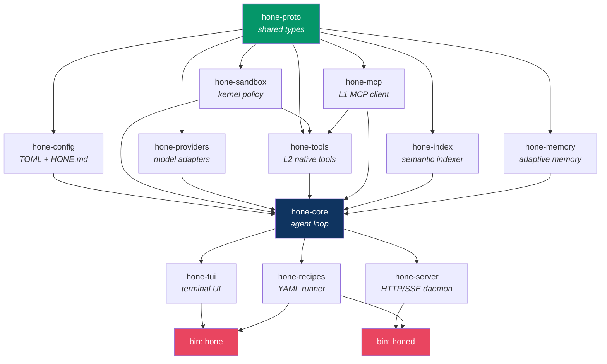
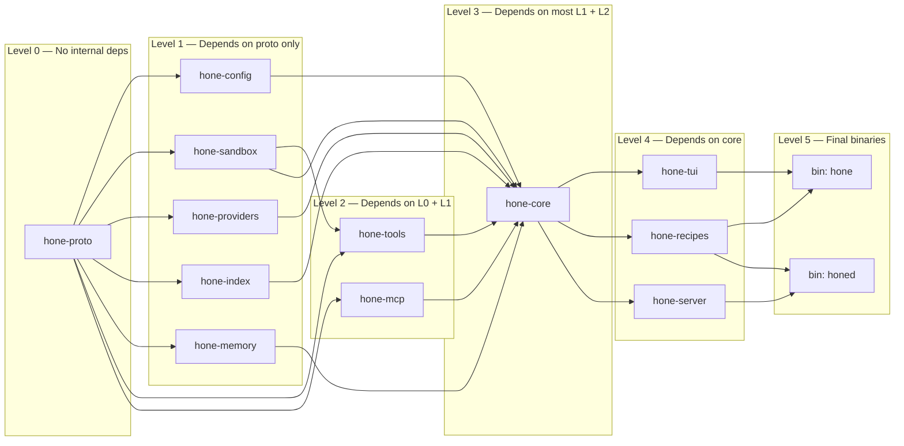

# Hone — Workspace Structure

**Version:** 1.0  
**Date:** 2026-04-04  
**Status:** Working Draft

---

## Table of Contents

1. [Complete Directory Tree](#1-complete-directory-tree)
2. [Cargo Workspace Configuration](#2-cargo-workspace-configuration)
3. [Crate Details](#3-crate-details)
4. [Feature Flags Strategy](#4-feature-flags-strategy)
5. [Build Profiles](#5-build-profiles)
6. [Dependency Graph](#6-dependency-graph)

---

## 1. Complete Directory Tree

```
hone/
├── Cargo.toml                      # Workspace root — members + workspace deps
├── Cargo.lock                      # Committed for reproducible builds
├── HONE.md                         # Project constitution (Layer 3 skills)
├── README.md
├── LICENSE                         # Apache 2.0
├── deny.toml                       # cargo-deny: license allowlist + advisory DB
├── clippy.toml                     # Workspace-wide clippy config
├── rustfmt.toml                    # Workspace-wide format config
├── .github/
│   └── workflows/
│       ├── ci.yml                  # PR checks (fmt, clippy, test, deny)
│       ├── release.yml             # Build + publish binaries
│       └── bench.yml               # Weekly performance regression
│
├── crates/
│   ├── hone-proto/                 # Shared types, DTOs, serialization
│   │   ├── Cargo.toml
│   │   └── src/
│   │       ├── lib.rs              # Re-exports
│   │       ├── message.rs          # Message, Content, Role
│   │       ├── model.rs            # ModelId, ModelInfo, TokenUsage
│   │       ├── session.rs          # SessionId, TurnId
│   │       ├── tool.rs             # ToolCallRequest, ToolResult, ToolSchema, ToolLayer
│   │       ├── event.rs            # AgentEvent, ProviderEvent
│   │       ├── error.rs            # Common error types
│   │       └── cost.rs             # CostEstimate, PricingEntry
│   │
│   ├── hone-config/                # TOML + HONE.md config parsing
│   │   ├── Cargo.toml
│   │   ├── src/
│   │   │   ├── lib.rs
│   │   │   ├── config.rs           # Config struct, load(), merge()
│   │   │   ├── hone_md.rs          # HONE.md parser (pulldown-cmark)
│   │   │   ├── provider_config.rs  # Per-provider settings
│   │   │   ├── sandbox_config.rs   # Sandbox policy config
│   │   │   ├── routing.rs          # Model routing rules
│   │   │   └── error.rs            # ConfigError
│   │   └── tests/
│   │       ├── config.rs
│   │       ├── hone_md.rs
│   │       └── fixtures/
│   │           ├── minimal.toml
│   │           ├── full.toml
│   │           └── sample_hone.md
│   │
│   ├── hone-sandbox/               # Kernel sandboxing
│   │   ├── Cargo.toml
│   │   ├── src/
│   │   │   ├── lib.rs
│   │   │   ├── policy.rs           # SandboxPolicy, SandboxPolicyBuilder
│   │   │   ├── traits.rs           # Sandbox trait
│   │   │   ├── null.rs             # NullSandbox (test double)
│   │   │   ├── seatbelt.rs         # macOS Seatbelt (cfg target_os = "macos")
│   │   │   ├── landlock.rs         # Linux Landlock + seccomp (cfg target_os = "linux")
│   │   │   ├── container.rs        # Container/setrlimit fallback
│   │   │   ├── detect.rs           # SandboxBuilder::detect() — picks strongest
│   │   │   └── error.rs            # SandboxError
│   │   └── tests/
│   │       ├── sandbox.rs
│   │       ├── policy.rs
│   │       └── fixtures/
│   │           └── test_seatbelt.sb  # Snapshot of expected Seatbelt profile
│   │
│   ├── hone-providers/             # Model provider abstraction + adapters
│   │   ├── Cargo.toml
│   │   ├── src/
│   │   │   ├── lib.rs
│   │   │   ├── traits.rs           # ModelProvider trait
│   │   │   ├── registry.rs         # ProviderRegistry (register, get, swap)
│   │   │   ├── router.rs           # ModelRouter (routing rules)
│   │   │   ├── fallback.rs         # FallbackChain
│   │   │   ├── pricing.rs          # PricingTable
│   │   │   ├── error.rs            # ProviderError
│   │   │   ├── adapters/
│   │   │   │   ├── mod.rs
│   │   │   │   ├── anthropic.rs    # Anthropic Messages API
│   │   │   │   ├── openai.rs       # OpenAI Chat Completions
│   │   │   │   ├── google.rs       # Gemini API
│   │   │   │   ├── ollama.rs       # Ollama local API
│   │   │   │   ├── llama_cpp.rs    # llama.cpp server
│   │   │   │   ├── vllm.rs         # vLLM OpenAI-compat
│   │   │   │   ├── openrouter.rs   # OpenRouter
│   │   │   │   ├── bedrock.rs      # AWS Bedrock
│   │   │   │   ├── azure.rs        # Azure OpenAI
│   │   │   │   ├── cli_passthrough.rs  # Claude Code / Codex CLI
│   │   │   │   └── openai_compat.rs    # Generic OpenAI-compatible
│   │   │   └── mock.rs             # MockProvider (deterministic, for tests)
│   │   └── tests/
│   │       ├── provider_contract.rs    # Trait contract tests against all adapters
│   │       ├── anthropic.rs
│   │       ├── openai.rs
│   │       ├── ollama.rs
│   │       ├── router.rs
│   │       ├── fallback.rs
│   │       └── fixtures/
│   │           ├── anthropic_sse.txt   # Raw SSE bytes for parser tests
│   │           └── openai_sse.txt
│   │
│   ├── hone-tools/                 # Layer 2 native tools
│   │   ├── Cargo.toml
│   │   ├── src/
│   │   │   ├── lib.rs
│   │   │   ├── traits.rs           # Tool trait, ToolContext
│   │   │   ├── registry.rs         # ToolRegistry
│   │   │   ├── file/
│   │   │   │   ├── mod.rs
│   │   │   │   ├── read.rs         # ReadFileTool
│   │   │   │   ├── write.rs        # WriteFileTool
│   │   │   │   ├── edit.rs         # EditFileTool (string replacement)
│   │   │   │   ├── glob.rs         # GlobTool
│   │   │   │   └── grep.rs         # GrepTool (ripgrep-backed)
│   │   │   ├── shell.rs            # ShellTool (sandboxed subprocess)
│   │   │   ├── git/
│   │   │   │   ├── mod.rs
│   │   │   │   ├── status.rs       # GitStatusTool
│   │   │   │   ├── diff.rs         # GitDiffTool
│   │   │   │   ├── commit.rs       # GitCommitTool
│   │   │   │   ├── branch.rs       # GitBranchTool, GitCheckoutTool
│   │   │   │   ├── undo.rs         # GitUndoTool, GitRedoTool
│   │   │   │   └── auto_commit.rs  # AutoCommitter wrapper
│   │   │   ├── lsp/
│   │   │   │   ├── mod.rs
│   │   │   │   ├── bridge.rs       # LspBridge (process lifecycle)
│   │   │   │   ├── diagnostics.rs  # LspDiagnosticsTool
│   │   │   │   ├── hover.rs        # LspHoverTool
│   │   │   │   ├── references.rs   # LspReferencesTool
│   │   │   │   ├── rename.rs       # LspRenameTool
│   │   │   │   ├── code_action.rs  # LspCodeActionTool
│   │   │   │   ├── auto_fix.rs     # AutoFixLoop (3 retries)
│   │   │   │   └── detect.rs       # LanguageDetector
│   │   │   └── error.rs            # ToolError
│   │   └── tests/
│   │       ├── file_tools.rs
│   │       ├── shell_tool.rs
│   │       ├── git_tools.rs
│   │       ├── git_workflow.rs
│   │       ├── lsp_tools.rs
│   │       └── fixtures/
│   │           ├── sample.rs        # Rust sample for indexing/LSP tests
│   │           ├── sample.py        # Python sample
│   │           └── sample.ts        # TypeScript sample
│   │
│   ├── hone-mcp/                   # Layer 1 MCP client
│   │   ├── Cargo.toml
│   │   ├── src/
│   │   │   ├── lib.rs
│   │   │   ├── traits.rs           # McpClient trait
│   │   │   ├── client.rs           # DefaultMcpClient
│   │   │   ├── transport/
│   │   │   │   ├── mod.rs
│   │   │   │   ├── stdio.rs        # StdioMcpTransport (subprocess)
│   │   │   │   └── http.rs         # HttpMcpTransport
│   │   │   ├── tool_wrapper.rs     # McpTool implements Tool trait
│   │   │   ├── schema_cache.rs     # Lazy schema loading + caching
│   │   │   └── error.rs            # McpError
│   │   └── tests/
│   │       ├── mcp_client.rs
│   │       └── fixtures/
│   │           ├── initialize_response.json
│   │           └── tools_list_response.json
│   │
│   ├── hone-index/                 # Semantic indexer
│   │   ├── Cargo.toml
│   │   ├── migrations/
│   │   │   └── 001_init.sql        # index.db schema
│   │   ├── src/
│   │   │   ├── lib.rs
│   │   │   ├── traits.rs           # SemanticIndex trait
│   │   │   ├── parser.rs           # TreeSitterParser (multi-language)
│   │   │   ├── embeddings.rs       # EmbeddingGenerator (ONNX)
│   │   │   ├── builder.rs          # IndexBuilder (parallel with rayon)
│   │   │   ├── search.rs           # SqliteVectorSearch
│   │   │   ├── watcher.rs          # File watcher (notify) for incremental
│   │   │   └── error.rs            # IndexError
│   │   └── tests/
│   │       ├── indexer.rs
│   │       ├── search.rs
│   │       ├── incremental.rs
│   │       └── fixtures/
│   │           ├── rust_project/    # Small sample project for indexing
│   │           └── python_project/
│   │
│   ├── hone-memory/                # Adaptive memory system
│   │   ├── Cargo.toml
│   │   ├── migrations/
│   │   │   └── 001_init.sql        # hone.db schema (sessions, turns, memories)
│   │   ├── src/
│   │   │   ├── lib.rs
│   │   │   ├── traits.rs           # MemoryStore trait
│   │   │   ├── store.rs            # SqliteMemoryStore
│   │   │   ├── decay.rs            # DecayScheduler
│   │   │   ├── patterns.rs         # PatternDetector
│   │   │   ├── encryption.rs       # sqlcipher integration (feature-gated)
│   │   │   ├── export.rs           # Export/import
│   │   │   └── error.rs            # MemoryError
│   │   └── tests/
│   │       ├── store.rs
│   │       ├── decay.rs
│   │       └── patterns.rs
│   │
│   ├── hone-core/                  # Agent loop, orchestration
│   │   ├── Cargo.toml
│   │   ├── src/
│   │   │   ├── lib.rs
│   │   │   ├── agent.rs            # Agent, AgentConfig
│   │   │   ├── context.rs          # ContextManager (token budgeting)
│   │   │   ├── session.rs          # Session (turn persistence)
│   │   │   ├── dispatcher.rs       # ToolDispatcher (routes tool calls)
│   │   │   ├── system_prompt.rs    # SystemPromptBuilder (HONE.md + memories)
│   │   │   ├── cost.rs             # CostAccumulator, BudgetCap
│   │   │   ├── code_mode.rs        # CodeModeRunner (Layer 0)
│   │   │   └── error.rs            # AgentError
│   │   └── tests/
│   │       ├── agent_turn.rs
│   │       ├── context_manager.rs
│   │       ├── tool_dispatch.rs
│   │       ├── cost.rs
│   │       └── code_mode.rs
│   │
│   ├── hone-recipes/               # YAML recipe system
│   │   ├── Cargo.toml
│   │   ├── src/
│   │   │   ├── lib.rs
│   │   │   ├── recipe.rs           # Recipe, RecipeStep types
│   │   │   ├── parser.rs           # YAML parsing + JSON Schema validation
│   │   │   ├── runner.rs           # RecipeRunner (step execution)
│   │   │   ├── tdd_hook.rs         # TDD test hook between steps
│   │   │   └── error.rs            # RecipeError
│   │   └── tests/
│   │       ├── parser.rs
│   │       ├── runner.rs
│   │       └── fixtures/
│   │           ├── tdd_recipe.yaml
│   │           └── minimal_recipe.yaml
│   │
│   ├── hone-server/                # honed daemon (HTTP/2 + SSE)
│   │   ├── Cargo.toml
│   │   ├── src/
│   │   │   ├── lib.rs
│   │   │   ├── server.rs           # Server startup, graceful shutdown
│   │   │   ├── routes/
│   │   │   │   ├── mod.rs
│   │   │   │   ├── sessions.rs     # CRUD /sessions
│   │   │   │   ├── turns.rs        # POST /sessions/{id}/turns
│   │   │   │   ├── events.rs       # GET /sessions/{id}/events (SSE)
│   │   │   │   └── health.rs       # GET /health
│   │   │   ├── sse.rs              # SseEncoder (AgentEvent → SSE frames)
│   │   │   ├── auth.rs             # Bearer token middleware
│   │   │   ├── session_store.rs    # In-memory SessionStore
│   │   │   ├── tunnel.rs           # TunnelManager (bore/WireGuard)
│   │   │   └── error.rs            # ServerError → HTTP response
│   │   └── tests/
│   │       ├── api.rs
│   │       └── sse.rs
│   │
│   └── hone-tui/                   # Ratatui terminal UI
│       ├── Cargo.toml
│       ├── src/
│       │   ├── lib.rs
│       │   ├── app.rs              # App state machine
│       │   ├── event_loop.rs       # Terminal event loop
│       │   ├── widgets/
│       │   │   ├── mod.rs
│       │   │   ├── input.rs        # InputWidget (text entry)
│       │   │   ├── messages.rs     # MessageListWidget (streaming)
│       │   │   ├── status_bar.rs   # StatusBarWidget (model, mode, cost)
│       │   │   ├── cost.rs         # CostWidget
│       │   │   └── diff.rs         # DiffWidget (syntax-highlighted)
│       │   ├── keybindings.rs      # Keybinding definitions
│       │   ├── commands.rs         # /model, /auto, /undo, etc.
│       │   └── theme.rs            # Color scheme
│       └── tests/
│           └── tui.rs
│
├── bins/
│   ├── hone/                       # CLI entry point
│   │   ├── Cargo.toml
│   │   └── src/
│   │       └── main.rs             # Thin shell: parse CLI args → hone-tui / hone-core
│   │
│   └── honed/                      # Daemon entry point
│       ├── Cargo.toml
│       └── src/
│           └── main.rs             # Thin shell: parse args → hone-server
│
├── tests/                          # Workspace-level integration tests
│   ├── cli_smoke.rs                # assert_cmd: `hone --help`, `hone "hello"`
│   ├── session_lifecycle.rs        # Full session: create → turn → undo → close
│   └── provider_live.rs            # Live provider tests (env-var gated)
│
├── benches/                        # Workspace-level benchmarks (criterion)
│   ├── startup.rs                  # CLI startup time
│   ├── context_build.rs            # ContextManager performance
│   ├── index_build.rs              # Semantic indexer throughput
│   └── tool_registry.rs            # Tool lookup latency
│
└── docs/
    ├── hone-prd.md                 # Product Requirements Document
    ├── architecture.md             # Architecture Document
    ├── implementation-plan.md      # TDD Implementation Plan
    └── workspace-structure.md      # This file
```

---

## 2. Cargo Workspace Configuration

### Root `Cargo.toml`

```toml
[workspace]
members = [
    "crates/hone-proto",
    "crates/hone-config",
    "crates/hone-sandbox",
    "crates/hone-providers",
    "crates/hone-tools",
    "crates/hone-mcp",
    "crates/hone-index",
    "crates/hone-memory",
    "crates/hone-core",
    "crates/hone-recipes",
    "crates/hone-server",
    "crates/hone-tui",
    "bins/hone",
    "bins/honed",
]
resolver = "3"

[workspace.package]
version = "0.1.0"
edition = "2024"
rust-version = "1.85"
license = "Apache-2.0"
repository = "https://github.com/hone-dev/hone"

[workspace.dependencies]
# Shared across workspace — single version source of truth
serde = { version = "1", features = ["derive"] }
serde_json = "1"
tokio = { version = "1", features = ["full"] }
async-trait = "0.1"
thiserror = "2"
anyhow = "1"
uuid = { version = "1", features = ["v7", "serde"] }
time = { version = "0.3", features = ["serde"] }
tracing = "0.1"
tracing-subscriber = { version = "0.3", features = ["env-filter"] }

# HTTP
axum = "0.8"
hyper = { version = "1", features = ["http2"] }
tower = "0.5"
tower-http = { version = "0.6", features = ["cors", "trace"] }
reqwest = { version = "0.12", default-features = false, features = ["rustls-tls", "json", "stream"] }

# Database
sqlx = { version = "0.8", features = ["runtime-tokio", "sqlite"] }

# TUI
ratatui = "0.29"
crossterm = "0.28"

# Parsing
tree-sitter = "0.24"
pulldown-cmark = "0.12"
toml = "0.8"
serde_yaml = "0.9"

# Git
git2 = "0.19"

# Testing
proptest = "1"
criterion = { version = "0.5", features = ["html_reports"] }
mockall = "0.13"
tempfile = "3"
assert_cmd = "2"

# Config
figment = { version = "0.10", features = ["toml", "env"] }

# Security
rustix = "0.38"
keyring = "3"
argon2 = "0.5"

# Other
rayon = "1"
futures = "0.3"
tokio-util = { version = "0.7", features = ["codec"] }
notify = "7"
walkdir = "2"
ignore = "0.4"
similar = "2"
lsp-types = "0.97"
eventsource-stream = "0.2"
tiktoken-rs = "0.6"
jsonschema = "0.18"
cfg-if = "1"
```

### Per-Crate `Cargo.toml` Pattern

Each crate references workspace dependencies with `workspace = true`:

```toml
# crates/hone-proto/Cargo.toml
[package]
name = "hone-proto"
version.workspace = true
edition.workspace = true
rust-version.workspace = true
license.workspace = true

[dependencies]
serde = { workspace = true }
serde_json = { workspace = true }
uuid = { workspace = true }
time = { workspace = true }

[dev-dependencies]
proptest = { workspace = true }
```

---

## 3. Crate Details

### Dependency Matrix



### Crate Isolation Rules

| Rule | Enforced By |
|---|---|
| `hone-proto` has zero non-`serde` dependencies | `cargo-deny` |
| `hone-sandbox` cannot depend on `hone-providers` or `hone-mcp` | `cargo-deny` |
| `hone-tui` cannot depend on `hone-server` | `cargo-deny` |
| No crate may depend on `bins/*` | Cargo workspace structure |
| Platform-specific code uses `cfg(target_os)` not feature flags | Code review |

---

## 4. Feature Flags Strategy

Feature flags gate optional dependencies and incomplete functionality. They are **never** used for platform detection (use `cfg` attributes instead).

### Workspace-Level Feature Flags

```toml
# Root Cargo.toml — feature unification
[workspace.features]
```

### Per-Crate Feature Flags

| Crate | Feature | Default | Purpose |
|---|---|---|---|
| `hone-memory` | `encrypted-memory` | off | SQLCipher encrypted memory database |
| `hone-providers` | `anthropic` | on | Anthropic adapter |
| `hone-providers` | `openai` | on | OpenAI adapter |
| `hone-providers` | `ollama` | on | Ollama adapter |
| `hone-providers` | `google` | off | Google Gemini adapter |
| `hone-providers` | `bedrock` | off | AWS Bedrock adapter |
| `hone-providers` | `azure` | off | Azure OpenAI adapter |
| `hone-providers` | `all-providers` | off | Enable all provider adapters |
| `hone-index` | `onnx-embeddings` | off | ONNX Runtime for local embeddings |
| `hone-server` | `tunnel` | off | WireGuard/bore tunnel support |
| `hone-tui` | `clipboard` | on | System clipboard integration |
| `bins/hone` | `daemon` | off | Embed `honed` in same binary |

### Example: Feature-Gated Provider

```toml
# crates/hone-providers/Cargo.toml
[features]
default = ["anthropic", "openai", "ollama"]
anthropic = ["dep:reqwest"]
openai = ["dep:reqwest"]
ollama = ["dep:reqwest"]
google = ["dep:reqwest"]
bedrock = ["dep:aws-sdk-bedrockruntime"]
azure = ["dep:reqwest"]
all-providers = ["anthropic", "openai", "ollama", "google", "bedrock", "azure"]

[dependencies]
reqwest = { workspace = true, optional = true }
aws-sdk-bedrockruntime = { version = "1", optional = true }
```

```rust
// crates/hone-providers/src/adapters/mod.rs
#[cfg(feature = "anthropic")]
pub mod anthropic;

#[cfg(feature = "openai")]
pub mod openai;

#[cfg(feature = "ollama")]
pub mod ollama;
```

---

## 5. Build Profiles

```toml
# Root Cargo.toml

[profile.dev]
opt-level = 0
debug = true
incremental = true
# Fast iteration — no LTO, keep debug info

[profile.dev.package."*"]
opt-level = 2
# Optimize dependencies even in dev (tree-sitter, sqlx are slow unoptimized)

[profile.release]
opt-level = 3
lto = "thin"
codegen-units = 1
strip = "symbols"
panic = "abort"
# Smallest, fastest binary for distribution

[profile.release-debug]
inherits = "release"
debug = true
strip = "none"
# For profiling with flamegraph/perf

[profile.bench]
inherits = "release"
debug = true
# Criterion needs debug info for accurate profiling

[profile.test]
opt-level = 1
# Slightly optimized tests — proptest + index tests are slow at opt-level=0
```

### Build Commands

```bash
# Development
cargo build                                    # Fast incremental build
cargo test --workspace                         # All unit + integration tests
cargo test -p hone-core                        # Single crate tests
cargo test -p hone-providers -- --ignored      # Run ignored (live API) tests

# CI
cargo fmt --check
cargo clippy --all-targets -- -D warnings
cargo deny check
cargo test --workspace --all-features
cargo build --release --all-targets

# Profiling
cargo build --profile release-debug
cargo flamegraph --bin hone -- "hello"

# Benchmarks
cargo bench --workspace                        # Run all benchmarks
cargo bench -p hone-core context_build         # Single benchmark

# Release
cargo build --release --bin hone --bin honed
```

---

## 6. Dependency Graph

### Build Order (Topological Sort)

The following is the order in which crates compile. Crates at the same level can compile in parallel.



### Compile Time Optimization Notes

1. **Level 0-1 crates compile in parallel** — `hone-config`, `hone-sandbox`, `hone-providers`, `hone-index`, `hone-memory` all start compiling as soon as `hone-proto` is done.
2. **`dev.package."*".opt-level = 2`** — Third-party deps (tree-sitter, sqlx, reqwest) are optimized even in dev mode to avoid painfully slow test runs.
3. **`sccache` in CI** — Shared compilation cache across CI runs, reducing cold build time by ~60%.
4. **Feature-gated heavy deps** — `ort` (ONNX), `aws-sdk-*`, `sqlcipher` are optional. Default builds compile fast with only the essential providers.
